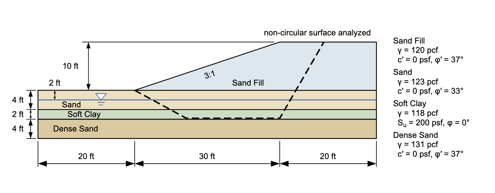
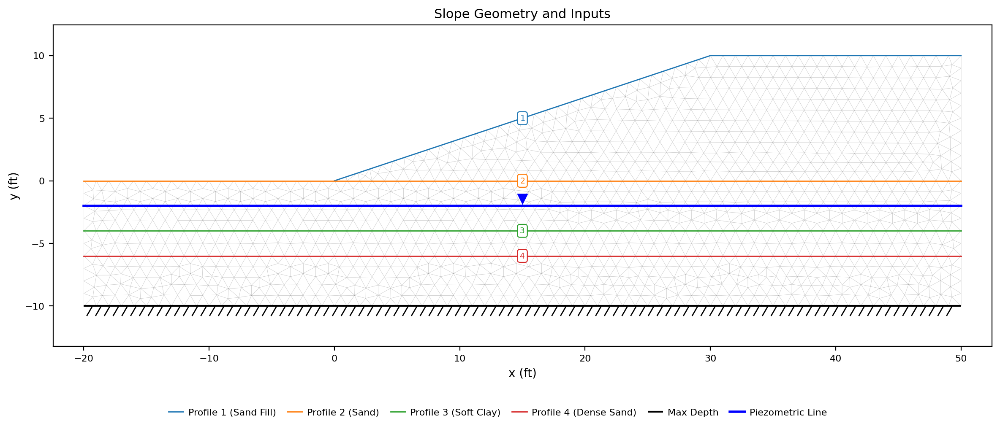
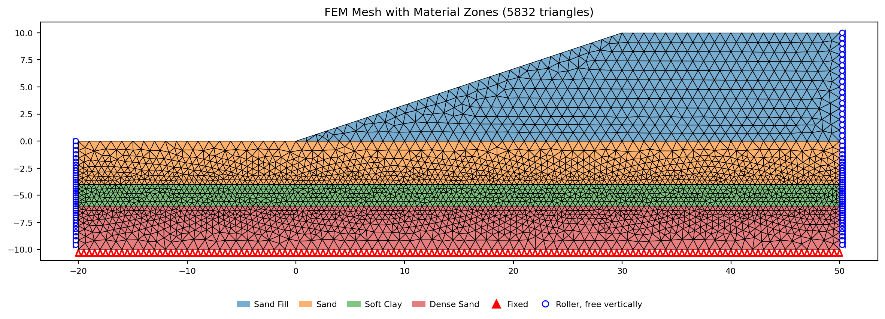
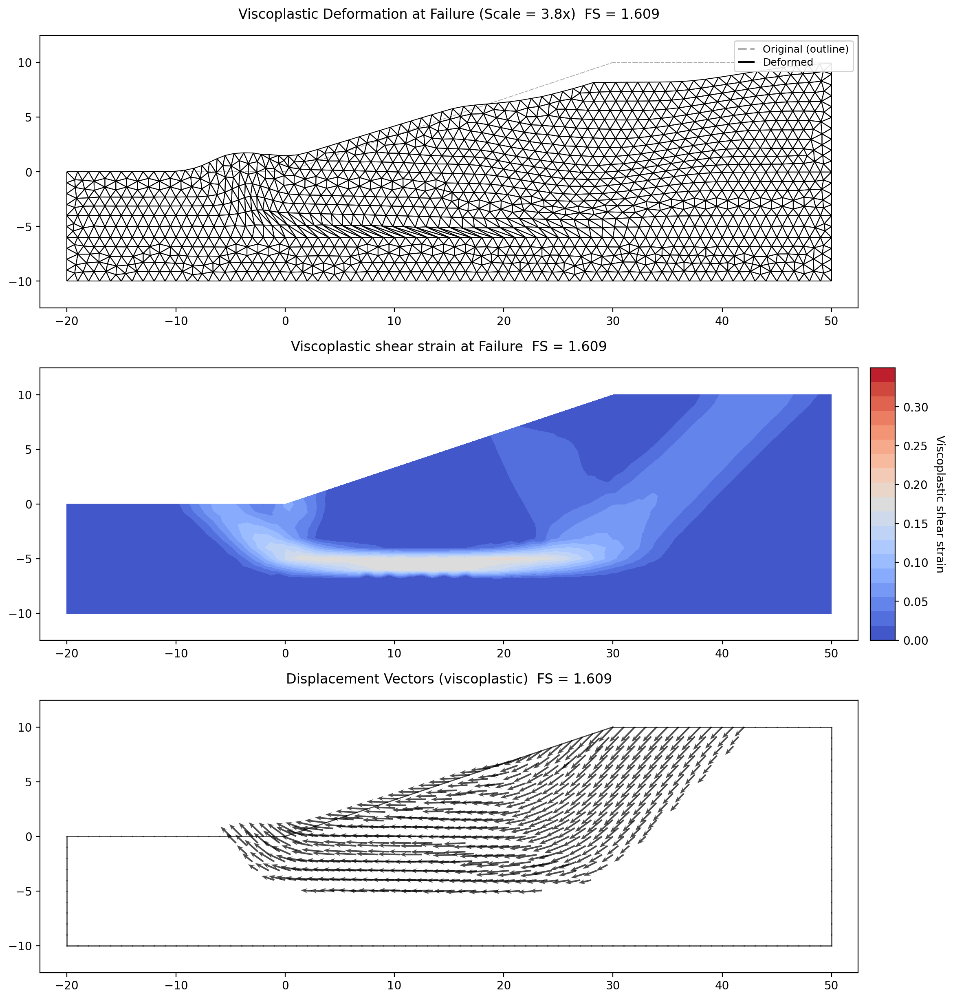
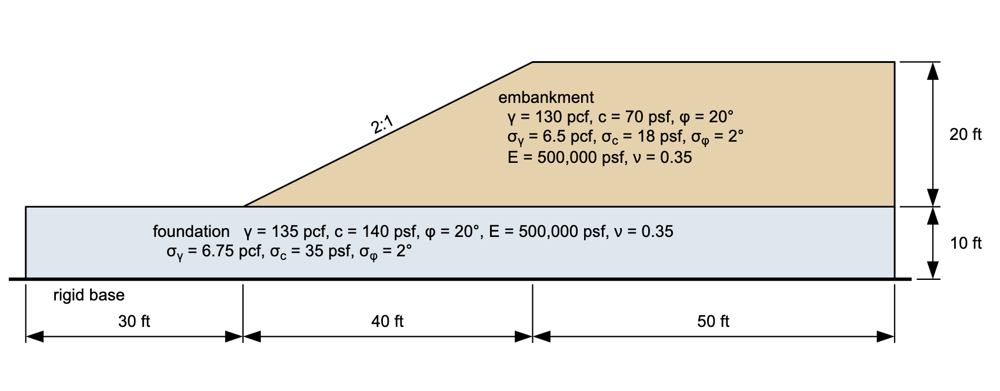

# Sample Problems - Finite Element Method

These problems apply the shear strength reduction method (SSRM) to a slope with a thin
weak layer and to a reliability analysis of a two-layer slope. Each one links its
Excel input file. Open the file in [XSLOPE Studio](../studio/index.md) with
**File → Open** and run it, or load it in Python with `load_slope_data()`. The
[finite element tutorials](../tutorials/index.md#finite-element) build models like
these step by step. The method is described in the [FEM Overview](overview.md), and
comparisons with published solutions are on the
[FEM/SSRM verification page](../verification/ssrm.md).

### 1. Non-Circular Failure Surface with Thin Weak Layer

This is the FEM counterpart of the non-circular failure surface model of [Tutorial LEM-5](../tutorials/lem05_weak_layer_noncircular.md).
The problem features a thin weak clay layer in the foundation of a slope, which controls the
failure mechanism. This problem was also featured in the user manual for the UTEXASED slope stability analysis
software developed by Stephen G. Wright at the University of Texas at Austin.

{width=1000}

The slope geometry and strength properties are the same as the LEM problem. As in the UTEXASED manual, each soil
has one unit weight, used both above and below the water table, so γsat is left blank. Young's modulus ($E$) and
Poisson's ratio ($\nu$) are estimated from typical correlations for each soil type:

| Soil | $c'$ (psf) | $\phi'$ (deg) | $\gamma$ (pcf) | $E$ (psf) | $\nu$ |
|------|:----------:|:--------------:|:---------------:|:---------:|:-----:|
| Sand Fill | 0 | 37 | 120 | 1,000,000 | 0.30 |
| Sand | 0 | 33 | 123 | 700,000 | 0.30 |
| Soft Clay ($S_u$ = 200) | 0 ($\phi = 0$) | 0 | 118 | 60,000 | 0.40 |
| Dense Sand | 0 | 37 | 131 | 1,500,000 | 0.28 |

The soft clay is modeled as an undrained material ($\phi = 0$) with $E/S_u \approx 300$. A Poisson's ratio of 0.40
is used rather than the theoretical undrained value of 0.5 to avoid numerical issues with near-incompressibility.

Excel input file: [xslope_noncircular_fem.xlsx](files/xslope_noncircular_fem.xlsx)

Inputs plotted with the XSLOPE plot_inputs() function:

{width=1000}

FEM mesh with boundary conditions and material zones. The soft clay layer is only 2 ft
thick, and the shear band that controls the failure mechanism forms inside it. A band can
develop through a layer that thin only if the mesh places enough element rows across it:
the model checks name a zone that carries fewer than three, and **Refine thin zones** in the
Build Mesh dialog meshes one at about four (see
[Thin material zones](mesh.md#thin-material-zones)). The mesh shown is built at a target
element size of 1.0 ft without that refinement, so the layer is about two elements thick. A
coarser mesh stiffens the thin layer artificially and distorts the strain field within it:

{width=1000}

SSRM results. The computed factor of safety is **FS = 1.609**. The plots show the slope
at failure. The middle plot shows the concentration of viscoplastic shear strain, which
follows a non-circular failure mechanism through the thin weak clay layer. The finite
element solution finds this shape without any assumption about the shape of the failure
surface. The bottom plot shows the displacement vectors, with the slope mass sliding
laterally along the clay layer.

{width=1000}

<!-- mesh resolution: the 2-ft soft clay layer. The model checks flag a zone with fewer than
     three element rows; Refine thin zones sizes it for about four (docs/fem/mesh.md). This lock
     is the target_size=1.0 mesh without that refinement. -->
<!-- test: file=files/xslope_noncircular_fem.xlsx, type=fem_ssrm, expected_fs=1.609, element_type=tri6, target_size=1, tolerance=0.01, f_min=1.4, f_max=2.2, max_iter=16000, f_stand=1.60625, f_fail=1.6125, check=edges, expected_elements=2588, expected_nodes=5349 -->

### 2. Reliability Analysis: Two-Layer c–φ Slope

This example is a **finite-element reliability analysis**. It uses the same
Taylor Series Probability Method as the [LEM reliability analysis](../reliability/taylor.md),
with each factor of safety computed by SSRM. See
[Reliability Analysis (FEM)](../reliability/fem.md) for the method.

{width=1000}

Excel input file: [xslope_simple_mult_layers_fem.xlsx](files/xslope_simple_mult_layers_fem.xlsx)

It uses the geometry of the layered slope of
[Tutorial LEM-3](../tutorials/lem03_layered_slope.md), an embankment
over a foundation layer. The elastic properties ($E$, $\nu$) are added for the
finite-element solve, and the strengths are lowered to give a **marginally stable c–φ slope**
whose probability of failure is not negligible:

| Material   | $c$ | $\phi$ | $\gamma$ | $E$     | $\nu$ | $\sigma_c$ (COV) | $\sigma_\phi$ (COV) | $\sigma_\gamma$ (COV) |
|------------|:----:|:-------:|:---------:|:--------:|:------:|:-----------------:|:--------------------:|:----------------------:|
| Embankment |  70 |    20° |      130 | 500,000 | 0.35  |  18 (26%)        |  2 (10%)            |  6.5 (5%)             |
| Foundation | 140 |    20° |      135 | 500,000 | 0.35  |  35 (25%)        |  2 (10%)            |  6.75 (5%)            |

The analysis runs on the **tri6 mesh** that ships with the workbook
(`xslope_simple_mult_layers_fem_mesh.json`, 985 elements and 2,080 nodes). Studio
and `load_slope_data` attach this mesh when they open the workbook, and
`reliability_fem` runs on an attached mesh. In Studio, run **Reliability…** from the
**Run** menu in FEM mode without building a new mesh. **Build Mesh** at 50 divisions
makes a different mesh, with 1,122 elements whether or not **Refine thin zones** is
ticked. The run gives:

| $F_{MLV}$ | $\sigma_F$ | $COV_F$ | $\beta_{LN}$ | Reliability $R$ | $P_f$ (lognormal) | $\beta_N$ | $P_f$ (normal) |
|:----------:|:-----------:|:--------:|:-------------:|:----------------:|:------:|:------:|:------:|
| 1.147     | 0.124      | 0.108   | 1.225        | **89.0%**       | 11.0% | 1.191 | 11.7% |

The most-likely factor of safety is 1.15, and with the moderate parameter scatter
in the table above the probability of failure is **11.0%**. A factor of safety
above 1.0 does not by itself mean a low probability of failure. Treating the factor
of safety as normally rather than lognormally distributed gives a slightly lower
reliability index and a slightly higher probability of failure (see the
[Reliability Equation](../reliability/index.md#reliability-equation)).

The per-parameter ΔF table shows how much each parameter changes the factor of safety:

| Parameter        | MLV | σ    | $F^+$ | $F^-$ | ΔF    |
|------------------|:----:|:-----:|:------:|:------:|:------:|
| Embankment $\phi$ |  20 | 2    | 1.236 | 1.058 | 0.178 |
| Embankment $c$    |  70 | 18   | 1.228 | 1.059 | 0.169 |
| Embankment $\gamma$ | 130 | 6.5 | 1.131 | 1.164 | 0.033 |
| Foundation $\phi$ |  20 | 2    | 1.147 | 1.147 | 0.000 |
| Foundation $c$    | 140 | 35   | 1.147 | 1.147 | 0.000 |
| Foundation $\gamma$ | 135 | 6.75 | 1.147 | 1.147 | 0.000 |

The foundation's properties have ΔF = 0. The critical failure mechanism stays
within the weaker embankment and does not reach the stronger foundation, so the
foundation's strength and its uncertainty have no effect on the factor of safety.
The embankment's friction angle and cohesion have the largest ΔF values and
account for most of the uncertainty in the factor of safety. The Taylor Series
method gives each parameter's contribution directly as its ΔF.

!!! note "Mesh dependence of the result"
    These numbers are for the tri6 mesh above. A finer mesh, or a different element
    type, gives a slightly different factor of safety and therefore a different
    reliability. On this slope, an SSRM on quad8 elements at target_size 2, under the
    Non-convergence criterion `reliability_fem` uses, gives FS = 1.132 against the
    1.147 of the shipped mesh. For a **fixed mesh** the reliability is reproducible:
    `reliability_fem` runs each SSRM on a fixed global grid, so the result is identical to every
    decimal for any `F_min`/`F_max` bracket. See
    [Numerical precision](../reliability/fem.md#numerical-precision-and-reproducibility).
    The reliability index is more sensitive to the mesh than the factor of safety
    is. With $COV_F$ essentially unchanged, $\beta_{LN} \approx \ln F_{MLV} / \sqrt{\ln(1+COV_F^2)}$,
    so a *relative* change in the factor of safety produces a relative change in
    $\beta_{LN}$ about $1/\ln F_{MLV}$ times as large, or about seven times at the
    $F_{MLV} \approx 1.15$ of this slope. Near $F_{MLV} = 1$, a change of a couple of
    percent in the factor of safety changes the reliability index, and the
    probability of failure with it, by ten times as much.

<!-- FEM reliability regression (marginally-stable two-layer slope). 13 SSRM solves. REL-FEM-page
     locks every number the example prints, on the shipped mesh the page describes (mesh=file); it
     takes 8-17 minutes, so it is pinned to the gate tier. REL-FEM runs the same pipeline on a
     deliberately coarse 253-element mesh (target_size=5, ~110-290s) as the standard-tier check.
     beta is mesh-dependent but bit-reproducible for a fixed mesh. REL-FEM-quad8 locks the
     mesh-dependence note's single SSRM on a finer quad8 mesh. -->
<!-- test: file=files/xslope_simple_mult_layers_fem.xlsx, type=fem_ssrm, expected_fs=1.132, element_type=quad8, target_size=2, tolerance=0.01, f_min=0.7, f_max=1.6, criterion=non_convergence, f_stand=1.12890625, f_fail=1.1359375, check=edges, expected_elements=682, expected_nodes=2189, benchmark=REL-FEM-quad8 -->
<!-- test: file=files/xslope_simple_mult_layers_fem.xlsx, type=fem_reliability, mesh=file, element_type=tri6, expected_elements=985, expected_nodes=2080, f_min=0.7, f_max=1.6, ssrm_tol=0.001, expected_beta=1.225, tolerance=0.01, expected_fmlv=1.147, expected_sigma=0.124, expected_cov=0.108, expected_r=0.890, expected_pf=0.110, expected_beta_n=1.191, expected_pf_n=0.117, params=1.phi;1.c;1.gamma;2.phi;2.c;2.gamma, f_plus=1.236;1.228;1.131;1.147;1.147;1.147, f_minus=1.058;1.059;1.164;1.147;1.147;1.147, delta_f=0.178;0.169;0.033;0.000;0.000;0.000, tier=gate, benchmark=REL-FEM-page -->
<!-- test: file=files/xslope_simple_mult_layers_fem.xlsx, type=fem_reliability, expected_beta=1.345, tolerance=0.1, element_type=tri6, target_size=5.0, f_min=0.7, f_max=1.6, ssrm_tol=0.001, benchmark=REL-FEM -->

---

**[Griffiths & Lane (1999)](https://doi.org/10.1680/geot.1999.49.3.387).** XSLOPE's finite-element slope-stability
solver follows the methodology of
[Griffiths & Lane (1999)](https://doi.org/10.1680/geot.1999.49.3.387), "Slope
stability analysis by finite elements" (*Géotechnique* 49(3), 387–403): a
plane-strain elasto-plastic (Mohr–Coulomb) formulation solved by viscoplastic
**strength reduction**. Griffiths & Lane take a trial as failed when the iteration does not
converge. XSLOPE offers that criterion, Non-convergence, and adds its own **hybrid failure
criterion**, which also reads displacement evidence and which the verification rows'
bisections use; see [SSRM failure criteria](solver.md#ssrm-failure-criteria). The
verification set reproduces
**all six** of the paper's worked examples:

- [Example 1 — homogeneous slope](../verification/ssrm.md#verification-griffiths1)
- [Example 2 — foundation layer, the false base circle](../verification/ssrm.md#verification-griffiths2)
- [Example 3 — undrained clay with a thin weak layer](../verification/ssrm.md#verification-griffiths3) — a sweep of the weak layer's strength ratio $c_{u2}/c_{u1}$, compared with Griffiths & Lane's factors of safety, and the two competing mechanisms
- [Example 4 — undrained clay over a weak foundation](../verification/ssrm.md#verification-griffiths4) — the mechanism changes from a base failure to a toe failure
- [Example 5 — "slow" drawdown sweep](../verification/ssrm.md#verification-griffiths5) — pore pressure and reservoir load
- [Example 6 — two-sided earth dam](../verification/ssrm.md#verification-griffiths6)

Each is documented with its geometry, mesh and factor of safety on the
[FE Slope Stability (SSRM)](../verification/ssrm.md) verification page. The
[Verification](../verification/index.md) page gives an overview of the whole
verification set.
