# Rapid Drawdown Analysis

When the pool behind a dam or levee is lowered quickly, the slope it leaves behind can fail even though it stood safely while the pool was full. The water standing against the upstream face pushes on it and helps hold it up. When the pool comes down, that support goes. A soil that drains freely loses its pore pressure as fast as the pool falls, and its strength rises with its effective stress. A low-permeability soil can't drain that fast. It keeps much of the pore pressure the full pool put into it while the load that balanced that pressure is gone, so the shear stress needed for equilibrium rises and the strength doesn't follow. Pilarcitos Dam and Walter Bouldin Dam both slid this way.

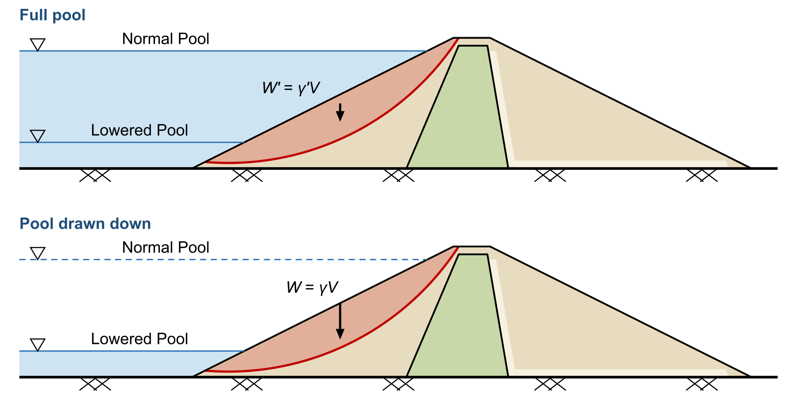{width=860px}

_Drawing after France and Winckler (2008)._

At full pool the sliding mass is under water and drives the slide with its buoyant weight, $W' = \gamma' V$, where $\gamma' = \gamma - \gamma_w$ is about half of $\gamma$. That is why a submerged slope is rarely the critical case. With the pool down, the same mass drives with its full weight, $W = \gamma V$, nearly twice as much, while nothing about the soil has changed.

Lowering the pool in the model and running an ordinary drained analysis would assume that the pore pressures in every soil came down with the pool. That is right for a free-draining sand or gravel. It is wrong for a clay that is sheared before its pore pressure can dissipate: the clay's undrained strength may govern, and a drained analysis at the low pool credits it with strength it doesn't have yet. **xslope** analyzes this case with the three-stage method of Duncan, Wright, and Wong (1990), described below and run by the `rapid_drawdown` function. The first question is which soils drain in time.

## Conditions for Rapid Drawdown {#when-does-rapid-drawdown-apply}

Rapid drawdown applies to a soil when the pool is lowered rapidly enough that its pore water pressures cannot dissipate. Duncan et al. (1992) suggested judging that with the dimensionless time factor, T, from consolidation theory:

>>$T = \dfrac{c_v t}{D^2}   \qquad (1)$

where:

>> $c_v$ = coefficient of consolidation [L²/t]<br>
$t$ = time for the drawdown [t]<br>
$D$ = maximum drainage distance, the longest path the pore water travels to leave the zone [L]

Then:

|  T   | Rapid drawdown applicable?                         |
|:----:|----------------------------------------------------|
| > 3.0 | Drainage should be sufficient: not rapid drawdown. By $T = 3$, more than 98% of the pore pressure change has dissipated. |
| < 3.0 | Assume rapid drawdown                              |

Approximate values of $c_v$:

| Soil type    | $c_v$ [ft²/day] |
|--------------|----------------|
| Coarse sand  | > 10,000       |
| Fine sand    | 100 – 10,000   |
| Silty sand   | 10 – 1,000     |
| Silt         | 0.5 – 100      |
| Compacted clay | 0.05 – 5     |
| Soft clay    | < 0.2          |

_(Duncan et al., 1992)_

A rule of thumb in permeability terms: soils with a hydraulic conductivity of 10⁻⁴ cm/s or more can be assumed to drain at normal rates of drawdown (Duncan, Wright, and Brandon 2014).

The test is applied zone by zone. Consider first a homogeneous embankment of compacted clay, 50 ft high, with a toe drain. The coefficient of consolidation is 2 ft²/day, and the drainage distance from the point shown to the upstream face is 35 ft.

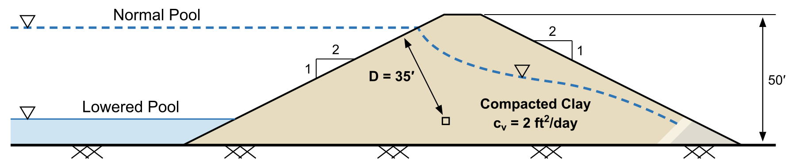{width=860px}

If the pool is lowered over 50 days, T = 2 × 50 / 35² = 0.08 < 3.0, so rapid drawdown applies, and the clay keeps nearly all of its pore pressure through the drawdown.

Now a zoned dam: a compacted clay core inside a shell of fine sand. The core drains into the shell on either side, so its drainage distance is 14 ft; the shell's is 31 ft.

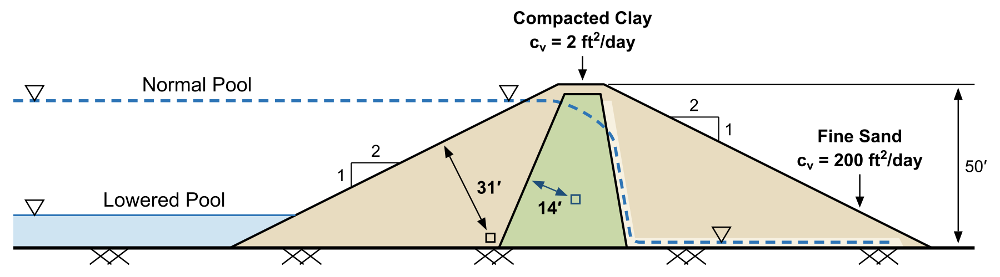{width=860px}

Over the same 50-day drawdown, T for the core = 2 × 50 / 14² = 0.5 < 3.0, so rapid drawdown applies to the core. T for the shell = 200 × 50 / 31² = 10.4 > 3.0, so the shell drains as the pool falls. In the same dam the shell is analyzed drained and the core undrained.

## Why Undrained Strengths {#why-undrained-strengths}

The alternative to an undrained strength is an effective stress analysis, and its strength parameters are easy to get: $c'$ and $\phi'$ come from isotropically consolidated undrained triaxial tests with the pore pressures measured. Its difficulty is the pore pressure during drawdown. That depends on the change in stress from the changing water loads, which can be estimated, and on how the soil responds as it is sheared undrained, which is much harder: well-compacted fill dilates as it is sheared, lowering its pore pressure and raising its strength, while poorly compacted fill contracts, with the opposite effect.

A seepage analysis cannot supply that second part. Flow nets and finite element seepage solutions, steady or transient, give the pore pressures that come from flow, and a transient run follows the partial drainage while the pool falls, but none contains the pore pressure changes caused by shearing the soil. Duncan, Wright, and Brandon (2014, Sections 9.3 and 9.4) consider an effective stress analysis built on predicted drawdown pore pressures beyond the current state of practice for that reason.

Most effective stress analyses have assumed, after Bishop (1954) and Morgenstern (1963), that the pore pressure at each point drops by the weight of the water removed above it. That treats loose and dense fill alike and does not always err on the safe side: Wong et al. (1983) analyzed Walter Bouldin and Pilarcitos Dams that way and got factors of safety of 1.0 and 1.2, and Pilarcitos slid. The undrained-strength method on this page gives 1.04 and 1.05 for the same two dams (Duncan, Wright, and Wong 1990), both close to 1, as a dam that failed should be. An undrained strength carries the shear-induced part because it is measured in tests in which the soil generates its own pore pressure as it is sheared.

## Which Strength When {#which-strength-when}

A dam passes through several conditions, and each takes its own strengths:

| Condition | Free-draining soils | Poorly draining soils |
|-----------|---------------------|-----------------------|
| End of construction | Effective stresses: $c'$ and $\phi'$ | UU strengths, at the water content set by compaction |
| Long term | Drained: $c'$ and $\phi'$, with steady-seepage pore pressures | Drained: $c'$ and $\phi'$, with steady-seepage pore pressures |
| Drawdown during or at the end of construction | Effective stresses, with the pore pressures after drawdown | UU strengths |
| **Drawdown after the dam has consolidated** | Effective stresses, with the pore pressures after drawdown | **CU strengths**: consolidated under the full-pool stresses, sheared undrained when the pool drops |

The last row is the case the three-stage method handles. The consolidation stresses vary from point to point along a slip surface, and so does the undrained strength they give.

## Three-Stage Analysis

**xslope** uses the three-stage method of Duncan, Wright, and Wong (1990), described in detail in *Soil Strength and Slope Stability*, 2nd edition (Duncan, Wright, and Brandon 2014), Chapter 9. In one sentence: the full pool sets the strength, and the lowered pool sets the load.

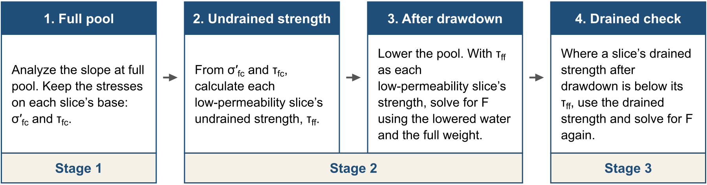{width=860px}

- **Box 1, Stage 1:** an ordinary effective stress analysis of the slope at full pool. It provides the stresses on the base of each slice, $\sigma'_{fc}$ and $\tau_{fc}$: the stresses the soil consolidated under.
- **Box 2, the first half of Stage 2:** from those two stresses, the undrained strength $\tau_{ff}$ of each slice in a low-permeability soil.
- **Box 3, the rest of Stage 2:** lower the pool. The full weight of the sliding mass and the lowered water drive failure, and $\tau_{ff}$ resists it on the low-permeability slices, with drained strengths in the free-draining soils. That gives a factor of safety.
- **Box 4, Stage 3:** the drained check. Where a slice's drained strength after drawdown is below its undrained strength, the drained strength replaces it and the factor of safety is computed again.

All three stages are run on every trial slip surface. The method combines two earlier ideas: Lowe and Karafiath's (1959), that the undrained strength depends on how the soil was consolidated (box 2), and the U.S. Army Corps of Engineers' (1970), that the drained strength may be the lower one (box 4).

Stage 3 only ever *lowers* a slice's strength, so its factor of safety can never exceed Stage 2's. The rapid drawdown factor of safety is therefore the Stage 3 value when Stage 3 runs and the Stage 2 value when it is not needed; equivalently, and how **xslope** computes it, the lower of the two.

### Reading the subscripts {#subscripts}

Most stresses in the method carry two subscripts. The first says which plane or direction the stress acts on: $f$ for the failure plane, or 1 and 3 for the major and minor principal directions. The second says when: $c$ for the end of consolidation, before drawdown, and $f$ for at failure.

| Symbol | Plane or direction | Time | What it is |
|--------|--------------------|------|------------|
| $\sigma'_{fc}$ | failure plane | end of consolidation | effective normal stress from Stage 1; Stage 2 starts from it |
| $\tau_{fc}$ | failure plane | end of consolidation | shear stress from Stage 1 |
| $\tau_{ff}$ | failure plane | at failure | the undrained strength, from Stage 2 |
| $\sigma'_{3c}$ | minor principal | end of consolidation | minor principal effective stress before drawdown |
| $\sigma'_{1f}$, $\sigma'_{3f}$ | major, minor principal | at failure | the ends of the Mohr's circle at failure |

The stress ratios follow the same idea: $K_c = \sigma'_{1c}/\sigma'_{3c}$ is the ratio of the principal stresses at the end of consolidation, $K_f$ the ratio at failure, and $K_1$ is $K_c$ worked out from the Stage 1 stresses (its 1 is the stage, not a direction).

### Stage 1: Pre-Drawdown Conditions

Stage 1 is performed for the conditions before drawdown: the full pool, with steady seepage through the dam. It is an ordinary effective stress stability analysis, on the same trial slip surface the later stages use. Its objective is the effective stresses along the slip surface before drawdown, the stresses the soil consolidated under; the factor of safety it returns is used only to get the shear stress, $\tau_{fc}$.

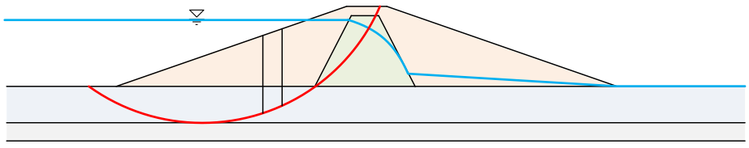

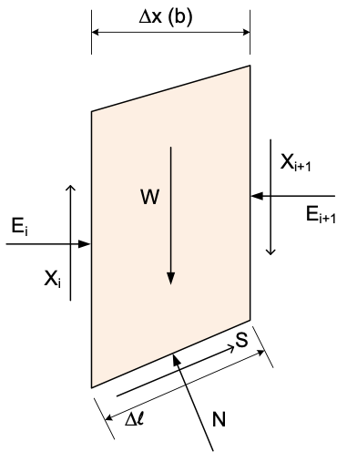{width=300px}

From the normal force on the base of each slice, the effective normal stress on the failure plane at the end of consolidation is

>>$\sigma'_{fc} = \dfrac{N}{\Delta \ell} - u$

The solvers return the effective normal force $N'$ directly, so equivalently

>>$\sigma'_{fc} = \dfrac{N'}{\Delta \ell}   \qquad (2)$

How $N'$ is computed depends on the solver; the **Methods** section of this documentation describes each. The shear stress on the failure plane at the end of consolidation is the shear force on the base over its length, which is the strength mobilized at the Stage 1 factor of safety, $F$:

>>$\tau_{fc} = \dfrac{S}{\Delta \ell}$

>>$\tau_{fc} = \dfrac{1}{F}(c' + \sigma'_{fc} \tan \phi')   \qquad (3)$

## Stage 2 - Compute FS for Post-Drawdown Conditions

Stage 2 is a total stress analysis with undrained strengths for the low-permeability zones. The undrained strengths come from the consolidation stresses of Stage 1, and the driving forces from the conditions after drawdown.

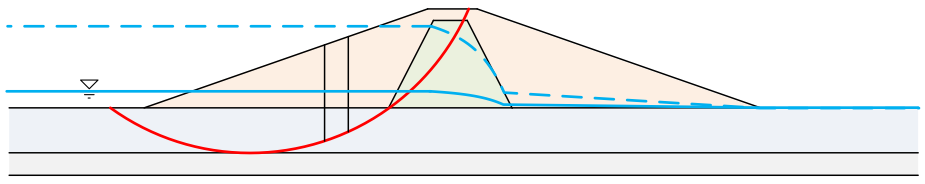

### The undrained strength is set by the full pool {#full-pool}

Before the drawdown, the dam has stood at full pool long enough for the clay to consolidate under the full-pool stresses. When the pool comes down quickly, the clay is sheared undrained. That is what a consolidated undrained triaxial test does, and the $\overline{CU}$ test also measures the pore pressure as the sample is sheared.

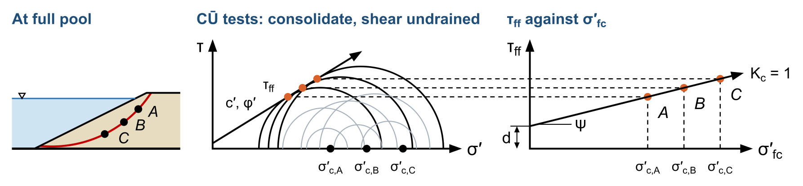{width=860px}

Take a sample from each of three points on a slip surface at full pool, A, B, and C, and consolidate each isotropically at its own $\sigma'_c$. Sheared undrained, each sample tries to contract, the pore pressure builds, and its effective stress circle drifts left as it grows, until it touches the effective stress envelope, $c'$ and $\phi'$. The shear stress on the failure plane at failure, where the circle touches, is

>>$\tau_{ff} = \dfrac{\sigma_{1f} - \sigma_{3f}}{2} \cos \phi'$

Carry each $\tau_{ff}$ to a new plot, above the stress the sample was consolidated at. Its horizontal axis is $\sigma'_{fc}$, the effective normal stress on the failure plane at consolidation, which for an isotropically consolidated sample is $\sigma'_c$. A test program fits a line through the points, with an intercept $d$ and a slope $\psi$. This is not a Mohr diagram: $\sigma'_{fc}$ is from before shearing and $\tau_{ff}$ from failure. That is what makes the plot useful. Stage 1 gives $\sigma'_{fc}$ on each slice, and a line like this turns it into the strength after drawdown.

These samples were consolidated under equal principal stresses. Soil in a slope is not: it carries shear stress at full pool, and the line depends on how it was consolidated.

### The stress ratio K {#stress-ratio}

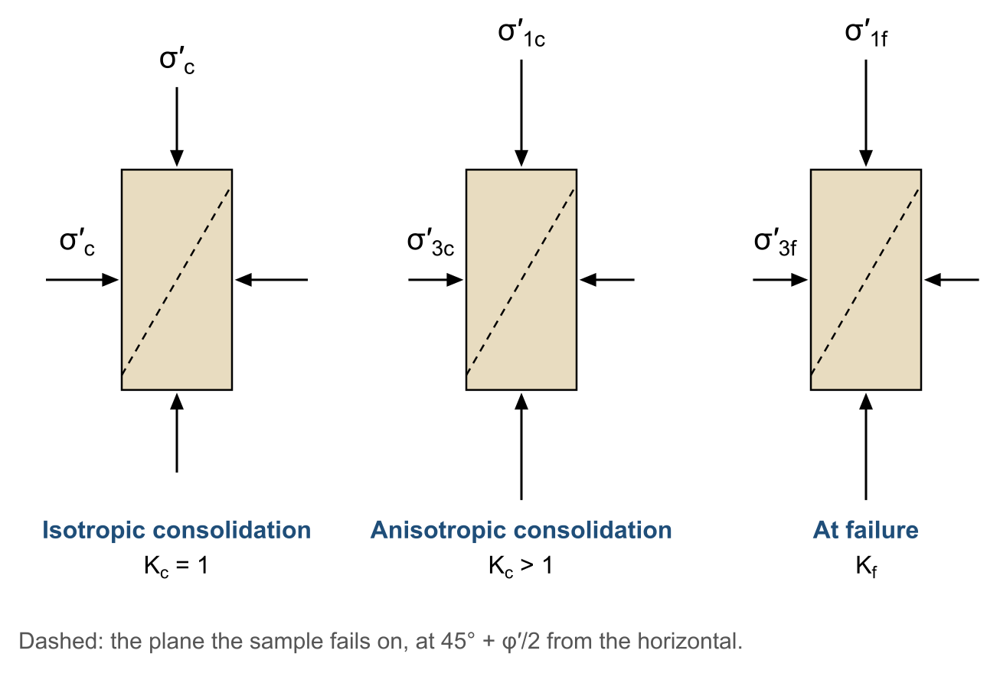{width=653px}

$K_c$ is the ratio of the major to the minor principal effective stress during consolidation. $K_c = 1$ is isotropic consolidation, the usual $\overline{CU}$ test. $K_c > 1$ is anisotropic consolidation, the way soil in a slope consolidates, carrying shear stress before it is ever sheared. $K_f$ is the ratio at failure, and $K_c = K_f$ is a sample consolidated at the verge of failure.

### Why the stress ratio matters {#why-k-matters}

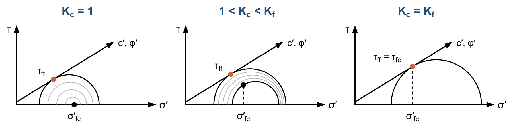{width=860px}

Three samples with the same $\sigma'_{fc}$, each sheared undrained against the same effective stress envelope:

- **$K_c = 1$:** the sample starts as a point, with no shear stress. It has the whole way to go to failure and builds pore pressure the whole way, so its circle drifts left and touches the envelope low.
- **$1 < K_c < K_f$:** the sample starts as a circle, part of the way to failure. Less shearing is left, so less pore pressure builds, and $\tau_{ff}$ is higher.
- **$K_c = K_f$:** the sample starts on the envelope. No shearing is left, so no pore pressure builds, and $\tau_{ff} = \tau_{fc}$: the drained strength.

The closer the soil starts to failure, the higher its undrained strength. That holds for a soil that contracts as it is sheared; a compacted fill at low stress dilates instead, and there it runs the other way.

### One line for each K<sub>c</sub> {#kc-lines}

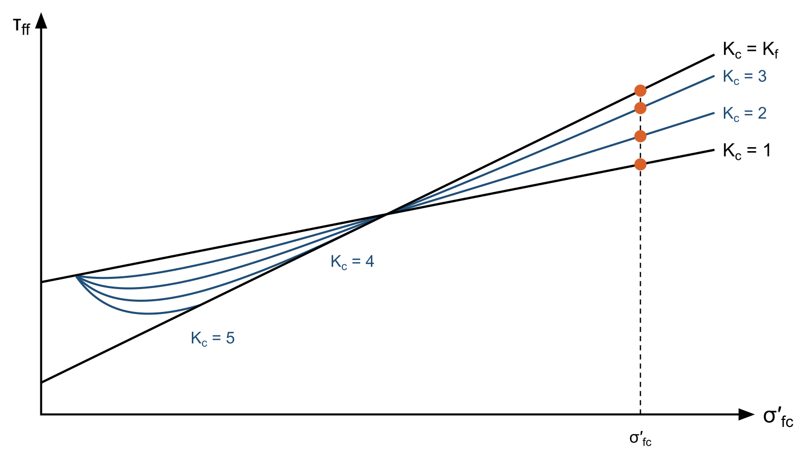{width=790px}

Test a set of samples all consolidated at one $K_c$, over a range of $\sigma'_{fc}$, and $\tau_{ff}$ against $\sigma'_{fc}$ gives a line. Every $K_c$ has its own, and they all lie between two extremes: $K_c = 1$, consolidated isotropically, and $K_c = K_f$, consolidated at failure. The lines of high $K_c$ end on the $K_c = K_f$ line, because a sample can't be consolidated past failure. Each slice in a slope was consolidated at its own $K_c$, so each slice needs the line for its own $K_c$. Measuring one takes anisotropically consolidated undrained (ACU) tests at that $K_c$, which are slow and difficult, so testing every line is impractical.

### Two envelopes from one set of tests {#two-envelopes}

The method needs only the two extremes, and one set of $\overline{CU}$ tests gives both. Plotting each test's $\tau_{ff}$ against the stress it was consolidated at gives the $K_c = 1$ envelope, $d$ and $\psi$. The same tests' effective stress circles at failure, from the measured pore pressures, give $c'$ and $\phi'$, which is the $K_c = K_f$ envelope: a sample consolidated at failure has no shearing left to do, so its undrained strength is its drained strength. Both appear in the figure under [The undrained strength is set by the full pool](#full-pool).

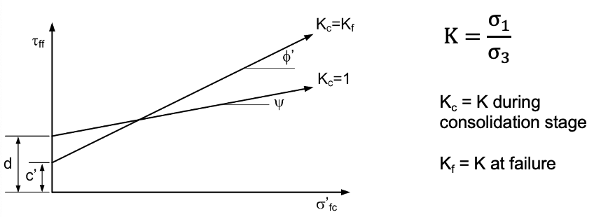

The two envelopes usually cross. To the right of the crossing, at higher stress, the soil contracts as it is sheared and the $K_c = 1$ envelope is the lower one. To the left, at low stress, compacted fill dilates and the $K_c = 1$ envelope is the higher one; Stage 3 guards against counting on that dilation.

For a rapid drawdown analysis in **xslope**, enter $d$ and $\psi$ in the material properties for each soil that does not drain during the drawdown. The free-draining soils keep their drained strengths, $c'$ and $\phi'$, in every stage, and their $d$ and $\psi$ are left blank.

A soil given an undrained strength directly, with the `cp` or [`ratio`](overview.md#undrained-strength-ratio) option, takes no $d$ and $\psi$ (any left in its row are not read) and keeps that strength in all three stages. A `ratio` material's strength comes from the vertical effective stress under the water before drawdown, the Stage 1 water, so lowering the pool does not change it.

### When the lab reports an R envelope {#r-envelope}

$\overline{CU}$ test results are often reported as an R envelope instead of the $K_c = 1$ envelope. R is the U.S. Army Corps of Engineers' name for the consolidated-undrained test, between its Q (unconsolidated-undrained) and S (drained) tests, and the R envelope is also called the total stress envelope. It is drawn on a Mohr diagram with one circle for each test. Each circle starts at the sample's effective consolidation pressure, $\sigma'_{3c}$, and its diameter is the principal stress difference at failure, $\sigma_{1f} - \sigma_{3f}$. The envelope's intercept and slope are $c_R$ and $\phi_R$.

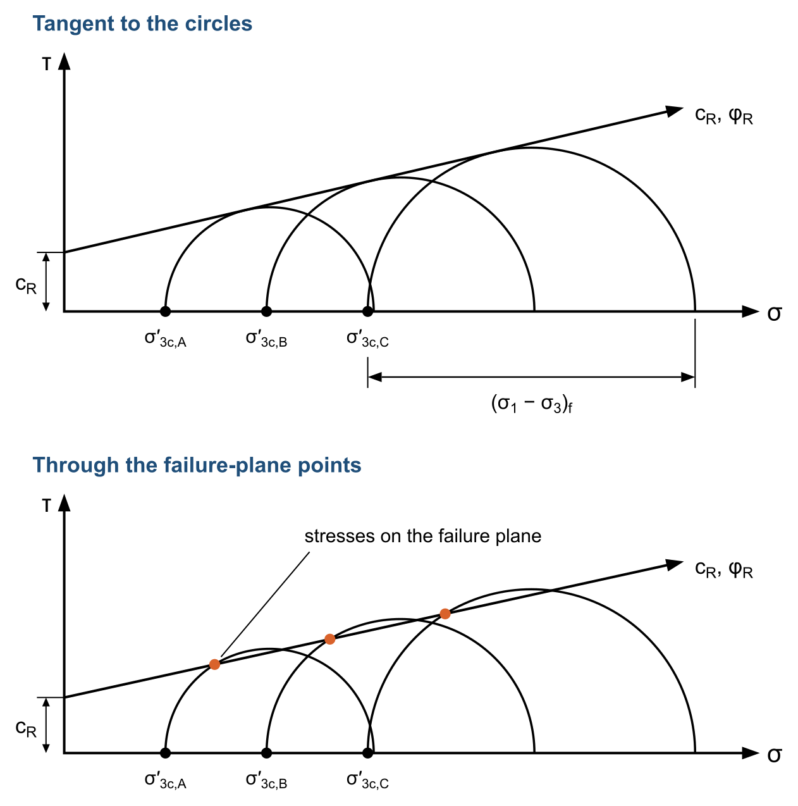{width=630px}

The R envelope and the $K_c = 1$ envelope come from the same tests and look alike, but they are different lines, and **xslope** needs $d$ and $\psi$. Duncan, Wright, and Brandon (2014) give a conversion for each of the two ways an R envelope is drawn. If it is drawn tangent to the circles, as in the top of the figure:

>>$d = c_R \dfrac{\cos \phi_R \cos \phi'}{1 - \sin \phi_R} \qquad \psi = \arctan \dfrac{\sin \phi_R \cos \phi'}{1 - \sin \phi_R}$

If it is drawn through the points that give the stresses on the failure plane, as in the bottom of the figure:

>>$d = \dfrac{c_R}{1 + (\sin \phi' - 1) \tan \phi_R / \cos \phi'} \qquad \psi = \arctan \dfrac{\tan \phi_R}{1 + (\sin \phi' - 1) \tan \phi_R / \cos \phi'}$

These are their Eqs. 9.6 to 9.9. Both pairs need $\phi'$, because the failure plane lies at $45° + \phi'/2$ from the major principal plane. The first pair follows from the equation for $\tau_{ff}$ under [The undrained strength is set by the full pool](#full-pool). A circle's radius is half the principal stress difference at failure, $\tau_{ff}$ is that radius times $\cos \phi'$, and for an isotropically consolidated sample $\sigma'_{fc} = \sigma'_{3c}$. Setting each circle tangent to the R envelope makes $\tau_{ff}$ a straight line in $\sigma'_{fc}$, with intercept $d$ and slope $\tan \psi$ as above. Before converting, find out from the lab report which way the envelope was drawn; the two pairs give different values for the same $c_R$ and $\phi_R$.

For Pilarcitos Dam, verification problem [VP97](../verification/rocscience.md#vp97) converts $c_R = 60$ psf and $\phi_R = 23°$, with $\phi' = 45°$, to $d = 64.1$ psf and $\psi = 24.4°$ by the first pair.

### Anisotropy and K Interpolation {#anisotropy-and-k-interpolation}

Wong et al. (1983) showed how to get the line for any $K_c$ from the two envelopes: interpolate between them. They found that interpolating linearly on $K$ gives very nearly the same strengths as anisotropically consolidated tests at each $K_c$, so the two envelopes from one set of $\overline{CU}$ tests stand in for all of those tests.

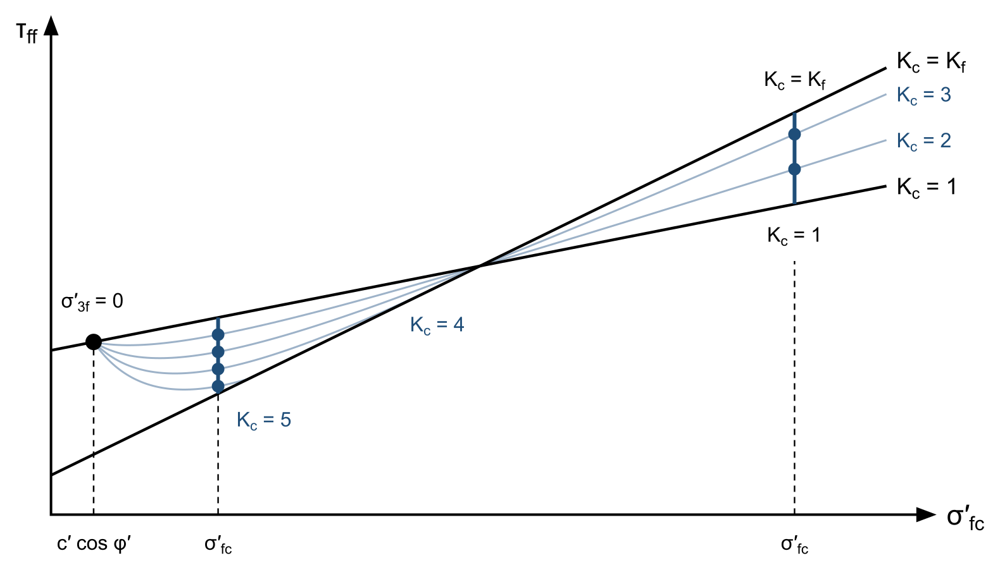{width=790px}

At a slice's $\sigma'_{fc}$, go straight up: the two envelopes give the strengths for $K_c = 1$ and $K_c = K_f$. Along the bar between them, the interpolation spaces $K_c$ evenly, so the strength for a given $K_c$ lies $(K_c - 1)/(K_f - 1)$ of the way from the $K_c = 1$ envelope to the $K_c = K_f$ envelope. Doing the same at every $\sigma'_{fc}$ draws the line for each $K_c$.

$K_f$ changes with $\sigma'_{fc}$ when $c' > 0$. The $K_c = K_f$ envelope is a straight line, but it is not a line of one $K$, the way the others are: each point on it is a sample consolidated at whatever ratio puts it at failure, and with cohesion that ratio is large at low stress and falls toward $\tan^2(45 + \phi'/2)$ at high stress. In the figure, the right bar runs from $K_c = 1$ to about 3.6 and the left bar from 1 to about 5.4. At $\sigma'_{fc} = c' \cos \phi'$, $K_f$ is infinite, and every line meets the $K_c = 1$ envelope there.

For a slice, the ratio is $K_1$, computed from the Stage 1 stresses:

>>$K_1 = \dfrac{\sigma'_{fc} + \tau_{fc}[(\sin \phi' + 1) / \cos \phi']}{\sigma'_{fc} + \tau_{fc}[(\sin \phi' - 1) / \cos \phi']}   \qquad (4)$

where $\sigma'_{fc}$ and $\tau_{fc}$ come from equations (2) and (3). Equation (4) assumes that the principal stresses at the end of consolidation and at failure have the same orientation. The undrained strength for the consolidation stress $\sigma'_{fc}$ and consolidation ratio $K_c = K_1$ is interpolated between the two envelopes:

>>$\tau_{ff} = \dfrac{(K_f - K_1) \tau_{ff(K_c=1)} + (K_1 - 1) \tau_{ff(K_c=K_f)}}{K_f - 1}  \qquad (5)$

The two $\tau_{ff}$ values come from the two envelopes at the slice's $\sigma'_{fc}$, and $K_f$ from:

>>$K_f = \dfrac{(\sigma'_{fc} + c' \cos \phi')(1 + \sin \phi')}{(\sigma'_{fc} - c' \cos \phi')(1 - \sin \phi')}   \qquad (6)$

### One slice, step by step {#one-slice}

Here is the whole calculation on one real slice: slice 2 of the 41 slices on the critical circle of [Walter Bouldin Dam](#walter-bouldin), at the toe of the upstream slope, in a clayey silty sand under about 24 ft of water at full pool. The sand has $c' = 240$ psf and $\phi' = 32.7°$, and its $K_c = 1$ envelope has $d = 750$ psf and $\psi = 15°$.

| Step | | Slice 2 |
|------|---|:-------:|
| Stage 1 stresses, equations (2) and (3) | $N' = 1{,}611$ lb/ft, $S = 1{,}193$ lb/ft, $\Delta\ell = 3.14$ ft | $\sigma'_{fc} = 514$ psf, $\tau_{fc} = 381$ psf |
| The two stress ratios, equations (4) and (6) | | $K_1 = 3.96$, $K_f = 7.69$ |
| The two envelopes at $\sigma'_{fc}$ | $d + \sigma'_{fc} \tan \psi$; $c' + \sigma'_{fc} \tan \phi'$ | 888 psf ($K_c = 1$); 570 psf ($K_c = K_f$) |
| Interpolate, equation (5) | 44% of the way from 888 toward 570 | $\tau_{ff} = 747$ psf |

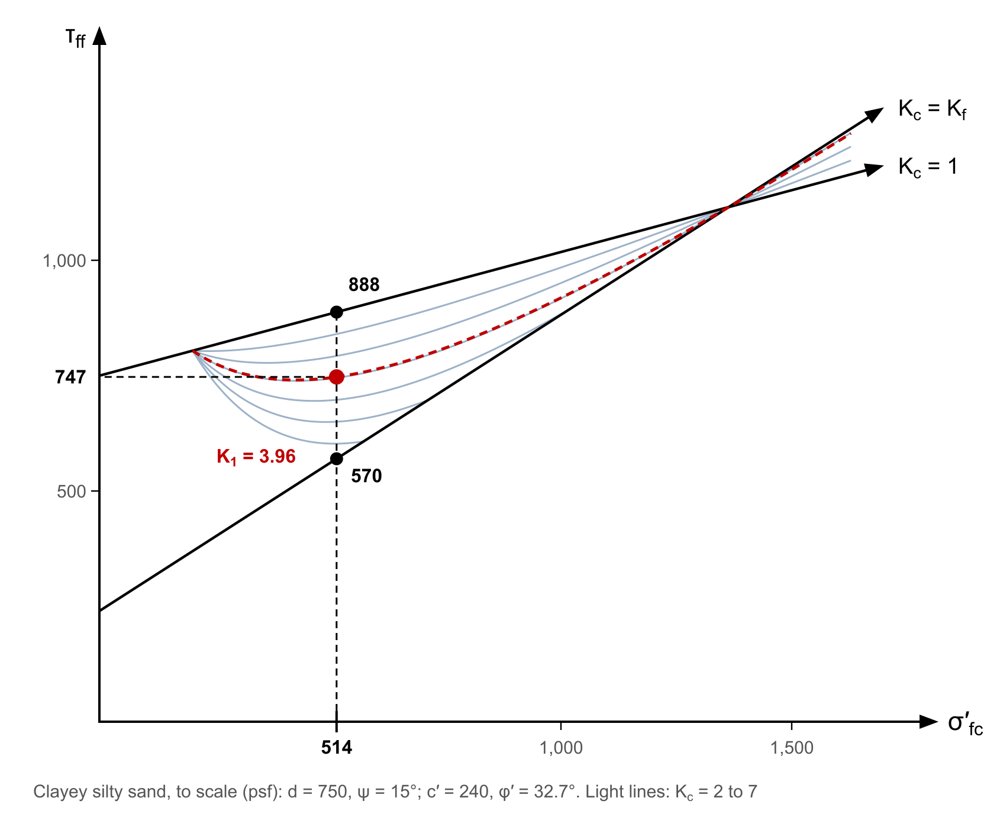{width=700px}

Slice 2 sits left of where the two envelopes cross, at about 1,360 psf, so its $K_c = 1$ envelope is the higher one; the interpolation works the same way on either side of the crossing. The same steps give every low-permeability slice on the circle its own $\tau_{ff}$.

### Negative Stresses {#negative-stresses}

The interpolation needs both stress ratios to mean something, and that fails when a minor principal effective stress is zero or negative. The two are checked with:

>>$\sigma'_{3c} = \sigma'_{fc} + \tau_{fc} \dfrac{\sin \phi' - 1}{\cos \phi'}  \qquad (7)$ (behind $K_1$, at the end of consolidation)

>>$\sigma'_{3f} = (\sigma'_{fc} - c' \cos \phi') \dfrac{1 - \sin \phi'}{\cos^2 \phi'}  \qquad (8)$ (behind $K_f$, on the $K_c = K_f$ envelope)

If either is negative **or zero**, the slice is not interpolated: it takes the lower of the two envelopes' strengths. Zero is excluded as well as negatives because $\sigma'_{3c}$ from equation (7) is the *denominator* of $K_1$ in equation (4). Only these slices skip the interpolation; everywhere else, on either side of the crossing, the strength comes from equation (5).

The two equations go negative for different reasons, and only one involves cohesion:

- Equation (8) carries the $c' \cos \phi'$ term: $\sigma'_{3f}$ is negative for every slice with $\sigma'_{fc} < c' \cos \phi'$, the point where all the lines of constant $K_c$ meet. Left of it $K_f$ comes out negative.
- Equation (7) has **no cohesion term**. It goes negative when $\tau_{fc}$ is large, and since $\tau_{fc} = \frac{1}{F}(c' + \sigma'_{fc} \tan \phi')$, that means a **low Stage 1 factor of safety**.

Slice 40 of the same circle, near the crest, is such a slice. Stage 1 gives it $\sigma'_{fc} = 178$ psf and $\tau_{fc} = 237$ psf: little normal stress and a lot of shear for it. Equation (7) gives $\sigma'_{3c} = 49$ psf, but equation (8) gives $\sigma'_{3f} = -15$ psf, since 178 psf is below $c' \cos \phi' = 202$ psf for this sand. The slice takes the lower envelope, here $K_c = K_f$, and $\tau_{ff} = 354$ psf; the $K_c = 1$ envelope would have given 798 psf.

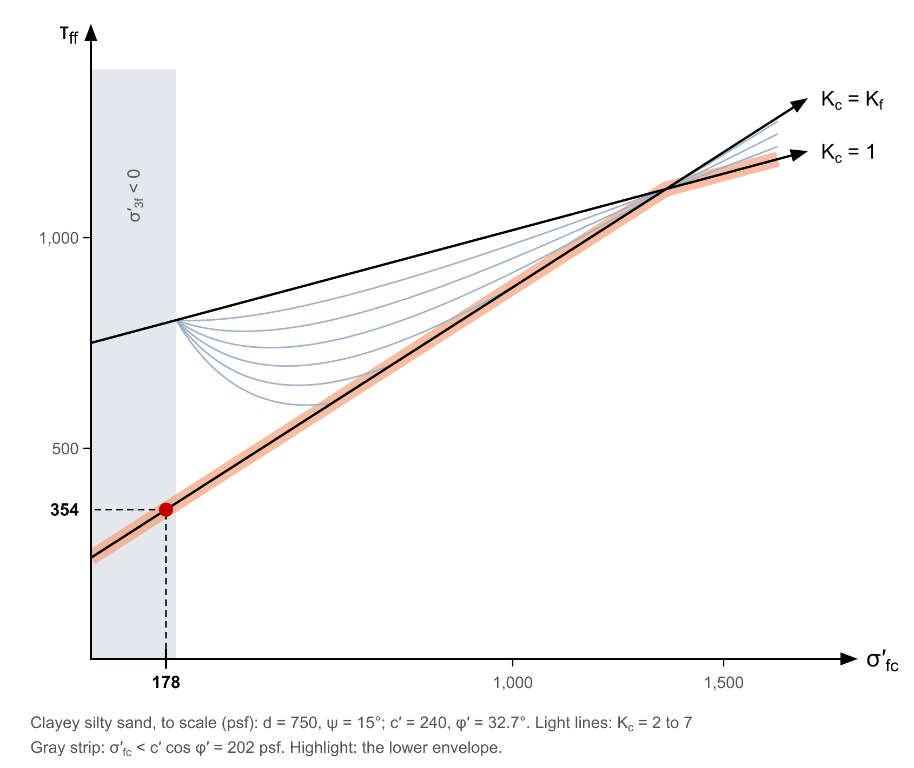{width=700px}

**xslope** makes this check on every slice and switches to the lower envelope on its own; on the Walter Bouldin circle it did so on slices 40 and 41.

### Stage 1 stability requirement {#the-stage-1-slope-must-be-stable}

Equation (5) *interpolates* between the $K_c = 1$ and $K_c = K_f$ envelopes, which bound the physically possible consolidation states. So $K_1$ must satisfy

>> $1 \le K_1 \le K_f$

$K_1$ increases monotonically with $\tau_{fc}$, and $\tau_{fc} \propto 1/F$. Substituting the failure value $\tau_{fc} = c' + \sigma'_{fc} \tan \phi'$ into equation (4) gives $K_1 = K_f$ exactly. Therefore

>> $K_1 > K_f \iff F < 1$ in Stage 1

In other words, the full-pool slope is already failing. Its mobilized shear stress lies above the failure envelope, so there is no equilibrium consolidation stress state for Stage 2 to use, and equation (5) would extrapolate beyond $K_c = K_f$ rather than interpolate. This condition is not caught by the negative-stress check above: $\sigma'_{3c}$ from equation (7) remains positive well below $F = 1$.

Because $F$ is a single global value, $K_1 > K_f$ holds for every slice at once. **xslope** therefore checks the Stage 1 factor of safety directly, and `rapid_drawdown` returns an error rather than a factor of safety when $F < 1$. Rapid drawdown presupposes a slope that is stable before the pool is lowered.

### FS Calculations

With an undrained strength for each low-permeability slice, Stage 2 computes the factor of safety: each of those slices gets a cohesion equal to its $\tau_{ff}$ and a friction angle of zero, and the free-draining slices keep $c'$ and $\phi'$. Everything that drives the slide is computed for the conditions after drawdown: the weight of the slices with the buoyancy of the full pool gone, the lowered pool's water load on the face, and, for the free-draining zones, the pore pressures after drawdown.

**Unit weights.** Each slice is weighed once, against the full-pool (Stage 1) water table, and keeps that weight in all three stages: soil below that water table weighs $\gamma_{sat}$ and soil above it $\gamma$. The low-permeability zones stay saturated while their pore pressures fall, which is the premise of rapid drawdown, and a free-draining zone between the two pool levels keeps its saturated weight too. With Duncan, Wright, and Wong's (1990) dry and saturated rockfill weights on their pumped-storage dam ([VP99](../verification/rocscience.md#vp99)), this gives 1.53 against their published 1.56; weighing the drained rockfill by the lowered water table in Stages 2 and 3 instead moves the result well above the published value.

## Stage 3 - Check Drained Strengths

Stage 3 is the dilation check. At low confining stress, a compacted clay tends to dilate when it is sheared undrained: its pore pressure drops and its effective stress and strength go up, so its undrained strength can come out higher than its drained strength. That negative pore pressure can't be counted on, since given time water flows in and the clay loses it. So the drained strength caps the undrained strength, slice by slice.

For each low-permeability slice, the drained strength after drawdown is computed from the Stage 2 solution:

>>$\sigma' = \dfrac{N'}{\Delta \ell}   \qquad (9)$

>>$\tau = c' + \sigma' \tan \phi'   \qquad (10)$

where $N'$ is the effective normal force from Stage 2, with the pore pressures after drawdown. Where the drained strength is lower than the undrained strength, the drained strength is assigned to that slice and the factor of safety is recalculated; some slices may use the drained strength while others use the undrained. If the drained strength is greater on every slice, there is no need to recalculate.

If Stage 3 calculations are required (drained less than undrained on at least one slice), the factor of safety from Stage 3 is the rapid drawdown factor of safety. If they are not required, the factor of safety from Stage 2 is. Since Stage 3 only substitutes *lower* strengths, this is the same as taking the lower of the two.

The drained strength tends to be the smaller one at shallow depths and the undrained strength at deeper ones, so shallow surfaces tend to be drained-critical and deep ones undrained-critical, and a slip surface that spans a range of depths can be governed by the drained strength on some slices and the undrained strength on others.

### Walter Bouldin Dam, the whole circle {#walter-bouldin}

Walter Bouldin Dam, a rolled earthfill dam, slid during a 32 ft drawdown in 1975, with the pool going from elevation 47 to 15. The section below is **xslope**'s verification problem [VP98](../verification/rocscience.md#vp98), with the $K_c = 1$ envelopes from Duncan, Wright, and Wong (1990), and the circle is the critical one from a rapid drawdown search with Spencer's method, cut into 41 slices. Every slice has its base in a low-permeability soil: the clayey silty sand at both ends, and the clay and the micaceous sand between.

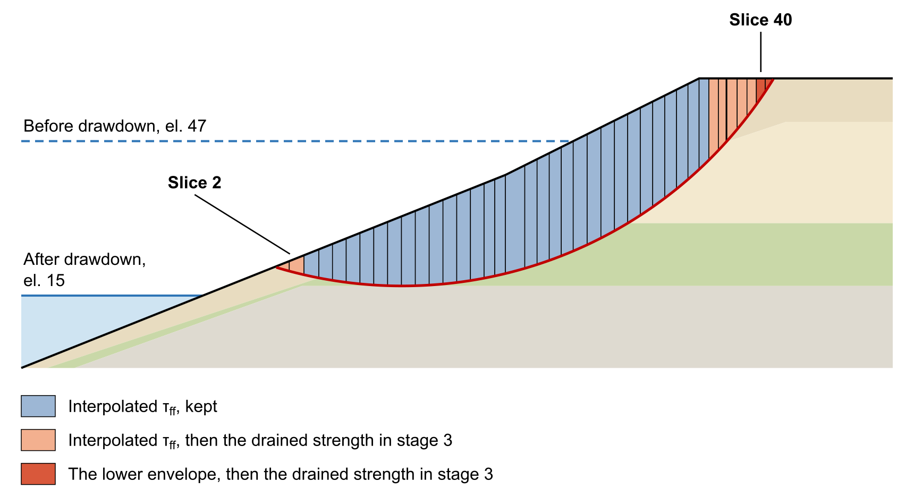{width=860px}

The colors say what governed each slice. Most interpolated their undrained strength, as slice 2 did, and kept it, because their drained strength after drawdown was higher. At both ends of the circle the drained strength came out lower in Stage 3 and replaced the undrained one; that includes slice 2, whose $\tau_{ff}$ of 747 psf gave way to a drained strength of 715 psf. Slices 40 and 41 at the crest took the lower envelope in Stage 2, as slice 40 did above, and then the drained strength in Stage 3 as well: shallow ends drained-critical, the deep middle undrained-critical.

| Stage | Factor of safety |
|-------|:----------------:|
| 1, full pool | 1.498 |
| 2, after drawdown | 1.097 |
| **3, ten slices drained** | **1.048** |
| Published (Duncan, Wright, and Wong 1990) | 1.04 |

The search on the verification page, with 40 slices, gives 1.048.

### Surfaces that cross no material with d and ψ {#drained-surfaces}

A slip surface that passes only through free-draining materials is analyzed like any other. No slice takes an undrained strength, so Stage 2 keeps $c'$ and $\phi'$ on every slice under the water after drawdown, Stage 3 is not required, and the rapid drawdown factor of safety is Stage 2's: the drained analysis of that surface with the pool lowered. A circular search keeps these surfaces as ordinary trials, so on a dam with a weak free-draining shell the critical circle can lie in the shell and miss the core entirely. When the critical circle (or the one circle analyzed) crosses no material with $d$ and $\psi$, the Log, the [Analysis Report](../studio/reports.md)'s rapid drawdown section, and the LEM Solution tab in XSLOPE Studio each say so. The [Stage 1 stability requirement](#the-stage-1-slope-must-be-stable) applies to these surfaces too.

## Inputs and Calculations

A rapid drawdown analysis needs these inputs beyond an ordinary one:

| Input | Where | Notes |
|-------|-------|-------|
| The $K_c = 1$ envelope, $d$ and $\psi$ | the `mat` sheet, columns J and K; Studio: Materials, with LEM parameters shown | For each `mc` material that does not drain during the drawdown; the pair is read on `mc` materials only. Blank or zero means free-draining: the material keeps $c'$ and $\phi'$ in all three stages. A material needs both or neither. A `cp` or `ratio` material keeps its own undrained strength, and a $d$ or $\psi$ left on it is not read; the model checks note it as information. A `pow` or `hb` material a slip surface can reach stops the run, because the drawdown stages replace each slice's $c$ and $\phi$, which a curved envelope computes itself. If the lab reports an R envelope ($c_R$, $\phi_R$) instead, convert it first, as described under [When the lab reports an R envelope](#r-envelope). |
| The water before and after drawdown | one of three sources, below | The water before drawdown feeds Stage 1; the water after drawdown feeds Stages 2 and 3. |
| The water load on the face | Water loads in the `main` sheet (cell D25) or Studio's Global parameters | **auto**, the default and the recommended setting, derives the full-pool load for Stage 1 and the lowered-pool load for Stages 2 and 3 from whichever water source the model uses. With **manual**, enter both: the `dloads` and `dloads (2)` sheets, or the Set 1 and Set 2 (rapid drawdown) tabs of Studio's Distributed loads. |

The two water states can come from three sources:

1. **Two piezometric lines**: Line 1 for the full pool and Line 2 for after drawdown, on the `piezo` sheet. Quick, and how published cases are usually given, but only as good as the sketch of Line 2.
2. **Two steady seepage solutions**, one at each pool level, from boundary sets `seep bc` and `seep bc (2)`, saved next to the workbook as `{base}_seep.csv` (full pool) and `{base}_seep2.csv` (lowered pool). This is the standard instantaneous drawdown: the second solution is the dam after its pore pressures have come to equilibrium with the lowered pool.
3. **A transient seepage run**, with the pool lowered on a schedule and two times read out of it; see [Rapid Drawdown from a Transient Solution](#transient-solution). The pool drives a `reservoir` boundary on the upstream face, bound to the schedule's pool series.

In Studio, run it with Run → Run LEM…, with Rapid drawdown ticked; on a model with a pool schedule the dialog also shows the two stage times. The Log reports the factor of safety of each stage, and the [Analysis Report](../studio/reports.md) has a rapid drawdown section with one row per stage. [Tutorial COMBO-2](../tutorials/combo02_rapid_drawdown.md) runs one dam with all three water sources, step by step, with the screens.

In summary, the calculations are done in the following process:

**Stage 1**

1. Using the drained strengths ($c'$ and $\phi'$) for all materials and the water and loads for the full pool, calculate the factor of safety with the selected solver. This returns a factor of safety and the effective normal force ($N'$) on the base of each slice. If this Stage 1 factor of safety is less than 1, the slope is already failing at full pool and the analysis is halted; see [Stage 1 stability requirement](#the-stage-1-slope-must-be-stable).<br>

2. Calculate $\sigma'_{fc}$ and $\tau_{fc}$ with equations (2) and (3).<br>

**Stage 2**

3. Calculate $K_1$ with equation (4), from $\sigma'_{fc}$ and $\tau_{fc}$.<br>

4. At $\sigma'_{fc}$, calculate $\tau_{ff(K_c=1)}$ from the $d$, $\psi$ envelope and $\tau_{ff(K_c=K_f)}$ from the $c'$, $\phi'$ envelope.<br>

5. Calculate $K_f$ with equation (6).<br>

6. Check equations (7) and (8). If either is zero or negative, use the lower of the two envelope strengths; otherwise calculate $\tau_{ff}$ with equation (5).<br>

7. Steps 3 to 6 are performed for each low-permeability slice, which then gets $c = \tau_{ff}$ and $\phi = 0$. The free-draining slices keep $c'$ and $\phi'$.

8. With those strengths and the water and loads after drawdown, calculate the factor of safety with the selected solver. This is the Stage 2 factor of safety.

**Stage 3**

9. For each low-permeability slice, calculate the drained strength from the Stage 2 $N'$ with equations (9) and (10), and compare it with the slice's $\tau_{ff}$. If the drained strength is smaller on any slice, use it there and recompute the factor of safety. This is the Stage 3 factor of safety.

10. The smaller of the Stage 2 and Stage 3 factors of safety is the rapid drawdown factor of safety.

## Rapid Drawdown from a Transient Solution {#transient-solution}

The three-stage method needs two pore-pressure fields along the slip surface: one for the pre-drawdown, full-pool consolidation state used in [Stage 1](#stage-1-pre-drawdown-conditions), and one for the drawn-down state used in [Stage 2](#stage-2-compute-fs-for-post-drawdown-conditions). Two piezometric lines or two steady seepage solutions supply them as described under [Inputs and Calculations](#inputs-and-calculations). A [**transient** seepage solve](../seep/transient.md) is the third source: a transient run produces a time history of pore-pressure fields as the reservoir is lowered on a schedule, and the two stage fields are two frames read from that history.

### Stage times on the tseep sheet

A transient run is driven by the [**tseep** sheet](../usage/input_template.md#worksheet-tseep), which carries two optional control times, **stage_1** and **stage_2** (with `stage_1 < stage_2`). They tag the two frames the drawdown analysis will use — for instance the full-reservoir steady state at `stage_1` and the drawn-down state at `stage_2`. Both times are forced into the transient solver's saved-frame schedule, so each is a *computed* frame, never interpolated between steps. Set both or neither; setting one without the other is an error, as is a `stage_1` at or after `stage_2`.

The stage times only select which two instants are read out of the transient solution. They change nothing about how that solution is computed, since the drawdown schedule itself is set in the boundary conditions. XSLOPE Studio therefore lets them be set where they are used, in the [Run LEM dialog](../studio/analysis.md#stage-times), as well as in the transient inputs editor; the file stores them either way. Stage times at instants that a solved transient run did not save cause the transient seepage analysis to be rerun with those times added to the save schedule.

The pool reaches the solution through the boundary on the upstream face: in boundary set `seep bc` (Studio: Seep BC, Set 1), that head's type is `reservoir` and its value is the name of the pool series. A [`reservoir` boundary](../seep/transient.md#head-types-head-and-reservoir) holds the face below the pool at the pool's level, makes the face the pool uncovers an exit face, and leaves the face the pool never reached no-flow. Boundary set 2 is not used.

### In-memory staging

Once the transient run is solved, `stage_transient_for_drawdown(slope_data, solution)` pulls the frames at `stage_1` and `stage_2` **in memory** and writes their pore-pressure fields into `slope_data['seep_u']` and `slope_data['seep_u2']` — exactly the structures the classic two-file path produces. No intermediate `seep.csv` / `seep2.csv` files are written; the two stage fields go straight into the structures the three-stage analysis already reads, and `rapid_drawdown` then runs as usual.

Staging also settles where the **stage-2 water load** comes from under [automatic water loads](../usage/preflight.md#where-the-water-load-comes-from): the drawn-down pool is boundary set `seep bc` as the schedule leaves it at the `stage_2` time — the same instant the stage-2 field was read at — and `seep bc (2)`, which states a separate steady drawn-down analysis, is not read at all. A boundary set 2 left on a file being staged this way is reported by preflight (`rapid.stage2_bc_ignored`) rather than silently used. The drop in pool level must therefore be in the schedule itself: a `seep bc` reservoir head typed as a fixed number, or bound to a series holding the same level at both stage times, gives two identical frames and a factor of safety that is the full-pool one, which preflight reports as `rapid.pool_static_between_stages`.

**Resolution order.** The classic two-file path remains fully supported. When `{base}_seep.csv` and `{base}_seep2.csv` sit next to the input workbook, `load_slope_data` reads their `u` columns into `seep_u` and `seep_u2` at load time. Calling `stage_transient_for_drawdown` afterward overwrites those two fields with the staged transient frames, so a transient solution carrying stage times takes precedence over the classic files. A model with no stage times cannot be staged this way — the call requires both `stage_1` and `stage_2` — so it falls back to the classic two-file path.

### When transient staging is preferable

Two independent steady solves treat the lowered-pool field as a new steady state at the new level: they assume the reservoir dropped and pore pressures then fully re-equilibrated. A transient solve is preferable whenever that limiting assumption is too crude:

- **Real drawdown schedules.** A reservoir is lowered over hours or days, not instantaneously. A transient run honors the actual lowering rate and the elapsed time, so the Stage 2 field reflects how far pore-pressure dissipation has *actually* progressed — the same physics the time factor $T$ at the [top of this page](#when-does-rapid-drawdown-apply) estimates, now resolved directly by the solve.
- **Partial drawdown.** The pool need not be lowered all the way. `stage_2` can be tagged at any intermediate reservoir level, and the staged field is the true partially-drawn-down state.
- **Intermediate times.** Because every saved frame is a computed state, `stage_2` can be tagged at any time along the drawdown to find how the factor of safety changes as the pool falls and pore pressures dissipate, rather than only at the fully-dissipated endpoint.

### Worked example: Johnson Reservoir {#worked-example}

The Johnson Reservoir zoned earth dam is the [transient drawdown seepage sample](../seep/samples.md#6-johnson-reservoir-zoned-drawdown-transient): a free-draining sand shell over a low-permeability compacted-clay core carried down into a silty-sand foundation, with the reservoir drawn from full pool (elevation 160 ft) down to the elevation-100 ft tailwater datum over 45 days. That model's cross-section, zones, storage properties, drawdown schedule, and `stage_1` (full pool, t = 0 day) / `stage_2` (end of drawdown, t = 50 day) times all carry over here unchanged; the stability version adds only the inputs the three-stage analysis needs.

**Undrained core.** Over a 45-day drawdown the sand shell and the silty-sand foundation drain freely — their [time factor $T$](#when-does-rapid-drawdown-apply) is well above 3 — so they are analyzed drained. Only the compacted-clay core cannot dissipate in time, so it is carried undrained into Stage 2 through its $K_c = 1$ envelope $d = 250$ psf, $\psi = 14^\circ$ (below the drained $c' = 400$ psf, $\phi' = 18^\circ$). This is the shell-versus-core split of the [second time-factor example](#when-does-rapid-drawdown-apply) above.

| Material | $\gamma$ (pcf) | $\gamma_{sat}$ (pcf) | $c'$ (psf) | $\phi'$ (deg) | $d$ (psf) | $\psi$ (deg) | Drawdown strength |
|----------|:---:|:---:|:---:|:---:|:---:|:---:|---|
| Shell (sand)          | 130 | 135 | 100 | 35 | — | — | drained |
| Core (compacted clay) | 125 | 130 | 400 | 18 | 250 | 14 | **undrained** |
| Foundation (silty sand) | 127 | 132 | 100 | 27 | — | — | drained |

As everywhere in the analysis, soil below the full-pool (Stage 1) phreatic surface weighs $\gamma_{sat}$ in all three stages (see [unit weights](#fs-calculations)).

**Loads and slip surface.** The full-pool reservoir standing against the upstream face is the Stage 1 distributed load (3744 psf at the toe, tapering to zero at the elevation-160 pool line). At Stage 2 the pool has been drawn all the way down to the elevation-100 datum, so no water remains on the upstream slope. Removing that load is the main cause of the loss of stability in rapid drawdown. The critical surface is a circle on the upstream (reservoir) face, located by a rapid-drawdown circular search: it toes near the upstream base, daylights just past the crest, and cuts twelve slices of core so the undrained zone governs Stage 2.

Excel input file: [xslope_johnson_res_rapid.xlsx](files/xslope_johnson_res_rapid.xlsx). Every material uses `u = seep`; the two stage pore-pressure fields are supplied from the transient frames in memory, so no `_seep.csv` / `_seep2.csv` companions are shipped.

**The two staged pore-pressure fields.** Staging pulls the frame at `stage_1` (full pool) and the frame at `stage_2` (end of drawdown) straight from the transient history. Between them the pool has been drawn down, but the dam has not caught up with it. The low-permeability core still holds a zone of elevated head where the slip circle crosses it, and the foundation beneath the upstream slope still holds head that a re-equilibrated field would not. Stage 2 reads only the foundation's. Each core slice takes the undrained strength its envelope assigns from the Stage 1 stresses, with $\phi = 0$, so the core's pore pressure does not enter its strength. The foundation keeps its drained strength, so its Stage 2 pore pressures go straight into the answer.

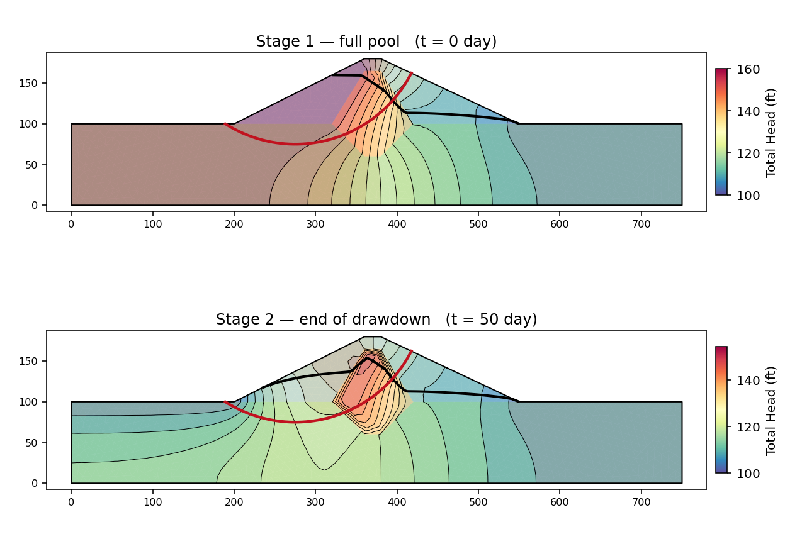

The staging is a three-call sequence: run the transient seepage analysis, place the two stage frames into `slope_data`, then run the ordinary three-stage `rapid_drawdown`.

```python
from xslope.fileio import load_slope_data
from xslope.mesh import build_mesh_from_polygons, get_material_polygons
from xslope.seep import (build_seep_data, build_tseep_data,
                         run_transient_seepage, stage_transient_for_drawdown)
from xslope.slice import generate_slices
from xslope.solve import solve_selected

slope_data = load_slope_data("docs/lem/files/xslope_johnson_res_rapid.xlsx")

# Run the transient drawdown seepage analysis
mesh = build_mesh_from_polygons(get_material_polygons(slope_data), 10.0, "tri3")
seep_data = build_seep_data(mesh, slope_data)
solution = run_transient_seepage(seep_data, build_tseep_data(slope_data))

# Pull the stage_1 / stage_2 frames into slope_data['seep_u'] / ['seep_u2']
slope_data = stage_transient_for_drawdown(slope_data, solution)
slope_data["mesh"] = mesh

# Three-stage rapid drawdown on the critical upstream circle
_, (slice_df, failure_surface) = generate_slices(
    slope_data, circle=slope_data["circles"][0], num_slices=40)
results = solve_selected("spencer", slice_df, rapid=True)
```

**Result.** The full-pool slope is comfortably stable (Stage 1 FS = 2.08). Removing the reservoir load while the core holds its undrained strength drops the Stage 2 factor of safety to 1.34, and Stage 3 confirms the drained strength is not lower anywhere on the surface, so it does not reduce the result further. The rapid-drawdown factor of safety is **1.34** (Spencer); Morgenstern–Price agrees at 1.35, and the simpler methods bracket it, from 1.11 (OMS) to 1.52 (Corps of Engineers).

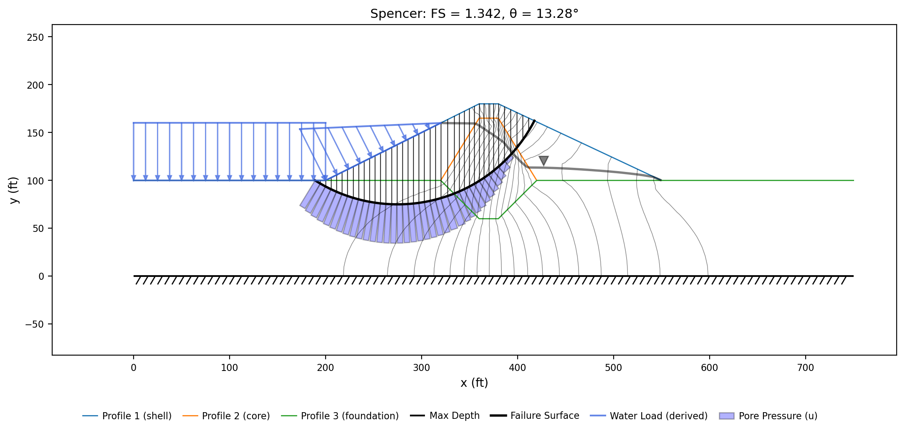

Because the Stage 2 field is the transient frame at t = 50 day rather than a re-equilibrated steady state, it carries the head the foundation has not yet given up, and the drained foundation slices read all of it. That makes this factor of safety lower, and more faithful to the 45-day drawdown, than one read on a re-equilibrated field. The core's retained head does not change it. [Tutorial COMBO-2](../tutorials/combo02_rapid_drawdown.md) compares the transient route with two steady solutions on the same dam.

## Verification {#verification}

**xslope**'s three-stage analysis is checked against published analyses of four dams, two of which failed in rapid drawdown:

| Dam | xslope (Spencer) | Published |
|-----|:----------------:|:---------:|
| [VP96](../verification/rocscience.md#vp96): USACE EM 1110-2-1902 example | 1.435 | 1.44, USACE (2003) |
| [VP97](../verification/rocscience.md#vp97): Pilarcitos Dam (failed) | 1.044 | 1.05, Duncan, Wright, and Wong (1990) |
| [VP98](../verification/rocscience.md#vp98): Walter Bouldin Dam (failed) | 1.048 | 1.04, Duncan, Wright, and Wong (1990) |
| [VP99](../verification/rocscience.md#vp99): pumped-storage dam | 1.527 | 1.56, Duncan, Wright, and Wong (1990) |

### See also

The [transient-seepage theory page](../seep/transient.md) documents the formulation, storage properties, and time-stepping behind these frames; its [Rapid drawdown staging](../seep/transient.md#rapid-drawdown-staging) section covers the coupling from the seepage side.
