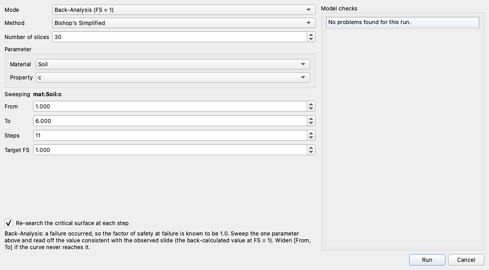
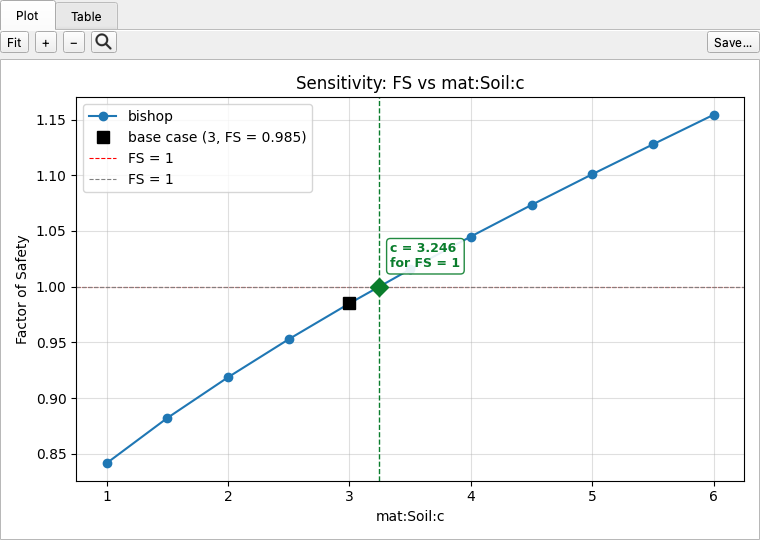

# Back-Analysis Mode

Back-analysis is the same single-parameter sweep as [Design](design.md), turned toward a
*failure investigation*. A slide has already occurred, so the factor of safety at the moment
of failure is known to be 1.0. The unknown is a strength, pore-pressure, or loading
parameter, and the study back-calculates the value **consistent with the observed failure**,
most commonly the shear strength the slide mobilized.
[What can be varied](index.md#what-can-be-varied) lists the parameters it can vary.

## In Studio

Click **Run → Parametric…** and set **Mode** to **Back-Analysis (FS = 1)**:



The controls are the same as in [Design mode](design.md#in-studio), and **Target FS** is set to
1.0 for you:

1. Pick the **Material** and **Property** to back-calculate.
2. Set **From** and **To** to the plausible range of the unknown, and **Steps** to the number
   of solves across it.
3. Click **Run**.

The dialog above back-calculates the cohesion of the ACADS simple slope
([xslope_acads_simple.xlsx](../lem/files/xslope_acads_simple.xlsx)) over 1 to 6 kPa in
eleven solves, with Bishop's method and 30 slices. The result opens in the **Design** tab:



The curve crosses FS = 1 at **c = 3.246 kPa**: if this slope failed, that is the cohesion it
mobilized, given the friction angle and unit weight in the model. The model's own c = 3 kPa
gives FS = 0.985, just below it.

A back-calculated value is only as good as everything held fixed. Here φ and γ are taken as
known; a different φ gives a different c. Varying a second parameter and repeating the study
traces the pairs of values that all reproduce the failure.

The same [never-extrapolate rule](design.md#honest-about-misses) applies as in Design mode:
if the range never reaches FS = 1.0, no value is reported, and a note says which way to
widen the range.

## From Python

`back_analysis()` is `design()` with `target_fs` defaulting to 1.0 and its message worded
for a failure investigation. It takes the same parameter grammar (see
[Addressing a parameter](index.md#addressing-a-parameter)) and the same `mode=`, `fem_opts=`,
and `seep_opts=` engine controls as `design()`. In `mode='seep'` the target is a discharge q
rather than a factor of safety.

```python
from xslope.sensitivity import back_analysis

success, result = back_analysis(
    slope_data,
    param="mat:Soil:c",          # the strength parameter to back-calculate
    low=1.0, high=6.0, steps=11, # sweep the plausible range...
    # target_fs=1.0,             # ...to the known failure condition (the default)
    method="bishop",
    num_slices=30,
)
print(result['message'])
# Back-analysis: mat:Soil:c = 3.246 gives FS = 1 (the value consistent with the
# observed failure).
```

`result['crossing']` is the back-calculated value and `result['study']` is
`'back_analysis'`; every other field carries the same meaning as in
[`design()`](design.md#running-a-design-study).

### The `modify=` callable

`back_analysis()` takes the same [`modify=` option](design.md#sweeping-anything-else-modify)
as `design()`: pass a `(slope_data, value) -> slope_data` callable and a `label` in place of a
`param` reference (exactly one per call) whenever the unknown is not a single stored value.
A common forensic use is a **water-table elevation**. The phreatic surface at the moment of a
slide is rarely recorded, so sweep it and back-calculate the level consistent with FS = 1.0:

```python
def set_water_table(sd, elev):
    """Set the piezometric line to a horizontal elevation `elev`."""
    sd['piezo_line'] = [(x, elev) for x, _ in sd['piezo_line']]
    return sd

success, result = back_analysis(
    slope_data, modify=set_water_table, label="water-table elevation (m)",
    low=8.0, high=16.0, steps=9,   # sweep the plausible phreatic range...
    # target_fs=1.0,               # ...to the known failure condition (the default)
    method="bishop",
)
print(result['message'])
```

`result['crossing']` is then the back-calculated elevation, and the never-extrapolate rule
applies whichever way the swept axis is named.
