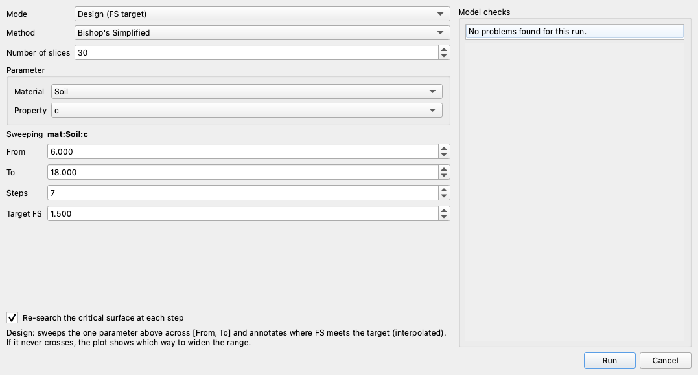
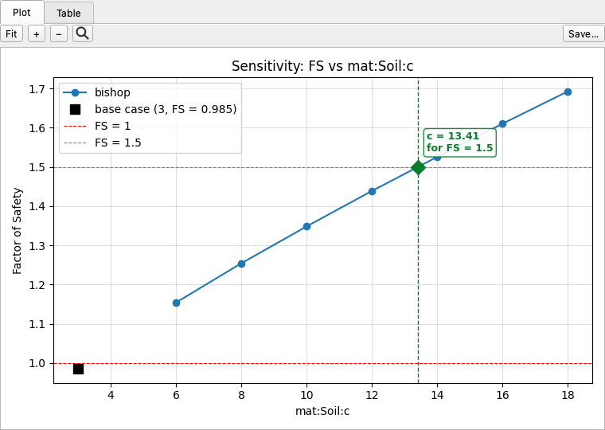
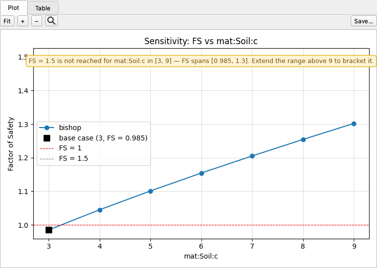

# Design Mode

A sensitivity sweep shows how much FS changes; a **design study** works the other way and
finds the value of a parameter that gives a target FS, such as 1.5. It solves the model at
evenly spaced values across a range you set and interpolates the value where the FS curve
crosses the target. This is a common deterministic design calculation: "vary the undrained
strength between X and Y and find where FS reaches the design factor."
[What can be varied](index.md#what-can-be-varied) lists the parameters it can vary.

## In Studio

Click **Run → Parametric…** and set **Mode** to **Design (FS target)**:



1. Pick the **Material** and **Property** to vary. The **Sweeping** line confirms the choice.
2. Set **From** and **To**, the range to search. The first time you pick a property they are
   filled with ±50% of its current value.
3. **Steps** is the number of solves, evenly spaced from **From** to **To**.
4. **Target FS** is the factor of safety to find.
5. Click **Run**.

The dialog above asks the ACADS simple slope
([xslope_acads_simple.xlsx](../lem/files/xslope_acads_simple.xlsx), base cohesion c = 3 kPa,
base Bishop FS = 0.985) what cohesion it needs for FS = 1.5, solving at seven values of c from
6 to 18 kPa with Bishop's method and 30 slices. The result opens in a **Design** tab:



The curve is the factor of safety at each solved value, with the unmodified model as a black
square. Where the curve crosses the target line, a green diamond marks the interpolated
crossing and the label gives the answer: **c = 13.41 kPa for FS = 1.5**. The sweep spans
FS = 1.154 at c = 6 to FS = 1.693 at c = 18. Solving the model at the interpolated
c = 13.41 gives FS = 1.500, so the straight-line interpolation between the c = 12 and c = 14
solves lands the target to within 0.02%. The **Table** sub-tab lists every solved value.

The [LEM-2](../tutorials/lem02_loads_on_the_crest.md) and
[LEM-13](../tutorials/lem13_rock_slope.md) tutorials run design studies on their own
models: the cohesion a slope needs under a crest surcharge, and the geological strength
index of a rock slope.

## Targets outside the swept range {#honest-about-misses}

A design study does not extrapolate. A crossing is reported *only* when the target lies
between two actual solves. Ask the same question over a range that never reaches the
target, c from 3 to 9 kPa, and no crossing is drawn. A note says how far the factor of safety
got and which way to widen the range:



> FS = 1.5 is not reached for mat:Soil:c in [3, 9] — FS spans [0.985, 1.3]. Extend the range
> above 9 to bracket it.

The study reports that it fell short rather than projecting a value past the last solve.

## A curve that crosses twice

The factor of safety need not rise or fall steadily with a parameter. When the curve crosses
the target more than once within the range, the first crossing is marked; narrow the range
around the one you mean.

## From Python

`design()` shares the parameter grammar of [Sensitivity](sensitivity.md) (see
[Addressing a parameter](index.md#addressing-a-parameter)) and its three
[engine modes](index.md#analysis-modes-lem-fem-seepage): `mode='lem'` (the default) and
`mode='fem'` both target a factor of safety, while `mode='seep'` targets the **total
discharge q** instead, with the crossing and bracketing logic below applied to q.

### Running a design study

```python
from xslope.sensitivity import design
from xslope.plot import plot_sensitivity

success, result = design(
    slope_data,
    param="mat:Soil:c",          # or {"material": "Soil", "property": "c"}, or a tuple
    low=6, high=18, steps=7,     # 7 evenly spaced solves across [6, 18]
    target_fs=1.5,
    method="bishop",             # one method: a design study locates a single curve
    num_slices=30,
)
print(result['message'])
# FS = 1.5 at mat:Soil:c = 13.41 (interpolated between solves).
plot_sensitivity(result['df'], target_fs=result['target_fs'])
```

`design()` returns `(success, result)`; on success `result` carries the sweep DataFrame
(`result['df']`, the same shape as a [sensitivity sweep](sensitivity.md#running-a-sweep))
plus a summary:

| field | meaning |
|---|---|
| `crossing` | interpolated parameter value at FS = `target_fs`, or `None` if the target is not reached |
| `crossings` | every crossing found; a non-monotonic curve can cross twice, and `crossing` is the first |
| `bracketed` | `True` only when the target is crossed *inside* `[low, high]` |
| `fs_range` | `(min FS, max FS)` over the successful sweep points |
| `direction` | `'increasing'` / `'decreasing'` / `'non-monotonic'` trend of FS versus the parameter |
| `extend` | on a miss, `'above {high}'` or `'below {low}'`: which way to widen the range; else `None` |
| `message` | one-line human-readable summary |
| `param`, `target_fs`, `base_value`, `runtime` | canonical ref, the target, the parameter's current value, wall-clock seconds |

For the example above, `result['crossing']` is 13.41, `result['bracketed']` is `True`, and
`result['direction']` is `'increasing'`. Over c from 3 to 9, `result['bracketed']` is
`False`, `result['crossing']` is `None`, and `result['extend']` is `'above 9'`.

`design()` also takes `progress_callback` and `cancel_check` hooks (a per-point progress
callback and a cooperative cancel), which is how Studio drives its progress bar and its
Cancel button; a plain data-in, data-out call leaves both `None`.

### Sweeping other quantities: `modify=` {#sweeping-anything-else-modify}

`design()` accepts the same `modify=` callable as the sensitivity engine, so the quantity you
design need not be a single stored scalar. When it is **geometry**, such as a slope angle or
a berm width, which Studio's picker does not offer, pass a callable in place of a parameter
reference: `modify` is a `(slope_data, value) -> slope_data` setter and `label` names the
swept axis, and the two are mutually exclusive with `param` (exactly one per call).
`low`/`high`/`steps` sweep the callable's value the same way, and the crossing, bracketing,
and `extend`/`direction` reporting are identical. The callable is responsible for keeping
the model consistent after its edit; here it rebuilds the material polygons and ground
surface after it moves a profile point, since slice weights come from the polygons, not the
raw profile lines:

```python
import math
from shapely.geometry import Polygon
from xslope.fileio import build_ground_surface_from_polygons
from xslope.mesh import build_polygons

def set_slope_angle(sd, beta_deg):
    """Rotate the slope face about the toe to beta_deg, then rebuild the polygon
    geometry."""
    prof = sd['profile_lines'][0]['coords']
    x_toe, y_toe = prof[1]
    _, y_top = prof[2]
    prof[2] = (x_toe + (y_top - y_toe) / math.tan(math.radians(beta_deg)), y_top)
    polys = [{'polygon': Polygon(p['coords']), 'mat_id': p['mat_id']}
             for p in build_polygons(slope_data={'profile_lines': sd['profile_lines'],
                                                 'max_depth': sd.get('max_depth')})]
    sd['polygons'] = polys
    sd['ground_surface'], sd['domain_polygon'] = build_ground_surface_from_polygons(polys)
    return sd

success, result = design(
    slope_data, modify=set_slope_angle, label="slope angle (deg)",
    low=12, high=25, steps=8,        # flatten the face from 25° toward 12°...
    target_fs=1.5, method="bishop",  # ...and find the angle that reaches FS = 1.5
)
print(result['message'])
# FS = 1.5 at slope angle (deg) = 16.74 (interpolated between solves).
```

On the ACADS sample slope this brackets the target: FS climbs from about 1.04 at 25° to
2.02 at 12° as the face flattens, crossing FS = 1.5 at a slope angle of **16.74°**. A
built-in `param` reference and a `modify=` callable are **one code path** (every reference
resolves internally to exactly the setter signature `modify=` takes), so the answer is
identical whichever way you name the swept axis. The engine validates the modified model
at each step (polygon validity, ground surface present) because a setter may be
user-written: a broken edit gives a failed sweep point rather than an inconsistent crossing.
