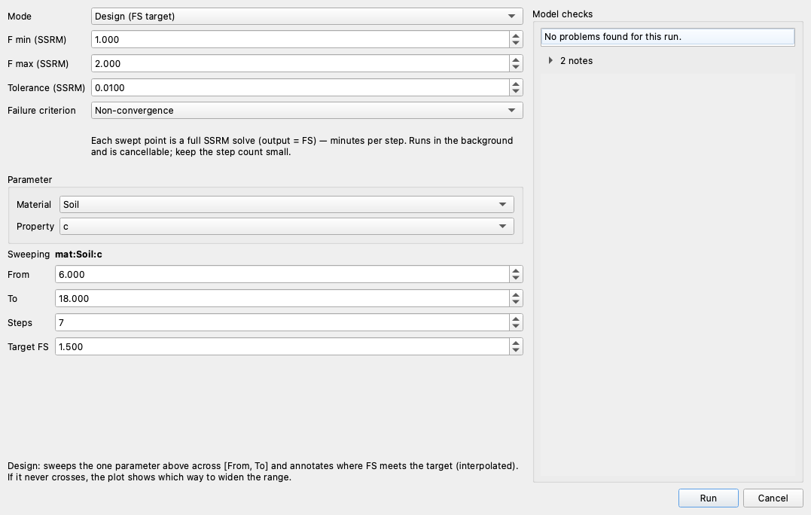

# Parametric Studies

A parametric study varies the inputs and reports how the result changes. XSLOPE groups
three closely related studies under one **Parametric** heading:

- **[Sensitivity](sensitivity.md)**: vary one or more parameters and see how the factor of
  safety responds. The results feed a family of plots: a tornado, scaled-sensitivity bars, a
  spider plot, and, when the model carries standard deviations, a variance-contribution
  Pareto and a Monte Carlo rank-correlation chart.
- **[Design](design.md)**: vary one parameter across a range and find the value at which
  FS meets a target (FS = 1.5, say).
- **[Back-Analysis](back_analysis.md)**: the same single-parameter sweep framed as a
  failure investigation. A slide has occurred, so FS = 1.0 is known, and the study
  back-calculates the parameter value consistent with the observed failure.

A fourth study sweeps **time** rather than an input:
[factor of safety versus time](sensitivity.md#factor-of-safety-versus-time) runs the
stability analysis against every saved instant of a
[transient seepage](../seep/transient.md) solution and reports when the slope is at its
weakest.

Duncan & Wright present these charts (FS versus a parameter, and tornado diagrams comparing
several parameters at their low and high bounds), and knowing *which* parameter controls a
given slope is a large part of slope-stability judgment.

## In Studio

Click **Parametric…** on the **Run** menu or the toolbar. It is available whenever a model
is open; in Seepage and FEM mode it also needs a built mesh, as **Run** does. One dialog runs
all four studies:


- **Mode** picks the study: **Sensitivity**, **Design**, **Back-Analysis**, or **Factor of
  safety vs time**. The controls below it change with the study.
- **Method** and **Number of slices** set the limit-equilibrium analysis that every point of
  the sweep runs.
- **Parameter** names what to vary: a **Material** and one of its **Properties**, or the
  seismic coefficient, listed as *k_seismic (global)*.
- **Re-search the critical surface at each step**, on by default, searches for the critical
  surface again at every point, because the surface moves as the parameter changes.
  Unticked, every point re-solves the surface you entered, which is much faster but answers
  only for that surface.
- **Model checks** on the right checks the model once before the first solve, with the same
  rules a single run gets (see
  [Model checks before a run](../studio/analysis.md#model-checks-before-a-run)).

**Run** starts the sweep in the background. The progress bar counts the solves, the
[Log pane](../studio/interface.md#the-log-pane) records each one, and **Cancel** on the status
bar stops the sweep once the solve in progress finishes. Each study opens its result in a tab
of its own with two sub-tabs: **Plot**, and **Table**, which holds the numbers the plot is
drawn from. **Save CSV…** on the Table writes them to a file beside the project.

The page for each study walks through its settings and its result.
[Running Analyses: Parametric study](../studio/analysis.md#parametric-study) lists every
control in the dialog.

### What can be varied

The **Property** list offers what the loaded model stores:

- for each material, the strength fields its strength option reads (c and φ for
  Mohr-Coulomb, the Hoek-Brown inputs for a rock mass, and so on), the unit weights γ and
  γ<sub>sat</sub>, and r<sub>u</sub>;
- the seismic coefficient k<sub>seismic</sub>;
- in Seepage mode, each material's hydraulic conductivities (k<sub>1</sub>, k<sub>2</sub>),
  anisotropy angle and unsaturated parameters, and every specified-head boundary value.

The list also shows fields the analysis may not read. r<sub>u</sub> is read only on a material
whose pore pressures are set by r<sub>u</sub>, and the rapid-drawdown strengths d and ψ only by
a rapid drawdown analysis, which a parametric study does not run. Pick one of those and
**Model checks** says why and keeps **Run** off, because the sweep would report a sensitivity
of zero.

Varying γ moves γ<sub>sat</sub> by the same amount, because the two are the same soil weighed
above and below the water table; γ<sub>sat</sub> can still be varied on its own. A sweep that would make
γ<sub>sat</sub> lighter than γ stops with an error.

Geometry (a slope angle or a berm width), the position of the water table, and reinforcement
and pile properties are not in the list. Those are varied [from Python](#from-python).

### LEM, FEM, and seepage

The dialog follows the mode Studio is in. In **LEM** each point is a limit-equilibrium
analysis and the output is the factor of safety. In **FEM** each point is a full
strength-reduction (SSRM) analysis; the output is still the factor of safety, but each point
takes minutes, so keep the number of points small. The SSRM settings take the place of
**Method** and **Number of slices**:



In **Seepage** the output is the **total discharge q** through the section, and a Design
study targets a discharge rather than a factor of safety. The variance Pareto and the Monte
Carlo rank plots are offered in LEM mode only, because they reuse the limit-equilibrium
[reliability](../reliability/index.md) analysis.

## Sensitivity and reliability

Sensitivity analysis differs from [reliability analysis](../reliability/taylor.md): the
Taylor-series method perturbs parameters by ±σ to estimate the *distribution* of FS, which
requires the parameters to be independent. A sensitivity sweep asserts nothing statistical.
It evaluates the model across a range, which also makes it the right tool for **correlated
fit coefficients** (the power-curve `A` and `b`, for example) that the reliability method
must not treat as independent. The Hoek-Brown inputs are in the same category: σ<sub>ci</sub>,
GSI, m<sub>i</sub> and D can all be varied here, but they carry no standard-deviation columns
and reliability rejects them, because m<sub>b</sub>, s and a are all *derived* from GSI,
m<sub>i</sub> and D, and perturbing them independently would be meaningless.

## From Python

Studio, the [`/xslope` Claude Code skill](../usage/claude/index.md), and a Python script all
drive the same functions in `xslope.sensitivity`, so a study gives the same result whichever
way it is set up. A study describes an analysis you run, not a property of the model, so
nothing about it is stored in the Excel input template.

### Analysis modes: LEM, FEM, seepage

Every sweep runs through one of three engine `mode=` values: `'lem'` (limit
equilibrium, output FS, the default), `'fem'` (a full finite-element SSRM solve per
point, output FS), or `'seep'` (a rebuilt-and-solved seepage problem per point, output
the **total discharge q**). `mode='fem'` and `mode='seep'` both need a mesh in
`slope_data['mesh']`. Not every function in the family takes a `mode=` argument;
the two plots that reuse the reliability machinery directly are LEM-only:

| Function | `lem` | `fem` | `seep` |
|---|:---:|:---:|:---:|
| `sensitivity()` | yes | yes | yes |
| `tornado()` | yes | yes | yes |
| `design()` | yes | yes | yes |
| `back_analysis()` | yes | yes | yes |
| `scaled_sensitivity()` | yes | yes | yes |
| `variance_contribution()` | yes | — | — |
| `mc_rank_correlation()` | yes | — | — |

`variance_contribution()` and `mc_rank_correlation()` reuse the LEM Taylor-series and
Monte Carlo [reliability](../reliability/index.md) machinery directly (`xslope.advanced.reliability`
and `reliability_mc`), which is a limit-equilibrium path only; see
[Monte Carlo in xslope](../reliability/monte_carlo.md#monte-carlo-in-xslope) for why. They take
no `mode=` argument at all rather than accepting one they cannot honor.

### Addressing a parameter

A sweep needs an unambiguous name for the thing being varied. Parameter references are
strings of the form `"kind:name:field"`:

| kind | name | fields | example |
|---|---|---|---|
| `mat` | material name | strength fields valid for the material's `option` (`c`, `phi` for `mc`; `c`, `cp` for `cp`), plus `gamma`, `gamma_sat`, `ru`, `d`, `psi` | `"mat:Clay:c"` |
| `reinforce` | line label | `t_max`, `t_res`, `lp1`, `lp2`, `tend1`, `tend2`, `spacing` | `"reinforce:Row 2:t_max"` |
| `piles` | pile label | `H`, `theta`, `D`, `S`, `V_cap`, `M_cap` | `"piles:Pile 1:H"` |
| `global` | — | `k_seismic`, `tcrack_depth`, `tcrack_water` | `"global:k_seismic"` |
| `seep` | material name | `k1`, `k2`, `alpha`, `kr0`, `h0` | `"seep:Sand:k1"` |
| `seep_bc` | boundary set (1 or 2) | the 0-based index of a specified-head value in that set | `"seep_bc:1:0"` |
| `geom` | — | `piezo:dy`: shift the piezometric line vertically (the value is a *delta*) | `"geom:piezo:dy"` |

Every reference is validated against the loaded model before anything runs: an unknown
kind, an unmatched name, or a field the material's strength option does not use raises
immediately, naming what was given and what exists. Names resolve case-insensitively;
duplicated names are an error rather than a guess. Sweeping `c` on a `cp` material is
rejected for the same reason the reliability module rejects it: the model would not
read the value, and the sweep would silently report zero sensitivity.

### Discovering and specifying parameters

Rather than hand-write every reference, `list_params(slope_data)` enumerates every sweepable
parameter in the loaded model as plain dicts. It is the list Studio's **Material** and
**Property** pickers are filled from, and the menu an assistant driving the API chooses
from, so a reference is never guessed:

```python
from xslope.sensitivity import list_params

for p in list_params(slope_data):
    print(p['ref'], p['value'], p['sigma'])
    # mat:Soil:c        3.0   1.8
    # mat:Soil:phi      19.6  2.744
    # mat:Soil:gamma    20.0  1.2
    # global:k_seismic  0.0   None
```

Each entry carries `ref` (the canonical string), `kind`, `name`, `index` (the 1-based
material index), `field`, `value` (the current value, or `None` if unset), `sigma` (the
reliability standard deviation, `sigma_c`, `sigma_phi`, …, if the model carries a non-zero
one, so a picker can offer a one-click ±σ range), a short `label`, and `available` with a
`reason` when the field cannot be swept on this model. Blank or zero-valued fields are still
listed, so a design study can target them with explicit bounds.
`list_params(slope_data, mode='seep')` lists the seepage set instead.

Anywhere a `"kind:name:field"` string is accepted, the entry points also accept the
equivalent **dict** or **tuple**, often what a GUI or an assistant naturally produces. All
forms resolve to the same setter and validate identically:

```python
design(slope_data, {"material": "Soil", "property": "c"}, low=6, high=18)  # dict, by name
design(slope_data, {"material": 1, "property": "phi"}, low=15, high=25)     # 1-based index
design(slope_data, {"global": "k_seismic"}, low=0.0, high=0.3)             # a global
design(slope_data, ("mat", "Soil", "c"), low=6, high=18)                    # tuple form
```

The dict accepts `ref` (passed straight through), `material`/`name` and `property`/`field`,
or a `global` key; a material may be named or given by 1-based index.
