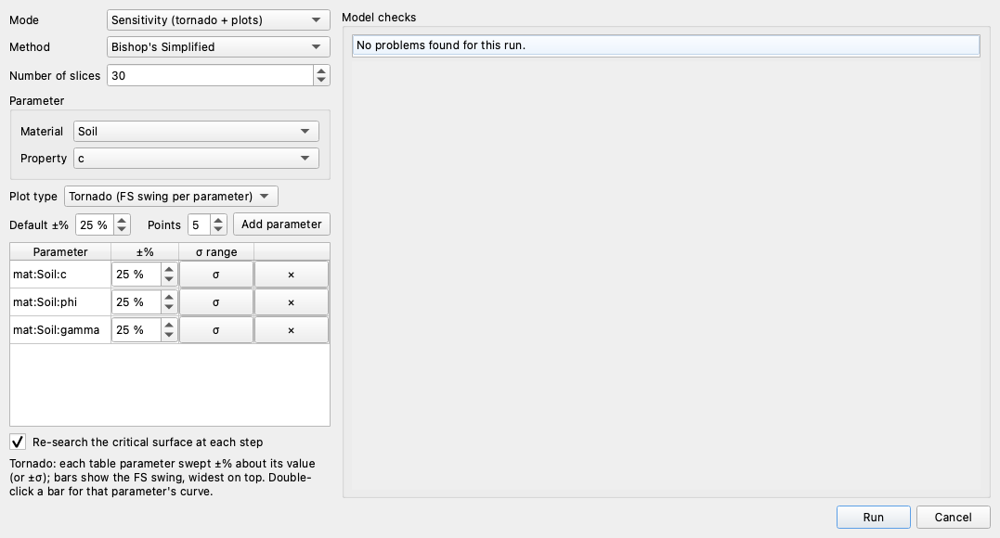
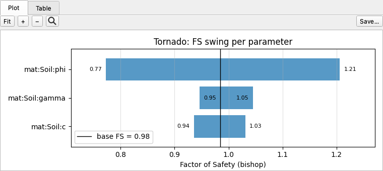
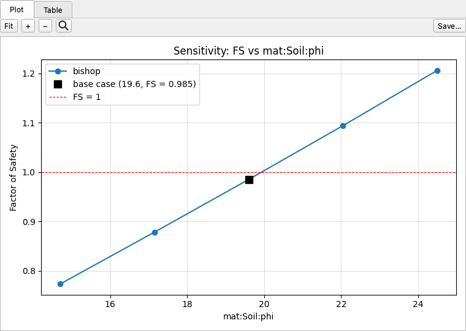
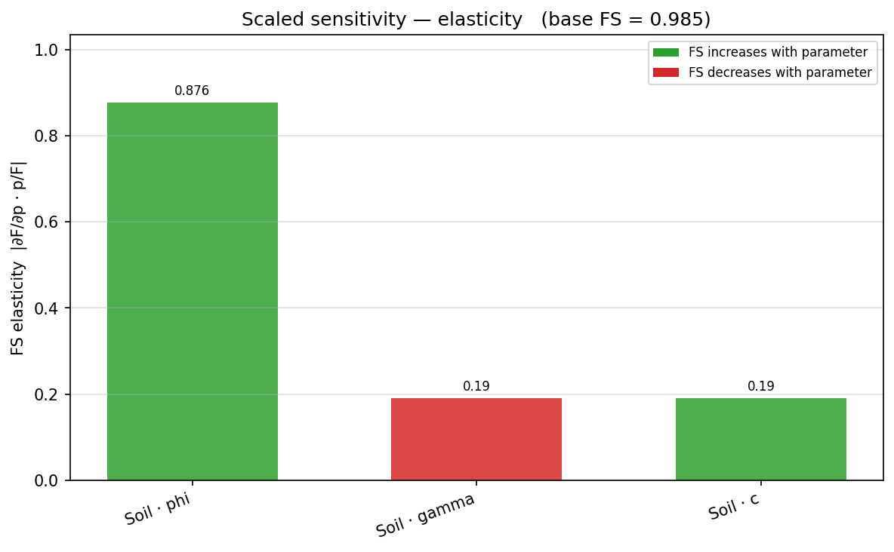
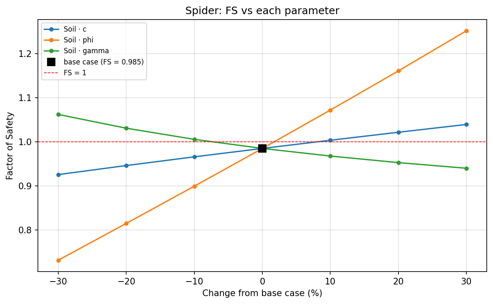
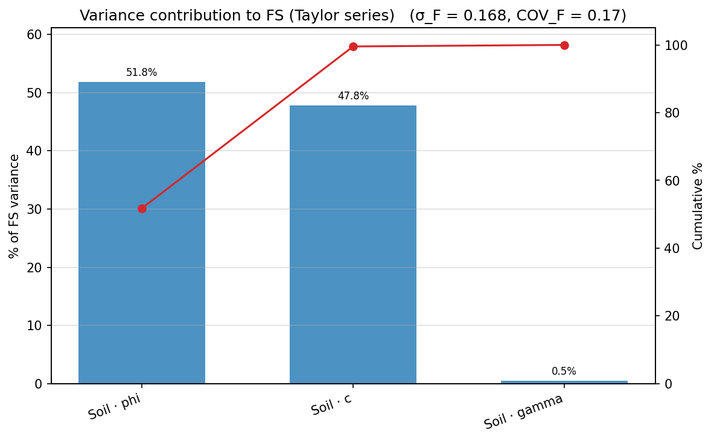
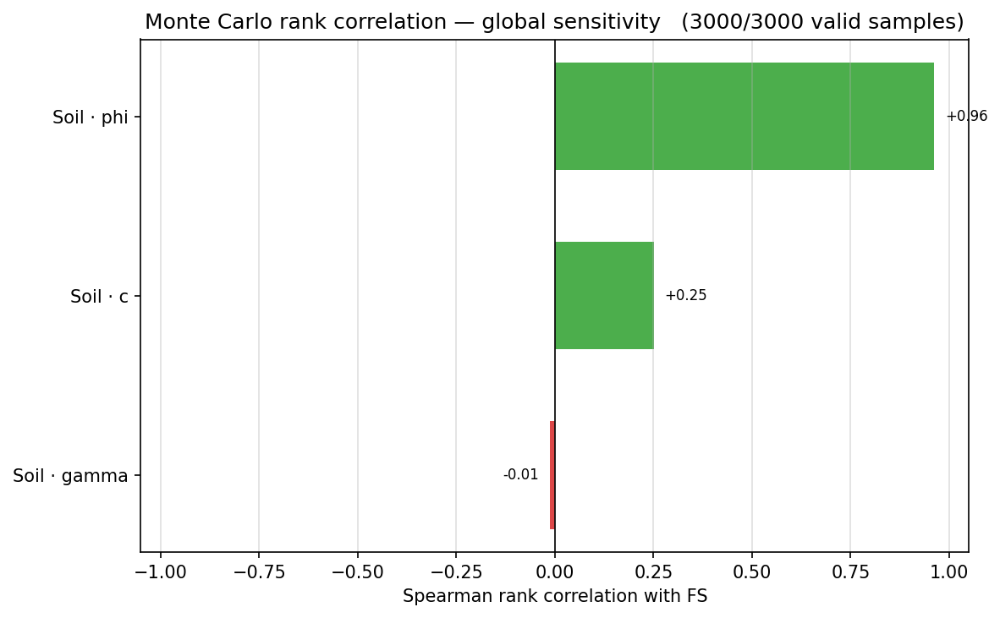
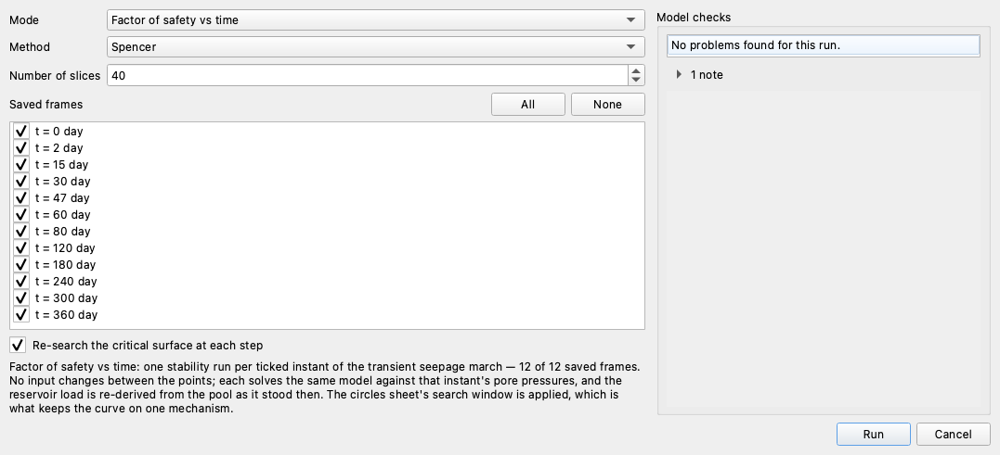
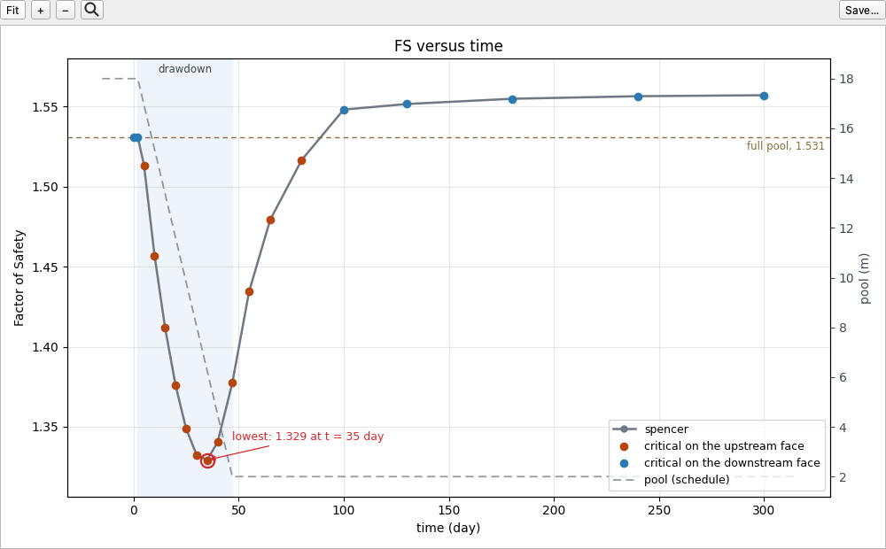

# Sensitivity

A sensitivity study varies one or more parameters about their current values and shows how
far the factor of safety moves with each, which shows which input controls the slope.
[What can be varied](index.md#what-can-be-varied) lists the parameters it can vary.

## In Studio

Click **Run → Parametric…** and leave **Mode** on **Sensitivity**:



1. Pick a **Material** and a **Property** and click **Add parameter**. Each parameter becomes
   a row of the table; add as many as you want to compare, and remove one with **×**.
2. Each row varies its parameter by **±%** about its current value. **Default ±%** is the
   range a new row starts with. The **σ** button replaces the row's range with ± one standard
   deviation, taken from the σ columns of the materials table, so a sweep can mirror a
   [reliability](../reliability/index.md) input band with one click. It is grayed for a property that has none.
3. **Points** sets how many values of each parameter are solved. The tornado reads the two
   end points; the spider plot and the per-parameter curve draw them all.
4. **Plot type** chooses the view. The [tornado](#tornado-diagrams) is the default; the
   others are described under [Sensitivity plots](#sensitivity-plots).
5. Click **Run**.

The dialog above is set up on the ACADS simple slope
([xslope_acads_simple.xlsx](../lem/files/xslope_acads_simple.xlsx), one c–φ soil):
c, φ, and γ, each ±25%, with Bishop's method and 30 slices. The result opens in a
**Sensitivity** tab:



Each bar spans the factor of safety at the two ends of its parameter's range, and the vertical
line is the base case, the model as it stands (FS = 0.985). The friction angle controls this
slope: its ±25% band alone swings FS from 0.77 to 1.21, across FS = 1, while the bars for c
and γ each span about 0.1.

**Double-click a bar** to see that parameter's whole curve in a **Sensitivity · Curve** tab:



The black square is the base case. A point where the search settled on a different family of
circles from its neighbors is drawn as an open circle; here every point found the same one.
The **Table** sub-tab of either view lists the numbers.

### The search window

With **Re-search the critical surface at each step** ticked, every point is searched inside
the limits the model's circles sheet declares: entry and exit ranges, a center box, a maximum
tangent depth, and a minimum slip depth, exactly as a single **Run** reads them. The window
matters because a sweep searches at every point. Left unconstrained on a slope with competing
minima (a benched face, an embankment on a soft foundation), one point can settle in a deep
foundation circle where its neighbor found a shallow one, and the step between them appears
as sensitivity to the parameter when it is really a change in what was measured. The curve's
open circles, and the circle columns of its **Table**, show such a jump; declaring a window
prevents it.

Unticking **Re-search** solves the surface you entered at every point instead, roughly fifty
times faster. That is the right setting when the question is "given this surface", as for a
prescribed-surface benchmark, and the wrong one otherwise: a fixed surface understates the
sensitivity.

### What is checked, and when

A sweep validates in two stages.

**Once, before the first point,** the base model goes through the full
[preflight input check](../usage/preflight.md) for whichever engine the sweep will run; in
Studio these are the dialog's **Model checks**. A model that cannot be analyzed at all is
rejected there, with the field named, rather than failing identically at every point.

**Then, per point,** the substituted value is re-checked against only the rules that read
the field being varied. A value that would produce a wrong answer, such as a unit weight at or
below zero, a negative cohesion, or a friction angle at or above 90°, makes that point a
failed row **carrying the reason**, and the sweep carries on. Points before and after it are
unaffected, so a sweep that breaks at the seventh of nine values still reports the first six;
finding where things break is often the point.

Finally, each point's result is screened before it is recorded: a factor of safety of 9999
is the search's no-admissible-surface flag rather than an answer, and a negative one is not
a result either. Both become failed rows with a stated reason instead of numbers that would
dominate every plot built from the sweep.

## Sensitivity plots

A sweep across several parameters feeds a family of views, each an item of the dialog's
**Plot type** list. Which one to read depends on the question: *which parameter matters most*
(tornado, scaled bars), *how the answer moves across the range* (spider), or *where the
uncertainty comes from* (variance Pareto, Monte Carlo rank). The same plots are functions in
`xslope.plot` (see [Plotting the results](#plotting-the-results)).

### Tornado diagrams

The tornado evaluates each parameter at its low and high bound and draws the Duncan-style
summary shown [above](#in-studio): horizontal bars of the FS swing, sorted so the parameter
that matters most sits on top, with the base-case FS as a labeled vertical line. It is the
default view because it ranks the parameters at a glance.

### Scaled-sensitivity bars

The scaled bars estimate the local derivative $\partial F/\partial p$ for each parameter with
a **central difference at ±1%** about the base case, then report it under one of three
scalings, the dialog's **Scaling** choice, so parameters with different units compare on one
axis. Each parameter gets a vertical bar whose height is the magnitude and whose color is the
sign (green: FS *rises* with the parameter; red: FS *falls*):

- **Elasticity** (the default): the dimensionless
  $\dfrac{\partial F}{\partial p}\cdot\dfrac{p}{F}$, the percent change in FS per percent
  change in the parameter.
- **Per 1% change**: the change in FS for a 1% change in the parameter.
- **Per σ**: the change in FS for a one-σ change, offered only when the model carries
  standard deviations.

{width=800}

For the ACADS sample the friction angle dominates on the elasticity scaling: a percent
change in φ moves FS several times more than a percent change in c or γ. The scaled bars
ignore the table's ±% ranges and **Points**, because each derivative is taken at ±1%.

### Spider plot

The spider plot overlays every parameter's FS-versus-value curve on one **normalized** x-axis
(percent change from the base value), with a black base-case marker at the origin and an
FS = 1 guide. The steepness of each line shows its sensitivity, and a curving line reveals
nonlinearity a single tornado bar would hide. Each curve has the **Points** count of solves.

{width=800}

### Variance-contribution Pareto

When the model carries standard deviations, the variance Pareto (**Variance Pareto (σ)**)
finds which uncertainties contribute most to the scatter in FS. It reuses the Taylor-series
[reliability](../reliability/taylor.md) analysis: each parameter's variance term is
$\left(\dfrac{\partial F}{\partial p}\,\sigma_p\right)^2$, exactly the $(\Delta F/2)^2$ the
Taylor series computes, normalized to a percent of $\mathrm{Var}(F)$ and drawn in descending
order with a cumulative line. It uses every parameter that carries a standard deviation, not
the rows of the table.

{width=800}

Note how this reorders the parameters relative to the elasticity bars: c and φ contribute
almost equally to $\mathrm{Var}(F)$ even though φ has the larger elasticity, because c's
standard deviation is a much larger fraction of its mean. A scaled bar shows how strong the
response is; the Pareto shows how much each parameter's uncertainty contributes; the per-σ
scaling connects the two. [LEM-11](../tutorials/lem11_reliability.md) runs this plot in
Studio as part of a reliability study.

### Monte Carlo rank correlation

The rank-correlation plot (**Monte Carlo rank correlation (σ)**) runs a Monte Carlo
[reliability](../reliability/monte_carlo.md) campaign of **MC samples** realizations and
computes the **Spearman rank correlation** between each sampled input and the resulting FS,
drawn signed and sorted. Like the Pareto, it uses every parameter that carries a standard
deviation.

{width=800}

This is a **global** sensitivity measure: unlike the scaled bars, a derivative *at the base
case*, it ranks parameters over the whole sampled distribution, so it captures a
parameter's spread and any nonlinearity in its effect. The local and global measures can
disagree, and the disagreement is itself informative; read the two together.

The variance Pareto and the rank correlation are offered only in LEM mode, and only when the
model carries standard deviations.

## Factor of safety versus time

A [transient seepage](../seep/transient.md) run produces a *sequence* of pore-pressure
fields, one per saved instant. This study runs the stability analysis against each of them in
turn. It answers the question a drawdown or infiltration study is run for: when the slope is
at its weakest, as well as how weak it is. No input changes between the points, so there is
no parameter to pick and no base case; the axis is time.

In Studio, run the transient seepage analysis first, then click **Run → Parametric…** and set
**Mode** to **Factor of safety vs time**. The mode needs a transient solution and at least
one material whose pore pressures come from it (`u = seep`); without either it is grayed,
with the reason in its tooltip. The parameter picker is replaced by a **Saved frames**
checklist of every instant the run stored, all ticked:



- Untick frames to thin a long run; each one is a full stability analysis. **All** and
  **None** set the whole list.
- **Method**, **Number of slices**, and **Re-search** work as in the other studies, and the
  search window keeps the curve on one mechanism rather than letting it jump between
  families from one instant to the next.
- **Grid search (auto-seed the circular search)** searches every instant from a sweep of
  centers and tangent elevations derived from the geometry rather than from the circles
  sheet alone. A curve needs it when the critical mechanism moves between parts of the
  section, as on a dam whose downstream face governs at full pool and whose upstream face
  governs during a drawdown.
- **Rapid drawdown at each time** turns every instant into a three-stage rapid drawdown
  (see [Each instant as a rapid drawdown](#each-instant-as-a-rapid-drawdown)).

The result opens in an **FS vs Time** tab:



The curve marks each evaluated instant and rings the lowest, annotated with its time. The
model's drawdown schedule is drawn faintly behind it on a second axis. Where the schedule
falls, the interval is shaded and labeled *drawdown*, and the factor of safety before the
fall began is carried across as a dashed **full pool** reference. Where the instants come out
on more than one face of the embankment, each marker is colored by the face its critical
circle sits on. The **Table** sub-tab, and the [Log pane](../studio/interface.md#the-log-pane),
list every instant with its factor of safety and critical circle; an instant that produced no
result carries its reason there rather than leaving a gap in the line.
[Combined 3](../tutorials/combo03_fs_vs_time.md) walks through a complete run.

The same study runs in FEM mode, with a full SSRM analysis at each instant. It is not offered
in Seepage mode, because the seepage solution is this study's input rather than its output.

### Each instant as a rapid drawdown

**Rapid drawdown at each time** turns every instant into a full three-stage
[Duncan, Wright and Brandon drawdown](../lem/rapid.md) rather than a single-stage
analysis. Stage 1 is the transient run's **initial** state: the `tseep` sheet's `stage_1`
(normally t = 0 at full pool), or the earliest saved frame where the sheet names none.
Stage 2 is the frame at *t*, and stage 3 re-checks the drawn-down section against drained
strengths where they are the lower. The reported value is the drawdown's own, the lower of
stages 2 and 3, so each point is the factor of safety of the slope if the pool falls to its
level at that instant, computed with the transient run's pore pressures rather than a single
assumed drawn-down state. The tab is then named **Drawdown vs Time**; it draws the reported
curve, and its table carries the three stage values and which stage governed.

- Every point is searched from the model's starting circle, so **Re-search** is held on: a
  drawdown's critical surface is not the drained one, and it moves with the drawn-down field.
- The stage values on a row are read **on that row's critical surface**, which is the
  drawdown's, so the stage 1 value varies slightly along the curve. It is the full-pool factor
  of safety of the surface the drawdown settled on, not of the surface a full-pool search
  would have found.
- The instant stage 1 is read at cannot be a drawdown (a fall from the pool to itself) and
  comes back as a failed row with that reason.

The option needs materials that carry the drawdown strengths d and ψ; without them it is
grayed, because all three stages would use the same strengths. It is LEM only: the
three-stage procedure is a limit-equilibrium construction with no SSRM equivalent.

!!! note "Two different analyses"
    The default curve and the drawdown curve are different analyses of the same
    physical problem. The default is a sequence of single-stage analyses, one per instant,
    each using the pore pressures computed for that moment: the factor of safety of the
    slope in its state at time t. The drawdown curve is a sequence of three-stage
    [rapid drawdowns](../lem/rapid.md), each using two instants through undrained
    strength envelopes: the factor of safety of the slope if the pool falls from full to
    its level at time t. Neither substitutes for the other, and on a model that carries d
    and ψ the drawdown curve is the lower of the two everywhere the undrained envelope governs.

A worked comparison against a vendor-published curve, both drawdown rates of the
GeoStudio rapid-drawdown example at 11 instants each, is on the
[GeoStudio verification page](../verification/geostudio.md#seepw-t03).

## Worked sample

The sweep below reproduces the base case of the ACADS simple slope sample
([xslope_acads_simple.xlsx](../lem/files/xslope_acads_simple.xlsx), the same file used
throughout these pages) and brackets it over ±50% of the cohesion, re-searching the
critical surface at every point. In Studio it is a one-row table, `mat:Soil:c` at ±50% with
3 **Points**, and Bishop's method with 30 slices. The test suite checks the end points: at
c = 1.5 the critical circle has retreated toward the face (the circle columns show the radius
growing as cohesion falls), and at c = 4.5 the slope crosses FS = 1.

<!-- test: file=../lem/files/xslope_acads_simple.xlsx, type=sensitivity, param=mat:Soil:c, method=bishop, num_slices=30, n=3, rel_range=0.5, expected_base=0.985, expected_low=0.882, expected_high=1.073, tolerance=0.01, benchmark=SENS-acads-c -->

| c (kPa) | Bishop FS |
|---|---|
| 1.5 (−50%) | 0.882 |
| 3.0 (base) | 0.985 |
| 4.5 (+50%) | 1.073 |

For a published benchmark of the sweep itself, see
[verification problem VP40](../verification/rocscience.md#vp40), [Perry (1993)](https://doi.org/10.1144/GSL.QJEGH.1994.027.P3.04)'s
power-curve sensitivity study, where the swept ΔFS matches Slide's published curves
within about a percent at every range endpoint.

## From Python

The functions on this page are in `xslope.sensitivity` and `xslope.plot`. See
[Addressing a parameter](index.md#addressing-a-parameter) and
[Discovering and specifying parameters](index.md#discovering-and-specifying-parameters) for the
parameter grammar they share with [Design](design.md) and [Back-Analysis](back_analysis.md).

### Running a sweep

```python
from xslope import load_slope_data
from xslope.sensitivity import sensitivity
from xslope.plot import plot_sensitivity

slope_data = load_slope_data("docs/lem/files/xslope_acads_simple.xlsx")

success, result = sensitivity(
    slope_data,
    param="mat:Soil:c",
    rel_range=0.5, n=9,          # ±50% about the base value, 9 points
    # values=[...],              # ...or give the values explicitly
    methods=("bishop", "spencer"),
    search=True,                 # re-search the critical surface per point
)
plot_sensitivity(result['df'], target_fs=1.2)
```

`search=True` is the default; `search=False` re-solves the stored surface (`circles[0]` or
the non-circular polyline) instead, as unticking **Re-search** does in Studio.

A searched sweep reads the circles sheet's [search window](#the-search-window) as Studio
does. Pass `search_opts={...}` to set or override any limit per call (a circular-search
keyword takes precedence over the file), or `use_file_window=False` to search unconstrained
regardless of what the file declares. The same two settings are available on `design`,
`back_analysis`, `tornado`, `scaled_sensitivity`, `fs_vs_time`, `reliability` and
`reliability_mc`, and they mean the same thing on each.

The result is a tidy long-format DataFrame, one row per (value × method), with the
unmodified model included as a flagged `is_base` row:

| column | meaning |
|---|---|
| `param` | canonical reference, e.g. `"mat:Soil:c"` |
| `value`, `rel` | the swept value and `value / base_value` |
| `is_base` | this row is the unmodified model |
| `method`, `fs` | solver name and factor of safety |
| `success`, `msg` | per-point outcome: a failed point is a row, not an exception, carrying its reason in `msg` |
| `Xo`, `Yo`, `R` | the critical circle per point (searched sweeps), so a jump of the critical surface is visible in the data |

`plot_sensitivity` draws one line per method with FS = 1 (and an optional `target_fs`) as
guide lines, marks the unmodified model as a labeled **base case** entry in the legend, and
draws any point where the critical surface jumped as an open circle.

`mode=` selects the engine that evaluates each swept point (see
[Analysis modes: LEM, FEM, seepage](index.md#analysis-modes-lem-fem-seepage)). `mode='lem'`
(the default) runs the limit-equilibrium methods and reports a factor of safety. `mode='fem'`
runs a full SSRM solve at every point and needs a mesh in `slope_data['mesh']`. `mode='seep'`
rebuilds and solves the seepage problem at every point and reports the **total discharge q**
through the section, and likewise needs a mesh. The result's value column stays `fs` for a
consistent schema; `result['output']` (`'FS'` or `'q'`) and `result['output_label']` state
what it is, so a discharge sweep is never mislabeled a factor of safety.

Pass `check_inputs=False` to skip both [validation stages](#what-is-checked-and-when). The
result screen still runs, because a sentinel value recorded as a success would be an error
in the record.

### Plotting the results

`tornado()` evaluates each parameter at its low and high bound (two solves per parameter plus
one shared base case), and `plot_tornado` draws the diagram:

```python
from xslope.sensitivity import tornado
from xslope.plot import plot_tornado

success, result = tornado(
    slope_data,
    ["mat:Soil:c", "mat:Soil:phi", "mat:Soil:gamma"],
    rel_range=0.25,              # ±25% per parameter...
    # bounds={"mat:Soil:c": (2.0, 5.0)},   # ...or explicit bounds per ref
    method="bishop",
)
plot_tornado(result)
```

`plot_tornado` stacks the bars widest on top by default; `widest_on_top=False` inverts the
stack. Studio has no control for it.

When you have already run *full* per-parameter sweeps, `tornado_from_sweeps()` assembles the
same diagram from those DataFrames with no extra solves, since `plot_tornado` reads each
parameter's lowest- and highest-value FS. This is how Studio draws its tornado and keeps the
curves for the double-click:

```python
from xslope.sensitivity import sensitivity, tornado_from_sweeps

sweeps = {ref: sensitivity(slope_data, param=ref, rel_range=0.25, n=5,
                           methods=("bishop",))[1]['df']
          for ref in ("mat:Soil:c", "mat:Soil:phi", "mat:Soil:gamma")}
result = tornado_from_sweeps(sweeps, method="bishop")   # {'df', 'base_fs', 'method'}
plot_tornado(result)
```

The other four views follow the same pattern; `scaling=` takes `"elasticity"`,
`"per_1pct"`, or `"per_sigma"`, and the estimator is documented in the `scaled_sensitivity`
docstring:

```python
from xslope.sensitivity import (scaled_sensitivity, variance_contribution,
                                mc_rank_correlation)
from xslope.plot import (plot_scaled_sensitivity, plot_spider,
                         plot_variance_pareto, plot_mc_rank_correlation)

refs = ["mat:Soil:c", "mat:Soil:phi", "mat:Soil:gamma"]

ok, result = scaled_sensitivity(slope_data, refs, method="bishop")
plot_scaled_sensitivity(result, scaling="elasticity")

plot_spider(sweeps)                     # the per-parameter sweeps from above

ok, result = variance_contribution(slope_data, method="bishop")
plot_variance_pareto(result)

ok, result = mc_rank_correlation(slope_data, method="bishop", n_samples=10000)
plot_mc_rank_correlation(result)
```

### Factor of safety versus time: `fs_vs_time`

```python
from xslope.sensitivity import fs_vs_time
from xslope.plot import plot_fs_vs_time

success, result = fs_vs_time(
    slope_data, transient_solution,   # from run_transient_seepage / import_transient_solution
    methods=("spencer",),
    # times=[0, 21600, 86400],        # ...or a chosen set instead of every saved frame
    # rapid=True,                     # each instant as a three-stage rapid drawdown
)
if success:
    print(f"lowest FS = {result['min_fs']:.3f} at t = {result['critical_time']:g}")
    plot_fs_vs_time(result, slope_data=slope_data)
```

It returns the same tidy DataFrame as a value sweep, with `time` in its `param` column, so
`plot_sensitivity` also draws it. Alongside `df` the result carries `critical_time` and
`min_fs` (the instant of the lowest factor of safety and its value), `critical` (the same
pair per method when several ran), `times`, `n_failed`, and `solution`.

When the sweep is done it prints its own table, one aligned row per evaluated instant. The
same rows come back as `result['table']` (a list of dicts) and the printed block as
`result['table_text']`, so a report or a notebook reads what the console showed rather than
rebuilding it; `print_table=False` keeps the rows and prints nothing. With `rapid=True` the
rows also carry `stage1_FS`, `stage2_FS`, `stage3_FS`, `stage3_run`, and `governs`.

Instants are never interpolated. A time that names no saved frame is obtained by
rerunning the transient seepage analysis with that instant added to the saved schedule;
pass `seep_data=` to allow it, and the whole set of missing times is served by *one* rerun
before the first solve. Without `seep_data` such a time becomes a `success=False` row with
that reason. A field blended between two frames is not a solution of anything, so the study
does not create one.

`search_opts={'seed': 'grid'}` is Studio's **Grid search** box. `mode='fem'` runs a full SSRM
solve per instant (needs a mesh in `slope_data['mesh']`) and rejects `rapid=True`;
`mode='seep'` is rejected.

### Sweeping other quantities: `modify=` {#sweeping-anything-else-modify}

For changes that are not a single stored scalar, geometry above all, pass a callable
instead of a parameter reference. Studio's picker offers stored values only, so this is the
way to vary a slope angle, a berm width, or the shape of a water table. The callable receives
a copy of the model and the swept value, and is responsible for keeping the model consistent
after its edit (rebuilding the material polygons and ground surface after moving profile
points, keeping reinforcement anchored to a moved face):

```python
import math
from shapely.geometry import Polygon
from xslope.fileio import build_ground_surface_from_polygons
from xslope.mesh import build_polygons

def set_slope_angle(sd, beta_deg):
    """Rotate the slope face about the toe to beta_deg, then rebuild the
    polygon geometry (slice weights come from the polygons, not the raw
    profile lines)."""
    prof = sd['profile_lines'][0]['coords']
    x_toe, y_toe = prof[1]
    _, y_top = prof[2]
    prof[2] = (x_toe + (y_top - y_toe) / math.tan(math.radians(beta_deg)), y_top)
    polys = [{'polygon': Polygon(p['coords']), 'mat_id': p['mat_id']}
             for p in build_polygons(slope_data={'profile_lines': sd['profile_lines'],
                                                 'max_depth': sd.get('max_depth')})]
    sd['polygons'] = polys
    sd['ground_surface'], sd['domain_polygon'] = build_ground_surface_from_polygons(polys)
    return sd

success, result = sensitivity(slope_data, modify=set_slope_angle,
                              label="slope angle (deg)",
                              values=[20, 22.5, 25, 27.5, 30],
                              methods=("bishop",))
```

Built-in references and `modify=` callables are one code path: every `param` reference
resolves internally to exactly the setter signature `modify=` accepts. Because a setter may be
user-written, the modified model is also checked at every point against the geometry (polygon
validity, ground surface present).

A water table that only needs to move up or down needs no setter: the `geom:piezo:dy`
reference shifts the piezometric line vertically by the swept delta.
