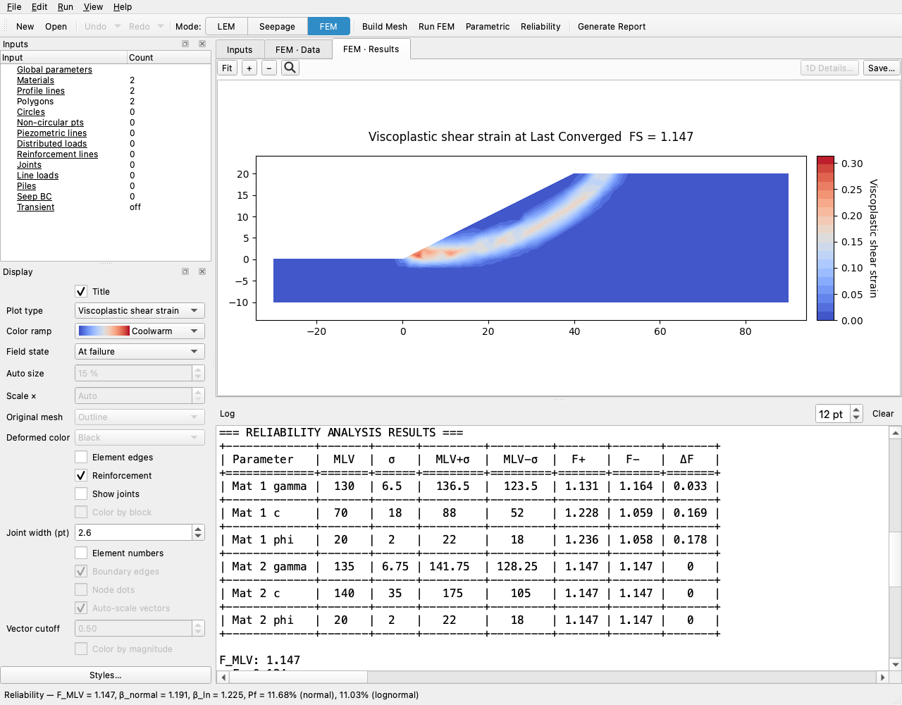
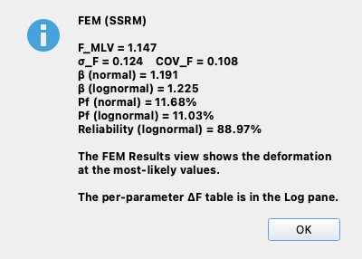

# Reliability Analysis (FEM)

In finite element mode, XSLOPE's reliability analysis is the [Taylor series](taylor.md) with each
factor of safety computed by the shear strength reduction method (SSRM) instead of a limit equilibrium
search. It reads the same standard deviations, combines the factors of safety with the same equations,
and reports the same results: $F_{MLV}$, $\sigma_F$, $COV_F$, and the reliability index and probability
of failure by both the normal and the lognormal shape. The theory is on the
[Reliability Analysis](index.md) and [Taylor Series](taylor.md) pages; this page covers what is
specific to the finite element version.

## The Method

The analysis runs $1 + 2N$ strength reduction solves for $N$ uncertain inputs: one at the most likely
values, for $F_{MLV}$, and a pair at $MLV \pm \sigma$ for each input, for $F^+$ and $F^-$. All of them
run on **one mesh**; only the material properties of the elements change from one solve to the next.

Monte Carlo and the response surface are not offered in finite element mode: thousands of strength
reduction solves are impractical, so finite element reliability stays on the Taylor series. Its two
points per input make it a point-estimate method, the family the finite element programs use
([Reliability in Other Programs](index.md#reliability-in-other-programs)).

The strength reduction bracket, $F_{min}$ to $F_{max}$, is used only for the solve at the most likely
values. Every other solve brackets itself in a window around $F_{MLV}$, which widens on its own if a
solve lands outside it, so the bracket does not have to be sized for the varied cases.

## Example: An Embankment on a Foundation Layer {#example}

This is the reliability example of the [FEM samples page](../fem/samples.md): an embankment of
c = 70 ± 18 psf, φ = 20° ± 2°, γ = 130 ± 6.5 pcf, on a foundation layer of c = 140 ± 35 psf,
φ = 20° ± 2°, γ = 135 ± 6.75 pcf. The model is
[xslope_simple_mult_layers_fem.xlsx](../fem/files/xslope_simple_mult_layers_fem.xlsx), and it ships
with its mesh, 985 six-node triangles, which Studio attaches when it opens the workbook.

In Studio, switch to **FEM** mode, click **Reliability…** on the **Run** menu, leave the **Method** on
`Taylor series (TSPM)`, and set **F min (SSRM)** to 0.7 and **F max (SSRM)** to 1.6, with the
tolerance at its default, 0.001. Six of the inputs have standard deviations, so the run makes 13
strength reduction solves. The results come in three places.

**1. The FEM · Results view** shows the solution at the most likely values: here the shear strain of
the failure mechanism, with $F_{MLV}$ in the title. Below it, the Log pane holds the table of the
analyses.

{width=800}

**2. The results box** Studio shows at the end of the run gives $F_{MLV}$, $\sigma_F$, $COV_F$, and the
reliability index and probability of failure by both shapes. The status bar repeats β and $P_f$.

{width=400}

| $F_{MLV}$ | $\sigma_F$ | $COV_F$ | $\beta_N$ | $P_f$ (normal) | $\beta_{LN}$ | $P_f$ (lognormal) | Reliability |
|:---:|:---:|:---:|:---:|:---:|:---:|:---:|:---:|
| 1.147 | 0.124 | 0.108 | 1.191 | 11.7% | 1.225 | 11.0% | 89.0% |

**3. The Log pane** lists each varied input with its $F^+$, $F^-$, and swing ΔF:

| Input | MLV | σ | $F^+$ | $F^-$ | ΔF |
|---|:---:|:---:|:---:|:---:|:---:|
| Embankment γ | 130 | 6.5 | 1.131 | 1.164 | 0.033 |
| Embankment c | 70 | 18 | 1.228 | 1.059 | 0.169 |
| Embankment φ | 20 | 2 | 1.236 | 1.058 | 0.178 |
| Foundation γ | 135 | 6.75 | 1.147 | 1.147 | 0.000 |
| Foundation c | 140 | 35 | 1.147 | 1.147 | 0.000 |
| Foundation φ | 20 | 2 | 1.147 | 1.147 | 0.000 |

The embankment's cohesion and friction angle carry nearly all the uncertainty. The foundation's inputs
do not move the factor of safety at all, because the failure mechanism stays in the embankment.

<!-- test: file=../fem/files/xslope_simple_mult_layers_fem.xlsx, type=fem_reliability, mesh=file, element_type=tri6, expected_elements=985, expected_nodes=2080, f_min=0.7, f_max=1.6, ssrm_tol=0.001, expected_beta=1.225, tolerance=0.01, expected_fmlv=1.147, expected_sigma=0.124, expected_cov=0.108, expected_r=0.890, expected_pf=0.110, expected_beta_n=1.191, expected_pf_n=0.117, params=1.gamma;1.c;1.phi;2.gamma;2.c;2.phi, f_plus=1.131;1.228;1.236;1.147;1.147;1.147, f_minus=1.164;1.059;1.058;1.147;1.147;1.147, delta_f=0.033;0.169;0.178;0.000;0.000;0.000, tier=gate, benchmark=REL-FEM-reliability-page -->

## Which Parameters Are Varied

The finite element analysis varies the same values as the limit equilibrium one: the strengths and
unit weights that have a standard deviation
([Standard Deviations in XSLOPE](index.md#standard-deviations-in-xslope)). Using the same standard
deviations keeps the two analyses directly comparable. As in limit equilibrium, a standard deviation
may not exceed its value: $MLV - \sigma$ would be negative, and the analysis stops with an error.

The elastic modulus $E$ and Poisson's ratio $\nu$ are not varied, and the materials table has no
standard deviation columns for them. They set the displacements, while the factor of safety of a
strength reduction analysis is set by the strengths: changing $E$ leaves it unchanged, and $\nu$ over
its plausible range moves it only slightly.

## Numerical Precision and Reproducibility

A strength reduction factor of safety comes from a bisection, so it is known only to within the
bisection tolerance, and where the bisection lands depends on the starting bracket. The reliability
index magnifies that imprecision:

$$\frac{d\beta_{LN}}{dF} = \frac{1}{F\sqrt{\ln(1 + COV_F^2)}}$$

which is about 9 at $COV_F = 0.1$. A small change in $F_{MLV}$ from one bracket to another would move
the last digit of β.

To remove that, `reliability_fem` runs every strength reduction on a **fixed global grid** with a step
equal to the tolerance (0.001 by default, tighter than a single SSRM run's). Instead of halving the
bracket, each solve finds the one grid cell that straddles failure. That cell is a property of the
slope and the mesh, not of the bracket, so every bracket gives the same result to every decimal, at the
same cost and precision as an ordinary bisection.

The result still depends on the **mesh**: a finer mesh or another element type gives a slightly
different factor of safety, as in any finite element analysis. Use a converged mesh, and report the
element type and size with the result.

## Running From Python

```python
from xslope.fileio import load_slope_data
from xslope.reliability import reliability_fem

slope_data = load_slope_data("xslope_simple_mult_layers_fem.xlsx")   # attaches its mesh file
success, result = reliability_fem(slope_data, F_min=0.7, F_max=1.6)
if success:
    print(result["F_MLV"], result["beta_ln"], result["prob_failure"],
          result["beta_normal"], result["pf_normal"])
```

`reliability_fem(slope_data, mesh=None, F_min=0.5, F_max=2.0, tolerance=0.001, ...)` runs on the `mesh`
given, else on the mesh attached to `slope_data`, else on a
mesh it builds from the geometry with `element_type` and `target_size`. It prints the table of the
analyses and the summary. The result has the same keys as the limit equilibrium Taylor series
(`F_MLV`, `sigma_F`, `COV_F`, `beta_ln`, `reliability`, `prob_failure`, `beta_normal`, `pf_normal`,
`param_info`) plus `mlv_solution`, the strength reduction result at the most likely values, and `mesh`,
the mesh every solve used. Only the solve at the most likely values keeps its displacement field for
the results plots; the others report only their factor of safety.
