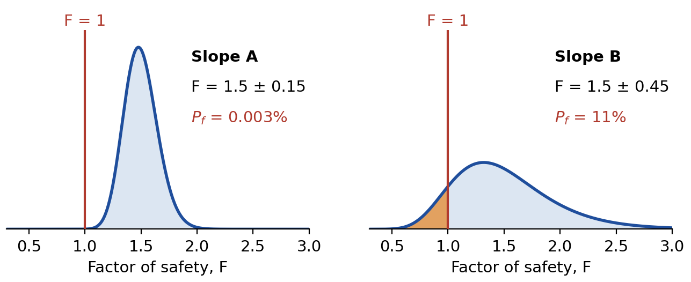
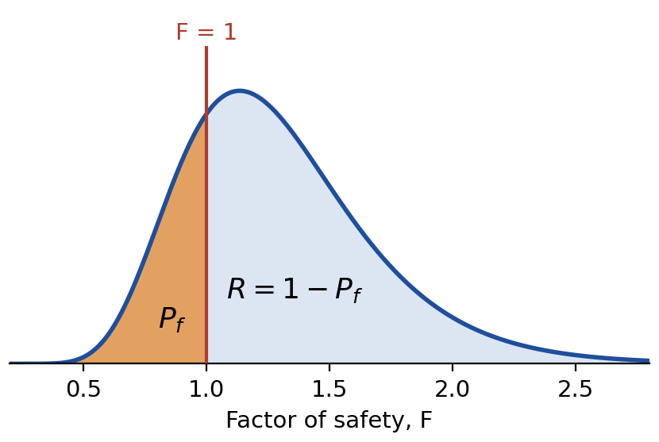
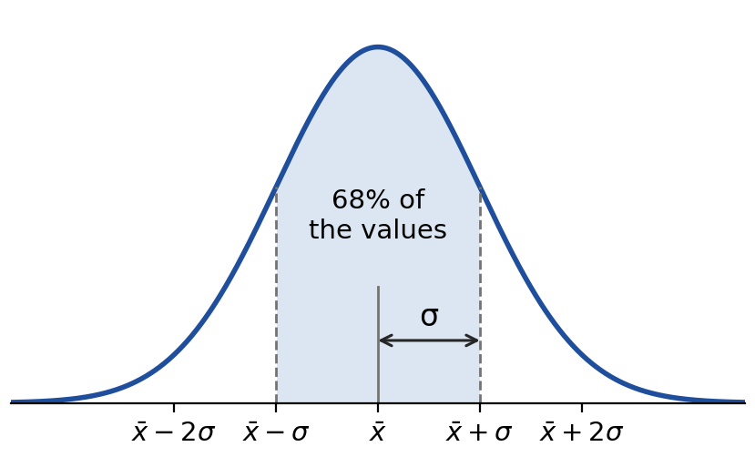
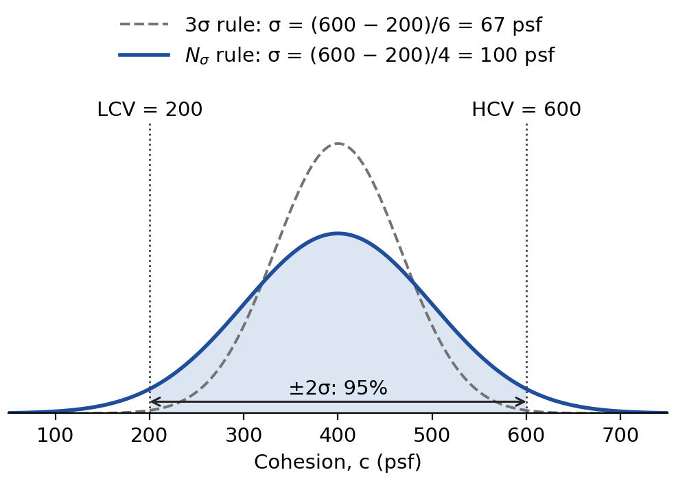
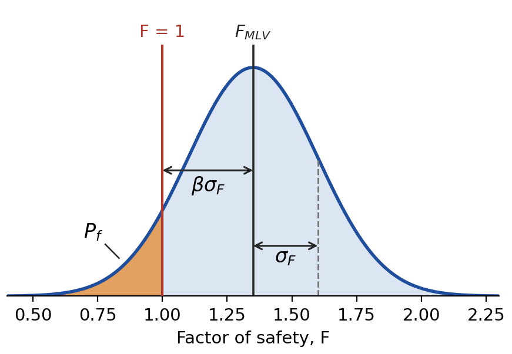
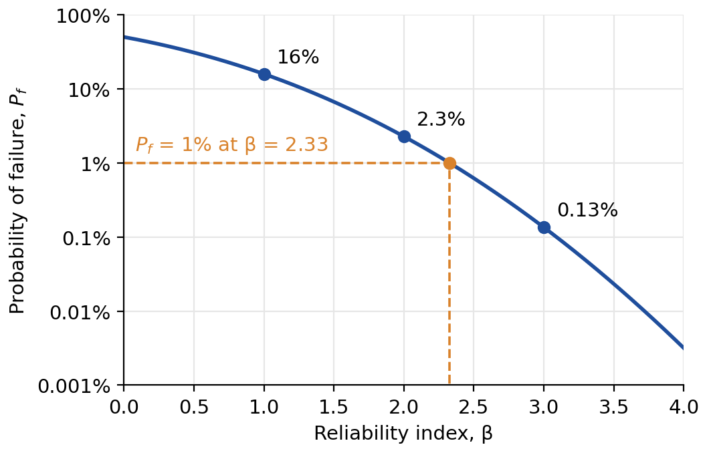
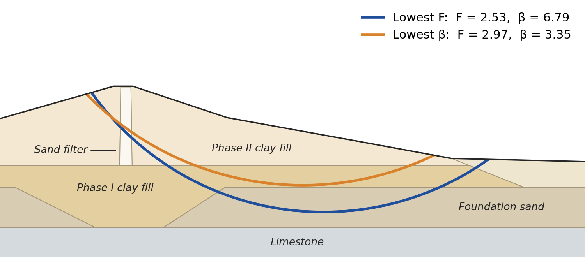

# Reliability Analysis

XSLOPE computes the **probability of failure**, $P_f$, and the **reliability index**, $\beta$, of a
slope from the uncertainty in its material properties. You enter a standard deviation beside each
uncertain value. XSLOPE varies those values, finds how much the factor of safety varies with them, and
reports $\beta$ and $P_f$.

Three methods do this with limit equilibrium: the [Taylor series](taylor.md),
[Monte Carlo simulation](monte_carlo.md), and a
[response surface](monte_carlo.md#sampling-a-fitted-response-surface). The Taylor series also runs on
the finite element method's strength reduction ([Reliability Analysis (FEM)](fem.md)). This page
covers what the methods share: what the numbers mean, where the standard deviations come from, what
probability is acceptable, and which slip surface to analyze.

## Why the Factor of Safety Is Not Enough

Every input to a stability analysis is uncertain, the shear strength most of all. A factor of safety
computed from the most likely value of each input, $F_{MLV}$, says how stable the slope is if those
values are right. It does not say how well they are known.

{width=700}

The two slopes in the figure both have $F_{MLV} = 1.5$. The curves show how likely each value of the
factor of safety is, and the orange area below $F = 1$ is the probability of failure. Slope A's inputs
are well known: its factor of safety is $1.5 \pm 0.15$ (one standard deviation), and its probability
of failure is about 3 in 100,000. Slope B's inputs are poorly known: $1.5 \pm 0.45$, and its
probability of failure is 11%, about one in nine. The factor of safety is the same, and the odds of
failure differ by a factor of about 3,600. (Both curves are lognormal, one of the two shapes described
under [Reliability Equation](#reliability-equation).)

## Reliability and Probability of Failure

The **reliability**, $R$, of a slope is the probability that it remains stable under stated design
conditions: the end of construction, long-term steady seepage, rapid drawdown, or an earthquake of a
given size (after Harr 1987 and Duncan, Wright, and Brandon 2014). The probability of failure is the
rest:

$$R = 1 - P_f$$

{width=460}

The factor of safety and the probability of failure complement each other, and knowing both is more
useful than knowing either one. One chance in ten against one chance in a hundred is often a clearer
basis for a decision than a factor of safety of 1.3 against 1.5. A probability of failure is never
zero.

## Parameter Uncertainty

### Standard Deviation and Coefficient of Variation

When a soil property is measured several times, the results scatter. The **standard deviation**, σ,
measures the scatter. It has the units of the property:

$$\sigma = \sqrt{\frac{1}{n-1} \sum_{i=1}^{n} (x_i - \bar{x})^2}$$

where $x_i$ are the $n$ measured values and $\bar{x}$ is their average. For a normally distributed
property, about 68% of the values fall within one standard deviation of the average:

{width=460}

The **coefficient of variation**, COV, is the standard deviation as a fraction of the average:

$$COV = \frac{\sigma}{\bar{x}}$$

It has no units, so it compares the scatter of different properties. If every value doubled, σ would
double and the COV would not change.

The inputs that need a standard deviation are the shear strengths and the unit weights. The shear
strength is usually the largest uncertainty.

### Published Values

Often there are too few tests to compute a standard deviation: a property comes from a correlation, or
from a few tests and judgment. Published coefficients of variation give a first estimate. These are
the ranges compiled by Duncan, Wright, and Brandon (2014) for the properties XSLOPE varies:

| Property | Typical COV | Sources |
|---|---|---|
| Unit weight ($\gamma$) | 3–7% | Harr (1987), Kulhawy (1992) |
| Buoyant unit weight ($\gamma_b$) | 0–10% | Lacasse and Nadim (1997), Duncan (2000) |
| Effective stress friction angle ($\phi'$) | 2–13% | Harr (1987), Kulhawy (1992), Duncan (2000) |
| Undrained shear strength ($S_u$) | 13–40% | Kulhawy (1992), Harr (1987), Lacasse and Nadim (1997) |
| Undrained strength ratio ($S_u/\sigma'_v$) | 5–15% | Lacasse and Nadim (1997), Duncan (2000) |

The ranges are wide. No range is given for an effective stress cohesion $c'$. The two rules below
make a better estimate from what you know about your own site.

### The 3σ and Nσ Rules

Estimate the **highest conceivable value** (HCV) and the **lowest conceivable value** (LCV) of the
property. In a normal distribution, 99.73% of the values lie within three standard deviations of the
average, so the HCV and LCV are about $\pm 3\sigma$ from it. That is the **3σ rule**:

$$\sigma = \frac{HCV - LCV}{6}$$

People, experienced engineers included, tend to guess ranges that are too narrow, and a range that is
too narrow gives a standard deviation that is too small. The **Nσ rule** (Foye, Salgado, and Scott
2006) corrects for it by dividing by a smaller number:

$$\sigma = \frac{HCV - LCV}{N_\sigma}, \qquad N_\sigma = 4$$

The reason for 4: our highest and lowest conceivable values come from experience of perhaps 20 or 30
cases, and in a sample of 20 to 30 values from a normal distribution, the highest and lowest sit about
four standard deviations apart (3.7σ for 20 values, 4.1σ for 30). So the HCV and LCV are taken at
$\pm 2\sigma$, and about one value in twenty falls outside them.

[Tutorial LEM-11](../tutorials/lem11_reliability.md)'s clay has a most likely cohesion of 400 psf.
Suppose its highest conceivable value is 600 psf and its lowest 200 psf. The 3σ rule gives
σ = 67 psf; the Nσ rule gives σ = 100 psf, a COV of 25%, which is the value the tutorial uses.

{width=540}

The same steps apply to a property that varies with depth: draw the most likely line through the data,
then the highest and lowest conceivable lines, and put the average $\pm \sigma$ lines halfway between
(for $N_\sigma = 4$). Analyzing the slope with each $\pm \sigma$ line gives the two factors of safety
the [Taylor series](taylor.md) needs for that strength.

### Standard Deviations in XSLOPE {#standard-deviations-in-xslope}

The values a material is given are its most likely values. The standard deviations go beside them, in
the **Standard Deviations** block at the right of the mat sheet: σ(γ), σ(c), σ(φ), σ(c/p), σ(d), and
σ(ψ). In Studio, open **Materials** and tick **Reliability** under **Show parameters for:**; a
**± σ** box appears beside each value that can have one. A blank or zero standard deviation means the
value is known exactly and is not varied.

Which values are varied depends on the material's strength model:

| Strength model | Values varied |
|---|---|
| Mohr-Coulomb (`mc`) | $c$, $\phi$, and $\gamma$; in a [rapid drawdown](../lem/rapid.md) analysis also the $K_c = 1$ envelope, $d$ and $\psi$ |
| Depth-varying undrained (`cp`) | $c$, the rate $c_p$ (the c/p column), and $\gamma$ |
| Strength ratio (`ratio`) | the minimum $c$, the ratio (the c/p column), and $\gamma$ |

σ(d) and σ(ψ) are read only in a rapid drawdown analysis. All three methods, and the finite element
Taylor series, read the same columns, so changing the method never changes the data you enter.

## From the Inputs to the Factor of Safety

Uncertain inputs make the factor of safety uncertain: every combination of strengths and unit weights
gives its own factor of safety, and together they make a distribution of $F$. Two numbers describe it
well enough for most purposes: $F_{MLV}$, and the standard deviation of the factor of safety,
$\sigma_F$, or its coefficient of variation, $COV_F = \sigma_F / F_{MLV}$. XSLOPE computes them three
ways:

| Method | How | Real solves | Page |
|---|---|---|---|
| Taylor series | Moves each input up and down one standard deviation and measures how far $F$ swings | $1 + 2N$ for $N$ uncertain inputs | [Taylor Series](taylor.md) |
| Monte Carlo | Solves thousands of versions of the slope drawn from the input distributions and counts the failures | thousands | [Monte Carlo](monte_carlo.md) |
| Response surface | Fits a formula for $F$ to a few real solves, checks it, and counts on the formula | a few hundred | [Response surface](monte_carlo.md#sampling-a-fitted-response-surface) |

## Reliability Equation

The **reliability index**, $\beta$, is the number of standard deviations between $F_{MLV}$ and failure,
$F = 1$. On a normal distribution of $F$, the distance from 1 to $F_{MLV}$ is $\beta \sigma_F$:

{width=480}

Treating $F$ as **normally distributed**:

$$\beta_N = \frac{F_{MLV} - 1}{\sigma_F}$$

Treating $F$ as **lognormally distributed**, which is skewed as the factor of safety usually is and never
goes below zero:

$$\beta_{LN} = \frac{\ln\left(F_{MLV} \big/ \sqrt{1 + COV_F^2}\right)}{\sqrt{\ln\left(1 + COV_F^2\right)}}$$

For either shape, the probability of failure and the reliability follow from the standard normal
distribution, $\Phi$:

$$P_f = \Phi(-\beta), \qquad R = \Phi(\beta)$$

In a spreadsheet, $P_f$ is `NORM.S.DIST(-beta, TRUE)`; in Python, `scipy.stats.norm.cdf(-beta)`.

{width=580}

A β of 1 is a probability of failure of 16%, 2 is 2.3%, and 3 is 0.13%. Each step in β cuts the
probability by a factor of ten or more, so for a safe slope, two analyses that barely disagree about β
can look far apart in $P_f$.

Which shape is right? Duncan, Wright, and Brandon (2014) find some justification for either and no
way to tell which is better in a particular case, so they suggest computing both and treating the
difference as a measure of the uncertainty in $P_f$. Every XSLOPE reliability analysis reports both:

- The **Taylor series** (limit equilibrium and finite element) reports $\beta_{LN}$ with its reliability
  and probability of failure, and $\beta_N$ with its probability of failure.
- **Monte Carlo** and the **response surface** count the probability of failure directly, and report
  both indices for comparison, computed from the mean and standard deviation of their realizations.

## Acceptable Probability of Failure

There is no universally acceptable probability of failure. Slopes designed by conventional practice
often have a probability of failure near 1%, which is a β of about 2.3 (Duncan, Wright, and Brandon
2014). Like the required factor of safety, the right value depends on the consequences of failure.

"Failure" need not be a catastrophe. Shallow sloughing on a slope that is easy to repair is a
maintenance issue; a slide that threatens lives or delays an important project is another matter. The
U.S. Army Corps of Engineers speaks of the probability of **unsatisfactory performance**, a reminder
to judge the event by its real consequences. Its target reliability indices (U.S. Army Corps of
Engineers 1995):

| Expected performance | β | Probability of unsatisfactory performance |
|---|:---:|:---:|
| High | 5.0 | 0.0000003 |
| Good | 4.0 | 0.00003 |
| Above average | 3.0 | 0.001 |
| Below average | 2.5 | 0.006 |
| Poor | 2.0 | 0.023 |
| Unsatisfactory | 1.5 | 0.07 |
| Hazardous | 1.0 | 0.16 |

A probability of failure can also be weighed against cost. The expected cost of failure is $P_f$ times
the cost of a failure, and a flatter, more expensive slope can cost less in all once that is added.

A small probability of failure is expensive to find by Monte Carlo, which counts failed realizations:
knowing a $P_f$ near 1% to within ±10% of itself takes about 38,000 realizations, and near 0.1% about
380,000 ([How Many Realizations](monte_carlo.md#how-many-realizations)). The
[response surface](monte_carlo.md#sampling-a-fitted-response-surface) makes that affordable.

## Choosing the Slip Surface

The slip surface is not one of the inputs a reliability analysis varies, and **the surface with the
lowest factor of safety need not have the lowest reliability index.** Hassan and Wolff (1999) showed
it on Cannon Dam, XSLOPE's verification problem [VP35](../verification/rocscience.md#vp35):

{width=800}

Both circles are analyzed by the Taylor series with Bishop's method, each held fixed. The blue circle is
the critical circle of a search at the most likely values: $F = 2.53$, $\beta_{LN} = 6.79$. The orange
circle has a higher factor of safety, 2.97, but a reliability index of only 3.35, less than half. It
stays in the two clay fills, which carry all the strength uncertainty. The blue circle runs through the
foundation sand for much of its length, and the sand's strength is taken as known. Two other analyses
find the same, with their own numbers: Slide2's lowest-β circle has β = 4.351 against 10.953 for its
lowest-F circle, and Hassan and Wolff's 3.987 against 10.356 (Rocscience, Slide2 verification manual,
problem 35). A design screened on the factor of safety alone can examine the wrong surface.

<!-- test: file=../verification/files/rocscience/vp035.xlsx, type=circular_search, num_slices=50, fs_bishop=2.53, benchmark=REL-VP35-fs -->
<!-- test: file=../verification/files/rocscience/vp035.xlsx, type=single_circle, circle_index=0, num_slices=40, fs_bishop=2.97, benchmark=REL-VP35-B -->
<!-- test: file=../verification/files/rocscience/vp035.xlsx, type=reliability, method=bishop, circular=true, search=false, expected_beta=3.35, tolerance=0.03, benchmark=REL-VP35-beta -->
<!-- test: file=../verification/files/rocscience/vp035.xlsx, type=reliability, method=bishop, circular=true, search=false, num_slices=40, circle_xo=348.899, circle_yo=265.399, circle_r=118.617, expected_beta=6.79, expected_fmlv=2.53, tolerance=0.03, benchmark=REL-VP35-A-beta -->

XSLOPE does not search for the surface of lowest β. The search checkbox in the Reliability dialog decides
which surface each solve uses:

| Method | Search ticked | Search unticked |
|---|---|---|
| Taylor series | A search for the critical surface at each of the $1 + 2N$ solves | Every solve on the file's own surface |
| Monte Carlo, response surface | One search, at the most likely values; every realization on that surface | Every realization on the file's own surface |

The file's own surface is the first circle on the circles sheet, or the non-circular surface. Untick
the search for a prescribed surface: a published benchmark's circle, an observed failure surface, a
bedding plane, or a candidate surface whose β you want to check. Monte Carlo holds one surface because
a search for every realization would cost hundreds of solves each. For some realizations the critical
surface lies elsewhere, so a fixed surface understates the probability of failure of the slope as a
whole a little.

## Choosing a Method {#when-to-use-monte-carlo-versus-the-taylor-series}

All three methods read the same standard deviations, and on ordinary problems they agree closely: on
LEM-11's slope their probabilities of failure are within about a percentage point of each other
([Monte Carlo: the three methods compared](monte_carlo.md#the-three-methods-compared)).

| Method | Assumes | Use it for |
|---|---|---|
| Taylor series | $F$ changes in a straight line over $\pm\sigma$, and $F$'s distribution has a known shape | The quick first look: $1 + 2N$ solves, and its table ranks the inputs by how much each contributes |
| Monte Carlo | Nothing about $F$: only the input distributions | The reference answer; and the cases the Taylor series cannot handle, below |
| Response surface | $F$ follows a quadratic formula, which it checks | A probability of failure too small for Monte Carlo to find affordably |

Use Monte Carlo when the Taylor series' straight line cannot hold:

- **A standard deviation larger than its value.** The Taylor series cannot evaluate a strength at
  $MLV - \sigma$ when that is negative, and stops without a result. Monte Carlo cuts its draws off at
  zero. [VP34](../verification/rocscience.md#vp34)'s fill has $\phi = 6.34° \pm 7.87°$, a COV of
  124%: the Taylor series cannot run, and Monte Carlo can
  ([the VP34 example](monte_carlo.md#vp34-a-standard-deviation-larger-than-its-value)).
- **A factor of safety that curves strongly with an input.** Then a straight line through the values
  at $\pm\sigma$ is a poor summary of it.

The standard deviations themselves often move the probability of failure more than the choice of
method does. Where a standard deviation is uncertain, run the analysis again with a second plausible
value and see whether the conclusion holds
([LEM-11 halves σ(c)](../tutorials/lem11_reliability.md#halving-c)).

## Reliability in Other Programs

The commercial limit-equilibrium programs compute reliability by Monte Carlo: Rocscience **Slide2**
and GeoStudio **SLOPE/W** sample the inputs, solve each realization, and count the realizations with
$F < 1$, on a fixed surface as XSLOPE's Monte Carlo does. Both offer Latin hypercube sampling, and
Slide2 adds a response surface and a spatially variable (random-field) mode
([Slide2 Probabilistic Analysis](https://www.rocscience.com/help/slide2/documentation/slide-model/project-settings/statistics/probabilistic-analysis)).
Finite element programs do not rely on mass sampling, because thousands of finite element solves are
impractical. Rocscience **RS2** offers the Rosenblueth point-estimate method (two points per variable at
$\pm\sigma$), a response surface, and Monte Carlo on that surface
([RS2 Probabilistic Analysis](https://www.rocscience.com/help/rs2/documentation/rs2-model/project-settings/statistics/probabilistic-analysis)).
XSLOPE's finite element reliability belongs to the point-estimate family: its $1 + 2N$ Taylor series
evaluates each variable at the same two points.

## Running a Reliability Analysis

In **XSLOPE Studio**, click **Reliability…** on the **Run** menu or the toolbar, beside
**Parametric…**. Choose the method, then the limit equilibrium method and slice count (or, in FEM mode,
the strength reduction bracket). **Standard deviations in this file**, at the bottom of the dialog, lists
what the run will vary. The results open in their own tab, and the per-parameter table goes to the Log
pane. [Studio: Reliability analysis](../studio/analysis.md#reliability-analysis) describes the dialog
and the result views.

From **Python**, one entry point runs every method:

```python
from xslope.fileio import load_slope_data
from xslope.reliability import reliability

slope_data = load_slope_data("xslope_reliability.xlsx")
success, result = reliability(slope_data, "spencer", engine="taylor")   # or "mc", "rs"
if success:
    print(result["beta_ln"], result["prob_failure"], result["beta_normal"], result["pf_normal"])
```

Each method is also public under its own name:

| Function | Method | Solver | Page |
|---|---|---|---|
| `reliability_taylor` | Taylor series | limit equilibrium | [Taylor Series](taylor.md) |
| `reliability_mc` | Monte Carlo | limit equilibrium | [Monte Carlo](monte_carlo.md) |
| `reliability_rs` | Response surface | limit equilibrium | [Response surface](monte_carlo.md#sampling-a-fitted-response-surface) |
| `reliability_fem` | Taylor series | finite element (SSRM) | [Reliability Analysis (FEM)](fem.md) |

## References

- Duncan, J.M. (2000). "Factors of safety and reliability in geotechnical engineering." *Journal of
  Geotechnical and Geoenvironmental Engineering*, 126(4), 307–316.
- Duncan, J.M., Wright, S.G., and Brandon, T.L. (2014). *Soil Strength and Slope Stability*, 2nd ed.
  Wiley, Hoboken, NJ. Chapter 13.
- Foye, K.C., Salgado, R., and Scott, B. (2006). "Assessment of variable uncertainties for
  reliability-based design of foundations." *Journal of Geotechnical and Geoenvironmental Engineering*,
  132(9), 1197–1207.
- Harr, M.E. (1987). *Reliability-Based Design in Civil Engineering*. McGraw-Hill, New York.
- Hassan, A.M., and Wolff, T.F. (1999). "Search algorithm for minimum reliability index of earth
  slopes." *Journal of Geotechnical and Geoenvironmental Engineering*, 125(4), 301–308.
- U.S. Army Corps of Engineers (1995). *Introduction to Probability and Reliability Methods for Use in
  Geotechnical Engineering*. Engineer Technical Letter 1110-2-547, Washington, DC.
