# Monte Carlo Reliability Analysis

XSLOPE's Monte Carlo analysis draws thousands of versions of the slope from the distributions of its
inputs, solves each one for its factor of safety on a fixed slip surface, and counts how many fail. It
reports the distribution of the factor of safety, its mean and standard deviation, the **counted**
probability of failure, and both reliability indices. It is a limit equilibrium analysis. The
[response surface](#sampling-a-fitted-response-surface), in the second half of this page, runs the
same sampling on a formula fitted to a few real solves.

## The Method

One **realization** is one version of the slope:

1. Draw a value of each uncertain input from its distribution.
2. Build the slope with those values and solve it for its factor of safety.
3. Repeat thousands of times, and keep every factor of safety.

Each value is drawn from its own distribution, likely values often and unlikely ones rarely, so every
realization is an equally likely version of the slope. The probability of failure is the fraction of
realizations with $F < 1$.

Monte Carlo assumes only the distributions of the inputs. It does not assume that the factor of safety
changes in a straight line with each input, and it does not assume a shape for the distribution of
$F$, as the [Taylor series](taylor.md) does. Whatever the shape is, it emerges from the realizations.

These are the two inputs of [Tutorial LEM-11](../tutorials/lem11_reliability.md)'s clay slope, the
unit weight at 120 ± 8 pcf and the cohesion at 400 ± 100 psf. The orange lines mark the first
realization's draws:

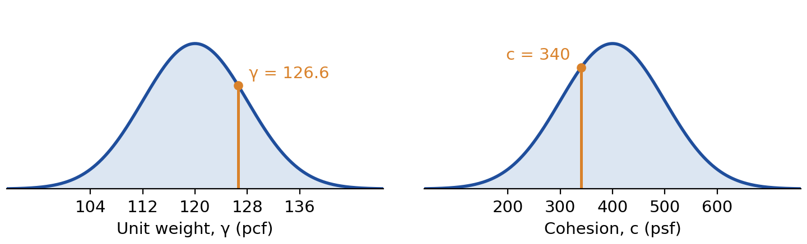{width=780}

Realization 1 draws γ = 126.6 pcf and c = 340 psf, and the slope with those values solves to
$F = 1.035$. A run repeats this thousands of times, each realization with its own draws; the run on this
page has 10,000. Here are its first eleven, with realization 1, the draws marked in the figure, in red:

| Realization | γ (pcf) | c (psf) | F | F < 1 |
|---|---|---|---|---|
| <span style="color:#b03a2e">1</span> | <span style="color:#b03a2e">126.6</span> | <span style="color:#b03a2e">340</span> | <span style="color:#b03a2e">1.035</span> |  |
| 2 | 108.6 | 524 | 2.221 |  |
| 3 | 110.0 | 348 | 1.431 |  |
| 4 | 132.5 | 547 | 1.525 |  |
| 5 | 137.9 | 90 | 0.234 | yes |
| 6 | 116.9 | 398 | 1.431 |  |
| 7 | 123.7 | 306 | 0.977 | yes |
| 8 | 117.5 | 401 | 1.426 |  |
| 9 | 103.1 | 500 | 2.408 |  |
| 10 | 129.5 | 428 | 1.249 |  |
| 11 | 127.6 | 327 | 0.982 | yes |

Three of these eleven fail. Realization 5 is heavy and weak, c = 90 psf. Realizations 7 and 11 are
less extreme: a little heavier than the most likely 120 pcf, with a cohesion nearly one standard
deviation low.

## Monte Carlo on LEM-11's Slope

Here are all ten thousand realizations of LEM-11's slope, solved with Spencer's method on the critical
circle of a search at the most likely values:

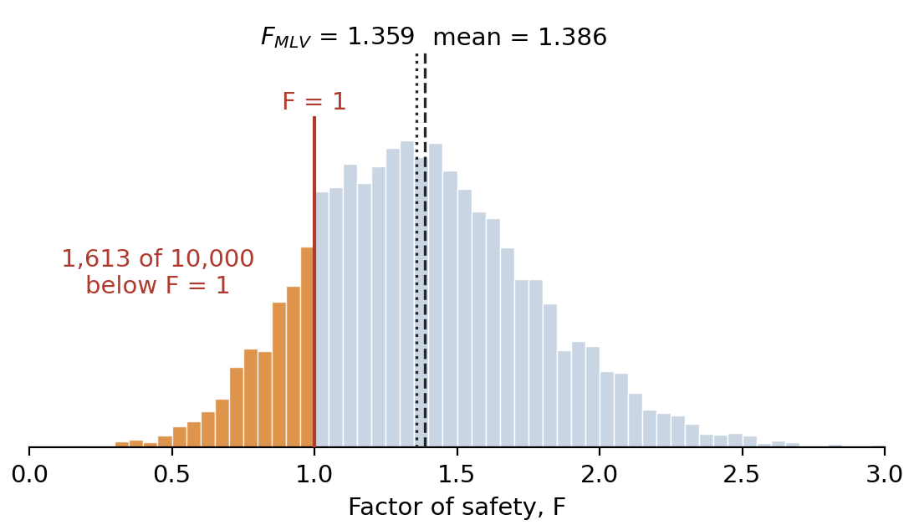{width=600}

1,613 of the 10,000 realizations came out below $F = 1$, so the probability of failure is
**16.13%**. It is counted directly, with no assumption about the shape of the distribution. The mean factor of safety
is 1.386 and its standard deviation 0.404. For comparison with the Taylor series, XSLOPE also computes
the two reliability indices from that mean and standard deviation: $\beta_N = 0.956$ and
$\beta_{LN} = 1.001$.

<!-- test: file=../lem/files/xslope_reliability.xlsx, type=reliability_mc, method=spencer, search=true, n_samples=10000, expected_beta=1.001, tolerance=0.01, expected_pf=0.1613, pf_tol=0.005, expected_mean=1.386, expected_sigma=0.404, expected_beta_n=0.956, benchmark=REL-LEM11-MC, draws=126.6/340/1.035;108.6/524/2.221;110.0/348/1.431;132.5/547/1.525;137.9/90/0.234;116.9/398/1.431;123.7/306/0.977;117.5/401/1.426;103.1/500/2.408;129.5/428/1.249;127.6/327/0.982 -->
<!-- test: file=../lem/files/xslope_reliability.xlsx, type=circular_search, method=spencer, num_slices=40, expected_fs=1.359, tolerance=0.005 -->

**Why the mean sits above $F_{MLV}$.** The Taylor series reports $F_{MLV} = 1.359$, the factor of
safety at the most likely inputs. Monte Carlo's 1.386 is the mean of the factors of safety, and the two
differ whenever $F$ curves with an input. In the Taylor series, the unit weight's pair of analyses
averaged 0.027 above $F_{MLV}$
([the straight-line assumption](taylor.md#the-straight-line-assumption)); the Monte Carlo mean sits
0.027 above it. The curvature with the unit weight accounts for the whole gap.

### Checking the Assumed Shape {#checking-the-assumed-shape}

Monte Carlo can check the shapes the Taylor series assumes. Over the histogram are the two curves the
Taylor series assumes from its $F_{MLV}$ and $\sigma_F$:

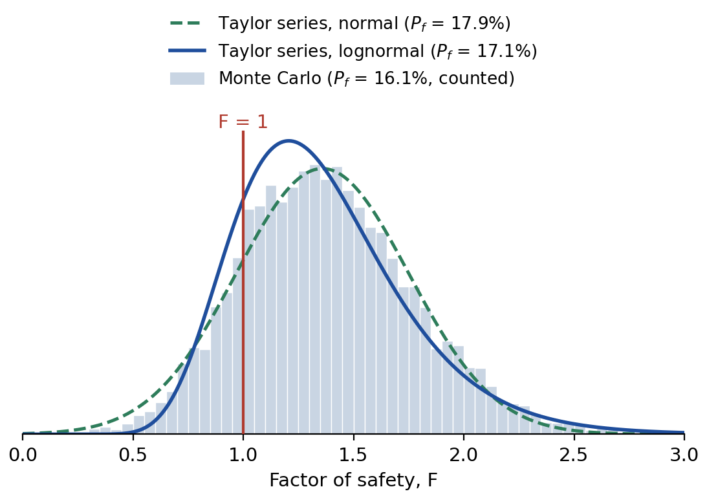{width=600}

The areas below $F = 1$ are 17.9% for the normal curve and 17.1% for the lognormal one, against the
16.1% counted from the realizations. On this slope both assumed shapes come within two percentage
points of the counted value, and the lognormal is the closer. The histogram sits a little to the right of both curves, because its mean
is above $F_{MLV}$.

## How Many Realizations {#how-many-realizations}

Each realization either fails or it does not. So a counted probability of failure is a fraction,
$p$ = failures ÷ $n$, like the share of heads in $n$ tosses of a weighted coin. Run the analysis again
with different draws and the number of failures comes out a little different. The standard deviation
of $p$ from one run to the next is

$$\sigma_p = \sqrt{\frac{p\,(1 - p)}{n}}$$

For a run of thousands of realizations, $p$ scatters in a normal distribution around the true
value, and 95% of a normal distribution lies within 1.96 standard deviations. So 95 times in 100, a
counted probability of failure lands within

$$P_f \pm 1.96\,\sigma_p$$

of the true value. On LEM-11's slope, $p$ = 1,613 ÷ 10,000 = 0.1613, $\sigma_p$ = 0.0037, and
$1.96\,\sigma_p$ = 0.007: the probability of failure is 16.1%, give or take 0.7 percentage points.

The same formula at every $n$ makes a band that narrows as the realizations accumulate. The dark line
is the run's own running $P_f$: the failures so far divided by the realizations so far. It wanders at
first and settles inside the band:

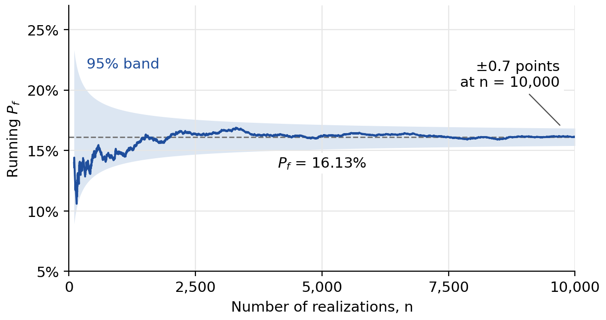{width=670}

**A small probability of failure takes many realizations.** The precision depends on how many failures
the run contains. To know a probability of failure to within ±10% of itself, 95 times in 100, takes

$$n = \frac{1.96^2\,(1 - p)}{0.1^2\,p}$$

realizations: about 38,000 near 1%, and about 380,000 near 0.1%. Each is a full solve of the slope.
That is the case the [response surface](#sampling-a-fitted-response-surface) is for.

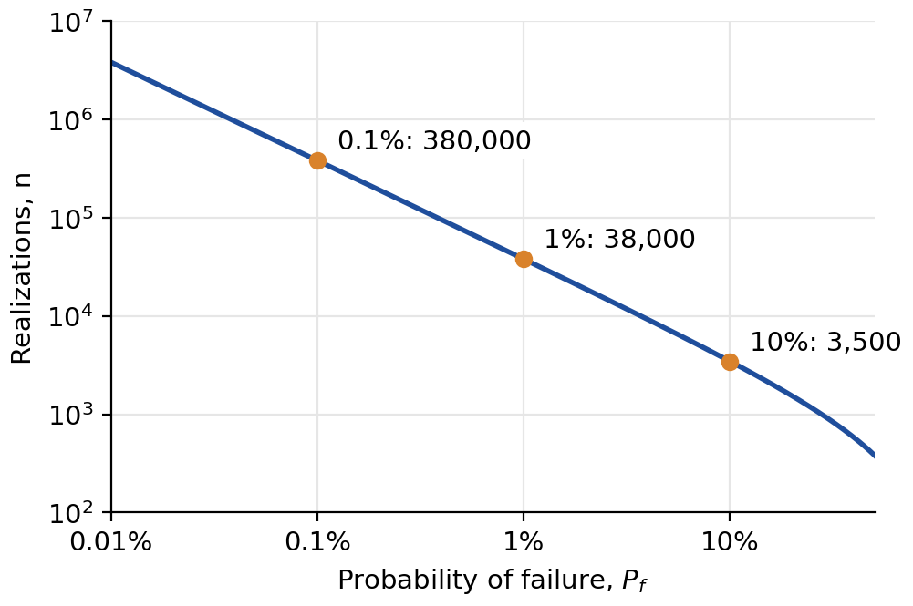{width=545}

### Stopping on Convergence

The convergence stop ends a run once the probability of failure is known well enough. In Studio, tick
**Stop when P_f converges** in the [Reliability dialog](index.md#running-a-reliability-analysis) and set its tolerance; in Python, pass
`converge_rel`. Every 100 realizations, the run checks the 95% half-width, $1.96\,\sigma_p$, and it
stops once that is within the tolerance **as a fraction of $P_f$ itself** (Studio's default is ±5%).
The sample count is then the upper limit.

The tolerance is relative because an absolute one would be wrong at one end of the range or the
other: half a percentage point is ±3% of a 17% probability of failure but ±25% of a 2% one. With a
relative tolerance, the realizations needed grow as $(1 - p)/p$. LEM-11's slope stops at ±5% after
8,100 realizations; a probability of failure of 2% would need about 75,000, so raise the sample count
when a small $P_f$ meets a tight tolerance. The stop never acts before 500 realizations or before 10
failures, so a rare-event problem runs to its sample count instead of stopping on too few failures to
trust. The draws are made up front from the fixed seed, so a run that stops early is exactly the first
$n$ realizations of the full run.

<!-- test: file=../lem/files/xslope_reliability.xlsx, type=reliability_mc, method=spencer, search=true, n_samples=10000, converge_rel=0.05, expected_beta=1.004, tolerance=0.01, expected_n=8100 -->

`plot_reliability_convergence` draws the running estimate with its band and the stop's target. This is
LEM-11's full run, with the ±5% target it meets at 8,100 realizations:

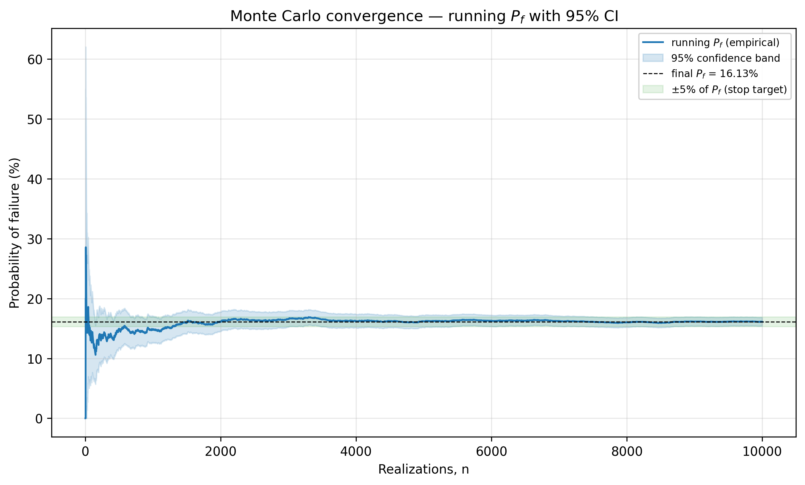{width=900}

## Latin Hypercube Sampling {#latin-hypercube-sampling}

With random sampling, each draw lands anywhere in its distribution, independently of the others. Over
a short run the draws bunch up by chance: one part of a distribution gets several and another none, and
the counted probability of failure wanders with them. **Latin hypercube sampling**, XSLOPE's default,
spreads each input's draws evenly over its distribution. The idea is this:

**A run of $n$ realizations cuts each input's distribution into $n$ segments of equal probability and
takes exactly one draw from each segment.**

The number of segments is the number of realizations. The 10,000-realization run above cuts each input
into 10,000 segments. Ten are easier to see, so here is a run of ten realizations of LEM-11's slope,
step by step.

**Step 1: cut each distribution into ten segments.** Each segment holds a tenth of the area under the
curve, so the segments are narrow near the mean, where the curve is tall, and wide in the tails:

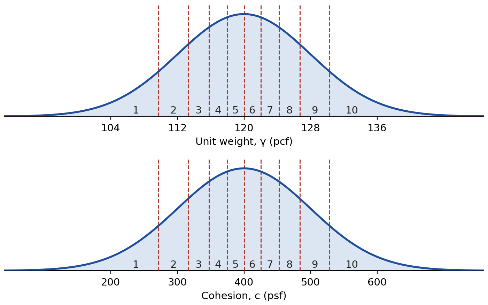{width=780}

**Step 2: pair the segments.** Each realization takes one segment of γ and one of c. Each input's ten
segment numbers are shuffled into a random order, a different order for each input, and realization
$i$ takes the $i$-th number from each:

| Realization | 1 | 2 | 3 | 4 | 5 | 6 | 7 | 8 | 9 | 10 |
|---|---|---|---|---|---|---|---|---|---|---|
| γ segment | 6 | 2 | 9 | 5 | 8 | 7 | 10 | 1 | 3 | 4 |
| c segment | 7 | 6 | 9 | 2 | 4 | 10 | 5 | 3 | 1 | 8 |

Each row holds every segment number once: the ten realizations draw from every segment of both inputs,
and which γ segment goes with which c segment is random.

**Step 3: draw a value inside each segment.** Segment $k$ of $n$ covers the fraction of the
distribution's area from $(k - 1)/n$ to $k/n$. A random number $u$ between 0 and 1 picks a spot inside
it, and the inverse of the normal distribution, $\Phi^{-1}$, turns that fraction into a value:

$$x = \mu + \sigma\,\Phi^{-1}\!\left(\frac{k - 1 + u}{n}\right)$$

Realization 1 takes γ's segment 6 at $u = 0.098$ and c's segment 7 at $u = 0.673$:

$$\gamma = 120 + 8\,\Phi^{-1}\!\left(\frac{6 - 1 + 0.098}{10}\right) = 120 + 8\,\Phi^{-1}(0.510) = 120.2\ \text{pcf}$$

$$c = 400 + 100\,\Phi^{-1}\!\left(\frac{7 - 1 + 0.673}{10}\right) = 400 + 100\,\Phi^{-1}(0.667) = 443.2\ \text{psf}$$

(For a lognormal distribution, the same is done on $\ln x$.)

In the figure below, **each orange dot is one draw**: one realization's value of that input. The dot's
position along the axis is the value drawn; it is placed on the curve so that it shows against the
shading. Each input has ten dots, one in each of its ten segments. A few dots sit almost on a segment
line, such as γ's draws for realizations 1, 2, and 6; each is still inside one segment, the one the
step 2 table gives.

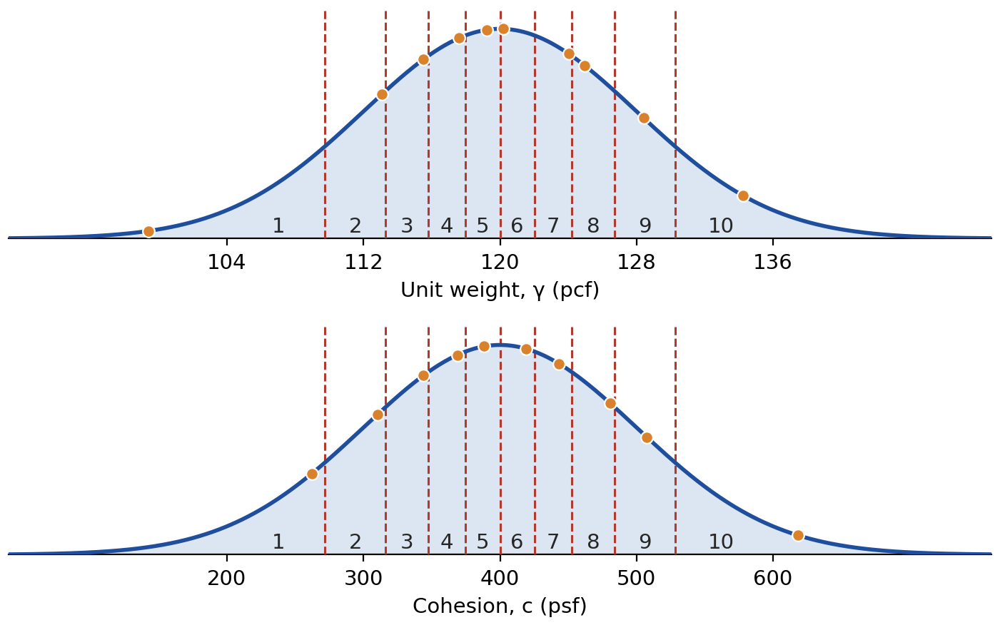{width=780}

Each realization is then solved with its two draws:

| Realization | γ (pcf) | c (psf) | F |
|---|---|---|---|
| 1 | 120.2 | 443.2 | 1.501 |
| 2 | 113.1 | 419.1 | 1.618 |
| 3 | 128.4 | 507.7 | 1.505 |
| 4 | 119.2 | 310.3 | 1.069 |
| 5 | 125.0 | 368.7 | 1.154 |
| 6 | 124.0 | 618.3 | 1.964 |
| 7 | 134.3 | 388.4 | 1.058 |
| 8 | 99.4 | 344.0 | 1.819 |
| 9 | 115.5 | 262.2 | 0.966 |
| 10 | 117.6 | 480.7 | 1.705 |

<!-- test: file=../lem/files/xslope_reliability.xlsx, type=reliability_mc, method=spencer, search=true, n_samples=10, sampling=lhs, expected_beta=1.375, tolerance=0.01, expected_pf=0.10, pf_tol=0.001, benchmark=REL-LEM11-LHS10, draws=120.2/443.2/1.501;113.1/419.1/1.618;128.4/507.7/1.505;119.2/310.3/1.069;125.0/368.7/1.154;124.0/618.3/1.964;134.3/388.4/1.058;99.4/344.0/1.819;115.5/262.2/0.966;117.6/480.7/1.705 -->

Only realization 9 fails, so these ten give $P_f = 10\%$: far too few realizations to count a
probability of failure, but enough to show the method.

With random sampling (`sampling="random"`), each value is drawn independently, and nothing stops two
draws landing in the same segment while another gets none. Here are 250 draws of LEM-11's unit weight
each way, counted in 25 segments of equal probability:

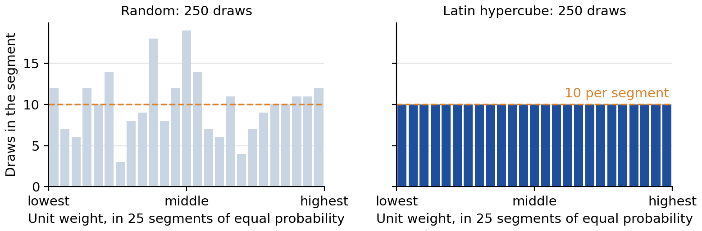{width=860}

Even coverage makes runs repeat more closely. These are twenty runs of 1,000 realizations each way,
with seeds 1 to 20: the Latin hypercube runs land closer together, and closer to the answer of a much
longer run.

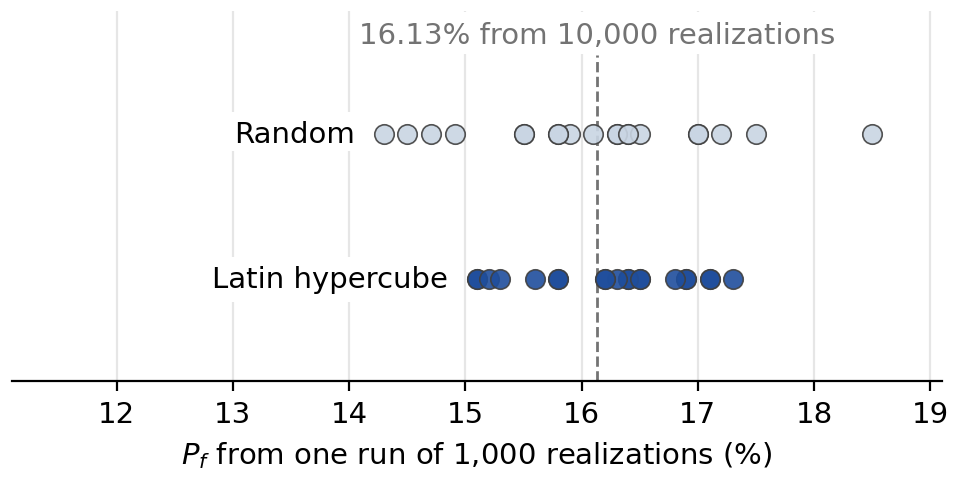{width=560}

The convergence stop's band assumes independent draws. Latin hypercube draws are not independent, so
under Latin hypercube the band overstates the uncertainty and the stop errs on the long side.

## Monte Carlo in XSLOPE {#monte-carlo-in-xslope}

**The inputs.** Monte Carlo reads the same values as the Taylor series: each material's most likely
values and the standard deviations beside them
([Standard Deviations in XSLOPE](index.md#standard-deviations-in-xslope)). Each uncertain input is
drawn independently, with the material's value as its mean and its σ column as its standard
deviation. The distribution is normal by default; `distribution="lognormal"` (**MC distribution** in
Studio) draws from a lognormal distribution with the same mean and standard deviation, which never goes
below zero. Every draw is cut off at its physical floor, since a strength or a unit weight cannot be
negative, and a friction angle is capped at 89°. The cutoff matters only when a standard deviation is
large next to its value (see [VP34](#vp34-a-standard-deviation-larger-than-its-value)).

**Sampling.** Realizations are drawn by Latin hypercube sampling by default (**MC sampling** in Studio,
`sampling="lhs"` in Python), or with every value drawn independently (`sampling="random"`); see
[Latin Hypercube Sampling](#latin-hypercube-sampling).

**The seed.** The random number generator starts from a fixed seed (**MC seed** in Studio, `rng_seed`
in Python), so the same file gives the same realizations, and the same results, on every run. Run again
with two or three other seeds to see the scatter: if a conclusion changes with the seed, the run needs
more realizations.

**The slip surface.** Every realization is solved on the same surface: the critical surface of one
search at the most likely values (search ticked, `search=True`), or the file's own surface (unticked).
A search for every realization would multiply the cost by hundreds. For some realizations the critical
surface lies elsewhere, so a fixed surface understates the probability of failure of the slope as a
whole a little. [Choosing the Slip Surface](index.md#choosing-the-slip-surface) covers the choice.

**Rapid drawdown.** With **Rapid drawdown** ticked (`rapid=True`), every realization is a three-stage
[rapid drawdown](../lem/rapid.md) on the fixed surface, and an `mc` material's $K_c = 1$ envelope is
sampled with everything else: $d$ from σ(d) and $\psi$ from σ(ψ). The drawdown procedure refuses a slope
that is unstable before the water is lowered. A realization whose draws leave the slope unstable at
full pool has failed before any drawdown, so it is counted as a failure at its stage 1 factor of
safety, and the run reports how many there were (`n_stage1_failed`).

**Results.** Studio opens the **Reliability · MC** tab: the histogram of the factors of safety with the
$F = 1$ line, the mean, and the fitted normal and lognormal curves. From Python:

```python
from xslope.fileio import load_slope_data
from xslope.reliability import reliability_mc
from xslope.plot import plot_reliability_histogram

slope_data = load_slope_data("xslope_reliability.xlsx")
success, result = reliability_mc(slope_data, "spencer", n_samples=10000, search=True)
if success:
    print(result["pf_empirical"], result["mean_FS"], result["sigma_F"])
    plot_reliability_histogram(result)
```

The result holds `pf_empirical` (the counted probability of failure, also `prob_failure`), `mean_FS`,
`sigma_F`, `COV_F`, `beta_ln` and `beta_normal` with the fitted `pf_lognormal` and `pf_normal`, the
counts `n_used`, `n_valid`, and `n_invalid`, the realizations themselves (`fs_samples`,
`param_samples`), and `pf_trace` and `pf_ci_half` for the convergence plot.

### VP34: A Standard Deviation Larger Than Its Value {#vp34-a-standard-deviation-larger-than-its-value}

[VP34](../verification/rocscience.md#vp34) is Clarence Cannon Dam on the noncircular surface Wolff and
Harr (1987) prescribed. Its Phase I fill has $\phi = 6.34° \pm 7.87°$, a coefficient of variation of
124%. The Taylor series cannot evaluate $\phi - \sigma$, which is negative, and stops with an error.
Monte Carlo cuts the negative draws off at $\phi = 0$:

```python
slope_data = load_slope_data("vp034.xlsx")
success, result = reliability_mc(slope_data, "spencer", circular=False,
                                 search=False, n_samples=10000, num_slices=40)
```

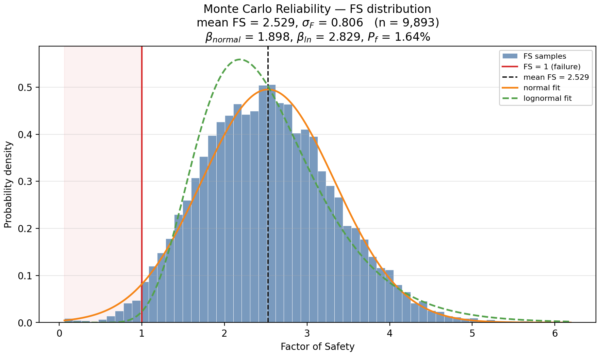{width=900}

The distribution is strongly skewed to the right, as a large scatter in an input usually makes it. The
mean factor of safety is 2.529, $\sigma_F$ is 0.806, and the probability of failure is 1.64%. 9,893 of
the 10,000 realizations gave a valid Spencer solution; the rest are left out of the probability of
failure rather than counted as failures. The result lies between the two published estimates for this problem: 0.355% by
Slide2's Monte Carlo and 4.55% by Wolff and Harr's point estimate.

<!-- test: file=../verification/files/rocscience/vp034.xlsx, type=reliability_mc, method=spencer, circular=false, search=false, n_samples=10000, num_slices=40, expected_beta=2.829, tolerance=0.01, expected_pf=0.0164, pf_tol=0.002, expected_mean=2.529, expected_sigma=0.806, expected_n_valid=9893 -->

## Sampling a Fitted Response Surface

A probability of failure counted from realizations is only as fine as the number of failures behind it.
Near 0.1% it takes about 380,000 real
solves to know $P_f$ to ±10% of itself ([How Many Realizations](#how-many-realizations)). The
**response surface** (`reliability_rs`, or **Response surface (RS)** in the Reliability dialog) is the
way around that. It solves the real slope a handful of times, fits a quadratic formula for the factor
of safety through the answers, checks the formula against more real solves, and then runs Monte Carlo
on the formula: ten million realizations, each one arithmetic. The sampling error becomes negligible,
and what remains is the error of the fit, which is measured and reported.

Everything else is the Monte Carlo above: the same fixed surface, the same uncertain inputs (in a rapid
drawdown, $d$ and $\psi$ among them, with every real solve a drawdown), and the same draws. Both
methods draw through one routine, so the distributions, floors, and caps are identical.

**The design.** The real solves are a central composite design around the most likely values: the
$2^d$ corners at $\pm 1\sigma$, $2d$ axial points at $\pm 2\sigma$, and the center, where $d$ is the
number of inputs with a standard deviation. That is 9 solves for two inputs, 15 for three, and 25 for
four, each a full solve on the fixed surface. A design point below an input's floor is solved at the
floor, and the formula is fitted at the value that was solved.

**The fit.** A full quadratic in the $d$ inputs, with $1 + d + d(d+1)/2$ coefficients, fitted by least
squares:

$$\hat F(x_1,\ldots,x_d) \;=\; b_0 \;+\; \sum_i b_i\, x_i \;+\; \sum_{i \le j} b_{ij}\, x_i x_j$$

A design point with no analyzable solution stops the run with a message naming it: the formula is
fitted to the whole design, so a corner that cannot be solved leaves the fit undefined over part of the
range.

The figure shows LEM-11's response surface: the nine real solves (diamonds), the formula they define
(contours), a sample of the draws, and the $F = 1$ boundary that splits the draws into failures and the
rest. Beside it, the formula's factor of safety is plotted against the solver's for the first 1,000
Monte Carlo realizations, solved on the same circle:

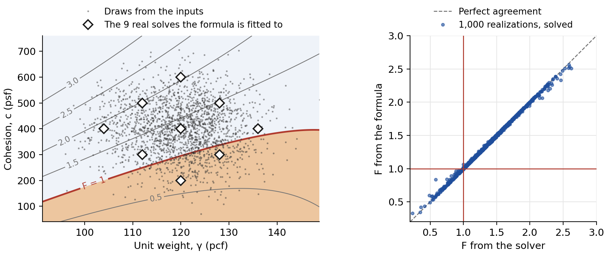{width=1000}

**The accuracy check.** The formula is not used until it has been checked against the real slope, in
two places:

- **500 held-out realizations**, drawn from the input distributions on a separate stream of the seed
  and never used in the fit, solved for real. The formula passes when its root-mean-square error is
  within 5% of the real spread of the factor of safety over those draws, its $R^2$ is at least 0.995,
  and at most 2% of the draws land on the other side of $F = 1$ from where the formula puts them.
- **200 realizations from the failure region**: draws the formula counted as $F < 1$, solved for real.
  A check drawn from the whole population rarely reaches that region, and the probability of failure
  depends entirely on it. The run stops without a result when more than 5% of them have no analyzable
  solution, or when the solver puts more than 10% of them back above $F = 1$.

On LEM-11's slope the formula passes with $R^2$ = 0.998 and counts a probability of failure of
16.30%, against the 16.13% Monte Carlo counted from ten thousand real solves. Every check measurement
is reported with the answer, in the Log pane, the run summary, and the result dictionary
(`gate_r2`, `gate_rms`, `gate_pf_disagree`, `tail_disagree`, and others).

<!-- test: file=../lem/files/xslope_reliability.xlsx, type=reliability_rs, method=spencer, search=true, expected_beta=1.010, tolerance=0.01, expected_pf=0.1630, pf_tol=0.005, expected_mean=1.387, expected_sigma=0.401, expected_r2=0.998 -->

**When the check fails**, the run returns a message naming the measured errors and no result. Monte
Carlo is the method to run instead. VP34 fails the second check: many of the realizations its formula
counts as failures have no analyzable solution, so its probability of failure would count realizations
the model cannot solve. A rapid drawdown is often a case for Monte Carlo too. Its factor of
safety is not a smooth function of the strengths, because each low-permeability slice takes the lower
of two strengths in stage 3 and the governing stage can change from one realization to the next. On the
[VP96](../verification/rocscience.md#vp96) embankment, the formula fits the bulk of the distribution,
but the solver puts too many of the realizations it counts as failures back above $F = 1$, and the run
stops.

```python
from xslope.reliability import reliability_rs

success, result = reliability_rs(slope_data, "spencer", search=True)
if success:
    print(result["pf_empirical"], result["beta_ln"], result["gate_r2"])
```

The result carries the Monte Carlo keys, so a histogram or a rank correlation reads it unchanged.
`fs_samples` and `param_samples` are an evenly spaced subsample of 10,000 realizations, for plotting;
every reported statistic comes from all ten million. In Studio the result opens on the
**Reliability · RS** tab.

## The Three Methods Compared {#the-three-methods-compared}

LEM-11's slope, Spencer's method, with the same standard deviations:

| Method | Real solves | F | $\sigma_F$ | $\beta_{LN}$ | $P_f$ | 95% sampling half-width on $P_f$ |
|---|:---:|:---:|:---:|:---:|:---:|:---:|
| Taylor series | 5 | 1.359 ($F_{MLV}$) | 0.391 | 0.949 | 17.1% (lognormal) | — |
| Monte Carlo | 10,000 | 1.386 (mean) | 0.404 | 1.001 | 16.13% (counted) | ±0.7 points |
| Response surface | 710 | 1.387 (mean) | 0.401 | 1.010 | 16.30% (counted on the formula) | ±0.02 points |

The response surface's 710 real solves are the 9 it fitted, the 500 and 200 it checked with, and the
one at the most likely values. The three methods agree to about a percentage point, which is the usual
result. [Choosing a Method](index.md#when-to-use-monte-carlo-versus-the-taylor-series) covers the cases
where they do not.

<!-- test: file=../lem/files/xslope_reliability.xlsx, type=reliability, method=spencer, expected_beta=0.949, tolerance=0.01, expected_sigma=0.391, expected_pf=0.171 -->

## References

- Duncan, J.M., Wright, S.G., and Brandon, T.L. (2014). *Soil Strength and Slope Stability*, 2nd ed.
  Wiley, Hoboken, NJ. Chapter 13.
