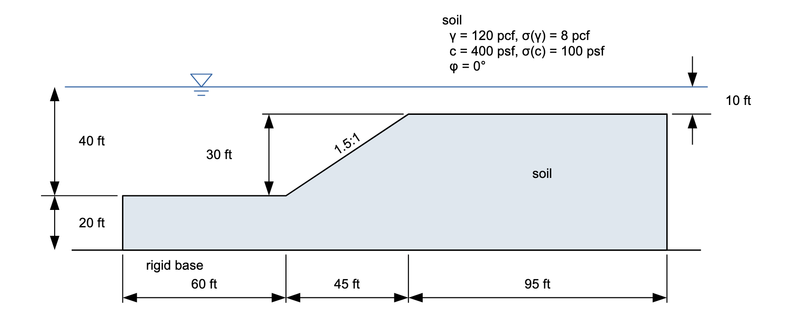
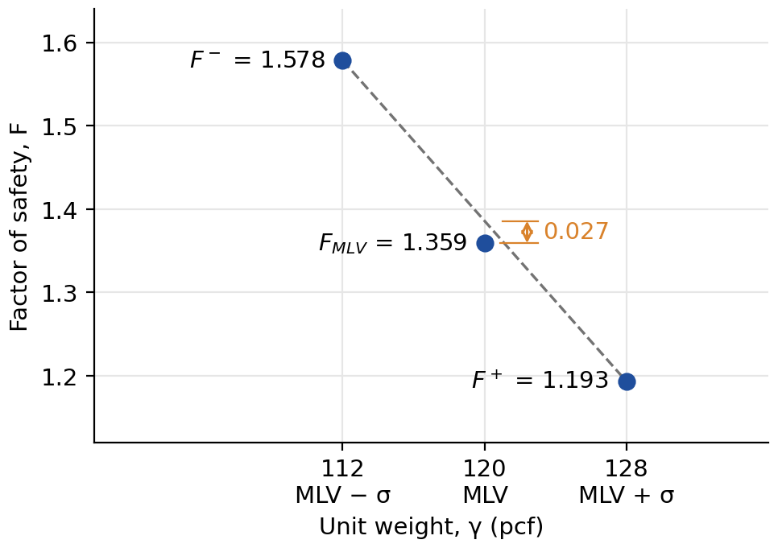
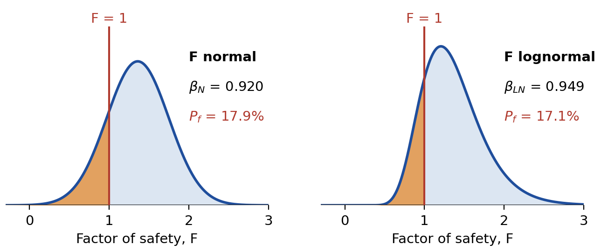
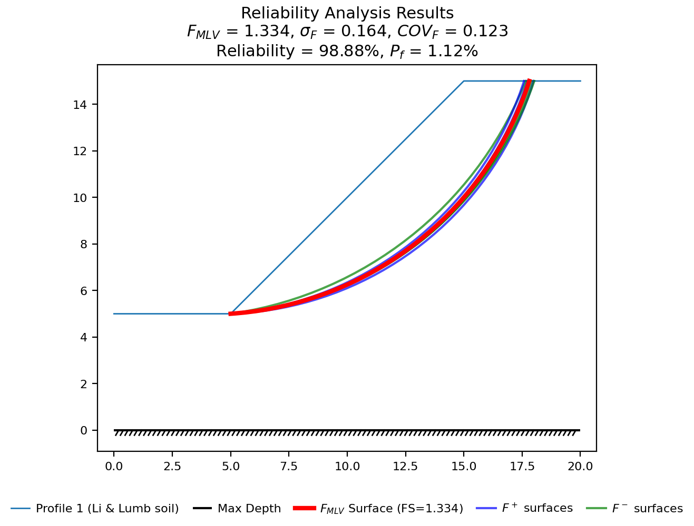

# Taylor Series Probability Method (TSPM)

The Taylor series is the quickest of XSLOPE's reliability methods. From $1 + 2N$ solves of the slope,
for $N$ uncertain inputs, it computes the standard deviation of the factor of safety, the reliability
index and probability of failure by both the normal and the lognormal shape, and a table of how much
each input contributes. Duncan (2000) brought the method into geotechnical practice. It runs with
limit equilibrium (this page) and with the finite element strength reduction
([Reliability Analysis (FEM)](fem.md)).

## The Method

1. Compute $F_{MLV}$, the factor of safety with every input at its most likely value (MLV).
2. For each uncertain input $i$, compute $F_i^+$ with that input at $MLV + \sigma_i$, and $F_i^-$ with
   it at $MLV - \sigma_i$. Every other input stays at its most likely value.
3. Compute the swing for each input:

    $$\Delta F_i = \left| F_i^+ - F_i^- \right|$$

4. Combine the half-swings into the standard deviation and coefficient of variation of the factor of
   safety:

    $$\sigma_F = \sqrt{\left(\frac{\Delta F_1}{2}\right)^2 + \left(\frac{\Delta F_2}{2}\right)^2 + \cdots + \left(\frac{\Delta F_N}{2}\right)^2}, \qquad COV_F = \frac{\sigma_F}{F_{MLV}}$$

5. Assume a shape for the distribution of $F$, normal or lognormal, with mean $F_{MLV}$ and standard
   deviation $\sigma_F$. The reliability index and the probability of failure follow from the
   [Reliability Equation](index.md#reliability-equation). XSLOPE reports both shapes.

The equations are after Duncan, Wright, and Brandon (2014). Each input is evaluated at exactly two
points, $MLV \pm \sigma_i$, so the method is a two-point estimate of the variance of $F$.

## Example: LEM-11's Slope {#example}

[Tutorial LEM-11](../tutorials/lem11_reliability.md)'s slope is 30 ft of undrained clay at 1.5:1 on a
rigid base 20 ft below the toe, entirely under water: 40 ft deep in front of the toe and 10 ft over
the crest. The clay's unit weight is 120 ± 8 pcf and its
cohesion 400 ± 100 psf, with φ = 0: coefficients of variation of 7% and 25%, inside the
[published ranges](index.md#published-values). The model is
[xslope_reliability.xlsx](../lem/files/xslope_reliability.xlsx), run with Spencer's method, 40
slices, and a search for the critical circle at each solve.

{width=1000}

### The Five Analyses

With two uncertain inputs, the Taylor series solves the slope five times. In each row below, the value
in bold is the input moved one standard deviation; the other stays at its most likely value.

| Analysis | γ (pcf) | c (psf) | F |
|---|:---:|:---:|:---:|
| $F_{MLV}$ | 120 | 400 | 1.359 |
| $F^+_\gamma$ | **128** | 400 | 1.193 |
| $F^-_\gamma$ | **112** | 400 | 1.578 |
| $F^+_c$ | 120 | **500** | 1.699 |
| $F^-_c$ | 120 | **300** | 1.019 |

Heavier clay drives the slope harder, so for the unit weight $F^+$ is the lower of the pair. Only the
size of each swing matters:

$$\Delta F_\gamma = |1.193 - 1.578| = 0.385, \qquad \Delta F_c = |1.699 - 1.019| = 0.680$$

<!-- test: file=../lem/files/xslope_reliability.xlsx, type=circular_search, method=spencer, num_slices=40, expected_fs=1.359, tolerance=0.005 -->
<!-- test: file=../lem/files/xslope_reliability.xlsx, type=circular_search, method=spencer, num_slices=40, mat_gamma=128, expected_fs=1.193, tolerance=0.005 -->
<!-- test: file=../lem/files/xslope_reliability.xlsx, type=circular_search, method=spencer, num_slices=40, mat_gamma=112, expected_fs=1.578, tolerance=0.005 -->
<!-- test: file=../lem/files/xslope_reliability.xlsx, type=circular_search, method=spencer, num_slices=40, mat_c=500, expected_fs=1.699, tolerance=0.005 -->
<!-- test: file=../lem/files/xslope_reliability.xlsx, type=circular_search, method=spencer, num_slices=40, mat_c=300, expected_fs=1.019, tolerance=0.005 -->

### The Standard Deviation of F

The two half-swings combine into the standard deviation of the factor of safety:

$$\sigma_F = \sqrt{\left(\frac{0.385}{2}\right)^2 + \left(\frac{0.680}{2}\right)^2} = 0.391$$

and $COV_F = \sigma_F / F_{MLV} = 0.287$: the factor of safety is uncertain by about 29% of its value.

Each half-swing squared is that input's share of $\sigma_F^2$. Here the cohesion carries about three
quarters of the variance and the unit weight one quarter, so the swings are also a sensitivity study:
they show which input's uncertainty matters most, and so where more testing pays off.
**Run → Parametric…** with **Plot type** `Variance Pareto (σ)` plots the shares
([Variance-contribution Pareto](../parametric/sensitivity.md#variance-contribution-pareto)).

### The Straight-Line Assumption

The Taylor series treats the factor of safety as changing in a straight line over $\pm\sigma$. The
plot shows the unit weight's three analyses:

{width=530}

$F_{MLV}$ sits a little below the dashed line: the straight line from $F^-$ to $F^+$ passes 0.027
above it at 120 pcf. The factor of safety curves a little with the unit weight, and the Taylor series
treats it as straight. With φ = 0 the factor of safety is a straight line in the cohesion, and that
pair averages exactly to $F_{MLV}$. The curvature shows again in
[Monte Carlo](monte_carlo.md#monte-carlo-on-lem-11s-slope), whose mean factor of safety sits above
$F_{MLV}$ by about the same amount.

### The Probability of Failure

The Taylor series gives two numbers, $F_{MLV}$ and $\sigma_F$, and nothing about the shape of the
distribution of $F$. To get a probability of failure, a shape has to be assumed. XSLOPE reports two:

{width=700}

- **F normal:** $\beta_N = (F_{MLV} - 1)/\sigma_F = 0.920$ (from the unrounded $F_{MLV}$ and
  $\sigma_F$), and $P_f = \Phi(-\beta_N) = 17.9\%$.
- **F lognormal:** $\beta_{LN} = 0.949$, a probability of failure of 17.1%, and a reliability of
  82.9%.

The two shapes put the area below $F = 1$ in different places, and on this slope they come within a
percentage point of each other. Monte Carlo on the same slope finds 16.1% of its realizations below
$F = 1$ ([checking the assumed shape](monte_carlo.md#checking-the-assumed-shape)). With $\beta$ near 1, the
slope has roughly a one-in-six chance of failing.

<!-- test: file=../lem/files/xslope_reliability.xlsx, type=reliability, method=spencer, expected_beta=0.949, tolerance=0.01, expected_sigma=0.391, expected_cov=0.287, expected_beta_n=0.920, expected_pf=0.171, expected_pf_n=0.179, expected_r=0.829 -->

## What Is Varied

The Taylor series varies every value that has a standard deviation, as
[Standard Deviations in XSLOPE](index.md#standard-deviations-in-xslope) lists. Two cases need care:

- **Rapid drawdown.** With **Rapid drawdown** ticked in the [Reliability dialog](index.md#running-a-reliability-analysis) (`rapid=True`), every
  factor of safety is a three-stage [rapid drawdown](../lem/rapid.md) factor of safety, and an `mc`
  material's $K_c = 1$ envelope, $d$ and $\psi$, is varied by σ(d) and σ(ψ).
- **A standard deviation larger than its value.** Then $MLV - \sigma$ is a negative strength, and the
  analysis stops with an error. Use [Monte Carlo](monte_carlo.md), which cuts its draws off at zero.

## The Search at Each Solve

With **Search for the critical surface at each solve (MLV and MLV ± σ)** ticked (`search=True`, the
default), each of the $1 + 2N$ solves is a full search, and each varied slope finds its own critical surface. On LEM-11
all five searches find the same circle: on a one-material φ = 0 slope, scaling the strength or the
weight does not move the critical circle. On other slopes the surfaces separate. This is
[VP36](../verification/rocscience.md#vp36), a homogeneous slope with standard deviations on γ, c, and φ:

{width=900}

The red $F_{MLV}$ surface and the six $F^+$ and $F^-$ surfaces fan out: the critical surface, as well
as the factor of safety, shifts with each change of one standard deviation. Where the surfaces separate
a long way, the input is moving the mechanism, not just the number. Every search uses the model's
search window, so the perturbed searches stay on the same family of surfaces as the first one.

Unticked (`search=False`), every solve uses the model's own surface: the first circle on the circles
sheet, or the non-circular surface. Use it for a prescribed surface
([Choosing the Slip Surface](index.md#choosing-the-slip-surface)).

## Results

In **XSLOPE Studio**, the **LEM · Reliability** tab draws the critical surface at the most likely
values with the $F^+$ and $F^-$ surfaces, as in the VP36 figure. Its title gives $F_{MLV}$,
$\sigma_F$, $COV_F$, the reliability, and the probability of failure. A results box and the status
bar give β and $P_f$ by both the normal and the lognormal shape. The table of the analyses, one row per
input with its MLV, σ, $F^+$, $F^-$, and ΔF, is in the Log pane and the view's **Table** sub-tab, and
**Save CSV…** writes it to a file. See
[Studio: Reliability analysis](../studio/analysis.md#reliability-analysis).

From **Python**:

```python
from xslope.fileio import load_slope_data
from xslope.reliability import reliability_taylor
from xslope.plot import plot_reliability_results

slope_data = load_slope_data("xslope_reliability.xlsx")
success, result = reliability_taylor(slope_data, "spencer")
if success:
    print(result["F_MLV"], result["sigma_F"], result["beta_ln"], result["beta_normal"])
    plot_reliability_results(slope_data, result)
```

`reliability_taylor(slope_data, method, rapid=False, circular=True, search=True, num_slices=None, ...)`
takes a limit equilibrium method name (`"bishop"`, `"spencer"`, and the others), `circular=False` for a
non-circular surface, and `search_opts` for a search window. `reliability(slope_data, method)` runs the
same analysis. The result holds:

| Key | Meaning |
|---|---|
| `F_MLV`, `sigma_F`, `COV_F` | $F_{MLV}$, $\sigma_F$, and $COV_F$ |
| `beta_ln`, `reliability`, `prob_failure` | the lognormal index, its reliability, and its probability of failure (also `pf_lognormal`) |
| `beta_normal`, `pf_normal` | the normal index and its probability of failure |
| `param_info` | one entry per input: material, parameter, `mlv`, `std`, `F_plus`, `F_minus`, `delta_F` |

The analysis prints the table of the analyses and the summary as it finishes; `debug_level=1` also
prints each search's progress.

## References

- Duncan, J.M. (2000). "Factors of safety and reliability in geotechnical engineering." *Journal of
  Geotechnical and Geoenvironmental Engineering*, 126(4), 307–316.
- Duncan, J.M., Wright, S.G., and Brandon, T.L. (2014). *Soil Strength and Slope Stability*, 2nd ed.
  Wiley, Hoboken, NJ. Chapter 13.
