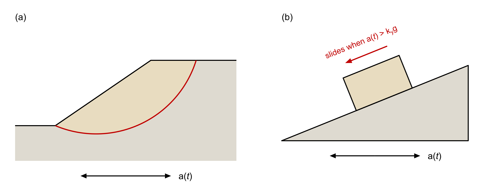
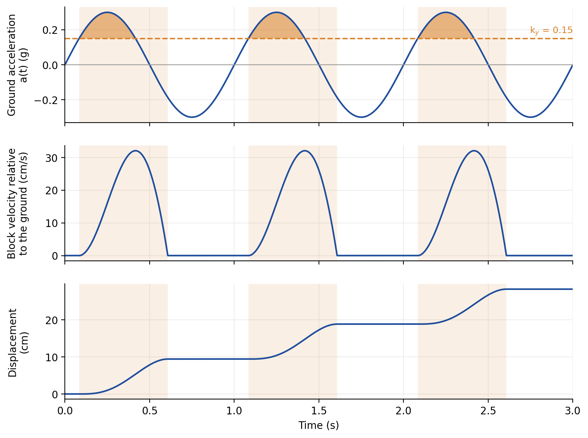
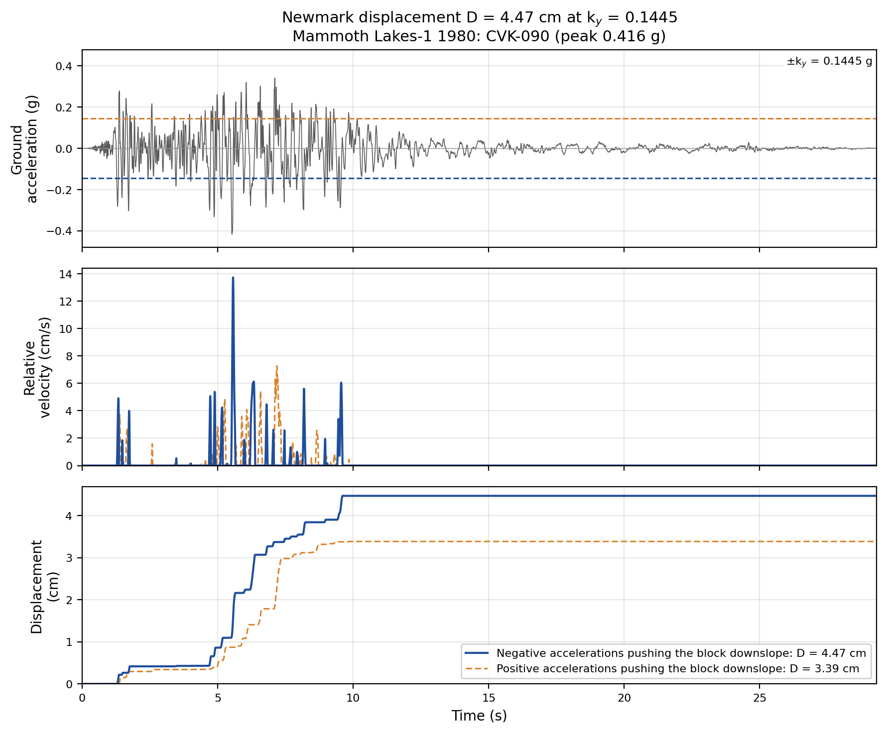
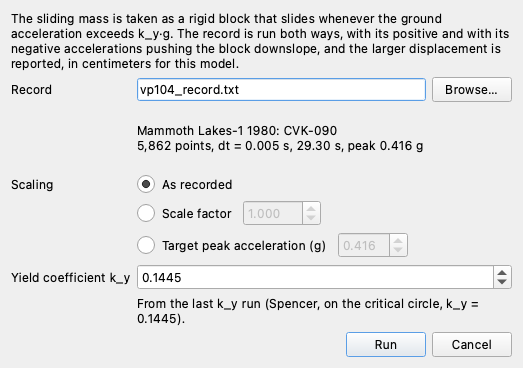

# Newmark Displacement

A pseudostatic factor of safety below 1 does not mean that a slope fails in an earthquake. The accelerations that
exceed the yield acceleration last only moments, so the sliding mass moves a limited distance and stops. Newmark
(1965) estimated that distance by replacing the sliding mass in the slope, (a) in the figure below, with a rigid block
on an inclined plane, (b). Whenever the ground acceleration $a(t)$ exceeds the block's yield acceleration $k_y g$, the
block slides down the plane, and these slips add up to a permanent displacement.

**xslope** computes this displacement from an acceleration record and the yield coefficient $k_y$ of the sliding mass,
found as on the [Yield Coefficient](yield_coefficient.md) page.

{width=900px}

## The Sliding Block {#sliding-block}

The block's yield acceleration is $a_y = k_y g$, where $k_y$ is the [yield coefficient](yield_coefficient.md) of the sliding
mass. While the ground acceleration $a(t)$, in the direction that drives the block down the slope, exceeds $a_y$, the
block accelerates relative to the ground at

>>$\dfrac{dv}{dt} = a(t) - k_y g$

It keeps sliding after the ground acceleration falls back below $a_y$, slowing down, until its velocity relative to the
ground returns to zero. Integrating the relative velocity gives the displacement:

>>$D = \displaystyle\int v\,dt$

The block slides again each time the acceleration exceeds $a_y$, and never slides back up the slope (Duncan, Wright,
and Brandon 2014, Fig. 10.3). The figure shows the process for a simple record, three cycles of a sine wave with a
peak of 0.3 g, and $k_y$ = 0.15. The dark shading marks where the acceleration exceeds $k_y g$, and the light bands
mark where the block is sliding. Each slip starts when the acceleration rises past $k_y g$ and ends after it has
fallen back below, when the relative velocity returns to zero. Each cycle adds about 9.4 cm, and the block ends
28.3 cm down the slope.

{width=760px}

**xslope** takes the record as linear between its samples and integrates each step exactly on that line, including
the moments sliding starts and stops.

**Both directions.** Nothing in a record says which way its positive accelerations point on the slope being
analyzed: the sign is the compass direction of the instrument's axis where it was recorded. So **xslope** runs every
record both ways, once with its positive accelerations driving the block down the slope and once with its negative
ones, and reports the larger displacement as $D$, with the other beside it.

**A check.** For one rectangular pulse of acceleration $A g$ lasting $t_0$, Newmark's closed form is

>>$D = \dfrac{g t_0^2}{2}\,\dfrac{A(A - k_y)}{k_y}$

and **xslope** matches it exactly ([Newmark (1965)](../verification/published.md#newmark-1965) on the verification
pages).

## Acceleration Records {#records}

A record is a file of horizontal ground acceleration, in g, in one of two forms.

**Two columns of text:** time in s and acceleration in g, separated by spaces, tabs, or commas. Lines before the
first pair of numbers are the header, and lines after it that start with `#` are skipped. The time steps need not be
equal. The record in the [example below](#vp104-example),
[vp104_record.txt](../verification/files/rocscience/vp104_record.txt), is in this form. Its first lines:

```text
# Mammoth Lakes-1 1980: CVK-090
# The acceleration record of Slide2's Tutorial 28 (Seismic Analysis with the
# Newmark Method), scenario "Newmark Displacement", used by Slide2 verification
# problem 104. Values as the tutorial model stores them; 5862 samples at 0.005 s.
# time (s), acceleration (g)
0.000	-9.81237e-05
0.005	-0.000115044
0.010	-8.23472e-05
0.015	-1.82978e-05
0.020	-2.06383e-05
```

**A PEER `.AT2` file,** as the PEER databases give them: header lines, a line stating the number of points and the
time step (`NPTS=  5862, DT=   .0050 SEC`, or the older `5862  .0050  NPTS, DT`), then the accelerations, several to a
line. In that layout, the same record begins:

```text
PEER NGA STRONG MOTION DATABASE RECORD
Mammoth Lakes-01, 5/25/1980, Convict Creek, 90
ACCELERATION TIME SERIES IN UNITS OF G
NPTS=  5862, DT=   .0050 SEC
 -9.8123700E-05 -1.1504400E-04 -8.2347200E-05 -1.8297800E-05 -2.0638300E-05
  1.3921800E-06  1.6148900E-05  9.9604700E-06  8.1173000E-06  2.5475200E-05
```

Records can be downloaded from strong-motion databases such as the
[PEER Strong Ground Motion Databases](https://peer.berkeley.edu/peer-strong-ground-motion-databases) and the
[Center for Engineering Strong Motion Data](https://www.strongmotioncenter.org/) of the U.S. Geological Survey and the
California Geological Survey. A record can be used as recorded, multiplied by a scale factor, or scaled so that its
peak acceleration matches a target, such as the design peak acceleration of the site.

The displacement is in cm for a metric model and in inches for an English one.

## Example: VP104 {#vp104-example}

The Slide2 verification problem [VP104](../verification/rocscience.md#vp104) is a slope with the record of the 1980
Mammoth Lakes earthquake at station CVK, component 090: 5,862 points at 0.005 s, with a peak of 0.416 g. Its lowest
yield coefficient on circles, found as on the [Yield Coefficient](yield_coefficient.md#one-surface) page, is $k_y$ = 0.1445:

{width=900px}

The top panel marks $\pm k_y$ on the record. With its negative accelerations driving the block, it slides in 22
episodes and moves 4.47 cm; the other way it moves 3.39 cm. Slide2's multi-modal search finds a slightly lower yield
coefficient, 0.139, and at that coefficient **xslope** computes 5.036 cm against Slide2's 5.042 cm.

## Limits {#limits}

- **A rigid block.** The whole mass slides as one, on one surface, with one yield coefficient, and the record stands for
  the acceleration of the whole mass. The [third candidate surface](yield_coefficient.md#which-surface) of Duncan et al. accounts for
  how the acceleration varies through the slope.
- **No loss of strength.** The yield coefficient stays fixed through the shaking. Duncan et al. (2014) use a
  sliding block analysis only where the cyclic loading costs the soil little strength; where it costs much, other
  methods apply. Seed (1979) found that pseudostatic analyses did not reveal the large displacements of the Upper Van
  Norman Dam, and used the concept of strain potential instead.
- **One way.** The block never slides back up the slope.

## In Studio {#studio}

In **LEM** mode, **Newmark…** is on the **Run** menu and the toolbar. Its dialog takes:

- **Record:** the file, chosen with **Browse…**. The dialog shows the record's header line, its number of points, time
  step, and peak acceleration.
- **Scaling:** **As recorded**, a **Scale factor**, or a **Target peak acceleration (g)**.
- **Yield coefficient k_y:** filled from the last run that found the yield coefficient, or typed.



The results open in the **LEM · Newmark** view: the three histories, both directions, with $D$ in the title, and a
table. The Log reports $D$, the governing direction and its number of slip episodes, and the displacement the other
way. The [Analysis Report](../studio/reports.md) prints the run under **Newmark displacement**: the record and its
scaling, $k_y$, the displacement each way, and the three histories. The record itself is not saved in the workbook.

## From Python {#python}

```python
from xslope.seismic import newmark_displacement, read_record, scale_for_pga
from xslope.plot import plot_newmark

record = read_record("record.AT2")
scale = scale_for_pga(record, 0.30)                  # scale the record to a peak of 0.30 g
result = newmark_displacement(record, ky=0.1445, scale=scale, units="si")
print(result["D"], result["D_unit"])                 # the larger of the two directions
print({sign: d["D"] for sign, d in result["directions"].items()})
plot_newmark(result)
```

## References

- Duncan, J.M., Wright, S.G., and Brandon, T.L. (2014). *Soil Strength and Slope Stability*, 2nd ed. Wiley, Hoboken,
  NJ. Section 10.1.3.
- Newmark, N.M. (1965). "Effects of earthquakes on dams and embankments." *Géotechnique*, 15(2), 139–160.
- Seed, H.B. (1979). "Considerations in the earthquake-resistant design of earth and rockfill dams." Nineteenth
  Rankine Lecture, *Géotechnique*, 29(3), 215–263.
