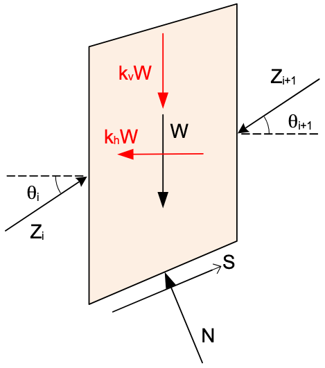

# Seismic Analysis

An earthquake threatens a slope in two ways. Its ground motion adds force that drives the slope toward failure, and
the shaking can lower the strength of the soil, both while it lasts and afterward. **xslope** analyzes a slope for
both with limit equilibrium: a pseudostatic factor of safety, in one stage or two; the yield coefficient and the
permanent displacement of a sliding block; and the factor of safety after the earthquake, with reduced strengths. The
procedures follow Duncan, Wright, and Brandon (2014), Chapter 10.

## Three Kinds of Analysis {#kinds-of-analysis}

Duncan et al. describe three kinds of seismic slope analysis.

- **Pseudostatic analysis.** The earthquake is a static force on every slice, the soil weight times a seismic
  coefficient. It is less accurate than the other procedures but useful for screening, as long as the soil does not
  lose significant strength.

- **Sliding block analysis.** The sliding mass is a rigid block that slides whenever the ground acceleration exceeds
  its yield acceleration. Integrating the acceleration record gives the permanent displacement (Newmark 1965). The
  yield acceleration is kyg, where the yield coefficient ky is the seismic coefficient at which
  a pseudostatic analysis gives F = 1.

- **Comprehensive analysis.** Used for large embankments and wherever the consequences of failure are high or the
  soil could lose significant strength. Geologists and seismologists determine the acceleration history of the site,
  and a dynamic finite element analysis computes the stresses and strains it causes in the slope. From those, the
  engineer estimates the loss of strength and the rise in pore pressure. The stability is then computed by limit
  equilibrium with the reduced strengths. If the slope is stable, its permanent displacement is computed, by a
  sliding block analysis if the strength losses are small and by other methods if not.

    **xslope** does not do the dynamic analysis: the stresses, strains, strength losses, and pore pressures must come
    from another program. It does the last two steps. The stability is an ordinary limit equilibrium run with the
    reduced strengths entered (see [After the Earthquake](#after-the-earthquake)), and the displacement a
    [Newmark analysis](newmark.md).

What **xslope** computes for each kind, and where. The last row is not one of the three kinds: it is the check of the
stability after the earthquake, described below.

| Kind of analysis | What XSLOPE computes | In XSLOPE | Page |
|---|---|---|---|
| Pseudostatic: one stage | F with khW on every slice | Any limit equilibrium method, and strength reduction in the finite element analysis | [Below](#pseudostatic-force) |
| Pseudostatic: two stages | F with undrained strengths from each slice's stresses before the earthquake | **Run LEM…**, **Two-stage seismic** | [Two-Stage Analysis](two_stage.md) |
| Sliding block: yield coefficient | ky, the seismic coefficient at which F = 1 | **Run LEM…**, **Find the yield coefficient k_y** | [Yield Coefficient](yield_coefficient.md) |
| Sliding block: displacement | The permanent displacement D under an acceleration record | **Run** menu, **Newmark…** | [Newmark Displacement](newmark.md) |
| Comprehensive | Its last two steps: F with the reduced strengths, and the displacement D. Not the dynamic analysis | An ordinary run with the reduced strengths; **Run** menu, **Newmark…** | [After the Earthquake](#after-the-earthquake), [Newmark Displacement](newmark.md) |
| After the earthquake (a separate check) | F with the strengths left after shaking | An ordinary run with those strengths | [Below](#after-the-earthquake) |

## The Pseudostatic Force {#pseudostatic-force}

A pseudostatic analysis represents the earthquake as a horizontal force khW through the center of gravity of
each slice, where W is the slice's weight and kh is the horizontal seismic coefficient. A vertical
coefficient kv adds a force kvW through the same point, positive downward.

{width=360}

Every limit equilibrium method includes these forces in its equilibrium equations, as each method's page shows. The
limit equilibrium methods take the magnitude of kh and point the force the way the failure surface would
slide, so a model needs no sign for it. The finite element analysis has no failure surface to read a direction from,
so it reads the sign: positive pushes toward +x and negative toward −x. The
[limit equilibrium overview](../lem/overview.md#advanced-loading-conditions) and the
[finite element overview](../fem/overview.md#seismic-forces) give the details for each engine.

**What kh means.** The coefficient can be thought of loosely as an acceleration, as a fraction of the
acceleration of gravity. But the pseudostatic force is static and acts in one direction, while an earthquake's
accelerations last only moments and reverse, at times helping to hold the slope rather than driving it (Duncan et al.
2014). So the pseudostatic factor of safety is an index for screening, not a prediction of how the slope moves. A
[Newmark analysis](newmark.md) estimates how far it moves.

**Where the force acts.** Terzaghi (1950) placed the force at the center of gravity of each slice, which is exact only
if the acceleration is the same throughout the sliding mass. Peak accelerations generally grow toward the top of a
dam, so the resultant probably acts somewhat higher, and for a circle a higher force has a smaller moment. Seed (1979)
found that moving the force from the centers of gravity down to the slice bases lowered the factor of safety of
Sheffield Dam from 1.32 to 1.21 at a seismic coefficient of 0.1. Duncan et al. conclude that the center of gravity is
reasonable and probably slightly conservative, which is where **xslope** applies it. A method that satisfies only
force equilibrium gives the same factor of safety wherever the force acts.

**The vertical coefficient.** The vertical component of the shaking is usually neglected in a pseudostatic analysis
(Duncan et al. 2014). Where a design code asks for it, enter kv: every method then uses
W(1 + kv) wherever it uses the weight. Its effect depends on the soil. On a frictional slope an upward
kv lowers the factor of safety, and on a cohesive slope a downward one does. A run applies kv in
the direction entered, so checking both directions takes two runs.

**Entering the coefficients.** The coefficients are the **Horizontal seismic coefficient** and the **Vertical seismic
coefficient** on the template's [main sheet](../usage/input_template.md#worksheet-main). In Studio they are
**Horizontal seismic coefficient k** and **Vertical seismic coefficient k_v (+ down)** under **Global parameters**.

## Choosing the Seismic Coefficient {#choosing-k}

Seismic coefficients were long taken from codes and rules of thumb, typically between 0.05 and 0.25 (Duncan et al.
2014). Most now come from criteria calibrated against displacement analyses and experience, used as **screening
analyses**: a pseudostatic analysis that meets the criterion indicates that the earthquake will not cause more than a
tolerable displacement.

Screening works for soils that do not lose much strength in an earthquake. Makdisi and Seed (1977) found that for
clays, for dry or partly saturated sands, and for very dense saturated sands, cyclic loading at about 80 percent of
the static undrained strength separates small strains from large ones. Each screening method combines five parts:

1. **A reference acceleration, aref.** Usually the peak acceleration of the bedrock beneath the slope, or
   the peak acceleration at the top of the slope, which takes a site response analysis to find. Some newer methods use
   a spectral acceleration.
2. **An acceleration multiplier, a/aref.** The recommended multipliers range from 0.17 to 0.75.
3. **A strength reduction factor.** Most methods reduce the static strength, most often by 15 to 20 percent.
4. **A minimum factor of safety,** 1.0 or 1.15 in the older methods. In some newer ones it depends on the tolerable
   displacement.
5. **A tolerable permanent displacement,** from 0.15 m for landfill liners to about 1 m for dams.

The seismic coefficient is the reference acceleration, as a fraction of the acceleration of gravity, times the
multiplier:

>>$k_h = \dfrac{a_{ref}}{g}\,\dfrac{a}{a_{ref}}$

Each method is complete in itself: a factor of safety at or above its minimum, computed with its reference
acceleration, multiplier, and strength reduction, indicates a displacement no larger than its tolerable one. Duncan et
al. (2014), Table 10.1, compare the methods of Seed (1979), Hynes-Griffin and Franklin (1984), Kavazanjian et al.
(1997), Bray et al. (1998), NCHRP 12-70 (2008), Bray and Travasarou (2009), and FHWA (2011). **xslope** applies no
strength reduction of its own: to follow a method that calls for one, enter the reduced strengths.

**Peak accelerations.** For a site in the United States, the U.S. Geological Survey's
[Unified Hazard Tool](https://earthquake.usgs.gov/hazards/interactive/) gives the peak ground acceleration on rock
for a latitude and longitude. Two levels are commonly analyzed: a 10 percent and a 2 percent probability of being
exceeded in 50 years, return periods of about 475 and 2,475 years.

## Choosing the Strengths {#strengths}

An earthquake is over before most soils can drain, so a pseudostatic analysis uses undrained strengths, except in
gravels and cobbles that drain freely (Duncan et al. 2014, Sec. 10.4). Which undrained strength depends on the slope
and when the earthquake comes:

| Slope | Strength | In XSLOPE |
|---|---|---|
| A new slope, with the earthquake soon after construction | Unconsolidated-undrained (UU) tests, total stresses | c and φ from the tests, with no pore pressure on the material |
| An existing slope that has consolidated under its own weight | UU tests on representative samples, total stresses | As above |
| A new slope, after it consolidates | Consolidated-undrained (CU) tests | d and ψ, run as a [two-stage analysis](two_stage.md); or the R envelope's cR and φR in a [single stage](two_stage.md#single-stage) |
| Free-draining gravels and cobbles | Drained | c′ and φ′ |

**Rate effects.** A pseudostatic analysis suits only soils that do not lose significant strength during the
earthquake. Even with no strength reduction factor, a loss of 15 to 20 percent can probably be ignored: undrained
strengths at the rates an earthquake loads the soil are 20 to 50 percent higher than in a static test, which offsets
it (Duncan et al. 2014, Sec. 10.4.3).

## After the Earthquake {#after-the-earthquake}

A slope can survive the shaking and fail afterward, because the cyclic loading has lowered its strength. Duncan et
al. (2014), Sec. 10.5, check it in three steps:

1. **Will the soil liquefy?** Correlations with cone penetration, standard penetration, or shear-wave velocity tests
   compare the soil's cyclic resistance with the cyclic stress the earthquake applies.
2. **The reduced strengths.** A soil that liquefies keeps only its undrained residual strength, usually estimated
   from correlations with field tests. One that does not liquefy may still build pore pressure and lose part of its
   strength.
3. **The stability.** A static analysis with the reduced strengths gives the factor of safety after the earthquake.
   Where a soil may lose strength as it drains afterward, the lower of its drained and undrained strengths applies.

In **xslope** the third step is an ordinary limit equilibrium run with no seismic coefficient, with the reduced
strengths entered as each material's strength. A zone that liquefies is entered as a material of its own.

## Pages in This Section

- [Two-Stage Analysis](two_stage.md): the pseudostatic analysis for a slope that has consolidated, with undrained
  strengths from consolidated-undrained tests, and the single-stage R envelope.
- [Yield Coefficient](yield_coefficient.md): the seismic coefficient at which the factor of safety is 1, on one surface or by
  search, and which surface to find it on.
- [Newmark Displacement](newmark.md): the permanent displacement of the sliding mass under an acceleration record.

## References

- Duncan, J.M., Wright, S.G., and Brandon, T.L. (2014). *Soil Strength and Slope Stability*, 2nd ed. Wiley, Hoboken,
  NJ. Chapter 10.
- Makdisi, F.I., and Seed, H.B. (1977). *A Simplified Procedure for Estimating Earthquake-Induced Deformation in Dams
  and Embankments.* Report UCB/EERC-77/19, University of California, Berkeley.
- Newmark, N.M. (1965). "Effects of earthquakes on dams and embankments." *Géotechnique*, 15(2), 139–160.
- Seed, H.B. (1979). "Considerations in the earthquake-resistant design of earth and rockfill dams." Nineteenth
  Rankine Lecture, *Géotechnique*, 29(3), 215–263.
- Terzaghi, K. (1950). "Mechanism of landslides." In *Application of Geology to Engineering Practice* (Berkey
  Volume), Geological Society of America, New York, 83–123.
