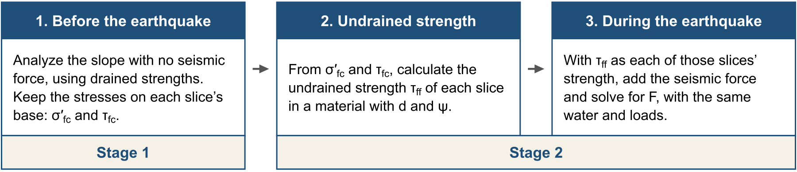
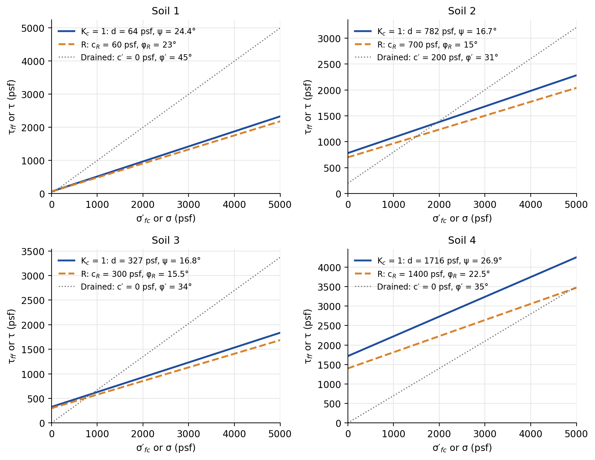
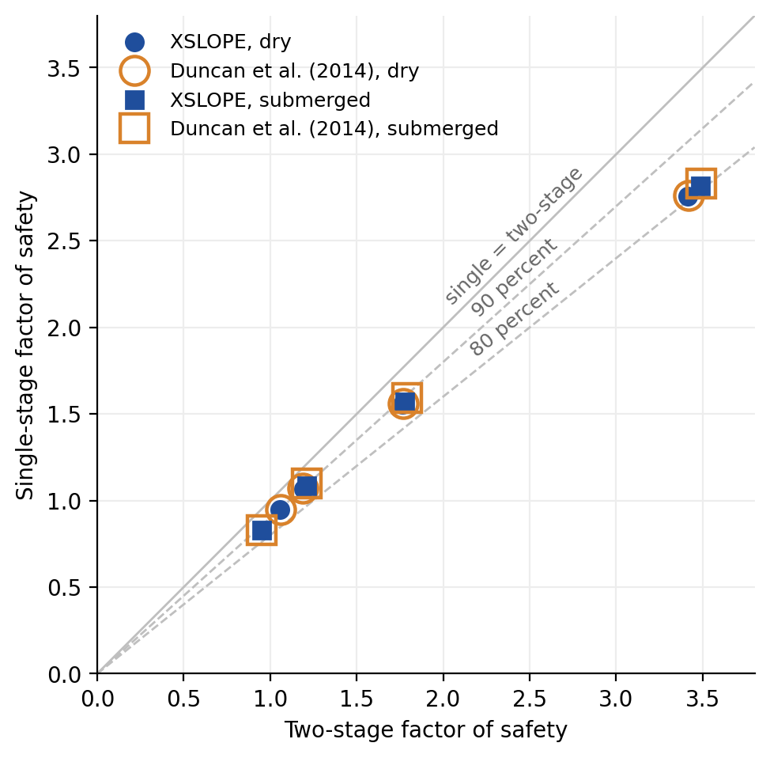
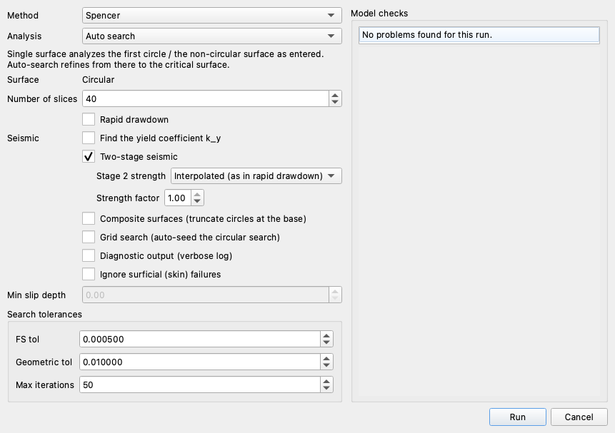

# Two-Stage Analysis

A slope that has consolidated under its own weight meets an earthquake with the undrained strength its soil
consolidated to. For a slope that exists, unconsolidated-undrained tests on representative samples measure that
strength. For a slope not yet built, the consolidation is simulated in consolidated-undrained ($\overline{CU}$) tests,
and the stability is computed in two stages (Duncan, Wright, and Brandon 2014, Sec. 10.4.2). The procedure is almost
the same as the [rapid drawdown analysis](../lem/rapid.md): the loading is the seismic force instead of the lowered
pool.

{width=900px}

## The Two Stages {#stages}

**Stage 1** solves the slope as it stands before the earthquake: no seismic force, drained strengths, and the pore
pressures and loads of the model. It is an ordinary effective stress analysis on the trial surface. Its purpose is the
stresses on each slice base that the soil consolidated under, the effective normal stress $\sigma'_{fc}$ and the shear
stress $\tau_{fc}$:

>>$\sigma'_{fc} = \dfrac{N'}{\Delta \ell}, \qquad \tau_{fc} = \dfrac{1}{F_1}(c' + \sigma'_{fc} \tan \phi')$

where $N'$ is the effective normal force on the base, $\Delta \ell$ the base length, and $F_1$ the stage 1 factor of
safety. These are the same equations as in stage 1 of a
[rapid drawdown analysis](../lem/rapid.md#stage-1-pre-drawdown-conditions).

**Stage 2** gives every slice in a material with $d$ and $\psi$ its undrained strength $\tau_{ff}$ from the
stresses found in stage 1, keeps $c'$ and $\phi'$ on the slices of every other material, keeps the same pore pressures and loads, and
adds the seismic force. Its factor of safety is the answer.

There is no third stage. In a rapid drawdown analysis, stage 3 checks for drainage during the drawdown, but drainage
during an earthquake is much less likely (Duncan et al. 2014).

**Which materials.** A material that does not drain during the earthquake carries the envelope from its
$\overline{CU}$ tests, as $d$ and $\psi$, beside its drained $c'$ and $\phi'$. A material with neither stays drained in
both stages, which suits gravels and cobbles that drain freely. The [rapid drawdown page](../lem/rapid.md#full-pool)
shows how the tests give $d$ and $\psi$.

## Stage 2's Undrained Strength {#stage-2-strength}

The undrained strength is one of two choices, set in the run:

- **Interpolated (as in rapid drawdown),** the default. The strength lies between the $K_c = 1$ envelope ($d$, $\psi$)
  and the drained envelope ($c'$, $\phi'$), according to each slice's consolidation stress ratio $K_1$, exactly as in
  stage 2 of a [rapid drawdown analysis](../lem/rapid.md#anisotropy-and-k-interpolation).
  This is the procedure Duncan et al.'s text prescribes: the undrained strength is estimated "using the same
  procedures as for rapid drawdown."
- **Kc = 1 envelope.** The strength is read from the $K_c = 1$ envelope at the slice's stage 1 stress, with no
  interpolation:

    >>$\tau_{ff} = d + \sigma'_{fc} \tan \psi$

    This is how Duncan et al.'s Table 10.4 was computed, and the only way to reproduce it.

The two choices differ where the envelopes do. Where the $K_c = 1$ envelope lies below the drained envelope at the
stresses on the surface, the interpolation raises the strength; where it lies above, the interpolation lowers it.

## Requirements {#requirements}

A two-stage run is refused when:

- stage 1's factor of safety is below 1, since a slope that fails before the earthquake has no consolidation stresses
  to give;
- no material carries $d$ and $\psi$, since stage 2 would only repeat a single-stage analysis with drained strengths;
- a material carries $d$ or $\psi$ but not both;
- a material with $d$ and $\psi$ uses a power-curve or Hoek-Brown envelope;
- the run is also a rapid drawdown analysis.

A seismic coefficient of 0 draws a warning: stage 2 is then a static analysis with undrained strengths. A material
whose strength is an undrained c/p ratio keeps that strength in both stages, and its $d$ and $\psi$ are not read.
[Preflight Input Checks](../usage/preflight.md) lists every rule.

## The Single-Stage R Envelope {#single-stage}

Duncan et al. call the two-stage analysis the proper procedure, but a simpler single-stage analysis is also used. It
takes the **R envelope**, the U.S. Army Corps of Engineers' name for the envelope drawn through $\overline{CU}$ test
results with each circle starting at the effective consolidation pressure $\sigma'_{3c}$ and spanning the principal
stress difference at failure. An example is shown on the [rapid drawdown page](../lem/rapid.md#r-envelope).
Its intercept and slope, $c_R$ and $\phi_R$, enter as an ordinary c and φ, and the analysis is one run with the seismic
force.

The pore pressures must be those before the earthquake, for example from steady seepage. The R envelope here stands
in for the relation between the undrained strength and the effective consolidation stress, so the effective normal
stresses it is applied to must be the ones the soil consolidated under. It is often called a total stress envelope,
but used this way it needs effective stresses and the right pore pressures (Duncan et al. 2014).

The R envelope and the $K_c = 1$ envelope come from the same tests and often lie close together. For the four soils
Duncan et al. compare, the R envelope lies below the $K_c = 1$ envelope:

{width=860px}

## Comparison with Duncan et al. (2014) {#comparison}

Duncan et al. ran both procedures on one slope, 2.5H:1V and 30 ft high, with γ = 135 pcf, at a seismic coefficient of
0.15, dry and submerged, for each of the four soils (their Fig. 10.7 and Table 10.4). **xslope** reproduces their
factors of safety with the Kc = 1 envelope choice, within 1.3 percent, and reproduces their finding that the
single-stage factor of safety is 80 to 90 percent of the two-stage one:

{width=560px}

[DWB Table 10.4](../verification/published.md#dwb-10-4) on the verification pages gives every value, the model, and
the interpolated choice's values on the same slope.

## In Studio {#studio}

In the dialog **Run LEM…** opens, under **Seismic**, check **Two-stage seismic** and choose the **Stage 2 strength**: **Interpolated
(as in rapid drawdown)** or **Kc = 1 envelope**. A run is a rapid drawdown analysis or a two-stage seismic analysis,
never both, so checking one clears the other.



The two-stage analysis works with every method, on a single surface or
in a search; a search solves both stages on every trial surface.

The Log reports both stages' factors of safety on the critical surface, and the LEM Solution view notes them. The
[Analysis Report](../studio/reports.md) prints them under **Two-stage seismic detail**.

## From Python {#python}

```python
from xslope.fileio import load_slope_data
from xslope.search import run_lem_analysis

slope_data = load_slope_data("my_slope.xlsx")
bundle = run_lem_analysis(slope_data, "spencer", seismic2="interpolated")   # or seismic2="kc1"
results = bundle["results"]
print(results["seismic_stage1_FS"], results["seismic_stage2_FS"])
```

`seismic2` is `False` (no two-stage analysis), `True` or `"interpolated"`, or `"kc1"`. `results["FS"]` is stage 2's
factor of safety. `circular_search` and `noncircular_search` take the same argument.

## References

- Duncan, J.M., Wright, S.G., and Brandon, T.L. (2014). *Soil Strength and Slope Stability*, 2nd ed. Wiley, Hoboken,
  NJ. Section 10.4.
- Duncan, J.M., Wright, S.G., and Wong, K.S. (1990). "Slope stability during rapid drawdown." *Proceedings of the H.
  Bolton Seed Memorial Symposium*, Vol. 2, 253–272.
