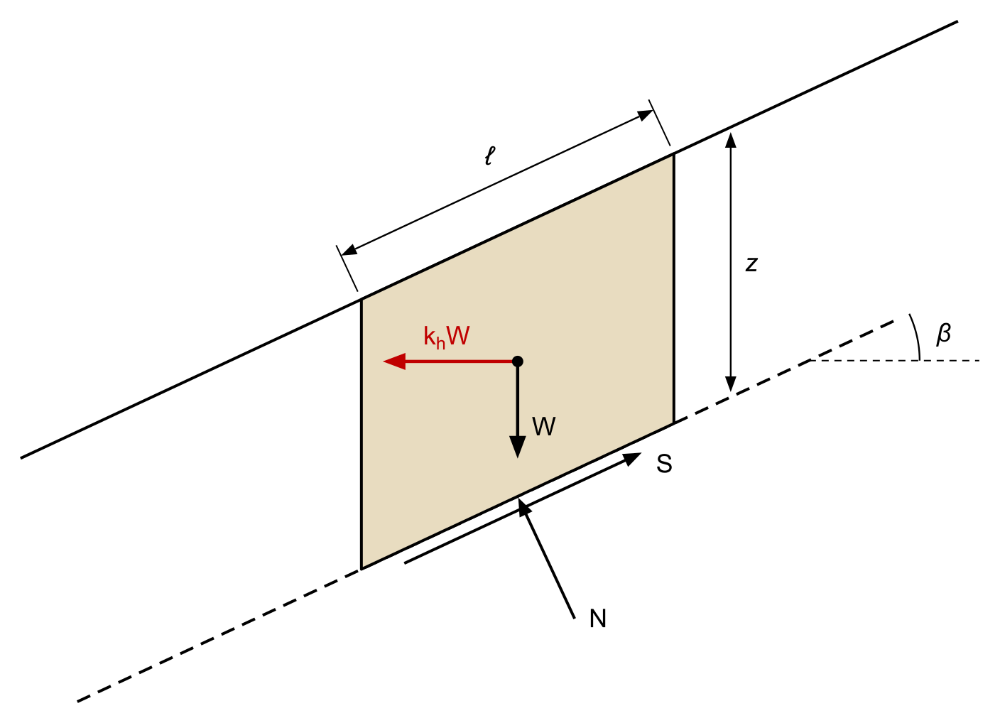
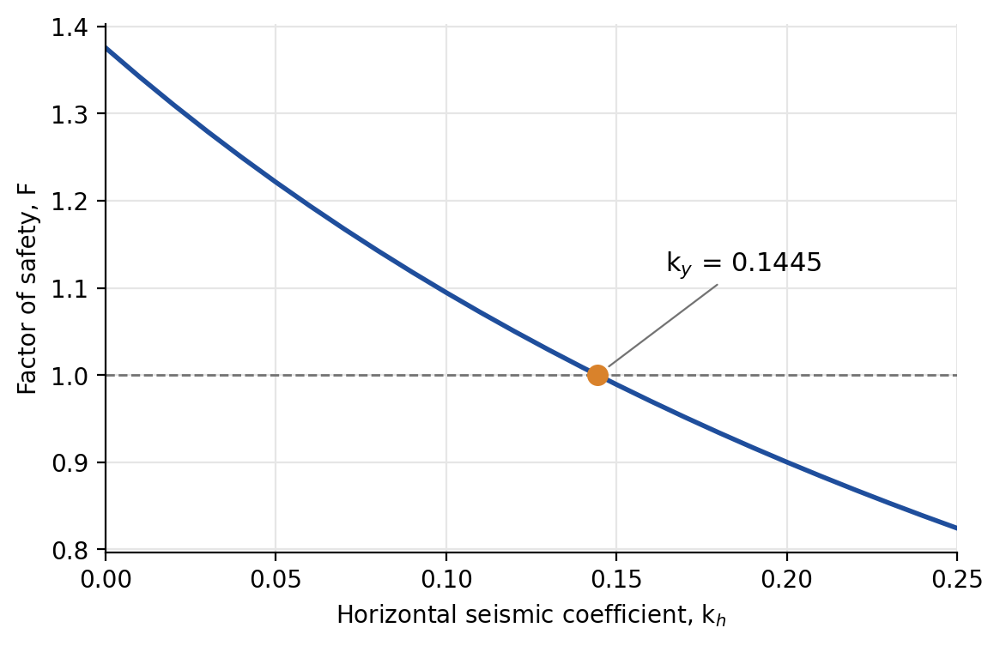
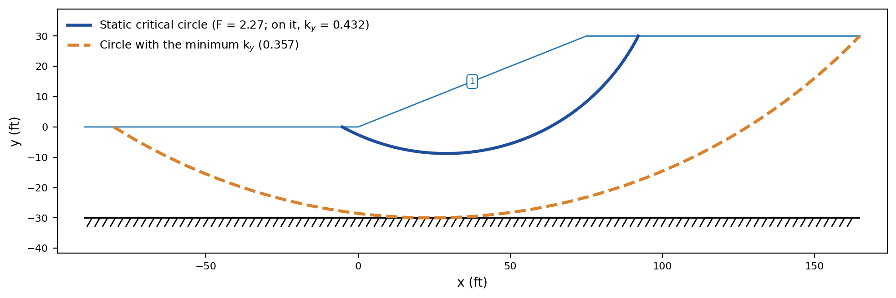

# Yield Coefficient

The **yield coefficient** $k_y$ is the seismic coefficient at which a pseudostatic analysis gives a factor of safety of
exactly 1. The yield acceleration is $a_y = k_y g$: when the ground accelerates harder than that, the sliding mass
slides (Duncan, Wright, and Brandon 2014, Sec. 10.1.3). A [Newmark analysis](newmark.md) integrates the part of an
acceleration record above $a_y$ to find how far the mass slides.

## A Mass on One Plane {#one-plane}

Duncan et al.'s Figure 10.1 resolves the forces on one block of an infinite slope with the seismic force at its
center of gravity:

{width=620px}

Perpendicular and parallel to the base,

>>$N = W\cos\beta - k_hW\sin\beta, \qquad S = W\sin\beta + k_hW\cos\beta$

and the factor of safety is

>>$F = \dfrac{c\ell + N\tan\phi}{S}$

These hold exactly for any mass that slides on one plane, because the interslice forces cancel when the slices are
summed. Setting $F = 1$ gives the yield coefficient in closed form:

>>$k_y = \dfrac{c\ell/W + \cos\beta\tan\phi - \sin\beta}{\cos\beta + \sin\beta\tan\phi}$

With $c = 0$ this is $\tan(\phi - \beta)$. A sand slope at $\phi = 35°$ and $\beta = 30°$ yields at
$k_y = \tan 5° = 0.087$. [DWB Figure 10.1](../verification/published.md#dwb-10-1) on the verification pages checks
**xslope** against this closed form, with and without a vertical seismic force.

## On One Surface {#one-surface}

On any other surface the yield coefficient comes from the methods of slices. **xslope** cuts the slices once, solves
them at a sequence of seismic coefficients with the seismic force scaled to each, and finds the coefficient at which
$F = 1$ by root finding (the Illinois form of regula falsi). The pore pressures, loads, and strengths stay exactly as
cut. On the circle with the lowest yield coefficient of the Slide2 verification problem
[VP104](../verification/rocscience.md#vp104), with Spencer's method:

{width=640px}

The same curve, searched afresh at each coefficient, comes from a Parametric sweep of **k_seismic**, and a
[Back-Analysis](../parametric/back_analysis.md) of **k_seismic** to $F = 1$ approximates the minimum yield coefficient
at the cost of a full search per step.

## Which Surface {#which-surface}

The yield coefficient depends on the surface, and so does the mass that slides. Duncan et al. (2014) name three
candidate surfaces:

1. **The surface with the lowest static factor of safety.** There is no reason to expect it to have the lowest yield
   coefficient or the largest displacement.
2. **The surface with the lowest yield coefficient.** It can become unrealistically deep, with a yield coefficient
   too low to be realistic for computing displacements.
3. **A surface that reflects the pattern of accelerations in the slope.** The average acceleration of the sliding mass,
   and the mass itself, vary with the extent of the surface. Duncan et al. call this the most appropriate choice.
   FHWA (2011) gives the variation of acceleration with depth.

The yield coefficient search gives the first two. It searches with no seismic force for the critical surface and finds
$k_y$ on it, the first candidate. It then searches again at that $k_y$: a surface found below $F = 1$ has a lower yield
coefficient, so the answer moves to it and the search repeats at the new coefficient. The rounds stop when a search
finds nothing more than 0.002 below $F = 1$, after at most six. The Log reports $k_y$ on both the static critical
surface and the surface with the lowest $k_y$.

On VP104 the two candidates nearly agree: $k_y$ = 0.1457 on the static critical circle and 0.1445 on the circle with
the lowest $k_y$. On the slope Duncan et al. use for their Table 10.4 (2.5H:1V, 30 ft high, γ = 135 pcf), with soil 2's
R envelope ($c_R$ = 700 psf, $\phi_R$ = 15°) and no water, they do not:

{width=1000px}

The circle with the lowest yield coefficient, 0.357, is 17 percent below the static critical circle's 0.432. It
reaches the base of the model, set one slope height below the toe, and the far end of the crest, so its yield
coefficient depends on where the model ends: the unrealistic depth Duncan et al. warn of. Of the four soils, the two
with the most cohesion, soils 2 and 4, do this. The seismic force grows with the sliding mass, while the resistance
that cohesion gives grows only with the length of the surface, so on a cohesive soil a larger mass yields at a lower
coefficient. Friction grows with the mass, as the seismic force does, and on soils 1 and 3 the two circles nearly
agree.

**The third candidate by hand.** Choose surfaces of several depths, find $k_y$ on each one on its own (a single-surface
run), and scale the acceleration record to the average acceleration of each surface's sliding mass, from a site
response analysis or from FHWA (2011). The [Newmark displacement](newmark.md) of each surface follows, and the largest
governs.

## With a Vertical Seismic Coefficient {#vertical}

A vertical coefficient $k_v$ rides with $k_h$ at the ratio of the two values entered, $k_v/k_h$, the way design codes
state it (Eurocode 8, for example, as $\pm 0.5k_h$ or $\pm 0.33k_h$). The yield coefficient is the horizontal
coefficient at which $F = 1$ with $k_v$ at that ratio. A model with a vertical coefficient and no horizontal one sets
no ratio, and its yield coefficient run is refused.

## With the Two-Stage Analysis {#two-stage}

The yield coefficient can be found with the [two-stage analysis](two_stage.md). Stage 1 has no seismic force, so on
each surface the undrained strengths are fixed, and only stage 2 depends on the coefficient.

## In Studio {#studio}

In the dialog **Run LEM…** opens, under **Seismic**, check **Find the yield coefficient k_y**. The model's own seismic
coefficient is not used. With **Analysis** set to a single surface, the run finds $k_y$ on the first circle or on the
non-circular surface; with an automated search, it finds the surface with the lowest $k_y$. The result is solved at
$k = k_y$, so its factor of safety is 1, and the LEM Solution view shows that surface. The Log and the LEM Solution
view report $k_y$ and, after a search, $k_y$ on the static critical surface too. The
[Analysis Report](../studio/reports.md) prints, under **Yield coefficient detail**, each search and its $k_y$, or the
coefficients tried on a single surface. **Newmark…** takes the last yield coefficient found.

## From Python {#python}

```python
from xslope.fileio import load_slope_data
from xslope.seismic import yield_coefficient

slope_data = load_slope_data("my_slope.xlsx")
bundle = yield_coefficient(slope_data, "spencer", analysis="auto_search")   # or "single_surface"
info = bundle["yield"]
print(info["k_y"], info["static"]["k_y"])   # the lowest k_y, and k_y on the static critical surface
```

`yield_coefficient` takes `surface="noncircular"` for a non-circular search and `seismic2=` for the two-stage
analysis. It returns the bundle of a run solved at $k = k_y$. `info["trace"]` holds every (k, F) the root search passed
through, and `info["rounds"]` each search round.

## References

- Duncan, J.M., Wright, S.G., and Brandon, T.L. (2014). *Soil Strength and Slope Stability*, 2nd ed. Wiley, Hoboken,
  NJ. Section 10.1.
- FHWA (2011). *LRFD Seismic Analysis and Design of Transportation Geotechnical Features and Structural Foundations.*
  Geotechnical Engineering Circular No. 3, Report FHWA-NHI-11-032, Federal Highway Administration, Washington, DC.
