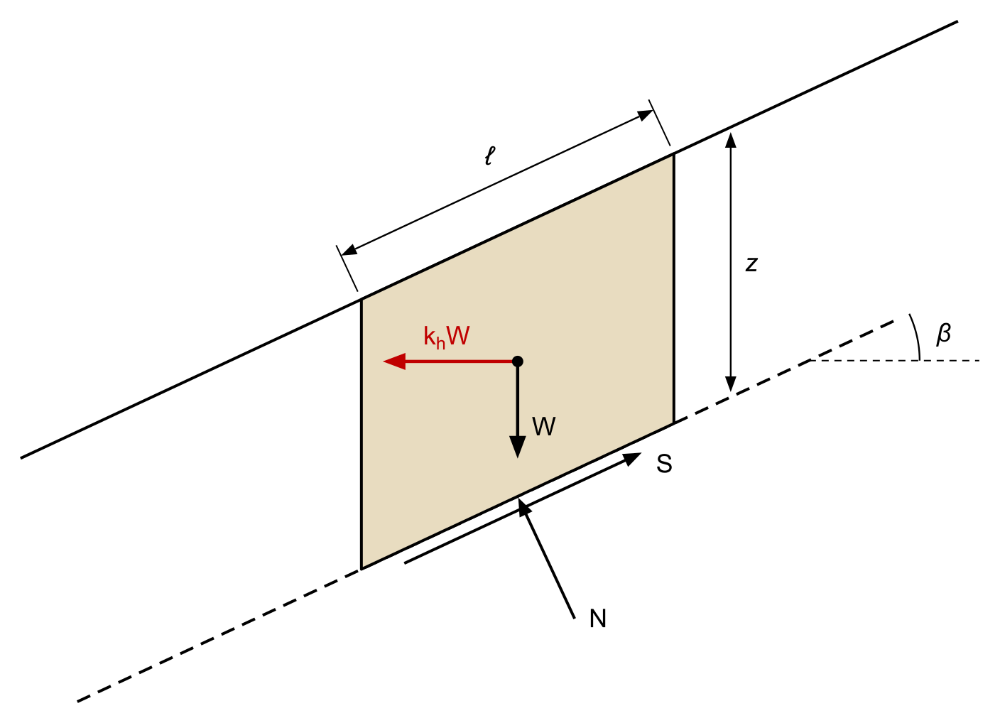
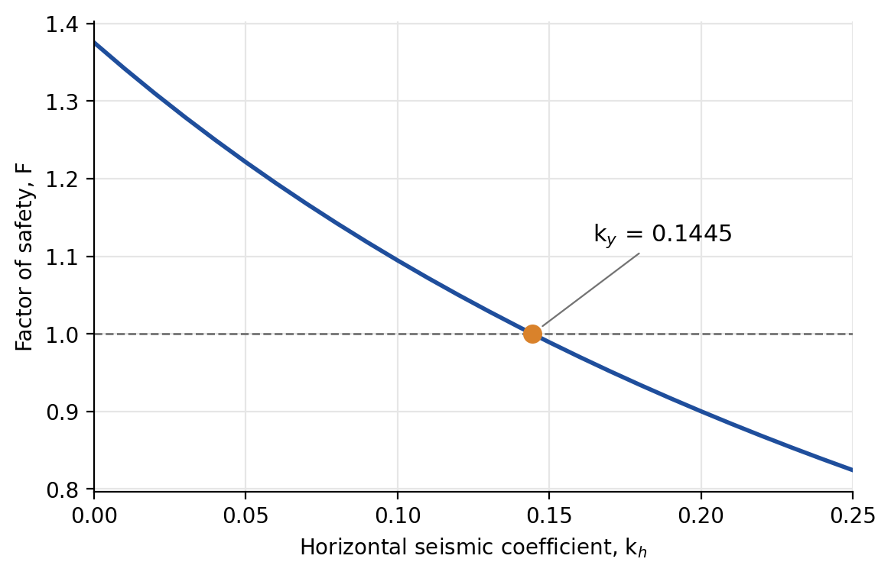

# Yield Coefficient

The **yield coefficient** $k_y$ is the seismic coefficient at which a pseudostatic analysis gives a factor of safety of
exactly 1. The yield acceleration $a_y = k_y g$ is the ground acceleration at which the sliding mass starts to move
(Duncan, Wright, and Brandon 2014, Sec. 10.1.3). The yield coefficient is the input to a
[Newmark analysis](newmark.md), which integrates the part of an acceleration record above $a_y$ to find how far the
mass moves.

**xslope** computes the yield coefficient in two ways:

- **For one slip surface,** a circle or a non-circular surface entered in the model. **xslope** solves the surface at
  a series of seismic coefficients until the factor of safety is 1.
- **By search.** **xslope** searches for the slip surface with the lowest yield coefficient, which is not always the
  surface with the lowest static factor of safety.

Both work with any limit equilibrium method, with a vertical seismic coefficient, and with the
[two-stage analysis](two_stage.md).

The page starts with the basic theory. For a mass that slides on one plane, $k_y$ has a closed form, which shows how
the yield coefficient depends on the soil's strength and the slope angle. The next section describes how
**xslope** computes $k_y$ for one circular or non-circular surface, where there is no closed form. The section after
it covers which surface to compute $k_y$ for, and how **xslope** searches for the surface with the lowest $k_y$.

## Planar Slip Surfaces {#one-plane}

The simplest case is a mass that slides on one plane, such as a block of an infinite slope. Figure 10.1 of Duncan et
al. shows the forces on one block, with the seismic force at the block's center of gravity:

{width=620px}

Perpendicular and parallel to the base,

>>$N = W\cos\beta - k_hW\sin\beta, \qquad S = W\sin\beta + k_hW\cos\beta$

and the factor of safety is

>>$F = \dfrac{c\ell + N\tan\phi}{S}$

These hold exactly for any mass that slides on one plane, because the interslice forces cancel when the slices are
summed. Setting $F = 1$ gives the yield coefficient in closed form:

>>$k_y = \dfrac{c\ell/W + \cos\beta\tan\phi - \sin\beta}{\cos\beta + \sin\beta\tan\phi}$

With $c = 0$ this is $\tan(\phi - \beta)$. A sand slope with $\phi = 35°$ and $\beta = 30°$ has a yield coefficient of
$\tan 5° = 0.087$. [DWB Figure 10.1](../verification/published.md#dwb-10-1) on the verification pages checks
**xslope** against this closed form, with and without a vertical seismic force.

## Computing the Yield Coefficient for One Surface {#one-surface}

For a circular or non-circular surface there is no closed form. Given one surface, **xslope** finds $k_y$ by trial,
with the limit equilibrium method chosen for the run:

1. It divides the sliding mass into slices once. The seismic force on each slice is $k$ times the slice's weight, so
   from one trial to the next only the seismic forces change. The slices, their weights, and their pore pressures,
   loads, and strengths stay the same.
2. It solves the surface with no seismic force. If $F$ is already 1 or less, the slope is not stable before the
   earthquake and has no yield coefficient, and the run stops.
3. It tries larger values of $k$ until $F$ falls below 1. The yield coefficient then lies between the last two values
   tried.
4. It narrows that interval, choosing each new trial value by interpolating between its two ends, until $F$ equals 1
   to within 0.00001.

Each trial is an ordinary one-stage pseudostatic analysis, with the strengths entered in the model. If **Two-stage
seismic** is also checked, each trial is a [two-stage analysis](two_stage.md) instead. Stage 1 has no seismic force, so
the undrained strengths it gives are the same at every trial, and only stage 2 changes with $k$.

For the circle with the lowest yield coefficient in the Slide2 verification problem
[VP104](../verification/rocscience.md#vp104), with Spencer's method, $F$ falls from 1.38 with no seismic force to 1 at
$k_y$ = 0.1445:

{width=640px}

## Searching for the Lowest Yield Coefficient {#which-surface}

The steps above compute $k_y$ for a surface that has already been chosen. The choice matters, because the yield
coefficient depends on which slip surface it is computed for. Duncan et al. (2014) list three candidates:

1. **The surface with the lowest static factor of safety.** There is no reason to expect it to have the lowest yield
   coefficient or the largest displacement.
2. **The surface with the lowest yield coefficient.** It can become unrealistically deep, with a yield coefficient
   too low to be realistic for computing displacements.
3. **A surface chosen with the shaking in the slope in mind.** The first two candidates come from limit equilibrium
   alone, and neither accounts for how hard each sliding mass is shaken. The shaking is not the same throughout a
   slope. In a dam, the peak accelerations grow from the bottom to the top (Duncan et al. 2014), so a deep sliding mass
   is shaken less, on average, than a shallow one near the face. The third candidate is the surface that gives the
   largest displacement once each sliding mass is shaken by its own average acceleration. Duncan et al. call it the
   most appropriate choice. FHWA (2011) gives the variation of acceleration with slope height.

With an automated search, **xslope** finds the first two candidates:

1. It searches for the critical surface with no seismic force and computes $k_y$ for that surface. This is the first
   candidate.
2. It searches again with the seismic coefficient set to that $k_y$. If the search finds a surface with $F$ below 1,
   that surface has a lower yield coefficient, so **xslope** computes $k_y$ for it.
3. It repeats step 2 with each new $k_y$ until a search finds no surface with $F$ more than 0.001 below 1, or until it
   has made six of these searches. The surface it ends with is the second candidate.

Each time it needs $k_y$ for a surface, it computes it as described under
[Computing the Yield Coefficient for One Surface](#one-surface). The Log reports $k_y$ on both surfaces, the static
critical surface first.

### When the Two Candidates Differ

For VP104 the two candidates nearly agree: $k_y$ = 0.1457 on the static critical circle and 0.1445 on the circle with
the lowest $k_y$. On other slopes they can be far apart. The figure shows the slope Duncan et al. use for their
Table 10.4 (2.5H:1V, 30 ft high, γ = 135 pcf), with soil 2's R envelope ($c_R$ = 700 psf, $\phi_R$ = 15°) and no
water:

{width=1000px}

The static critical circle is shallow, and its $k_y$ is 0.432. The circle with the lowest yield coefficient is far
larger, and its $k_y$ is 0.351. It reaches the bottom of the model, 30 ft below the toe, and comes out on the crest
about 140 ft behind the top of the slope. Of the four soils in Duncan et al.'s Table 10.3, the two circles are this
far apart only for soils 2 and 4, the two with the most cohesion. For soils 1 and 3 they nearly agree.

Neither circle settles the question. Computing $k_y$ only on the static critical circle misses a surface with a much
lower one. The deep circle has the lowest $k_y$, but Duncan et al. warn that a surface this deep gives a yield
coefficient too low for computing displacements. A deep mass is shaken less than a shallow one, so a Newmark analysis
that shakes it with the full record overstates its displacement. The third candidate accounts for this.

### Finding the Third Candidate

**xslope** cannot find the third candidate by itself, because that takes knowing how the acceleration varies through
the slope, which comes from a site response analysis. With it, you can compare surfaces by their displacements. For
each surface you want to check, such as the shallow circle, the deep circle, and one or two in between:

1. Find the surface's $k_y$. For the two circles the search found, $k_y$ is in the Log. For any other surface, enter it
   as the model's circle or non-circular surface, set **Analysis** to a single surface, and run with **Find the yield
   coefficient k_y** checked.
2. Estimate the average peak acceleration of the mass above the surface from the site response analysis.
3. In [**Newmark…**](newmark.md), choose **Target peak acceleration (g)**, enter that acceleration, and run the
   record. The record is scaled so that its peak equals the mass's average peak acceleration, and the result is that
   surface's displacement.

The surface with the largest displacement is the third candidate.

FHWA (2011) gives a simpler estimate of the average peak acceleration, for a mass that spans the full height of the
slope. It multiplies the site's peak ground acceleration, adjusted for the soil at the site, by a factor that falls as
the slope gets taller, because a tall mass does not shake in step from top to bottom. The estimate depends on the
height of the slope, not on the depth of the surface, so it suits a surface that runs the full height of the slope,
but it cannot compare surfaces of different depths.

## Vertical Seismic Coefficient {#vertical}

Design codes usually give the vertical seismic coefficient as a fraction of the horizontal one. Eurocode 8, for
example, uses $k_v = \pm 0.5k_h$ or $\pm 0.33k_h$. **xslope** follows that convention when it computes the yield
coefficient of a model that has both.

While it searches for $k_y$, **xslope** changes the horizontal coefficient from one trial to the next. At each trial it
sets the vertical coefficient to the same fraction of the horizontal one as in the model, acting up or down as it was
entered. For
example, a model with $k_h$ = 0.2 and $k_v$ = 0.1 has $k_v/k_h$ = 0.5, so a trial at $k_h$ = 0.15 uses $k_v$ = 0.075.
The yield coefficient reported is the horizontal one, and the vertical coefficient at yield is $0.5k_y$.

A model with a vertical coefficient and a horizontal coefficient of 0 gives no fraction to work from, and its yield
coefficient run is refused.

## Using the Parametric Tools {#parametric}

The [Parametric](../parametric/index.md) tools can also estimate the yield coefficient, by varying **k_seismic**, the
horizontal seismic coefficient. They are a way to check a result, or to see how the factor of safety changes with $k$.

- **Sensitivity.** A [sensitivity](../parametric/sensitivity.md) sweep plots the factor of safety against $k$. If
  **Re-search the critical surface at each step** is unticked, it solves only the surface entered in the model, and the
  curve is the one-surface curve shown in [Computing the Yield Coefficient for One Surface](#one-surface): it crosses
  $F = 1$ at that surface's $k_y$. If the option is ticked, it searches for the critical surface at each value of $k$,
  and the curve crosses $F = 1$ near the lowest yield coefficient.
- **Back-analysis.** A [back-analysis](../parametric/back_analysis.md) solves the model at evenly spaced values of $k$
  over a range you set and interpolates between them for the value at which $F = 1$. With a search at each step, the
  result is close to the lowest yield coefficient. Closer steps give a closer result.

Finding the yield coefficient directly, as described above, does not depend on the spacing of steps, reports $k_y$ for
the static critical surface as well, and passes $k_y$ to **Newmark…**.

## In Studio {#studio}

In the **Run LEM…** dialog, under **Seismic**, check **Find the yield coefficient k_y**. The model's own seismic
coefficient is not used. With **Analysis** set to a single surface, the run finds $k_y$ for the first circle or for
the non-circular surface. With an automated search, it finds the surface with the lowest $k_y$. The final solution is
computed at $k = k_y$, so its factor of safety is 1, and the LEM Solution view shows that surface. The Log and the LEM
Solution view report $k_y$ and, after a search, $k_y$ for the static critical surface too. The
[Analysis Report](../studio/reports.md) prints, under **Yield coefficient detail**, each search and its $k_y$, or the
coefficients tried on a single surface. **Newmark…** uses the last yield coefficient found.

## From Python {#python}

```python
from xslope.fileio import load_slope_data
from xslope.seismic import yield_coefficient

slope_data = load_slope_data("my_slope.xlsx")
bundle = yield_coefficient(slope_data, "spencer", analysis="auto_search")   # or "single_surface"
info = bundle["yield"]
print(info["k_y"], info["static"]["k_y"])   # the lowest k_y, and k_y for the static critical surface
```

`yield_coefficient` takes `surface="noncircular"` for a non-circular search and `seismic2=` for the two-stage
analysis. It returns the bundle of a run solved at $k = k_y$. `info["trace"]` holds every (k, F) pair computed while
finding $k_y$, and `info["rounds"]` each search.

## References

- Duncan, J.M., Wright, S.G., and Brandon, T.L. (2014). *Soil Strength and Slope Stability*, 2nd ed. Wiley, Hoboken,
  NJ. Section 10.1.
- FHWA (2011). *LRFD Seismic Analysis and Design of Transportation Geotechnical Features and Structural Foundations.*
  Geotechnical Engineering Circular No. 3, Report FHWA-NHI-11-032, Federal Highway Administration, Washington, DC.
