# Tutorials

Each tutorial here is one problem, built from scratch and solved. Each is
self-contained: it states its own geometry and materials, and
it ends with the completed model as a file you can open beside your own.

Every tutorial is written three times over — build it with the **AI assistant**,
build the **Excel input file**, or build it in **Studio's editors** — and the three
paths join at the run. Pick whichever suits you and skip the other two; all three
produce the same file.

If you have not used XSLOPE before, read
[Building Models Three Ways](building_models.md) first. It covers what every
tutorial below assumes — the template, the editors, the assistant, what **Save As**
writes, and how to send a whole project to somebody else.

## Getting started

1 guide

[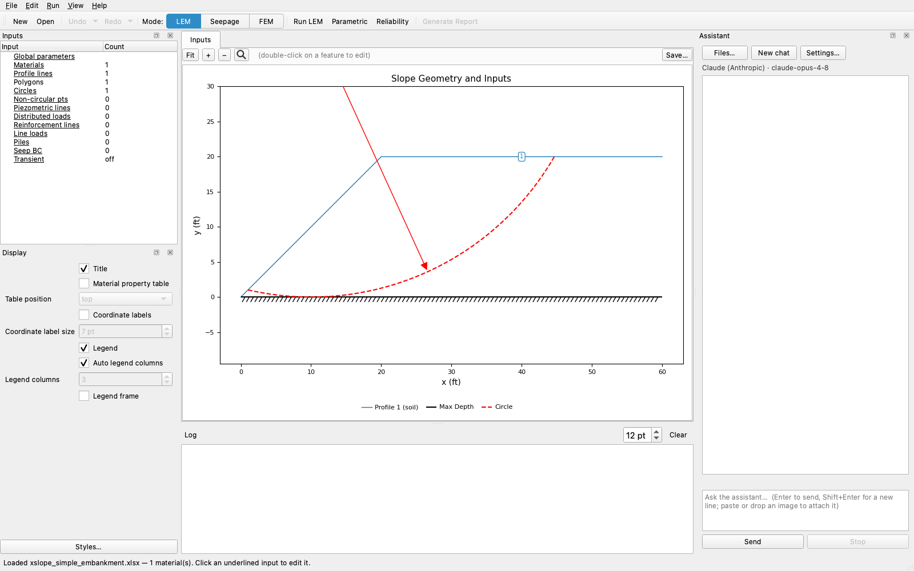](building_models.md)
0

Start here · All analyses · 10 min read

### [Building Models Three Ways](building_models.md)

The three build paths, the template's worksheets, what **Save As** writes, and `.xslz` packages for sending a project.

Excel templateStudio editorsAI assistantSave Asproject packages

## Limit equilibrium

13 tutorials

1

LEM-1 · Limit equilibrium · 10–30 min

### [Simple Embankment](lem01_simple_embankment.md)

The smallest complete model — one material, one profile line, a rigid base — searched for its critical circle with Spencer's method, then read past the factor of safety to the crest tension its warnings expose.

profile linesone materialMohr-Coulombstarting circlescircular searchtension crackwater in crack

2

LEM-2 · Limit equilibrium · 10–25 min

### [Loads on the Crest](lem02_loads_on_the_crest.md)

A surcharge added to LEM-1's embankment — spread over the crest, gathered onto a point, pushed normal to the ground or straight down, and shaken — then a sweep for the cohesion that would carry it at a target factor of safety.

distributed loadsline loadsload directionseismic coefficientdesign mode

3

LEM-3 · Limit equilibrium · 10–20 min

### [A Layered Slope](lem03_layered_slope.md)

An embankment on a foundation layer over rigid rock — a profile line at the material boundary, a starting circle at the base of each layer, and a search result read at depth: why the critical surface settles on the contact, and what moves it to the rock.

two materialsprofile linesper-layer starting circlesgenerated circlescircular search

4

LEM-4 · Limit equilibrium · 10–25 min

### [Water in the Slope](lem04_water_in_the_slope.md)

A three-layer slope on a soft foundation clay, searched for its critical circle and then measured on it — the same surface with the pore pressures on and off, u on every slice base, the γ/γ_sat unit-weight split, and ru.

three materialspiezometric lineeffective stresssaturated unit weightcircular search

5

LEM-5 · Limit equilibrium · 30–60 min

### [A Weak Layer, Non-Circular](lem05_weak_layer_noncircular.md)

A sand slope over a 2 ft seam of soft clay, with the failure surface entered as a table of vertices instead of a circle and then searched — what the Movement column does to each vertex, the methods a polyline rules out, and how steep an end ramp a search will start from.

four materialspiezometric linenon-circular surfacenon-circular searchMovement optionsweak-zone generator

[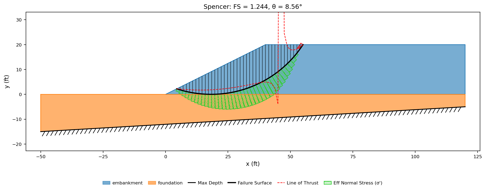](lem06_polygon_geometry.md)
6

LEM-6 · Limit equilibrium · 10–20 min

### [Polygon Geometry](lem06_polygon_geometry.md)

An embankment on bedrock that dips across the section, entered as closed material-zone polygons instead of profile lines and with no maximum depth — then searched, and read for what the base does to it: the circles it refuses, the option that truncates one against it, and the soil change that puts the critical surface on it.

two materialspolygonsdipping basecomposite surfacescircular search

[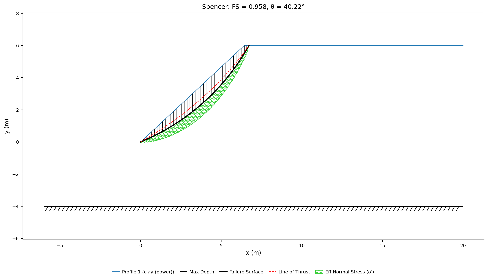](lem07_strength_envelopes.md)
7

LEM-7 · Limit equilibrium · 30–40 min

### [Strength Options Beyond Mohr-Coulomb](lem07_strength_envelopes.md)

Two slopes whose strength is not a pair of numbers — a compacted clay fitted once as a curved power envelope and once as the straight Mohr-Coulomb line through the same triaxial data, and a layered clay whose undrained strength grows with depth, flattened to a constant to see how the search responds when strength no longer increases with depth.

one materialthree materialspower-curve envelopeMohr-Coulombstrength with depthundrained strengthstarting circlescircular search

[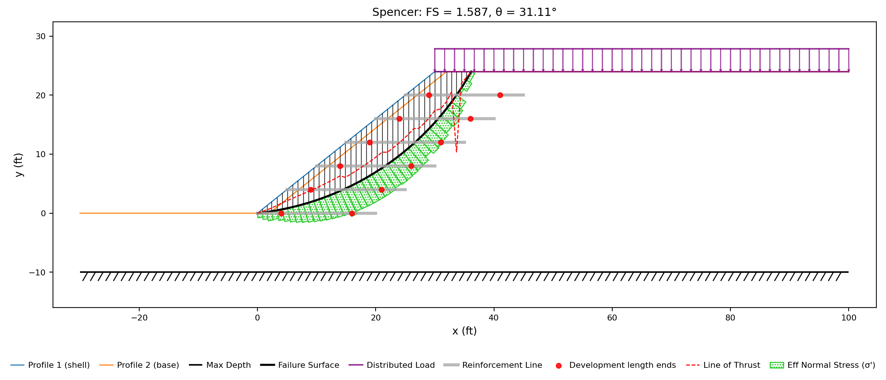](lem08_reinforced_slope.md)
8

LEM-8 · Limit equilibrium · 15–35 min

### [A Reinforced Slope (Geogrids)](lem08_reinforced_slope.md)

A 24 ft sand fill held at 1.25:1 by six geogrid layers — lines carrying a tensile capacity, a pullout length at each end and a support-type preset — searched, then read against the same slope with the lines removed, against the force each crossing mobilizes, and against the one layer the critical surface never touches.

two materialsdistributed loadreinforcement linescapacity envelopepullout lengthsupport typescircular search

[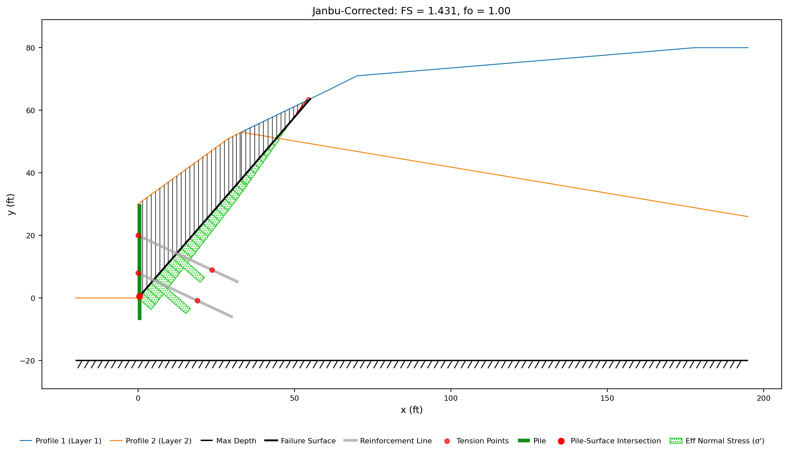](lem09_tieback_wall.md)
9

LEM-9 · Limit equilibrium · 10–25 min

### [A Tieback Wall](lem09_tieback_wall.md)

A 30 ft soldier-pile wall held by two rows of grouted tiebacks — discrete anchors entered as axial reinforcement with a bearing plate at one end and a grout bond length at the other, plus the pile that carries their heads — searched for its critical wedge, then read against the wedge a reference manual specifies, against the same wall with the anchors removed, and against the two ways an anchor force can be applied.

two materialsreinforcement linessupport typesanchorspilesnon-circular searchactive vs passive

[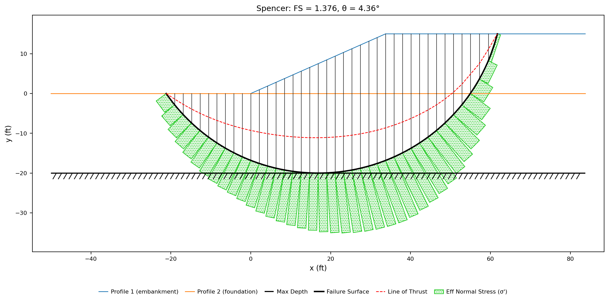](lem10_global_minimum.md)
10

LEM-10 · Limit equilibrium · 20–25 min

### [Finding the Global Minimum](lem10_global_minimum.md)

Two slopes with competing failure mechanisms: an embankment on soft clay where moving the starting circle moves the answer, and the James Bay dyke, where a single credible seed reads 23% high — resolved with a minimum slip depth and grid seeding.

starting circlescircular searchgrid seedingminimum slip depthJames Bay dyke

[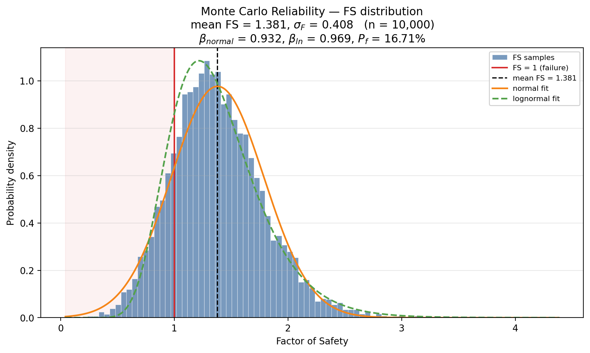](lem11_reliability.md)
11

LEM-11 · Limit equilibrium · ~30 min

### [Reliability](lem11_reliability.md)

A submerged clay slope whose strength and unit weight carry standard deviations — the factor of safety of 1.354 turned into a reliability index and a probability of failure two ways, by the Taylor series over 1 + 2N searches and by a 10,000-realization Monte Carlo campaign, then the dominant uncertainty measured and halved.

one materialundrained strengthdistributed loadstandard deviationsTaylor series (TSPM)Monte Carlovariance Paretocircular search

[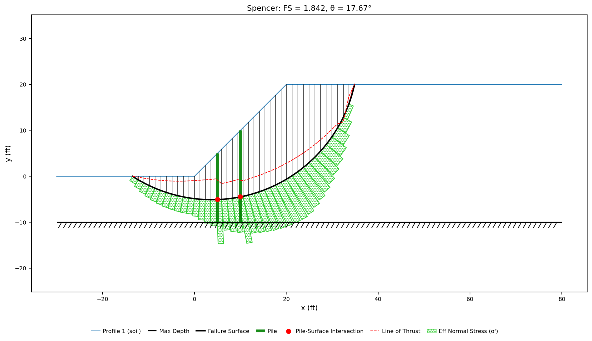](lem12_piles.md)
12

LEM-12 · Limit equilibrium · ~25 min

### [Piles](lem12_piles.md)

A 20 ft clay slope stabilized by two rows of drilled shafts whose force column is left blank, so Ito & Matsui computes it from the diameter and the spacing at every trial surface — read in the report the run writes, capped by the shaft's own bending capacity, swept across the spacing band, compared against the same force stated outright, and checked against the shallow surface that slides over the pile row.

one materialpilesIto &amp; Matsuipile spacingstructural capacityspecified pile forcecircular searchgrid seeding

[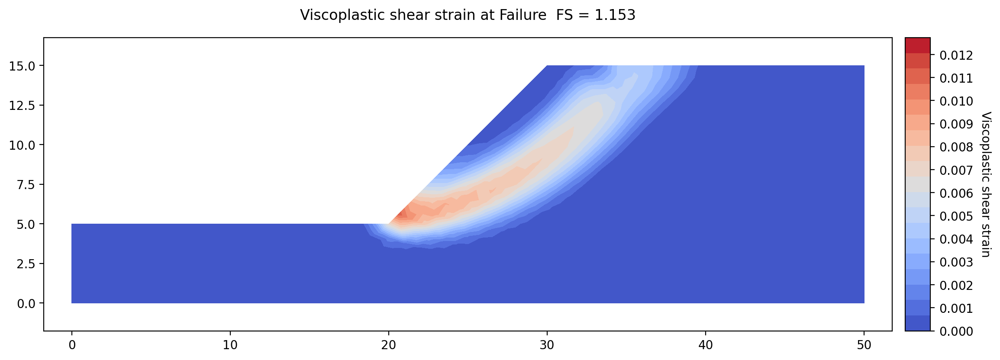](lem13_rock_slope.md)
13

LEM-13 · Limit equilibrium, finite element (strength reduction) · ~60 min

### [A Rock Slope (Hoek-Brown)](lem13_rock_slope.md)

A 10 m rock cut whose strength is described by four field observations rather than a cohesion and a friction angle — the intact strength, the Geological Strength Index, the intact constant and the blast disturbance — solved by Spencer's method and then by strength reduction on the same file, read once more with its intact strength typed in the megapascals the literature quotes, and then swept across the Geological Strength Index and the blast-disturbance factor to find which of the four field inputs controls the answer.

one materialHoek-BrownGSIdisturbance factorinstantaneous tangentcircular searchstrength reductionquadratic trianglesparametric studydesign sweepmodel checks

## Seepage

4 tutorials

1

SEEP-1 · Seepage · 10–30 min

### [Confined Seepage Under a Sheetpile](seep01_sheetpile.md)

A sheetpile driven 3 m into a 10 m silt foundation behind an impervious clay blanket, built from scratch and solved for the discharge under it — what makes a problem confined, the three boundary condition types and the no-flow default that models the blanket, meshing and element order, the flow net set up so its channels and head drops come out whole, a mesh study on a problem where the discharge keeps changing with refinement, and a conductivity sweep that is exactly proportional.

one materialconfined flowspecified headno-flow boundariesmesh generationelement typesflow netfeature refinementparametric study

2

SEEP-2 · Seepage · ~40 min

### [Unconfined Seepage Through a Zoned Dam](seep02_johnson_dam.md)

An 80 ft earth dam with a shell, a keyed clay core and 60 ft of water behind it, opened and explored — the seepage face whose wet extent is an output rather than an input, where the head drops and how much of the flow goes under the core and above the phreatic surface, the base material a zoned flow net has to be scaled to, the three unsaturated conductivity models run against each other and the one parameter that accounts for the difference between them, and a run that stops without converging.

three materialsunconfined flowseepage facephreatic surfaceunsaturated modelsrelative conductivityflow net base materialconvergenceunderseepage

[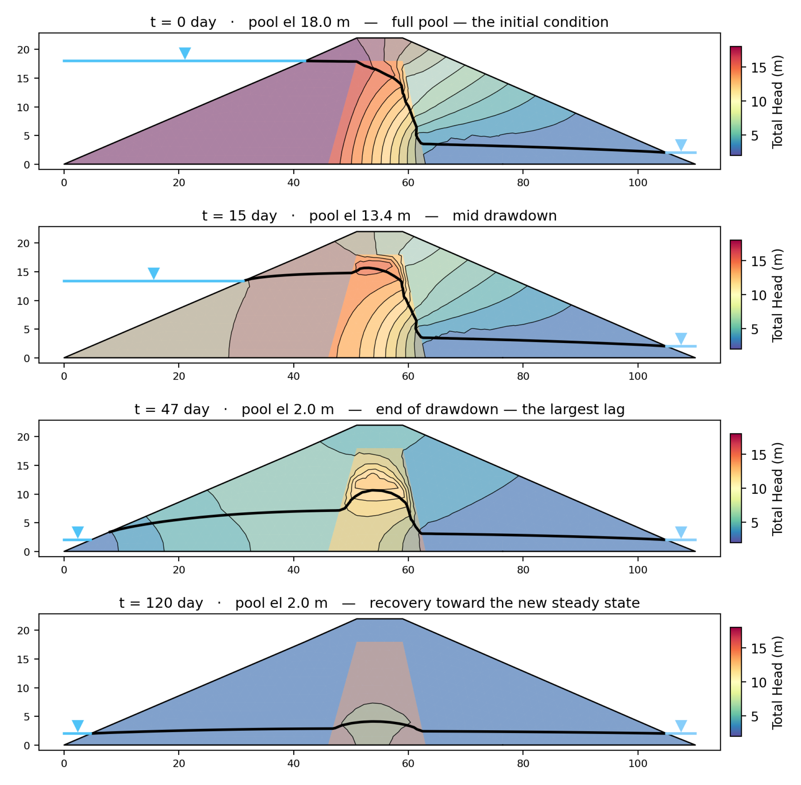](seep03_reservoir_drawdown.md)
3

SEEP-3 · Seepage · ~30 min

### [Transient Seepage: Reservoir Drawdown](seep03_reservoir_drawdown.md)

A 22 m dam with a granular shell and a clay core, whose reservoir is lowered to the tailwater elevation over 45 days — the storage properties that decide how much water a soil gives up as its head falls, the full-pool steady solution the transient run starts from, a pool schedule entered as a named time series and bound to the upstream boundary, and the three ways a transient answer is read: frames on a play bar, a head history where the core's head passes above the shell's, and an outflow ten times the steady discharge drawn entirely from storage.

two materialstransient seepagespecific storagespecific yieldtime seriesreservoir boundaryinitial conditionsaved frameshead historymass balance

[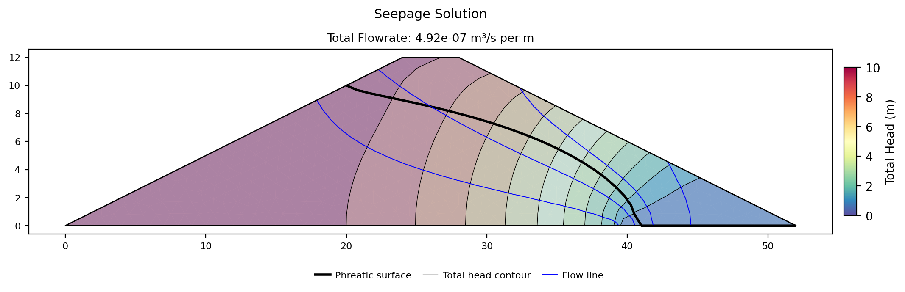](seep04_dam_infiltration.md)
4

SEEP-4 · Seepage · ~35 min

### [Infiltration and Flux Boundaries](seep04_dam_infiltration.md)

A 12 m earth dam with a reservoir, a toe drain and steady rain falling on its exposed surface, solved twice with the rain as the only difference — the specified flux that carries rainfall, the projection that turns a vertical rain rate into the normal flux a boundary takes, why a flux boundary is drawn on the section's corners rather than on a mesh's nodes, what happens at the nodes where it runs into the reservoir and the drain, and a water budget where the discharge rises 75% while the reservoir's share falls 36% — then a sweep of six rain rates that finds the ceiling past which the soil can no longer take what the boundary prescribes, and finally a transient run in which the same three flux boundaries are driven from a time series so the rain starts, holds and stops.

one materialsteady seepagespecified fluxinfiltrationnormal fluxspecified headexit facetoe drainvan Genuchtenphreatic surfacewater budgettransient seepagetime seriesstorage

## Finite element

5 tutorials

1

FEM-1 · Finite element · ~25 min

### [Strength Reduction Basics](fem01_strength_reduction.md)

A 50 ft embankment on a rigid base solved twice — once with Spencer's method for the reference answer, once by meshing the slope and weakening its soil until it can no longer stand — the two elastic properties the run requires and the measurement showing E scales every displacement while changing the factor of safety not at all, why a stability mesh has to be quadratic, the bracket the search validates and bisects with the iteration count climbing toward failure, the per-trial budget that decides which near-critical trials are allowed to finish, and the mechanism read out of shear strain, a deformed mesh and displacement vectors against the converged state on one color scale.

one materialMohr-Coulombstrength reductionYoung's modulusPoisson's ratioquadratic trianglesside boundary conditionstensile cutoffbisection bracketiteration budgetshear straindeformed meshdisplacement vectors

[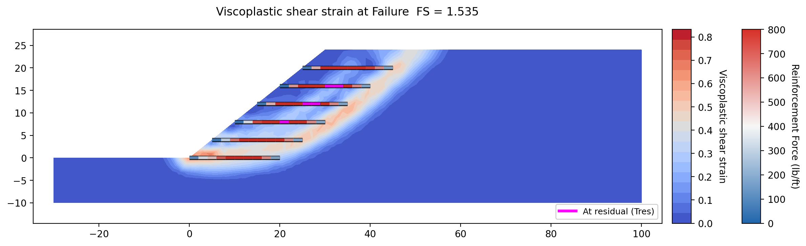](fem02_reinforcement.md)
2

FEM-2 · Finite element · ~30 min

### [Reinforcement: LEM vs FEM](fem02_reinforcement.md)

Six layers of geogrid in a 24 ft sand fill solved by Spencer's method and then by strength reduction — the two limits every reinforcement model has, bond and rupture, and what each engine does with them; the axial stiffness the finite element run requires; the per-trial iteration budget without which both runs return the same number; the elastic-perfectly-plastic run against the peak-residual one, read out of shear strain and each layer's own force profile; and two measurements of how much the modeling choices change the answer — the soil-to-bar stiffness ratio, and a residual capacity that lands on three values rather than a curve.

two materialsreinforcement linescapacity envelopepullout lengthbar elementsaxial stiffnesselastic-perfectly-plasticresidual capacitystrength reductionquadratic trianglesthin zonesiteration budget1D detailsshear strain

[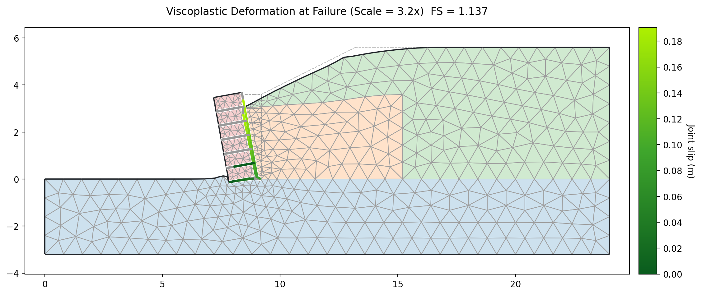](fem03_block_wall_joints.md)
3

FEM-3 · Finite element · ~60 min (2 h with the long run)

### [A Block Wall on Slip Joints](fem03_block_wall_joints.md)

A 3.6 m segmental block wall whose every contact is a slip joint — under the base of the block column, on its back face against the fill, and between each pair of courses — so the wall can slide and tip the way a stack of blocks does instead of standing as one solid; the two settings a jointed run needs and what leaving them alone costs; three geogrid layers tied into the facing and what they add; and then two small embankments, each run twice with one cell changed, to show when a geosynthetic should be a bonded bar and when a slip surface — a base geotextile the failure surface cuts across, where a bonded bar and a slip surface agree, and a smooth liner the fill slides out along, where they do not.

four materialsslip jointsjoints worksheetinterface elementblock wallelastic blocksgeogridend tiesbonded barjointed sheethybrid criterionsweep budgetlocal element sizejoint slipdeformed blocks1D detailsmodel checks

[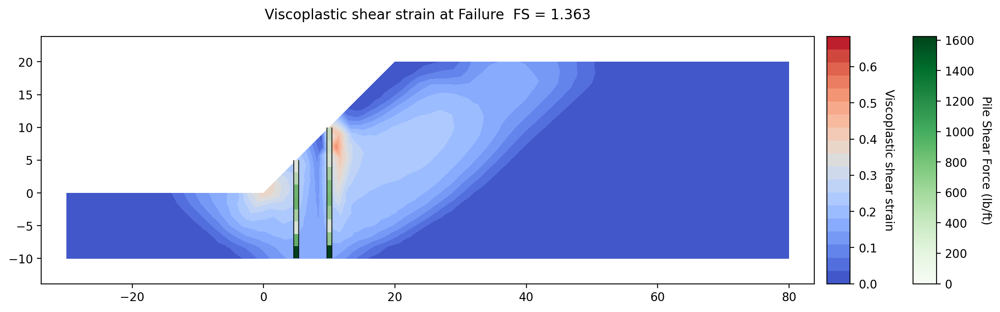](fem04_piles.md)
4

FEM-4 · Finite element · ~60 min

### [Piles: LEM vs FEM](fem04_piles.md)

Two rows of drilled shafts and a sheet pile wall on the same slope, each put through both engines — why a plane-strain finite element model has no gap between piles and turns a discrete row into a continuous wall, seen in the mechanism it forces; a spacing sweep in which the limit equilibrium answer swings 36% and changes which surface governs while the strength reduction answer does not move; the effect of fixing the pile tip, 0.047; the one benchmark with a published three-dimensional answer; and then a case suited to the finite element engine — a wall entered as a continuous member at spacing 1, run with its toe free and then fixed, and read for the moment, shear, deflection and soil reaction no limit equilibrium analysis can report.

pilesIto &amp; Matsuipile spacinghead and tip fixitybeam elementssmeared stiffnessplane strainsheet pile wallcontinuous memberstrength reductionquadratic triangles1D element sizeshear strainmoment and shear profiles

[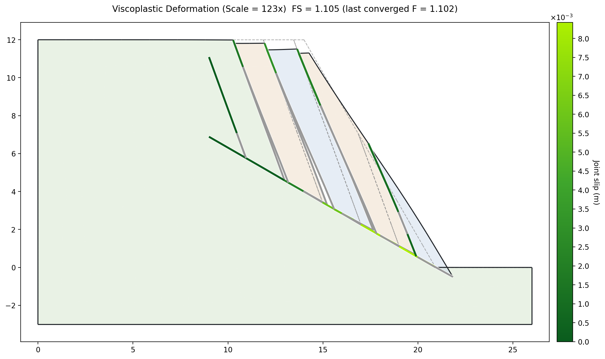](fem05_rock_slope_joints.md)
5

FEM-5 · Finite element · ~30 min

### [A Rock Slope on Its Joints](fem05_rock_slope_joints.md)

A 12 m rock face cut by a bedding plane that daylights at the toe and a release joint behind the crest, with the rock declared elastic so the strength reduction has nothing but the two surfaces to weaken — a factor of safety of 1.199 against the closed-form tan φ / tan β, and a deformed-block figure showing the slab sliding out with the release joint carrying nothing; then the same face cut by a set of joints generated from a dip and a spacing over a joint region instead of typed line by line, where the rock stands as columns that tip rather than slide, and a measurement of what halving the spacing costs.

one materialelastic rockjoints worksheetbedding planerelease jointplane failureclosed-form checkjoint regionBuild networkparallel setVoronoiblock topplingstrength reductionhybrid criterionsweep budgetjoint slipdeformed blocks

## Combined

3 tutorials

[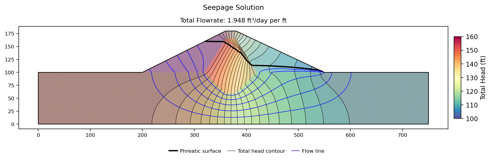](combo01_seepage_stability.md)
1

COMBO-1 · Seepage + limit equilibrium + finite element · ~20 min

### [Seepage &rarr; LEM &rarr; FEM](combo01_seepage_stability.md)

The Johnson Reservoir dam run three ways from one file — a seepage solution on a quadratic mesh, then a Spencer search and a strength reduction on that same mesh and the same pore pressures — the element type a shared mesh has to be chosen for, the materials table's `u` column that decides whether the stability engines read the seepage answer at all and what leaving it on `none` costs, and the staleness rule that stops the three results belonging to three different models.

three materialsunconfined seepageshared meshquadratic trianglespore-pressure optionu = seepSpencercircular searchstrength reductionshear strainstale results

[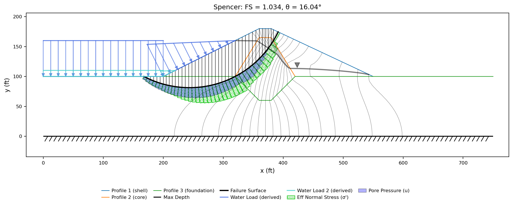](combo02_rapid_drawdown.md)
2

COMBO-2 · Limit equilibrium + seepage · ~35 min

### [Rapid Drawdown](combo02_rapid_drawdown.md)

The same dam with its reservoir lowered 50 ft, from elevation 160 to a residual pool at 110 — the Duncan, Wright and Wong three-stage procedure and its `d` / `ψ` undrained envelope, then its two water states supplied three ways, each searched from the same starting circle: a sketched piezometric pair, two steady seepage solutions from a second boundary set, and two frames of a transient run, reading 1.196, 1.206, and 1.034 — with the drained runs that bracket them, and a sweep of the core's undrained intercept that moves the governing stage from stage 2 to stage 3.

three materialsrapid drawdownthree-stage procedureKc = 1 enveloped and ψpiezometric linessecond boundary settransient seepagestage timesautomatic water loadsSpencercircular searchparametric sweep

[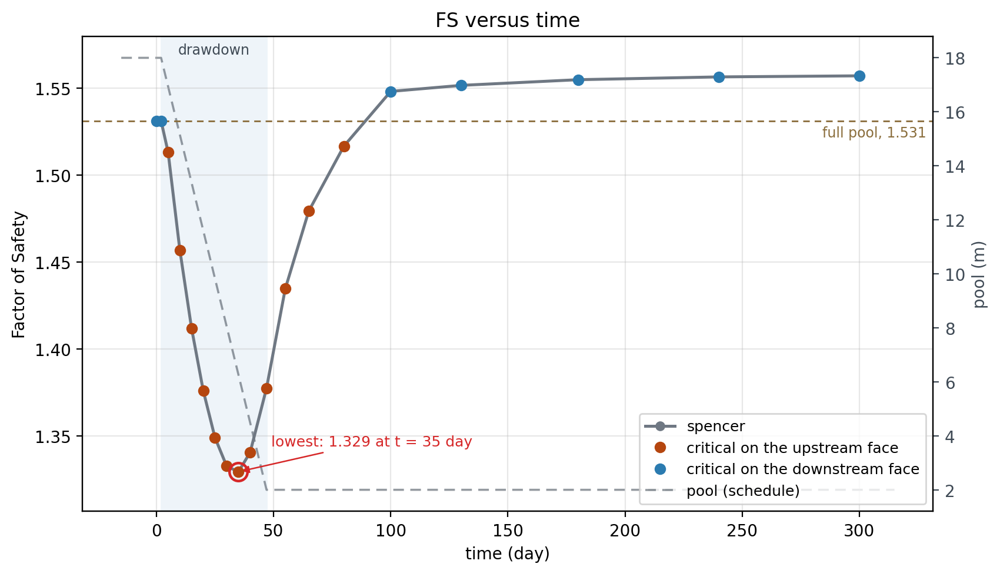](combo03_fs_vs_time.md)
3

COMBO-3 · Seepage + limit equilibrium (drained, and rapid drawdown) · ~35 min

### [Factor of Safety vs Time](combo03_fs_vs_time.md)

Two dams run for stability against every saved frame of a transient drawdown. Part 1 gives SEEP-3's cored earth dam drained strengths — how `u = seep` and Run LEM's **Seepage time** group send one instant of a transient run to a limit equilibrium search, how to place one starting circle per face so a curve spanning a full reservoir and an empty one can report either, and a minimum of 1.331 on day 35 on the upstream face against 1.531 on the downstream face at full pool. Part 2 turns the same sweep into a three-stage rapid drawdown at every instant of COMBO-2's Johnson Reservoir transient run: 1.034 on day 50, which is COMBO-2's own answer on the same circle, against 1.054 for the drained analysis of that instant — with both curves on one figure and the reason the gap is narrowest where the slope is weakest.

two materialsthree materialstransient seepageu = seepsaved framesseepage timeFS vs timerapid drawdownthree-stage procedureKc = 1 enveloped and ψstage timesSpencercircular searchstarting circlesminimum slip depthautomatic water loads

## Workflow

3 tutorials

1

W-1 · Any · ~30 min

### [The AI Assistant](w01_ai_assistant.md)

Studio's built-in assistant put through eight requests on the layered slope of LEM-3 — setting it up with a provider, a model and a key, and what a turn costs; then building the model from nothing but its drawing, editing its face, its water and its strength, a sweep the Parametric dialog offers and a sweep it does not, material stiffnesses suggested and then run through strength reduction, a question answered out of this documentation and the verification corpus, a broken file diagnosed one input at a time, and the analysis report — with what to check after each one.

AI assistantprovider setupimagesmodel editsparameter studiesstrength reductiondocumentationanalysis report

[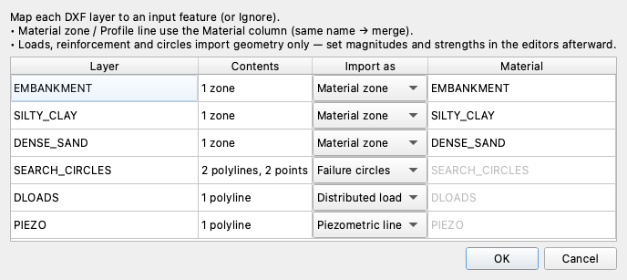](w02_import.md)
2

W-2 · Limit equilibrium · ~40 min

### [Importing Models from CAD and Other Programs](w02_import.md)

The three limit-equilibrium importers of Studio's four walked end to end — a layered DXF section of a highway embankment mapped layer by layer through the import wizard, with the seven targets a layer can take and the properties no CAD file can hold typed in afterward (1.184 on a surface tangent to the dense sand); a GeoStudio SLOPE/W verification dam that arrives whole, including one of SLOPE/W's own solved trial circles, so the two programs can be compared on one surface (1.939 against 1.934); and a Slide2 scenario that arrives with no failure surface at all, because Slide2 stores a search rather than a surface (1.372 against 1.360 once a starting circle is added) — with the note list every import reports, read against what each source model defines.

DXF importlayer mappingmaterial zonespiezometric linedistributed loadfailure circlesGeoStudio importanalysis pickerimported trial circleSlide2 importscenario pickerimport notesSpencercircular search

[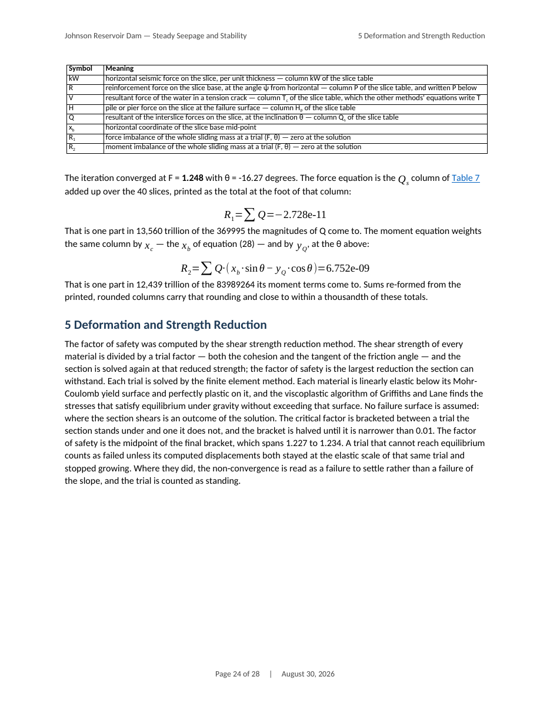](w03_report.md)
3

W-3 · Seepage + limit equilibrium + finite element · ~20 min

### [Generating the Analysis Report](w03_report.md)

A solved model turned into a Word calculation package — COMBO-1's Johnson Reservoir dam opened with its seepage and strength reduction solutions already attached, so the report documents them instead of solving them again; the Generate Report dialog walked group by group, with both stability methods documented in full (Spencer 1.248 from the search we run, Bishop 1.222 from the search the report runs for it); what the document states, from the flow net to each method's own equation with its converged numbers in it; and the same report built a second time on a company letterhead made from the template XSLOPE ships — the style names that have to survive the edit, the document properties that carry the title page into the header, and where a logo has to sit to print on every page.

generate reportattached solutionsmethod selectiontitle pagecontents treeflow netcalculationsslice tablecompany templateWord stylesletterhead

