# Tutorial LEM-14 — Pseudostatic Analysis

This tutorial shows how to analyze a slope for earthquake loading with a pseudostatic seismic coefficient and
undrained strengths from consolidated-undrained tests. The slope is a 15 ft fill at 2:1. We run it at a seismic
coefficient of 0.15 in one stage with the R envelope, then in two stages with each choice of stage 2 strength, first dry
and then with a water table. Last, we run finite element strength reduction at the same coefficient.

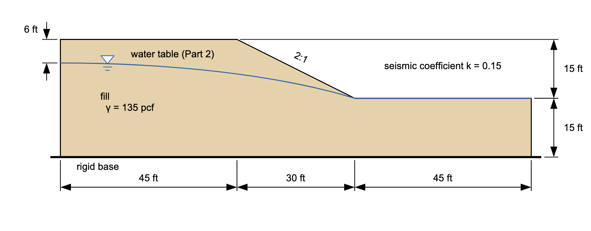{width=1000}

<div class="tut-glance" markdown>
<div class="tgt-row">
<div class="tgt-tile"><span class="tg-label">Analysis</span><p>Limit equilibrium, finite element</p></div>
<div class="tgt-tile"><span class="tg-label">Open &amp; run</span><p>~45 min</p></div>
</div>
<div class="tgm-obj" markdown>
**Objectives** — Learn how to enter a seismic coefficient, how to enter the strengths for a one-stage analysis with the
R envelope and for a two-stage analysis, and how the two procedures, the two stage 2 strengths, and a water table change
the factor of safety.
</div>
<p><span class="tg-pill">one material</span><span class="tg-pill">seismic coefficient</span><span class="tg-pill">R envelope</span><span class="tg-pill">two-stage seismic</span><span class="tg-pill">Kc = 1 envelope</span><span class="tg-pill">d and ψ</span><span class="tg-pill">piezometric line</span><span class="tg-pill">Spencer</span><span class="tg-pill">circular search</span><span class="tg-pill">strength reduction</span><span class="tg-pill">quadratic triangles</span></p>
<div class="tgm-model" markdown>
**Starter file** — [xslope_pseudostatic_start.xlsx](files/xslope_pseudostatic_start.xlsx), the dry slope with the R
envelope and no seismic coefficient

**Completed model** — [xslope_pseudostatic.xlsx](files/xslope_pseudostatic.xlsx), the slope as the tutorial leaves it,
with the water table, the R envelope, and k = 0.15; open it to start at
[Part 3](#part-3-strength-reduction-at-the-same-coefficient)
</div>
</div>

---

## The slope and the soil

The slope is 15 ft high at 2H:1V, with level ground 45 ft wide behind the crest and in front of the toe. One soil fills
the section down to a rigid base 15 ft below the toe. The water table in the sketch is added in Part 2.

The soil is soil 1 of Duncan, Wright, and Brandon (2014), Table 10.3, a compacted fill from Pilarcitos Dam with a unit
weight of 135 pcf. Its consolidated-undrained ($\overline{CU}$) tests give three strength envelopes:

| Envelope | Intercept (psf) | Friction angle (deg) |
| --- | :---: | :---: |
| Drained: c′ and φ′ | 0 | 45 |
| K<sub>c</sub> = 1: d and ψ | 64 | 24.4 |
| R envelope: c<sub>R</sub> and φ<sub>R</sub> | 60 | 23 |

An earthquake is over before a fill like this can drain, so the analysis uses its undrained strength, which depends on
the stresses the soil consolidated under before the earthquake. The two procedures get that strength in different ways:

- **One stage.** The R envelope is entered as an ordinary c and φ, and one analysis is run with the seismic force.
- **Two stages.** Stage 1 solves the slope without the seismic force, with the drained strengths, to find the
  consolidation stresses on each slice. Stage 2 adds the seismic force and gives each slice an undrained strength from
  those stresses, either from the K<sub>c</sub> = 1 envelope or interpolated between it and the drained envelope.

The [Two-Stage Analysis](../seismic/two_stage.md) page describes both procedures and the R envelope in detail.

## Opening the model

Download [xslope_pseudostatic_start.xlsx](files/xslope_pseudostatic_start.xlsx) and open it in Studio with **File →
Open**. The Inputs plot draws the section and the starting circle the search will begin from:

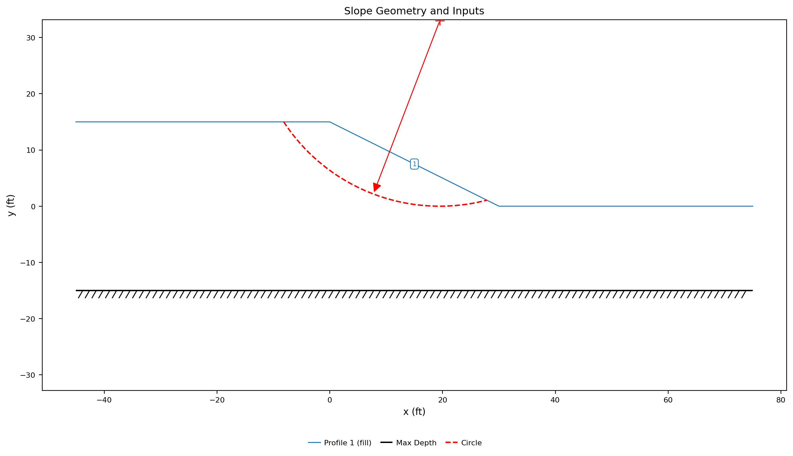{width=1000}

The fill has the R envelope as its strength, c = 60 psf and φ = 23°, with no pore pressure.

---

## Part 1 — The dry slope {#part-1-the-dry-slope}

### Entering the seismic coefficient

Open **Global parameters** and set **Horizontal seismic coefficient k** to `0.15`. Leave **Vertical seismic
coefficient k_v (+ down)** at 0:

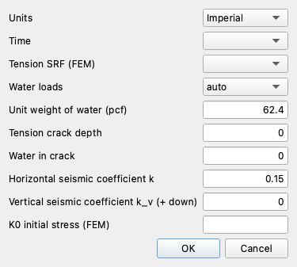

Every slice now carries a horizontal force of k times its weight, at its center of gravity. The limit equilibrium methods
point it in the direction that drives the slope, so k needs no sign for them.

### One stage with the R envelope

Click **Run → Run LEM…**, choose **Method** = `Spencer` and **Analysis** = `Auto search`, and leave **Number of slices**
at 40 and every box under **Seismic** clear:

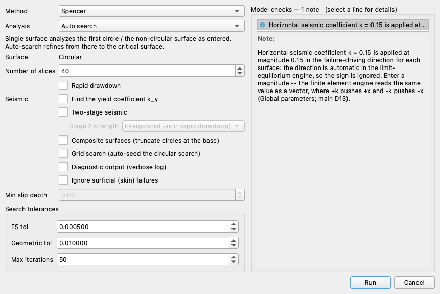

Click **Run**. The search settles on a circle that runs from just behind the crest to the toe:

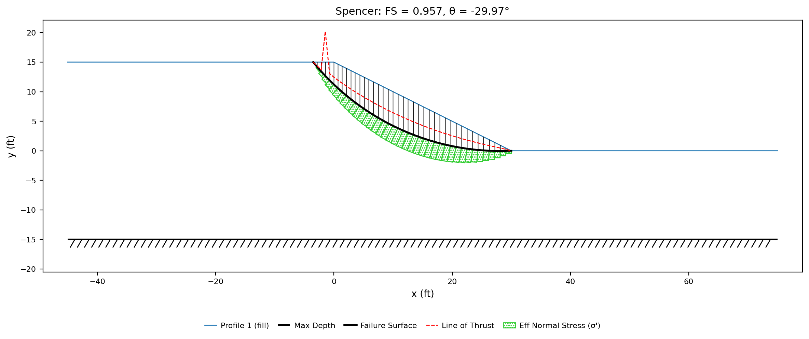{width=1000}

**FS = 0.957.**

<!-- test: file=files/xslope_pseudostatic_start.xlsx, type=circular_search, method=spencer, num_slices=40, k_seismic=0.15, expected_fs=0.957, tolerance=0.005, benchmark=LEM-14-dry-one-stage -->

### Two stages

The two-stage analysis needs the drained strengths and the K<sub>c</sub> = 1 envelope in place of the R envelope. Open
**Materials**, set the **Show parameters for:** toggles to **LEM** alone, and enter the row below (or paste it into the
table view starting at **name**). The c and φ columns now hold c′ and φ′, and the **d** and **psi** columns hold the
K<sub>c</sub> = 1 envelope:

| name | γ (pcf) | γsat (pcf) | option | c (psf) | φ (deg) | c/p | r-elev | d (psf) | ψ (deg) | u |
| --- | :---: | :---: | --- | :---: | :---: | :---: | :---: | :---: | :---: | --- |
| fill | 135 | | mc | 0 | 45 | 0 | 0 | 64 | 24.4 | none |

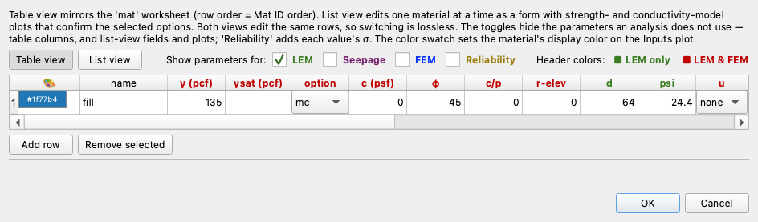

A material with d and ψ is one that does not drain during the earthquake, and stage 2 gives its slices an undrained
strength. A material without them would keep its drained strength in both stages.

Click **Run → Run LEM…** again, tick **Two-stage seismic**, and set **Stage 2 strength** to `Kc = 1 envelope`:

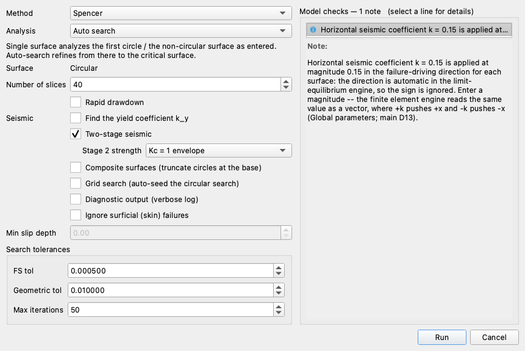

Click **Run**. The search solves both stages on every trial circle, and the Log reports both on the critical one:

```text
Critical FS = 1.068
Two-stage seismic stages on the critical circle: Stage 1 (static) FS = 2.3598, Stage 2 (seismic, undrained strength from the K_c = 1 envelope) FS = 1.0684
```

Stage 1 solves the slope before the earthquake, with the drained strengths, and gives 2.36. Stage 2 gives the factor of
safety of the two-stage analysis:

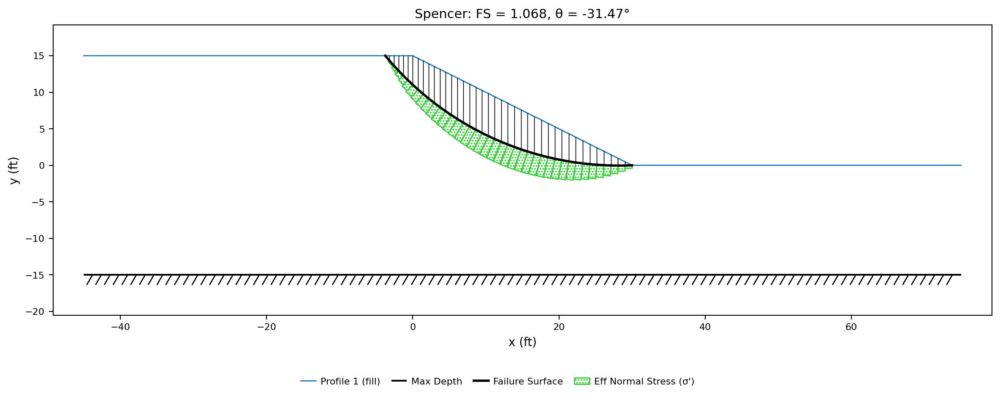{width=1000}

**FS = 1.068.**

<!-- test: file=files/xslope_pseudostatic_start.xlsx, type=circular_search, method=spencer, num_slices=40, k_seismic=0.15, mat_c=0, mat_phi=45, mat_d=64, mat_psi=24.4, seismic2=kc1, expected_fs=1.068, tolerance=0.005, benchmark=LEM-14-dry-two-stage-kc1 -->

Now run it once more with **Stage 2 strength** set to `Interpolated (as in rapid drawdown)`. The Log reports:

```text
Critical FS = 1.282
Two-stage seismic stages on the critical circle: Stage 1 (static) FS = 2.2785, Stage 2 (seismic, undrained strength interpolated between the K_c = 1 and drained envelopes) FS = 1.2820
```

<!-- test: file=files/xslope_pseudostatic_start.xlsx, type=circular_search, method=spencer, num_slices=40, k_seismic=0.15, mat_c=0, mat_phi=45, mat_d=64, mat_psi=24.4, seismic2=interpolated, expected_fs=1.282, tolerance=0.005, benchmark=LEM-14-dry-two-stage-interpolated -->

### Comparing the dry results

| Procedure | FS |
| --- | :---: |
| One stage, R envelope | 0.957 |
| Two stages, K<sub>c</sub> = 1 envelope | 1.068 |
| Two stages, interpolated | 1.282 |

The one-stage answer is below 1 and both two-stage answers are above it, so on this slope the procedure decides whether
the slope passes. The one-stage factor of safety is 90 percent of the two-stage one with the K<sub>c</sub> = 1 envelope.
Duncan et al. found the one-stage analysis between 81 and 90 percent of the two-stage one for all four of their soils.
The interpolation raises the strength further because the drained envelope, at φ′ = 45°, lies far above the
K<sub>c</sub> = 1 envelope at the stresses on this slope.

---

## Part 2 — Adding a water table {#part-2-adding-a-water-table}

### Entering the water table

Click **Piezometric lines**. On **Line 1**, leave **Type** at piezo, add 17 rows, and enter (or paste) the points
below:

| x | y |
| :---: | :---: |
| -45 | 9 |
| -40 | 8.97 |
| -35 | 8.87 |
| -30 | 8.71 |
| -25 | 8.47 |
| -20 | 8.17 |
| -15 | 7.8 |
| -10 | 7.35 |
| -5 | 6.82 |
| 0 | 6.2 |
| 5 | 5.49 |
| 10 | 4.68 |
| 15 | 3.74 |
| 20 | 2.67 |
| 25 | 1.44 |
| 30 | 0 |
| 75 | 0 |

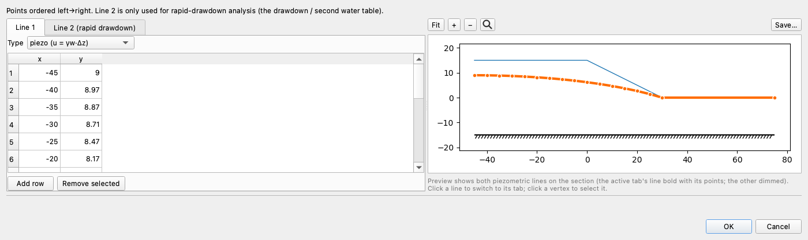

The water table stands 6 ft below the crest at the back of the model and comes out at the toe. Its shape follows
Dupuit's approximation for groundwater fed by rainfall and draining to the toe over the rigid base, so it is level at
the back and steepens toward the face.

Then open **Materials** and set **u** to `piezo`, so the fill takes its pore pressure from the line:

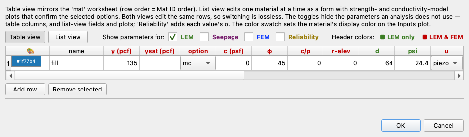

**γsat** stays blank, so the fill weighs 135 pcf below the water table as well as above it, as in Duncan et al.'s
analyses. Both stages use these pore pressures. The one-stage analysis with the R envelope needs them too, because the
R envelope gives the undrained strength from the effective stresses before the earthquake, and those depend on the pore
pressures the soil carries then.

### Two stages with the water table

Run LEM again with **Two-stage seismic** ticked, first with the `Kc = 1 envelope` and then
`Interpolated (as in rapid drawdown)`. The Log reports:

```text
Critical FS = 0.934
Two-stage seismic stages on the critical circle: Stage 1 (static) FS = 2.1228, Stage 2 (seismic, undrained strength from the K_c = 1 envelope) FS = 0.9339
```

```text
Critical FS = 1.161
Two-stage seismic stages on the critical circle: Stage 1 (static) FS = 2.0842, Stage 2 (seismic, undrained strength interpolated between the K_c = 1 and drained envelopes) FS = 1.1607
```

<!-- test: file=files/xslope_pseudostatic.xlsx, type=circular_search, method=spencer, num_slices=40, mat_c=0, mat_phi=45, mat_d=64, mat_psi=24.4, seismic2=kc1, expected_fs=0.934, tolerance=0.005, benchmark=LEM-14-wet-two-stage-kc1 -->
<!-- test: file=files/xslope_pseudostatic.xlsx, type=circular_search, method=spencer, num_slices=40, mat_c=0, mat_phi=45, mat_d=64, mat_psi=24.4, seismic2=interpolated, expected_fs=1.161, tolerance=0.005, benchmark=LEM-14-wet-two-stage-interpolated -->

### One stage with the water table

To put the R envelope back, open **Materials** and enter the row below, with d and ψ set back to 0:

| name | γ (pcf) | γsat (pcf) | option | c (psf) | φ (deg) | c/p | r-elev | d (psf) | ψ (deg) | u |
| --- | :---: | :---: | --- | :---: | :---: | :---: | :---: | :---: | :---: | --- |
| fill | 135 | | mc | 60 | 23 | 0 | 0 | 0 | 0 | piezo |

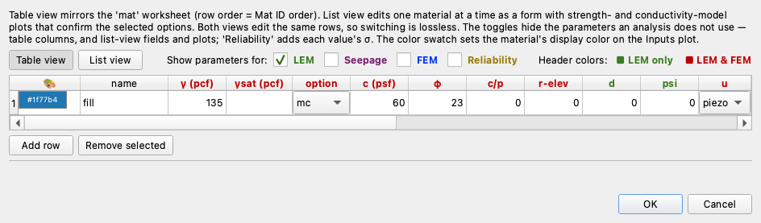

Run LEM with **Two-stage seismic** clear. The critical circle now passes below the toe and comes out on the level ground
in front of it. The blue band along its base is the pore pressure on each slice:

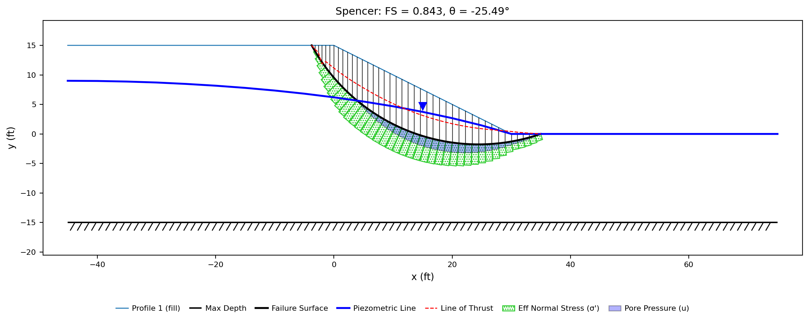{width=1000}

**FS = 0.843.**

<!-- test: file=files/xslope_pseudostatic.xlsx, type=circular_search, method=spencer, num_slices=40, expected_fs=0.843, tolerance=0.005, benchmark=LEM-14-wet-one-stage -->

### Comparing all six results

| Water | One stage, R envelope | Two stages, K<sub>c</sub> = 1 | Two stages, interpolated |
| --- | :---: | :---: | :---: |
| Dry | 0.957 | 1.068 | 1.282 |
| Water table | 0.843 | 0.934 | 1.161 |

The water table lowers every factor of safety by 0.11 to 0.13. With it, the two-stage answer with the
K<sub>c</sub> = 1 envelope also falls below 1, and only the interpolated one stays above it. Duncan et al. describe the
two-stage analysis as the proper procedure and the one-stage analysis as a simpler alternative. The interpolated stage 2
strength follows their text, which estimates the undrained strength "using the same procedures as for rapid drawdown";
the K<sub>c</sub> = 1 envelope is how their Table 10.4 was computed.

---

## Part 3 — Strength reduction at the same coefficient {#part-3-strength-reduction-at-the-same-coefficient}

The finite element engine applies the same seismic force, k times the weight of the soil, as a body force throughout the
mesh. Strength reduction cannot run the two-stage analysis, so this part uses the model as Part 2 leaves it: the R
envelope, the water table, and k = 0.15. If you are starting here, open
[xslope_pseudostatic.xlsx](files/xslope_pseudostatic.xlsx).

The finite element engine has no slip surface to read a direction from, so it reads the sign of k: **a positive k
pushes toward +x** and a negative k toward −x. This slope faces +x, with the crest on the left, so k = 0.15 drives it
down the face. A slope facing the other way would need k = −0.15.

The two elastic properties the run needs, E = 2,088,500 psf and ν = 0.3, are already on the materials table behind its
**FEM** toggle. Switch the mode strip to **FEM** and click **Run → Build Mesh…**:

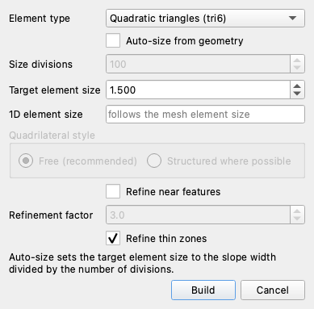

**Element type** opens on **Quadratic triangles (tri6)** and **Target element size** on `1.500`, the size the file
declares. Click **Build**. Then click **Run → Run FEM…**:

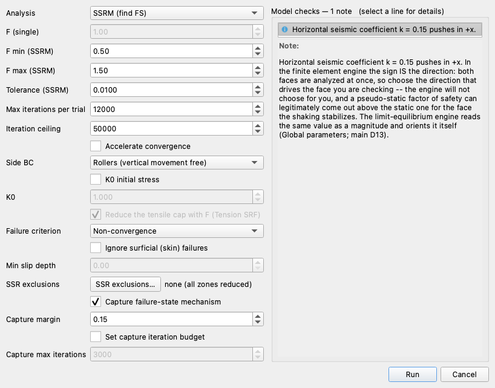

The dialog opens on **SSRM (find FS)** with the bracket the file declares, **F min (SSRM)** = 0.50 and **F max (SSRM)** =
1.50. The bracket reaches below 1 because the limit equilibrium answer is 0.843. Leave the rest alone and click **Run**.

**FS = 0.801.** The shear strain at failure shows the mechanism:

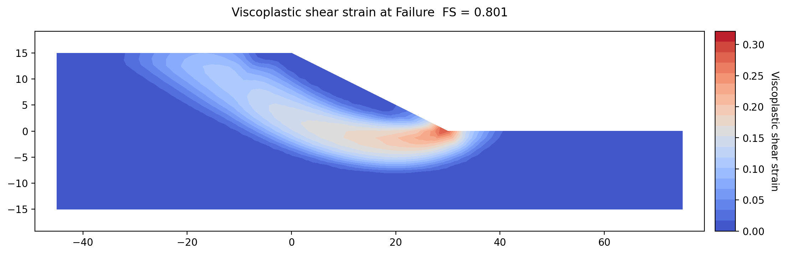{width=1000}

<!-- test: file=files/xslope_pseudostatic.xlsx, type=fem_ssrm, expected_fs=0.801, element_type=tri6, target_size=1.5, tolerance=0.01, f_min=0.5, f_max=1.5, benchmark=LEM-14-ssrm, f_stand=0.796875, f_fail=0.8046875, check=edges, expected_elements=2893, expected_nodes=5980 -->

The strain is largest at the toe and spreads back under the crest, farther back than Spencer's circle, which comes out
4 ft behind the crest. The strength reduction answer is 5 percent below Spencer's 0.843 for the same one-stage case.

---

## Conclusion

This tutorial covered:

- Entering a seismic coefficient, and how its sign matters to the finite element engine but not to the limit
  equilibrium methods.
- The one-stage analysis with the R envelope, and the two-stage analysis with c′, φ′, d, and ψ.
- The two stage 2 strengths, the K<sub>c</sub> = 1 envelope and the interpolation, and how far apart they can be.
- How a water table lowers every answer, and why the one-stage analysis needs the pore pressures from before the
  earthquake.
- Strength reduction at the same seismic coefficient.

**Where to go next:** the [Seismic Analysis](../seismic/overview.md) pages cover choosing the seismic coefficient and
the strengths.

## References

- Duncan, J.M., Wright, S.G., and Brandon, T.L. (2014). *Soil Strength and Slope Stability*, 2nd ed. Wiley, Hoboken,
  NJ. Section 10.4.
