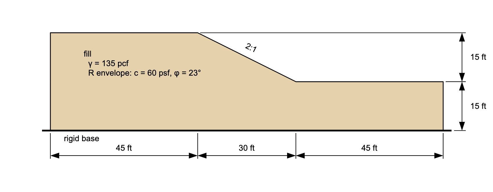
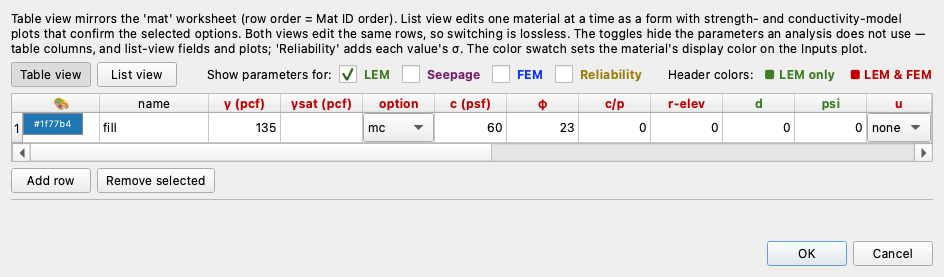
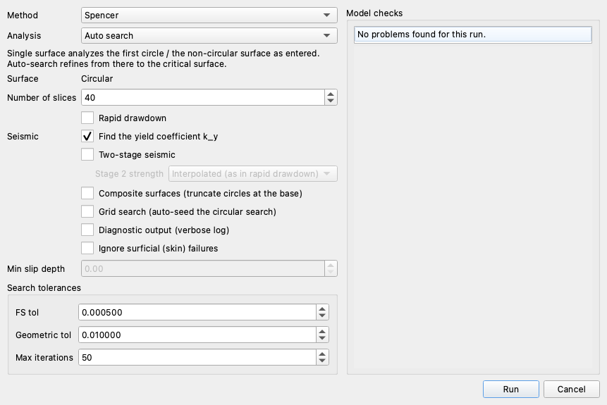
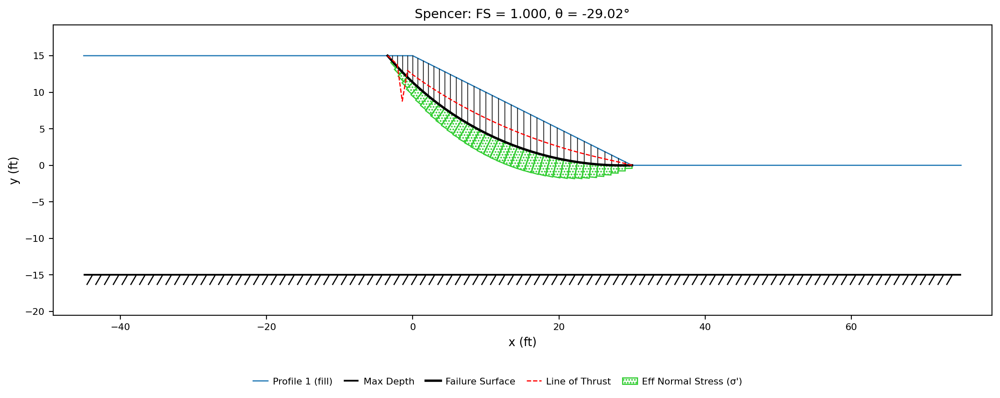
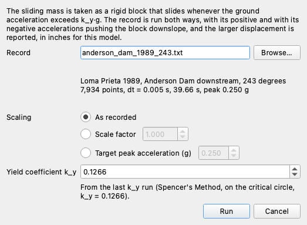
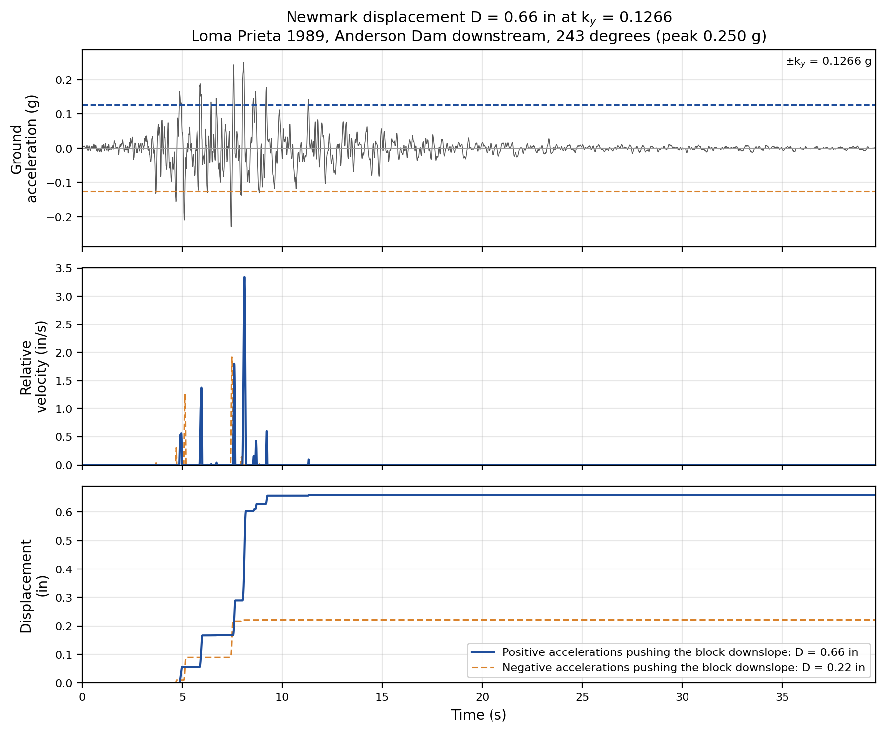
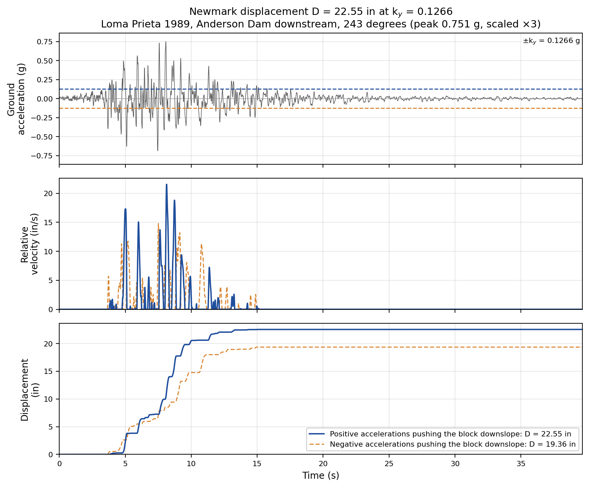

# Tutorial LEM-15 — Yield Coefficient and Newmark Displacement

This tutorial shows how to find the yield coefficient of a slope, the seismic coefficient at which its factor of safety is
1, and how far an earthquake record would move the slope in a Newmark sliding-block analysis. The slope is the dry fill
slope from [LEM-14](lem14_pseudostatic.md), with its R envelope. We find the yield coefficient on the static critical
circle and by search, and then run a record of the 1989 Loma Prieta earthquake through the sliding block as recorded and
scaled by 2 and 3.

{width=1000}

<div class="tut-glance" markdown>
<div class="tgt-row">
<div class="tgt-tile"><span class="tg-label">Analysis</span><p>Limit equilibrium</p></div>
<div class="tgt-tile"><span class="tg-label">Open &amp; run</span><p>~30 min</p></div>
</div>
<div class="tgm-obj" markdown>
**Objectives** — Learn how to find a slope's yield coefficient, how the static critical surface and the surface with the
lowest yield coefficient compare, and how to compute and read the Newmark displacement of an acceleration record,
in both directions and at more than one scale.
</div>
<p><span class="tg-pill">one material</span><span class="tg-pill">R envelope</span><span class="tg-pill">yield coefficient</span><span class="tg-pill">Spencer</span><span class="tg-pill">circular search</span><span class="tg-pill">Newmark displacement</span><span class="tg-pill">acceleration record</span><span class="tg-pill">scale factor</span></p>
<div class="tgm-model" markdown>
**Model** — [xslope_pseudostatic_start.xlsx](files/xslope_pseudostatic_start.xlsx), the dry slope of LEM-14 with the R
envelope

**Record** — [anderson_dam_1989_243.txt](files/anderson_dam_1989_243.txt), the 1989 Loma Prieta earthquake recorded
below Anderson Dam
</div>
</div>

---

## Opening the model

Download [xslope_pseudostatic_start.xlsx](files/xslope_pseudostatic_start.xlsx) and open it in Studio with **File →
Open**. It is the starter file of LEM-14, a 15 ft slope at 2:1 in one soil, dry, with one starting circle through the
toe. Open **Materials** and set the **Show parameters for:** toggles to **LEM** alone:

| name | γ (pcf) | γsat (pcf) | option | c (psf) | φ | c/p | r-elev | d | psi | u |
| --- | :---: | :---: | --- | :---: | :---: | :---: | :---: | :---: | :---: | --- |
| fill | 135 | | mc | 60 | 23 | 0 | 0 | 0 | 0 | none |



The fill's strength is its R envelope, c = 60 psf and φ = 23°, an undrained strength from consolidated-undrained tests,
as in the one-stage analysis of LEM-14. The yield coefficient comes from pseudostatic analyses, so it takes the same
undrained strength, because the earthquake is over before the fill can drain.

---

## Part 1 — The yield coefficient {#part-1-the-yield-coefficient}

The yield coefficient k<sub>y</sub> is the seismic coefficient at which the factor of safety is exactly 1. A ground
acceleration above k<sub>y</sub> g moves the sliding mass, and one below it does not. In Part 2 it decides how much of
the earthquake record moves the slope, so the displacement depends on it directly.

### Choosing the slip surface

Every slip surface has its own yield coefficient, and a Newmark analysis uses one surface and its k<sub>y</sub>.
Duncan, Wright, and Brandon (2014) list three candidates:

1. The static critical surface, the one with the lowest factor of safety before the earthquake.
2. The surface with the lowest yield coefficient.
3. The surface that gives the largest displacement once each sliding mass is shaken by its own average acceleration.

The first two come from limit equilibrium alone, and **xslope** finds both in one run. It first finds k<sub>y</sub> on
the static critical surface. Then it searches again with the seismic coefficient set to that k<sub>y</sub>. A surface
with a factor of safety below 1 at that coefficient has a lower yield coefficient, so **xslope** finds k<sub>y</sub> on
that surface and searches again, until the surface it finds is within 0.001 of F = 1.

The third candidate takes a site response analysis of the slope, which **xslope** does not do. It matters because the
shaking is not the same throughout a slope. In an embankment, the peak accelerations grow from the bottom to the top,
so a large, deep mass is shaken less, on average, than a shallow one near the face. The surface with the lowest
k<sub>y</sub> is often large and deep, and running the full record on it overstates its displacement. The
[Yield Coefficient](../seismic/yield_coefficient.md#which-surface) page explains how to find the third candidate.

### Finding the yield coefficient

One run finds both surfaces. Click **Run → Run LEM…**, choose **Method** = `Spencer` and **Analysis** = `Auto search`,
leave **Number of slices** at 40, and tick **Find the yield coefficient k_y** under **Seismic**:



The run does not use the model's own seismic coefficient. It finds k<sub>y</sub> on both surfaces. Click **Run**. The
Log reports:

```text
k_y = 0.1275 on the static critical circle (F = 1.309 with no seismic force).
k_y = 0.1266 on the circle with the lowest yield coefficient.
```

The static critical circle has a factor of safety of 1.309 before the earthquake and a yield coefficient of 0.1275. The
search found a circle with a slightly lower yield coefficient, 0.1266. The LEM Solution view shows that circle, solved at
k<sub>h</sub> = k<sub>y</sub>, so its factor of safety is 1:

{width=1000}

<!-- test: file=files/xslope_pseudostatic_start.xlsx, type=critical_kc, method=spencer, num_slices=40, expected_kc=0.1266, kc_tol=0.0005, benchmark=LEM-15-ky -->

The two circles nearly coincide, and their yield coefficients differ by less than 1 percent. For this fill the choice
of surface makes little difference, because both give a similar displacement. We use the lower value, 0.1266, in
Part 2. In a soil with more cohesion the two surfaces can be far apart, as
[the example on the Yield Coefficient page](../seismic/yield_coefficient.md#when-the-two-candidates-differ) shows.

---

## Part 2 — Newmark displacement {#part-2-newmark-displacement}

A Newmark analysis treats the sliding mass as a rigid block on an inclined plane. Whenever the ground acceleration
exceeds k<sub>y</sub> g, the block slides down the plane, and it keeps sliding until its velocity relative to the ground
returns to zero. The slips add up to the permanent displacement D. The
[Newmark Displacement](../seismic/newmark.md) page describes the method.

### The record

Download [anderson_dam_1989_243.txt](files/anderson_dam_1989_243.txt). It is the U.S. Geological Survey's corrected
record of the 1989 Loma Prieta, California, earthquake from its station downstream of Anderson Dam, horizontal component
243°: 7,934 points at 0.005 s, with a peak of 0.250 g. The file is two columns, time in s and acceleration in g, below a
header that names the record and its source.

### Running the record as recorded

Click **Run → Newmark…**. Choose the record with **Browse…**; the dialog shows its header line, its number of points,
time step, and peak acceleration. Leave **Scaling** at **As recorded**. **Yield coefficient k_y** is filled from the run
in Part 1, 0.1266:



Click **Run**. The **LEM · Newmark** view opens on three histories, the ground acceleration, the block's velocity
relative to the ground, and its displacement, each for both directions of the record:

{width=900}

The dashed lines in the top panel mark ±k<sub>y</sub>. Only a few peaks of the record pass them, between about 5 and 11
s, and each one adds a step to the displacement. The Log reports:

```text
Newmark displacement D = 0.66 in at k_y = 0.1266 under anderson_dam_1989_243.txt (peak 0.250 g), with its positive accelerations pushing the block downslope (10 slip episodes); the other way it is 0.22 in.
```

<!-- test: file=files/anderson_dam_1989_243.txt, type=newmark, ky=0.1266, units=imperial, expected_d=0.66, tolerance=0.005, benchmark=LEM-15-newmark-x1 -->

The sign of a recorded acceleration gives the compass direction of the instrument's axis, not a direction on the slope
being analyzed. So **xslope** runs the record both ways and reports the larger displacement. Here the
positive accelerations govern, at 0.66 in, against 0.22 in the other way.

### Scaling the record

A record is often scaled to the peak acceleration expected at the site. Open **Run → Newmark…** again, choose **Scaling**
= **Scale factor**, and enter `2`:


Run it, and then run it once more with a scale factor of `3`. **Target peak acceleration (g)** is the other way to scale a
record. It scales the record so that its peak equals the value entered.

| Scale factor | Peak (g) | D (in) | Other direction (in) | Slip episodes |
| :---: | :---: | :---: | :---: | :---: |
| 1 | 0.250 | 0.66 | 0.22 | 10 |
| 2 | 0.501 | 8.21 | 5.27 | 21 |
| 3 | 0.751 | 22.55 | 19.36 | 30 |

<!-- test: file=files/anderson_dam_1989_243.txt, type=newmark, ky=0.1266, units=imperial, scale=2, expected_d=8.21, tolerance=0.005, benchmark=LEM-15-newmark-x2 -->
<!-- test: file=files/anderson_dam_1989_243.txt, type=newmark, ky=0.1266, units=imperial, scale=3, expected_d=22.55, tolerance=0.005, benchmark=LEM-15-newmark-x3 -->

At a scale of 3 the record passes ±k<sub>y</sub> many times, and the block slides in 30 episodes:

{width=900}

Doubling the record multiplies the displacement by 12, and tripling it by 34. Only the part of each peak above
k<sub>y</sub> g moves the block, and as recorded only the highest peaks reach above it, and not by much. Scaled, more
peaks pass k<sub>y</sub> g, by more, and for longer. The two directions also come closer together, because at the larger
scales both the positive and the negative peaks pass k<sub>y</sub> g many times.

### What the displacement assumes

The sliding block is rigid, slides on one surface with one yield coefficient, and is shaken by the record as a whole.
Its yield coefficient stays fixed through the shaking, so the analysis suits a soil that loses little strength in an
earthquake. The [Newmark Displacement](../seismic/newmark.md#limits) page lists these limits.

---

## Conclusion

This tutorial covered:

- Finding the yield coefficient in one run, on the static critical circle and by search.
- The three candidate surfaces for a Newmark analysis, and how the first two compare on this slope.
- Running an acceleration record through the Newmark sliding block, in both directions.
- Scaling a record, and how much faster the displacement grows than the record.

**Where to go next:** the [Seismic Analysis](../seismic/overview.md) pages cover choosing the seismic coefficient, the
yield coefficient's surfaces, and the Newmark method in detail.

## References

- Brady, A.G., and Mork, P.N. (1990). *Loma Prieta, California, Earthquake October 18 (GMT), 1989; Processed Strong
  Motion Records, Volume 1.* U.S. Geological Survey Open-File Report 90-247.
- Duncan, J.M., Wright, S.G., and Brandon, T.L. (2014). *Soil Strength and Slope Stability*, 2nd ed. Wiley, Hoboken,
  NJ. Section 10.1.3.
- Newmark, N.M. (1965). "Effects of earthquakes on dams and embankments." *Géotechnique*, 15(2), 139–160.
