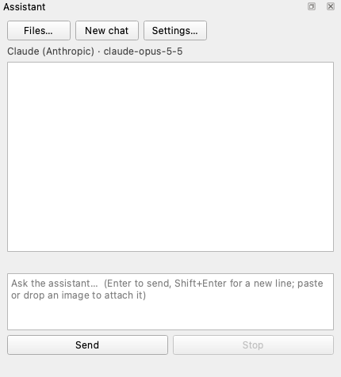
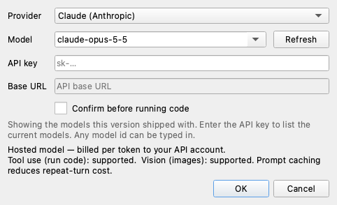
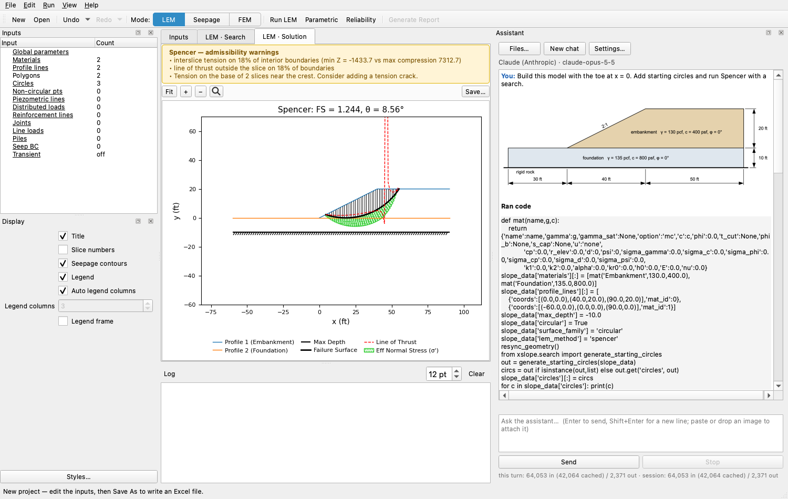
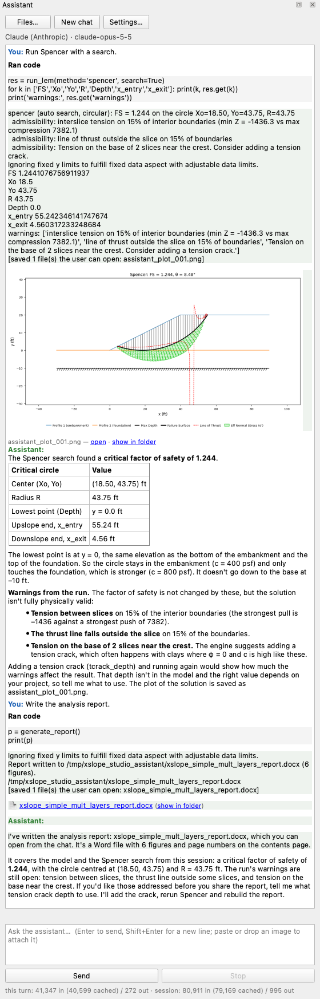

# Tutorial W-1 — The AI Assistant

Studio includes an assistant that does the work the rest of this series does by
hand. It can build a model from a drawing or from a description in words, edit
any part of one, run every analysis XSLOPE offers, sweep a parameter, answer a
question out of the built-in documentation, and write the analysis report — all
in the open project, on the same undo stack the editors use.

We set the assistant up first, then work through eight sample conversations on
one slope — the two-layer embankment of [LEM-3](lem03_layered_slope.md).

<div class="tut-glance" markdown>
<div class="tgt-row">
<div class="tgt-tile"><span class="tg-label">Analysis</span><p>Any</p></div>
<div class="tgt-tile"><span class="tg-label">Read &amp; try</span><p>~30 min</p></div>
</div>
<div class="tgm-obj" markdown>
**Objectives** — Learn how to set the assistant up and what to ask it for, and
learn how to check each kind of answer it gives back.
</div>
<p><span class="tg-pill">AI assistant</span><span class="tg-pill">provider setup</span><span class="tg-pill">images</span><span class="tg-pill">model edits</span><span class="tg-pill">parameter studies</span><span class="tg-pill">strength reduction</span><span class="tg-pill">documentation</span><span class="tg-pill">analysis report</span></p>
<div class="tgm-model" markdown>**Model** — the layered slope of
[LEM-3](lem03_layered_slope.md) —
[xslope_simple_mult_layers.xlsx](../lem/files/xslope_simple_mult_layers.xlsx)</div>
</div>

!!! note "October 2026"
    The conversations, scores and costs on this page show what the models could
    do, and what they cost, as of October 2026, when the sessions were recorded.
    Both change over time: models are updated or replaced, and providers change
    their prices.

---

## Setting it up

The assistant lives in a dock on the right of the Studio window, titled
**Assistant**. It opens with the window; **View → Assistant** brings it back if
it has been closed, and like every Studio dock it can be dragged to another
edge, floated, or widened by dragging its inner border.

{width=430}

Three buttons sit across the top: **Files…** opens the folder the assistant
saves its plots and files to, **New chat** starts a fresh conversation, and
**Settings…** opens the dialog below. Under them is a caption naming the
provider and model in use. The transcript fills the middle, the input box is
below it, and **Send** and **Stop** are at the bottom.

### The settings dialog

You bring your own model: the assistant does nothing until it has a provider and
credentials. To supply them, click **Settings…**.

{width=482}

**Provider** — the services Studio can talk to. This release offers
**Claude (Anthropic)**, **OpenAI**, **Kimi (Moonshot AI)** and **Z.ai (GLM)**,
which are hosted and bill for what you use, and **Ollama**, which runs a model on
your own machine, free, and sends nothing anywhere; the list may change from
release to release. Where a provider's catalog
mixes models that read images with text-only ones, only the models that read an
image are listed, and the caption under the box says so; every Claude model on
the list reads images. Handing the assistant a sketch of a cross section
is the first thing this tutorial does.

**Model** — a list of what the chosen provider currently offers, with one marked
as recommended. The box also accepts free text, so a model id released after your
copy of Studio was built can be typed in. **Refresh** beside it asks the provider
for its list again.

**API key** — the key from your provider's account page. It is masked as you type
and stored in your operating system's keychain, not in a settings file. Ollama
needs no key, and the field is disabled when Ollama is selected.

**Base URL** — the address the provider is reached at, filled in for you. Leave
it alone unless your provider gave you a different endpoint. It is disabled for
Claude and OpenAI, whose addresses are fixed.

**Confirm before running code** — unchecked by default. The assistant works by
writing short pieces of Python code — snippets — and running them inside Studio;
each one appears in the dock under **Ran code**, with what it printed below it.
With this box checked, every snippet is shown to you and waits for your approval.
Leaving it unchecked is fine for ordinary use: the edits change the model in
memory, and **Edit → Undo** or closing without saving takes them back.

Below the fields, two captions report where the model list came from and what the
selected model can do — running code, reading an image, prompt caching.

### What it costs

A hosted provider bills per token, and both the tokens read and the tokens
written count. A turn is one message you send and the reply it gets; inside a
turn the assistant may call the model several times, once per snippet it runs.
The line under the input box reports the tokens each turn spent and the running
total for the conversation:

```
this turn: 63,953 in (61,064 cached) / 2,401 out · session: 63,953 in (61,064 cached) / 2,401 out
```

The first number climbs while the assistant works. **New chat** starts the count
over.

A routine question — one asked of a built model, answered with a run — costs
about **40,000 input tokens** on Claude Opus 5.5, nearly all of them served from
the provider's prompt cache at a twentieth of the price of fresh input. A
conversation that edits and re-solves the model several times costs several
times that: the three edits below spend 195,000 across nine calls.

The eight conversations below were run on Claude Opus 5.5, one of the more
expensive models, and cost this much between them, measured as they ran:

| Session | Turns | Model calls | Tokens in (cached) | Tokens out | Time |
| --- | :---: | :---: | :---: | :---: | :---: |
| Building a model from a drawing | 1 | 3 | 63,953 (61,064) | 2,401 | 39 s |
| Modifying the model | 3 | 9 | 195,368 (170,963) | 4,495 | 78 s |
| A sweep with the helper | 1 | 2 | 40,377 (19,568) | 1,193 | 70 s |
| A sweep written ad hoc | 1 | 3 | 60,035 (58,526) | 1,464 | 34 s |
| Stiffnesses and a strength reduction run | 2 | 4 | 83,255 (77,723) | 1,835 | 436 s |
| Two documentation questions | 2 | 4 | 88,380 (82,373) | 4,038 | 98 s |
| A broken file | 1 | 3 | 60,884 (58,888) | 2,203 | 62 s |
| Generating a report | 2 | 4 | 80,927 (79,156) | 935 | 26 s |
| **Total** | **13** | **32** | **673,179 (608,261)** | **18,564** | **844 s** |

That comes to **\$0.93** at Anthropic's list prices on 2026-10-10: \$4.00 per
million input tokens, \$5.00 per million for a five-minute cache write and \$8.00
for a one-hour write, \$0.20 per million for a cache read, and \$20.00 per million
output tokens. The input counts above include the cache writes and the cache
reads. Price and elapsed time do not track each other: the strength reduction run
takes more than half the total time for under a tenth of the cost, because
404 of its 436 seconds are spent inside the finite element solver.

The same eight conversations cost between \$0.25 and \$1.30 on the four other
models compared under [Other models](#other-models).

Prices change; the current ones are on each provider's pricing page:
[Anthropic](https://claude.com/pricing),
[OpenAI](https://developers.openai.com/api/docs/pricing),
[Moonshot AI](https://platform.kimi.ai/docs/pricing) and
[Z.ai](https://docs.z.ai/guides/overview/pricing); Ollama is free. The turns,
calls, tokens and times are listed session by session in
[w1_sessions.txt](files/w1_sessions.txt), and [Other models](#other-models),
after the eight conversations, compares the same requests on four other models.

---

## What to expect

The eight conversations below were produced with **Claude Opus 5.5**. Another
model will do the same work differently, and so will the same model on another
day. Treat the transcripts as an illustration of what the requests look like, not
as a script to match line for line.

The assistant is good at this work, but everything it produces should still be
checked — the same checking a model built by hand deserves. Every result quoted
on this page has had that checking: each factor of safety was solved again
independently, from the saved workbook where the session wrote one, and where a
session's answer or a sentence in it is wrong, the page says so at that point.

---

## Building a model from a drawing

The assistant can build a model straight from a drawing. We paste the problem
drawing from the top of the [LEM-3 tutorial page](lem03_layered_slope.md) into
an empty project and ask for the model it describes. The drawing gives both
layers, the face, the extents, both soils and the rigid rock, so the request only
says where to put the toe and asks for the run.

Start from **File → New**. Open the LEM-3 page in your browser, right-click the
drawing at the top of it and choose **Copy image**; back in Studio, click in the
chat box, press Ctrl/Cmd+V to attach it, and type:

<div class="prompt-block" markdown>
```text
Build this model with the toe at x = 0. Add starting circles and run Spencer with a search.
```
</div>

While the conversation runs, the model takes shape in the main window: the
section appears on the canvas as the snippet builds it, the **Inputs** tree
on the left fills in, and when the search finishes the **LEM · Solution** tab
shows the critical surface — the same view a run from the **Run LEM** dialog
gives.

{width=1500}

The box above the plot lists three admissibility warnings — interslice
tension, a line of thrust outside the slice, and tension on the base of two
slices near the crest — and they are not the assistant's doing. A φ = 0 slope
with no tension crack normally raises all three, however the section was built:
by hand, from the spreadsheet, or here. LEM-3's own solution shows the same
three, and [LEM-3](lem03_layered_slope.md#the-search-result) shows the tension
crack that clears them without changing which surface is critical.

The dock itself shows the whole exchange:

{width=560}

One snippet builds the whole model. It took everything off the drawing — the
layer thicknesses, the 2:1 face, embankment 130 pcf and 400 psf, foundation
135 pcf and 800 psf, φ = 0 on both, and the rigid rock as a maximum depth of
−10 — and put the toe at x = 0 as asked. It made one change of its own: it
extended the ground on both sides, in front of the toe from the drawn 30 ft to
60 ft and behind the crest from the drawn 50 ft to 90 ft, so that trial circles
come out on the ground rather than at the model's edges, and its reply says so.
It generated three starting circles, one through the toe and one at the base of
each layer, and ran the search: **FS = 1.244**, on a surface bottoming at
elevation 0 and coming out on the face at x = 4.5, just above the toe and well
inside either extent. It reported the three admissibility warnings and placed
that surface from the Depth its own run printed — the elevation of the circle's
lowest point: *"The critical circle's lowest point is at y = 0, so it just
touches the top of the stronger foundation and stays in the embankment."*

The session saved
[w1_build_from_image_after.xlsx](files/w1_build_from_image_after.xlsx); the
exchange is in
[w1_build_from_image_transcript.md](files/w1_build_from_image_transcript.md).

<!-- test: file=files/w1_build_from_image_after.xlsx, type=circular_search, method=spencer, num_slices=40, expected_fs=1.2441, tolerance=0.005 -->

### Check its work

- **Reopen the workbook and search.** 1.2441, on a circle tangent to the
  contact — [LEM-3](lem03_layered_slope.md)'s published answer and its
  mechanism.
- **Materials editor.** 130 pcf / 400 psf and 135 pcf / 800 psf, φ = 0 and
  `u = none` on both, embankment first. The row order sets the Mat IDs the
  profile lines point at, so read it with the **Profile lines** editor: line 1,
  the top of the embankment, points at material 1.
- **Profile lines editor.** The foundation line runs from x = −60 to 130 and the
  crest to x = 130: 30 ft beyond the drawing's left edge and 40 ft beyond its
  right. Set those ends back to −30 and 90 if the model should match the drawing
  exactly; the search returns the same 1.2441.

---

## Modifying the model

Next, we take the finished slope and change three things in one conversation:
the face, the water, and the foundation's strength. Each edit is rerun, so the factor of
safety moves in front of us — and on the third, so does the governing circle.

First, we open LEM-3's completed model,
[xslope_simple_mult_layers.xlsx](../lem/files/xslope_simple_mult_layers.xlsx),
and send three requests, one at a time — each is typed after the previous
reply has finished, so every edit starts from the model the last one left. The
first prompt:

<div class="prompt-block" markdown>
```text
Change the face to 3:1 and rerun the search.
```
</div>

Then the water:

<div class="prompt-block" markdown>
```text
Add a piezometric line at elevation 30 across the whole section so the slope is fully submerged. Use the piezo pore-pressure option on both soils and enter saturated unit weights of 135 pcf for the embankment and 140 pcf for the foundation. Rerun the search.
```
</div>

Then the strength:

<div class="prompt-block" markdown>
```text
Reduce the foundation cohesion to 250 psf and rerun the search. Which circle governs now, and why?
```
</div>

{width=560}

The first turn moved the crest break to (60, 20) on the profile lines, moved both
starting circles to the middle of the new face, and reran: **FS = 1.546**, still
bottoming at elevation 0. It also extended the crest and the foundation from
x = 90 to x = 110, so that the crest stays 50 ft wide, which nothing asked for.
Its reply says so, and the change is harmless: the same edit on the file's own
extents searches to the same 1.546.

The second turn adds the piezometric line and the saturated unit weights:
**FS = 2.767**, without the admissibility warnings the dry run raised. It added
no distributed load for the pool, because **Water loads** in **Global
parameters** is already `auto` and the load on the submerged ground comes from
the piezometric line itself. Since pore pressure cannot change a φ = 0 strength,
it put the rise down to the water — the pond pressing on the face and crest —
and said it had not tested how much comes from the water and how much from the
heavier saturated soil. The water is the source: with the saturated weights
taken out, the same model searches to 2.972, so the heavier weights take some of
the rise back rather than adding to it.

The third turn drops the foundation to 250 psf: **FS = 1.418**, on a critical
surface that bottoms at **elevation −10** and exits past the toe. At 250 psf the
foundation is the weakest material in the section, and with φ = 0 its strength
does not grow with depth, so the search drives the surface down to the rigid
base at −10 — the same change of mechanism demonstrated in
[LEM-3](lem03_layered_slope.md).

One workbook was saved per turn —
[w1_modify_after_1.xlsx](files/w1_modify_after_1.xlsx),
[w1_modify_after_2.xlsx](files/w1_modify_after_2.xlsx),
[w1_modify_after_3.xlsx](files/w1_modify_after_3.xlsx) — and the conversation is
in [w1_modify_transcript.md](files/w1_modify_transcript.md).

<!-- test: file=files/w1_modify_after_1.xlsx, type=circular_search, method=spencer, num_slices=40, expected_fs=1.5460, tolerance=0.005 -->
<!-- test: file=files/w1_modify_after_2.xlsx, type=circular_search, method=spencer, num_slices=40, expected_fs=2.7673, tolerance=0.005 -->
<!-- test: file=files/w1_modify_after_3.xlsx, type=circular_search, method=spencer, num_slices=40, expected_fs=1.4184, tolerance=0.005 -->

### Check its work

- **Reload each workbook and search.** 1.5460, 2.7673 and 1.4184.
- **Read the lowest point beside each number.** Elevation 0, then 0, then −10.
  The third run is a different mechanism, not the same surface re-solved.
- **Profile lines editor, first workbook.** The crest and the foundation run to
  x = 110, 20 ft past the file we opened. Decide whether to keep that before
  comparing 1.546 with anything.
- **Circles editor, first workbook.** One starting circle is tangent to the top
  of the foundation (Depth 0) and one to the rock (Depth −10). A search started
  only from circles that cut into the foundation can stay deep and miss the
  1.546 surface.
- **Materials editor, second workbook.** `u = piezo`, with the saturated unit
  weights beside the total ones — the water explicit and the weights total, which
  is how a submerged section is entered in XSLOPE.

---

## A sweep with the helper

The first of two sweeps asks for the foundation's cohesion swept from 200 to
800 psf with a search at every step:

<div class="prompt-block" markdown>
```text
Sweep the foundation cohesion from 200 to 800 psf in steps of 100 psf, Spencer with a search at each step, and give me the factor of safety at each. Leave the model as it was.
```
</div>

{width=560}

Nothing in the request names a tool, and the assistant reached for one on its
own — a design-sweep helper built into the assistant, the counterpart of the
**Design** mode of Studio's **Run → Parametric…** dialog. One call ran the seven
searches and left the foundation's cohesion as it found it —
`foundation c after sweep: 800.0`. Under each step the helper prints what that
step's solve reported about itself, and the reply carries it into its table.

| Foundation c (psf) | FS (Spencer, searched) | Trial circles Spencer could not solve |
| :---: | :---: | :---: |
| 200 | 0.627 | 67 of 330 |
| 300 | 0.792 | 11 of 347 |
| 400 | 0.964 | 2 of 356 |
| 500 | 1.135 | none |
| 600 | 1.244 | none |
| 700 | 1.244 | none |
| 800 | 1.244 | none |

The rise below 500 psf is close to linear, and the last three rows are
identical. The assistant did not print the critical circles, and said so: it
offered the likely cause of the plateau, the critical surface moving up into the
embankment, as untested. Re-running the steps confirms it. Below 600 psf every
critical circle bottoms on the rock at elevation −10, and from 600 psf up the
surface sits on the contact and the embankment governs, capping the factor of
safety at 1.244.

The weakest steps are the ones to treat with care, and the reply says so. Beside
the unsolved trial circles, every step raised at least one admissibility note:
interslice tension on 8 to 22% of the boundaries, at most steps a line of thrust
outside the slice, and at five of the seven tension on the base of two slices
near the crest. The assistant listed them beside each factor of safety and named
the 200 to 400 psf values the least reliable. It also pointed out that the
helper had drawn a reference line at FS = 1.5, a target nobody asked for, which
no step reaches. The transcript is
[w1_sweep_builtin_transcript.md](files/w1_sweep_builtin_transcript.md).

### Check its work

- **Re-run any step.** All seven values reproduce; the 200-psf step is the one
  to watch, because a fifth of its trial circles go unsolved.
- **Read two rows against LEM-3.** 0.792 at 300 psf is its weak-foundation
  answer; 1.244 at 800 psf is its published one.
- **Read the circle at 500 and at 600 psf.** It bottoms at −10, then at 0: the
  switch from the rock to the contact is the mechanism change.
- **Materials editor.** The foundation's cohesion reads 800 psf again.

---

## A sweep written ad hoc

The second sweep asks for the factor of safety at face slopes of 2:1, 2.5:1 and
3:1, with the toe and crest elevation held. What varies is the shape of the
section rather than a value in a cell, and the **Parametric…** dialog cannot move
a slope face, so the assistant has to write the geometry change itself.

<div class="prompt-block" markdown>
```text
Compute the factor of safety for face slopes of 2:1, 2.5:1 and 3:1, keeping the crest elevation and the toe where they are, Spencer with a search each time. Give me a table. Leave the model as it was.
```
</div>

{width=560}

It wrote a short function that moves the crest break and handed it to the
assistant's sensitivity helper, which takes a function that edits the model where
the design-sweep helper of the last section takes a named property, and which
rebuilds the section and runs the search at each step. The toe stays at (0, 0),
the crest at elevation 20, and the file's two starting circles are used every
time.

| Face slope | Crest break | FS (Spencer, searched) |
| :---: | :---: | :---: |
| 2:1 | (40, 20) | 1.244 |
| 2.5:1 | (50, 20) | 1.396 |
| 3:1 | (60, 20) | 1.546 |

It put the geometry back the way it found it, and saved the table and a plot of
the factor of safety against the slope to its **Files…** folder; both appear in
the dock. It reported each face's admissibility warnings — interslice tension and
a line of thrust outside the slice on 15, 13 and 10% of the boundaries, and at
2:1 tension on the base of two slices near the crest — and judged the 2:1 result
the least reliable of the three. It also raised a possible problem it did not
test: at 3:1 only 30 ft of crest is left behind the crest break. The transcript
is
[w1_sweep_adhoc_transcript.md](files/w1_sweep_adhoc_transcript.md).

### Check its work

- **Re-run the three steps.** The three values reproduce, and the 3:1 row agrees
  with the 3:1 face change in [Modifying the model](#modifying-the-model), which
  ran on ground extended to x = 110.
- **Read the circle at each step, not only the number.** All three bottom at
  elevation 0, tangent to the top of the foundation. The 3:1 circle reaches the
  crest at about x = 75, inside the model, so the short crest does not change
  that answer.
- **Profile lines editor.** The face reads (0, 0), (40, 20), (90, 20) again: the
  model is the one we opened.

---

## Stiffnesses and a strength reduction run

For many problems, we may need assistance in selecting elastic properties:
limit equilibrium needs no stiffnesses, the finite element engine requires
them, and measured values are rarely on hand. In our next prompt,
we ask what these two soils should have, have the assistant enter them, and
then run the strength reduction analysis beside a limit equilibrium analysis
with Spencer's method.

<div class="prompt-block" markdown>
```text
Suggest elastic properties for both soils and enter them.
```
</div>

Then, once they are in:

<div class="prompt-block" markdown>
```text
Run a strength reduction analysis and compare it with the limit equilibrium result.
```
</div>

{width=560}

A built-in estimator classifies each soil from its strength and suggests
values — the embankment as **Soft Clay** at E = 167,100 psf with ν = 0.45, the
foundation as **Medium Clay** at E = 668,300 psf with ν = 0.40 — and the
assistant entered both, calling them generic textbook values rather than site
data since the model states no stiffnesses.

The second turn ran the limit equilibrium search at **FS = 1.244** — Spencer,
the method a run takes when the model names none — then built the mesh and ran
the strength reduction to **1.270**, 2.0% higher. That number comes out of a
bisection on the factor the strengths are divided by: nine trials, each of them
either converging or failing to converge, closing on the bracket
[1.2656, 1.2734], and 1.270 is its midpoint. The reply calls a 2% gap agreement
and notes that the failing trials were judged by movement that did not slow
rather than by displacements growing without limit. It did not compare the two
failure mechanisms itself; it asked the reader to check the strength reduction
plots against the Spencer circle. One sentence there is wrong: it says both
saved plots show the displacement pattern at failure, but the first is the
Spencer solution. The band of shear strain in the second runs along the top of
the foundation, where the Spencer circle bottoms.

The session saved
[w1_elastic_fem_after.xlsx](files/w1_elastic_fem_after.xlsx); the exchange is in
[w1_elastic_fem_transcript.md](files/w1_elastic_fem_transcript.md).

<!-- test: file=files/w1_elastic_fem_after.xlsx, type=fem_ssrm, expected_fs=1.270, element_type=tri6, target_size=1.2, tolerance=0.01, f_min=1.0, f_max=2.0, benchmark=W-1-ssrm, f_stand=1.265625, f_fail=1.2734375, check=edges -->

### Check its work

- **Materials editor.** The estimator's two values, entered unedited, with the
  strengths untouched.
- **Read 1.270 as a bracket.** The bisection stops once the bracket is narrower
  than the tolerance it was given, 0.01. [1.2656, 1.2734] is 0.008 wide, so the
  answer is pinned to about ±0.3%; a tighter tolerance gives a narrower one at
  the price of another trial or two.
- **The mesh came from defaults.** The run reports a tri6 mesh at target size
  1.2 — 8,849 nodes — and this model declares neither an element type nor a mesh
  size. Rebuilding at another size shows how much the answer depends on the
  mesh.

---

## Two documentation questions

The assistant can also answer questions. We ask two about the analysis rather
than for a change to the model; the first question's premise is false,
which makes it the more useful of the two.

<div class="prompt-block" markdown>
```text
Why do all of the limit equilibrium methods give the same factor of safety on this model?
```
</div>

Then, in the same conversation:

<div class="prompt-block" markdown>
```text
Both soils are undrained. What should the pore-pressure option be, and what would change in the analysis if I added a water table?
```
</div>

{width=560}

**It corrected the premise.** One snippet ran five of the methods, each with its
own search, and the answer says first that not quite all of them match.

| Method | Equilibrium satisfied | FS (searched) |
| :--- | :--- | :---: |
| Ordinary Method of Slices (OMS) | moment only | 1.244 |
| Bishop | moment, and vertical force | 1.244 |
| Spencer | moment and force | 1.244 |
| Morgenstern-Price | moment and force | 1.244 |
| Janbu (corrected) | force only | 1.314 |

<!-- test: file=../lem/files/xslope_simple_mult_layers.xlsx, type=circular_search, num_slices=40, fs_oms=1.244, fs_bishop=1.244, fs_janbu=1.314, fs_spencer=1.244, fs_mprice=1.244 -->

The reason it gives is the right one: at φ = 0 the base resistance is c·L, which
has no normal-force term, so moment equilibrium about the center is the same
equation for all four moment methods, and they find the same critical circle.
Janbu's method uses force equilibrium only and lands higher. The answer leaves
out the two other force-only methods, Lowe & Karafiath and the Corps of
Engineers method; [LEM-3](lem03_layered_slope.md) tabulates all seven. It then
tested the cause with φ = 20° in both soils for one round of searches: the five
methods spread from 2.227 to 2.312, OMS lowest, and it set φ back to 0.

For the second question the assistant searched the built-in documentation
first, and its answer quotes the entry for `none` in the table of pore-pressure
options: *"No pore pressures — dry soils, or a total stress analysis"*. Both
soils keep `u = none`, as a total-stress undrained analysis requires. It then
measured what a water table would change, with a search each time, before
putting the model back. A water table below the toe changes nothing. A water
table at elevation 10, which stands 10 ft of water against the toe, raises the
factor of safety from 1.244 to 1.416 with either pore-pressure option,
so the rise comes from the load of the pond on the ground, which XSLOPE derives
from the piezometric line itself. It said a saturated unit weight would change
the slice weights if one were entered, and did not test it. Both replies point
out that the stored LEM result is their own last test run, not the model as it
stands. The transcript is
[w1_conceptual_transcript.md](files/w1_conceptual_transcript.md).

### Check its work

- **Check that nothing moved.** Both turns changed the model only for the length
  of a run and put it back, and no workbook was written. Run the search again
  before reading the result tabs: the stored result is the last test run.
- **Search with each method.** 1.244 for the four moment methods and 1.314 for
  Janbu's, as in LEM-3's table, which adds 1.285 for Lowe & Karafiath and 1.326
  for the Corps of Engineers method.
- **Test the water attribution.** Add the piezometric line at elevation 10 and
  search with the pore-pressure option at `none` and then at `piezo`: 1.416 both
  times. The rise is the water load and nothing else.

---

## A broken file

A model is often typed in from a report, a paper or a tutorial, and one wrong
cell can move the answer without tripping any check. Finding it by hand means
reading every input against the source — a job the assistant can do. We open a
copy of the slope with three transcription errors written into it, give the
assistant the tutorial's own inputs, and ask it to check the file against them.
Nothing says where the faults are or how many there are.

That copy, [w1_diagnose_start.xlsx](files/w1_diagnose_start.xlsx), has three
faults typed into LEM-3's model: the material rows **swapped**, so the strong
clay sits in the embankment and the weak clay in the foundation; the
embankment's unit weight **13 pcf** instead of 130; and the maximum depth
**−100** instead of −10, putting a rigid base 100 ft below a 20 ft section. A Spencer's-method search returns
0.998 on it.

<div class="prompt-block" markdown>
```text
This model was built from the LEM-3 tutorial, but the factor of safety looks wrong. The tutorial's inputs are: embankment 130 pcf, c = 400 psf; foundation 135 pcf, c = 800 psf; both undrained; rigid rock 10 ft below the top of the foundation. Check the file against them, fix anything that does not match, and rerun.
```
</div>

{width=560}

It answers by reading the file once against the inputs in the request and
searching it as it came in, at 0.998. One snippet then fixes all three faults: it
re-points the two profile lines at the right materials, sets the embankment's
unit weight back to 130 pcf, and sets the maximum depth to −10. The rerun returns
**FS = 1.244** on a surface bottoming at elevation 0 — LEM-3's answer — and the
closing summary places that surface correctly: *"the circle just touches the top
of the foundation, so the slide runs through the embankment only."* It fixed the
three together, and says it did not measure how much of the rise from 0.998 to
1.244 each fix accounts for.

It repaired the swap by re-pointing the profile lines' Mat IDs rather than
reordering the material rows, so the saved
[w1_diagnose_after.xlsx](files/w1_diagnose_after.xlsx) still lists the
foundation first — defensible, and one to notice before the next person reads
that table top down. The transcript is
[w1_diagnose_transcript.md](files/w1_diagnose_transcript.md).

<!-- test: file=files/w1_diagnose_start.xlsx, type=circular_search, method=spencer, num_slices=40, expected_fs=0.9984, tolerance=0.005 -->
<!-- test: file=files/w1_diagnose_after.xlsx, type=circular_search, method=spencer, num_slices=40, expected_fs=1.2441, tolerance=0.005 -->

### Check its work

- **Reload the repaired workbook and search.** 1.2441 on a contact-tangent
  circle, against LEM-3's published 1.244.
- **Materials and Profile lines editors, before trusting the row order.** The
  foundation is still listed first, with profile line 1 pointing at material 2.
- **Maximum depth.** It reads −10 in the repaired file; the file that came in read
  −100.

---

## Generating a report

Every analysis ends in a document someone else reads, and Studio writes it:
the analysis report, from **File → Generate Report…**, which
[W-3](w03_report.md) walks through in full. The assistant can produce the same
report from the chat box, so we close the eight conversations by asking for it.
The report documents what the session has solved, so a Spencer's-method search
comes first:

<div class="prompt-block" markdown>
```text
Run Spencer with a search.
```
</div>

Then the document:

<div class="prompt-block" markdown>
```text
Write the analysis report.
```
</div>

{width=560}

The first turn returns **FS = 1.244** — [LEM-3](lem03_layered_slope.md)'s
published answer, on its published circle — and places that circle correctly: it
just touches the top of the foundation and does not cut into it. The second turn
generates the document and gives its name. The step that
[numbers the contents page](../studio/reports.md#building-the-page-numbers) was
switched off for this session, and the reply says the page has no numbers yet
and how to fill them in: open the file in Word, select all and press F9. With
that step on, as it is by default, Studio fills them in itself, and the linked
copy below has been through it. The report contains
six figures and three tables across its Traceability, Project Definition and
Limit Equilibrium Analysis sections — a short version of the full report built
in [W-3](w03_report.md), where the model includes all three engines and the
dialog's options are walked through. The session saved
[w1_report_after.docx](files/w1_report_after.docx); the transcript is
[w1_report_transcript.md](files/w1_report_transcript.md).

### Check its work

- **Open the report at §3.4.2.** "Spencer's Method gives a factor of safety of
  1.244 on the critical surface of Figure 4" — the run made in the first turn,
  not a second analysis the report performed for itself.
- **Read the traceability page.** It names the input file and its SHA-256 digest,
  so the document identifies the model it was written from.
- **Read what it says about water and loads.** No groundwater, no external water,
  no distributed loads — this section as built.

---

## Other models

The same eight requests were sent, word for word, to four other models. Like the
rest of the page, the table below is a snapshot of October 2026 (see the note at
the top), so treat its numbers as an example of how to compare models, not as a
rating of any of them.

Each session is scored twice. **Model and numbers** asks whether the work was
done: the model built or edited is the one the request describes, and every
factor of safety reported is right. **Explanation** asks whether what it said
about the mechanism or the finding is right.

| Model | Calls | Tokens in (cached) | Tokens out | Cost | Model and numbers | Explanation |
| --- | :---: | :---: | :---: | :---: | :---: | :---: |
| Claude Opus 5.5 | 32 | 673,179 (608,261) | 18,564 | \$0.93 | 8 of 8 | 8 of 8 |
| Claude Sonnet 5.5 | 36 | 769,130 (685,140) | 17,744 | \$0.54 | 8 of 8 | 6 of 8 |
| OpenAI gpt-6-astra | 36 | 509,015 (453,199) | 5,691 | \$1.30 | 8 of 8 | 7 of 8 |
| Kimi K3 (Moonshot AI) | 39 | 583,548 (502,479) | 48,803 | \$1.13 | 8 of 8 | 5 of 8 |
| GLM-5V-Turbo (Z.ai) | 39 | 557,212 (500,352) | 15,825 | \$0.25 | 6 of 8 | 1 of 8 |

gpt-6-astra is the model OpenAI names as its flagship. Four of the five build the
section the drawing shows and get the 1.244 that LEM-3 publishes for this slope,
all five run the strength reduction to the same 1.270, and in the cohesion sweep
all five report the trial circles Spencer could not solve at the weakest steps.
They part ways elsewhere. GLM-5V-Turbo drew the top of the foundation along the
ground surface, which leaves the embankment no area and puts the whole section in
the 800-psf foundation, and reported that model's 1.856. It also missed the
swapped materials in the broken file and reported 1.208 as the repaired answer.
The other four get every number right.

Opus 5.5 is the only one scored right in both columns in all eight sessions.
Sonnet 5.5's two misses are in the build, where it widened the ground in front
of the toe to 60 ft and reported it as the drawing's 30, and in the broken file,
where it placed the exit of the repaired file's critical circle beyond the toe,
on the foundation; it is on the face, at x = 4.6. gpt-6-astra's one miss is the
first documentation question: it explained why all the methods agree without running any of them, and they do not
all agree. The other misses are mostly a right number with a wrong sentence
beside it: a circle that only touches the top of the foundation described as
tangent to the rock or as deep and wide, a foundation twice as strong as the
embankment called 40% stronger, a strength reduction result said to come out
higher because the finite element method is free to find a more critical
surface, the rise under ponded water put down to heavier slices the model does
not have.

Z.ai publishes no price for GLM-5V-Turbo; its cost here is at the rate a
reseller lists for it.

---

## A harder problem

As the slope and the prompts get more complicated, the opportunity for error
rises. The same eight tasks were also run on the reinforced slope of
[LEM-8](lem08_reinforced_slope.md) — a 2 ft cohesive band along the face, six
geogrid layers, and a surcharge across the crest — and scored the same two ways.
Those sessions were run earlier, in August 2026, on the models of that
time — Claude Opus 5 rather than Opus 5.5, for example — and under different
wording of the same requests, so read them as a second problem rather than as
the models above measured twice.

| Model | Cost | Model and numbers | Explanation |
| :--- | :---: | :---: | :---: |
| Claude Opus 5 | \$2.23 | 8 of 8 | 5 of 8 |
| OpenAI gpt-5.5 | \$1.12 | 5 of 8 | 7 of 8 |
| Kimi K3 | \$1.20 | 5 of 8 | 5 of 8 |
| Claude Sonnet 5 | \$1.31 | 5 of 8 | 6 of 8 |
| Claude Haiku 4.5 | \$0.53 | 2 of 8 | 3 of 8 |
| GLM-5V-Turbo | \$0.24 | 5 of 8 | 4 of 8 |

Most of the errors had three causes. The 2 ft band along the face is a thin zone
read off a drawing, and a model that missed it gave the whole embankment one
strength. Moving the crest break for a flatter face left the surcharge behind on
the old geometry. And in the diagnosis, several models measured the effect of a
planted fault and then filed it under something other than a fault — which is why
the checks above re-run the measurements rather than read the conclusions.

---

## Conclusion

This tutorial covered:

- Setting the assistant up: a provider, a model and a key in **Settings…**, and
  13 turns of work for about \$0.93.
- Building a layered model from a drawing and editing it three ways — face, water
  and strength — with every factor of safety reproducing from the saved workbook.
- Two sweeps, a strength reduction run, two questions answered without leaving a
  change in the model, a diagnosis that fixed all three planted faults, and a
  report documenting the run it names.
- Checking what came back: reload the workbook and re-run the search, read the
  findings as well as the numbers, and look for changes nobody asked for — the
  build and the face change both widened the ground beyond what they were given.

**Where to go next:** The [AI Assistant reference](../studio/assistant.md)
documents the helpers the assistant calls, the checks that run after every edit,
and what each provider can do. In [LEM-3](lem03_layered_slope.md) this same
slope is built by hand three ways, and in [LEM-8](lem08_reinforced_slope.md) we
build the reinforced slope the comparison above runs on.
