# Videos

Short walkthroughs of XSLOPE, published on the
**[xslope YouTube channel](https://www.youtube.com/@xslope-org)**. Each video
below lists the completed model it builds, and the starting model when it doesn't
begin from a blank one, so you can download the file and follow along.

## Getting started

Videos 1–2

[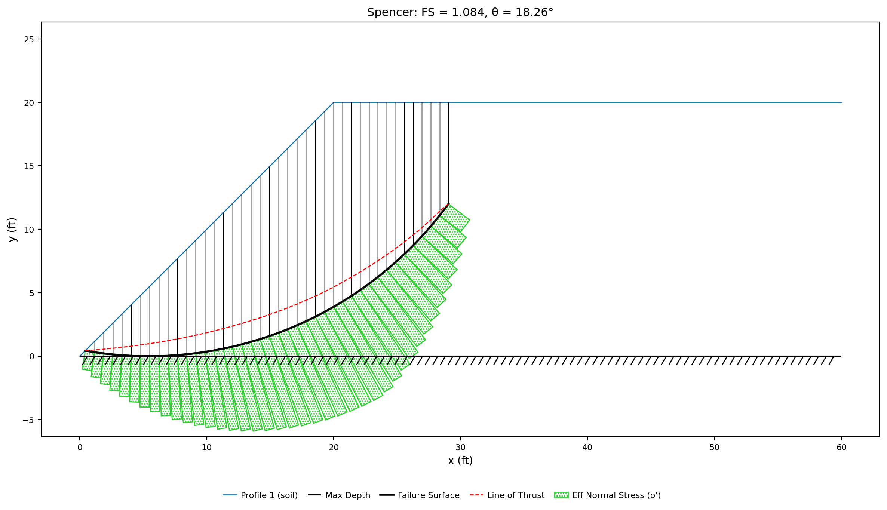](https://youtu.be/bNy9WkYUvLc)
1

Video 1 · Limit equilibrium

### A Simple Embankment from Scratch {#video-1}

A 20 ft embankment of undrained clay, built in Studio's editors starting from
**File → New**: the global parameters, one material, one profile line, and a
starting circle from the generator. A Spencer search finds the critical circle,
its warnings show the crest in tension, and an 8 ft tension crack removes the
tension and lowers the factor of safety.

<a class="vid-pill vid-watch" href="https://youtu.be/bNy9WkYUvLc">▶ Watch · 18 min</a>

**Completed model** — [xslope_video01_simple_embankment.xlsx](files/xslope_video01_simple_embankment.xlsx)

<!-- test: file=files/xslope_video01_simple_embankment.xlsx, type=circular_search, method=spencer, num_slices=40, expected_fs=1.084, tolerance=0.005 -->

**Related tutorial** — [LEM-1. Simple Embankment](../tutorials/lem01_simple_embankment.md)

[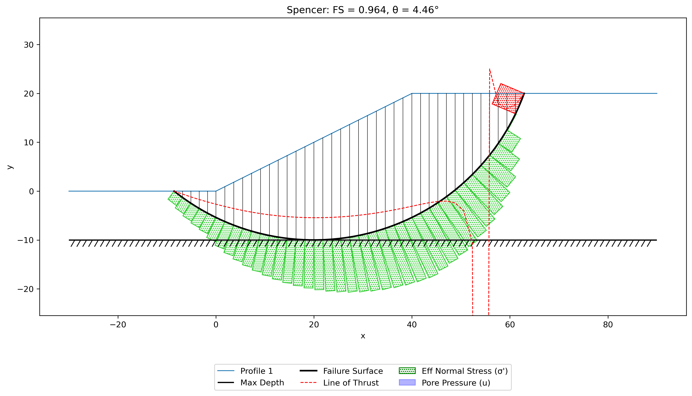](https://youtu.be/mjhU-9LGG4k)
2

Video 2 · Limit equilibrium

### Building a Model Three Ways {#video-2}

A 20 ft slope of undrained clay, with the soil continuing 10 ft below the toe to
a rigid base, built three ways: in the Excel input template, in Studio's editors,
and by Studio's AI assistant from the problem sketch. All three builds give the
same model and the same factor of safety, 0.964: the slope as drawn is unstable.

<a class="vid-pill vid-watch" href="https://youtu.be/mjhU-9LGG4k">▶ Watch · 17 min</a>

**Completed model** — [xslope_simple_foundation.xlsx](../lem/files/xslope_simple_foundation.xlsx)

**Related pages** — [Building Models Three Ways](../tutorials/building_models.md) ·
[LEM sample problem 1](../lem/samples.md#1-simple-slope-with-foundation)

## Limit equilibrium

Videos 3–8

[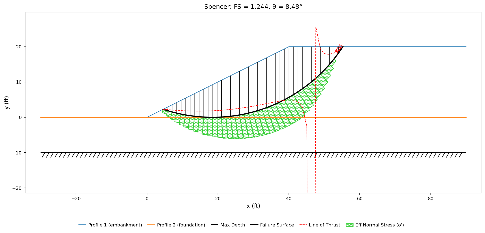](https://youtu.be/mNE2UAJeb4Y)
3

Video 3 · Limit equilibrium

### Adding Layers {#video-3}

An embankment on a foundation layer over rigid rock, with a profile line at each
material boundary and a starting circle at the base of each layer. The search
result shows why the critical circle settles on the contact between layers.
With a weaker foundation, the same search finds a deeper circle that reaches the
rock, at a much lower factor of safety.

<a class="vid-pill vid-watch" href="https://youtu.be/mNE2UAJeb4Y">▶ Watch · 8 min</a>

**Completed model** — [xslope_simple_mult_layers.xlsx](../lem/files/xslope_simple_mult_layers.xlsx)

**Related tutorial** — [LEM-3. A Layered Slope](../tutorials/lem03_layered_slope.md)

[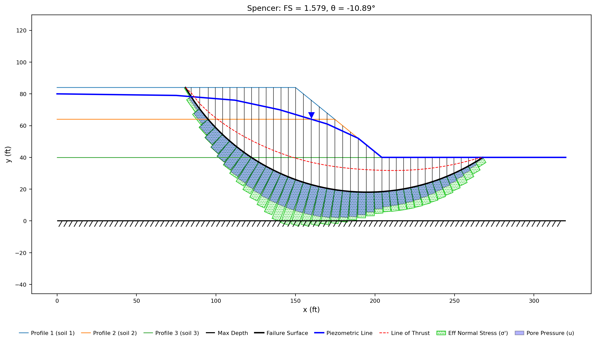](https://youtu.be/82QOuQAxOrw)
4

Video 4 · Limit equilibrium

### Water in the Slope {#video-4}

A piezometric line added to a layered slope, with saturated unit weights below
it. The same critical surface is solved with the pore pressures on and off to
show what the water costs.

<a class="vid-pill vid-watch" href="https://youtu.be/82QOuQAxOrw">▶ Watch · 10 min</a>

**Starting model** — [xslope_video04_water_start.xlsx](files/xslope_video04_water_start.xlsx)

<!-- test: file=files/xslope_video04_water_start.xlsx, type=circular_search, method=spencer, num_slices=40, expected_fs=1.667, tolerance=0.005 -->

**Completed model** — [xslope_method_slices_problem.xlsx](../lem/files/xslope_method_slices_problem.xlsx)

**Related tutorial** — [LEM-4. Water in the Slope](../tutorials/lem04_water_in_the_slope.md)

[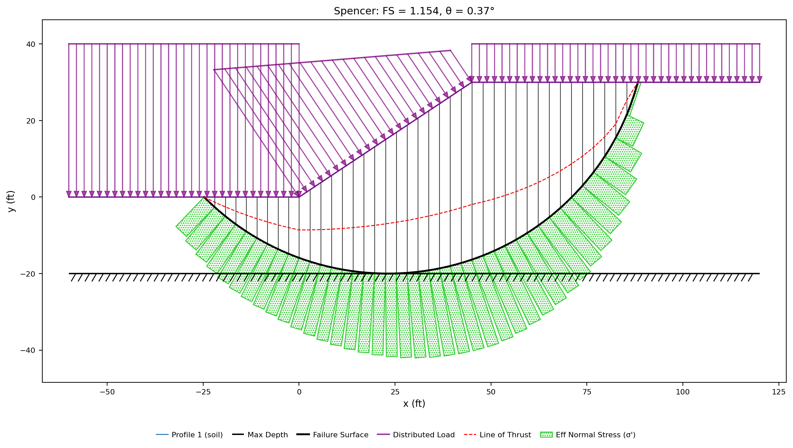](https://youtu.be/21n3zhrO1XE)
5

Video 5 · Limit equilibrium

### A Submerged Slope {#video-5}

A clay slope under 10 ft of standing water. The water is entered as a
piezometric line above the ground, and Studio converts it into the load the water
applies to the slope surface. Because the clay is analyzed with its undrained
strength, the water adds load without adding pore pressure in the soil.

<a class="vid-pill vid-watch" href="https://youtu.be/21n3zhrO1XE">▶ Watch · 9 min</a>

**Completed model** — [xslope_video05_submerged.xlsx](files/xslope_video05_submerged.xlsx)

<!-- test: file=files/xslope_video05_submerged.xlsx, type=circular_search, method=spencer, num_slices=40, expected_fs=1.154, tolerance=0.005 -->

**Related page** — [LEM sample problem 2](../lem/samples.md#2-submerged-slope)

[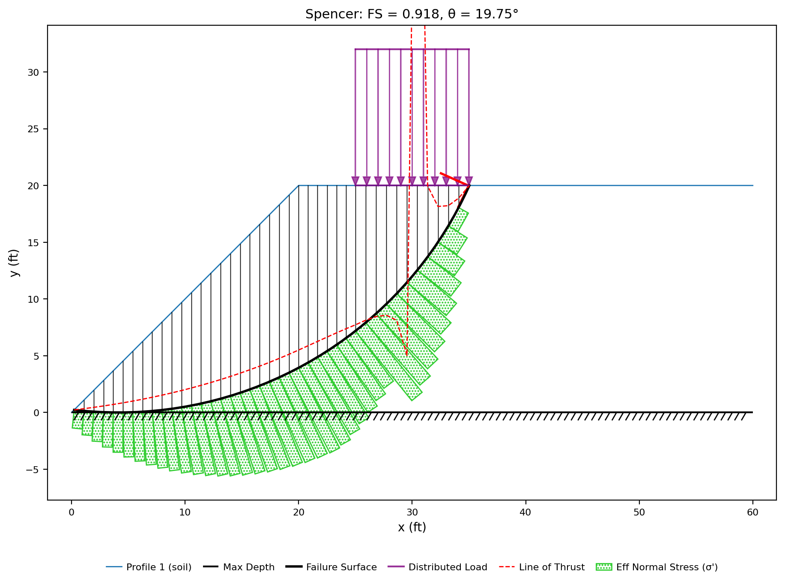](https://youtu.be/bru3hkAFsX8)
6

Video 6 · Limit equilibrium

### Loads and Earthquake {#video-6}

A stockpile on the crest of the Video 1 embankment, entered first as a distributed
load and then as a line load carrying the same force, followed by a seismic
coefficient. Each load moves the critical circle, so each case gets its own search.

<a class="vid-pill vid-watch" href="https://youtu.be/bru3hkAFsX8">▶ Watch · 10 min</a>

**Starting model** — [xslope_video01_simple_embankment.xlsx](files/xslope_video01_simple_embankment.xlsx), the Video 1 completed model

**Completed model** — [xslope_video06_loads.xlsx](files/xslope_video06_loads.xlsx)

<!-- test: file=files/xslope_video06_loads.xlsx, type=circular_search, method=spencer, num_slices=40, expected_fs=0.890, tolerance=0.005 -->

**Related tutorial** — [LEM-2. Loads on the Crest](../tutorials/lem02_loads_on_the_crest.md)

[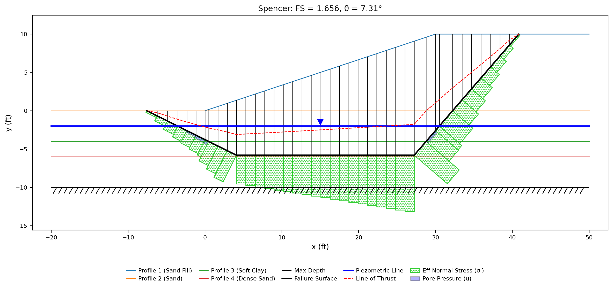](https://youtu.be/yhR6sioGTek)
7

Video 7 · Limit equilibrium

### A Non-Circular Surface Through a Weak Layer {#video-7}

A sand slope over a thin seam of soft clay. The weak-zone generator builds a
failure surface that runs along the seam, and a search moves its vertices to the
critical surface. The Movement column controls how each vertex is allowed to move
during the search.

<a class="vid-pill vid-watch" href="https://youtu.be/yhR6sioGTek">▶ Watch · 12 min</a>

**Starting model** — [xslope_video07_weak_layer_start.xlsx](files/xslope_video07_weak_layer_start.xlsx)

**Completed model** — [xslope_noncircular.xlsx](../lem/files/xslope_noncircular.xlsx)

**Related tutorial** — [LEM-5. A Weak Layer, Non-Circular](../tutorials/lem05_weak_layer_noncircular.md)

[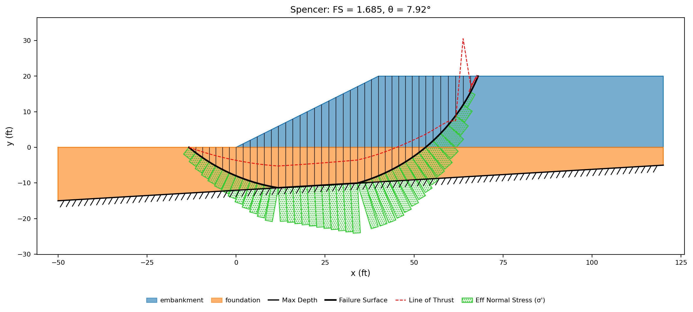](https://youtu.be/dljDgesNJjQ)
8

Video 8 · Limit equilibrium

### Polygon Geometry {#video-8}

An embankment on bedrock that dips across the section, entered as one closed
polygon per material zone instead of profile lines. The dipping base limits the
circles a search can try, and the composite-surface option lets a circle run
along the bedrock instead of being refused.

<a class="vid-pill vid-watch" href="https://youtu.be/dljDgesNJjQ">▶ Watch · 11 min</a>

**Completed model** — [xslope_sloping_bottom.xlsx](../lem/files/xslope_sloping_bottom.xlsx)

**Related tutorial** — [LEM-6. Polygon Geometry](../tutorials/lem06_polygon_geometry.md)

## Seepage

Videos 9–11

[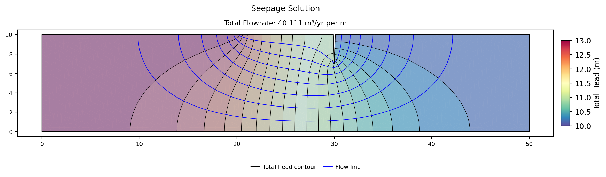](https://youtu.be/wxmpjUXc80s)
9

Video 9 · Seepage

### Confined Seepage Under a Sheetpile {#video-9}

A sheetpile wall in a silt layer behind an impervious clay blanket, built from a
blank model: the boundary conditions and the no-flow default, the mesh, the
discharge, a flow net checked by hand, and where the hydraulic gradient is
highest.

<a class="vid-pill vid-watch" href="https://youtu.be/wxmpjUXc80s">▶ Watch · 15 min</a>

**Completed model** — [xslope_clay_blanket.xlsx](../seep/files/xslope_clay_blanket.xlsx)

**Related tutorial** — [SEEP-1. Confined Seepage Under a Sheetpile](../tutorials/seep01_sheetpile.md)

[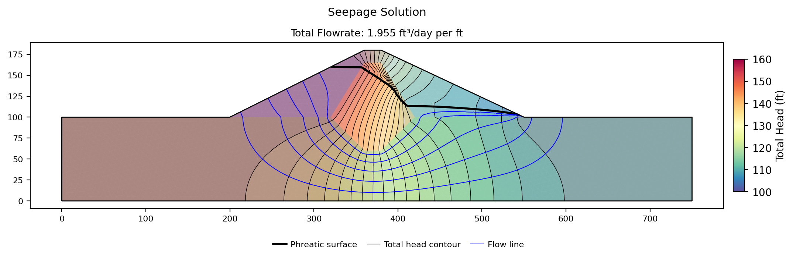](https://youtu.be/JRlGONbFQeM)
10

Video 10 · Seepage

### Unconfined Seepage Through a Zoned Dam {#video-10}

An earth dam with a sand shell, a clay core, and a cutoff key, built from a
blank model: three zones from a stack of profile lines, the reservoir and
tailwater heads, and an exit face down the downstream slope. The solution finds
the phreatic surface, and raising the core's conductivity moves where the water
comes out.

<a class="vid-pill vid-watch" href="https://youtu.be/JRlGONbFQeM">▶ Watch · 18 min</a>

**Completed model** — [xslope_johnson_res.xlsx](../seep/files/xslope_johnson_res.xlsx), which also holds the strengths used in Video 11

**Related tutorial** — [SEEP-2. Unconfined Seepage Through a Zoned Dam](../tutorials/seep02_johnson_dam.md)

[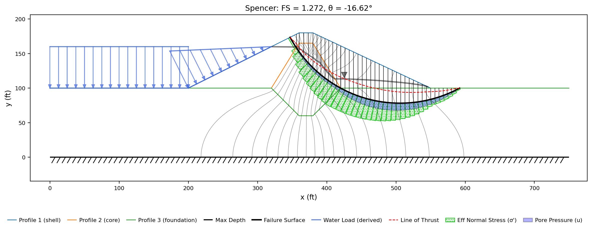](https://youtu.be/An-PtHu2cfc)
11

Video 11 · Seepage + limit equilibrium

### Seepage Pore Pressures in a Stability Run {#video-11}

The Video 10 dam with unit weights and strengths added, run in two steps: a
seepage solution, then a Spencer search that reads its pore pressures through
the materials' `u` column. Setting `u` to `none` shows the factor of safety a
stability run gets when it ignores the seepage.

<a class="vid-pill vid-watch" href="https://youtu.be/An-PtHu2cfc">▶ Watch · 7 min</a>

**Model** — [xslope_video11_seep_to_lem.xlsx](files/xslope_video11_seep_to_lem.xlsx)

<!-- test: file=files/xslope_video11_seep_to_lem.xlsx, type=circular_search, method=spencer, seep=steady, element_type=tri6, size_divisions=100, num_slices=40, expected_fs=1.272, tolerance=0.005 -->

**Related tutorial** — [COMBO-1. Seepage → LEM → FEM](../tutorials/combo01_seepage_stability.md)

## Finite element

Videos 12–14

[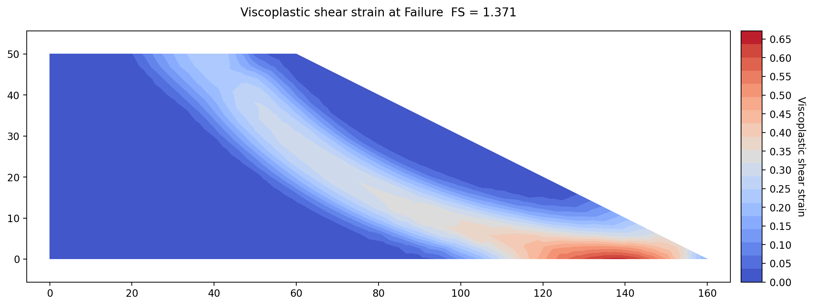](https://youtu.be/wrK-weaLUA8)
12

Video 12 · Finite element

### Strength Reduction on an Embankment {#video-12}

A one-soil embankment solved by the shear strength reduction method: a quadratic
mesh and why linear elements read too high, the Young's modulus and Poisson's
ratio the run needs, the search over the reduction factor, and the shear strain
and deformed mesh at failure. The answer, 1.371, sits within half a percent of
Spencer's method on the same slope.

<a class="vid-pill vid-watch" href="https://youtu.be/wrK-weaLUA8">▶ Watch · 15 min</a>

**Starting model** — [xslope_ssrm_embankment_start.xlsx](../tutorials/files/xslope_ssrm_embankment_start.xlsx)

**Completed model** — [xslope_ssrm_embankment.xlsx](../tutorials/files/xslope_ssrm_embankment.xlsx)

**Related tutorial** — [FEM-1. Strength Reduction Basics](../tutorials/fem01_strength_reduction.md)

[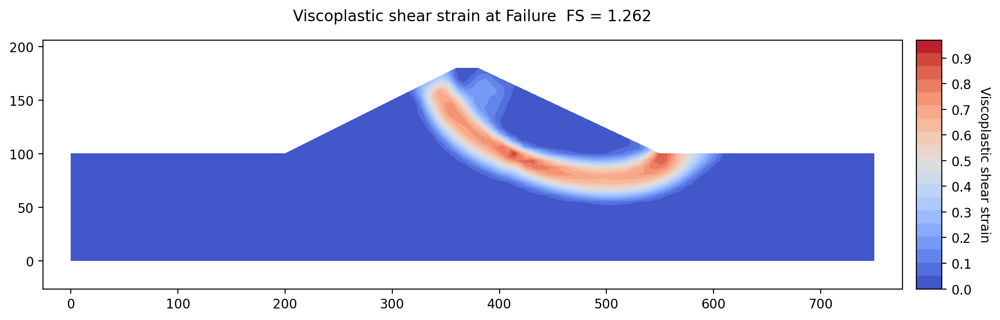](https://youtu.be/knHukVX7MMw)
13

Video 13 · Seepage + LEM + FEM

### Seepage, LEM, and FEM on One Mesh {#video-13}

The Video 11 dam run through all three analyses on one quadratic mesh: the
seepage solution, a Spencer search on its pore pressures for comparison, and a
strength reduction that reads the same pore pressures. The two factors of
safety, 1.272 and 1.262, agree to within 1%.

<a class="vid-pill vid-watch" href="https://youtu.be/knHukVX7MMw">▶ Watch · 10 min</a>

**Model** — [xslope_video11_seep_to_lem.xlsx](files/xslope_video11_seep_to_lem.xlsx), the Video 11 model, meshed at 100 size divisions

<!-- test: file=files/xslope_video11_seep_to_lem.xlsx, type=fem_ssrm, seep=steady, element_type=tri6, size_divisions=100, expected_fs=1.262, tolerance=0.01, f_min=1.0, f_max=2.0, f_stand=1.2578125, f_fail=1.265625, check=edges -->

**Related tutorial** — [COMBO-1. Seepage → LEM → FEM](../tutorials/combo01_seepage_stability.md)

[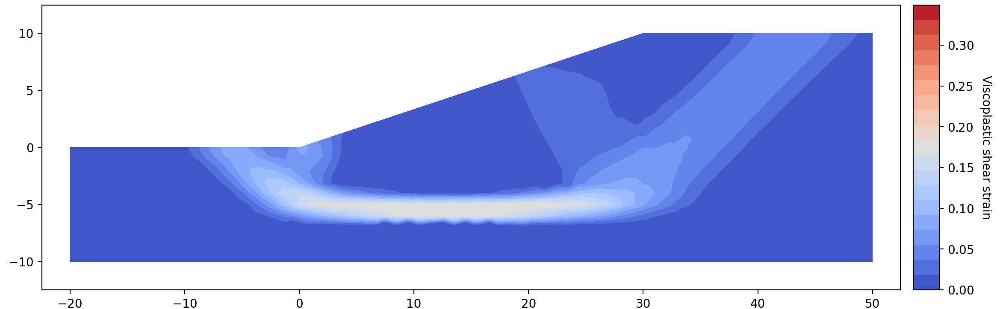](https://youtu.be/dsPmON8-Yfk)
14

Video 14 · Finite element

### The FEM Finds the Weak Layer {#video-14}

The Video 7 slope, with its 2 ft seam of soft clay, run as a strength reduction.
No failure surface is entered: the shear strain gathers along the seam on its
own. A local element size on the seam's profile line resolves the thin layer
without refining the whole mesh. The answer, 1.621, is 2% below the
non-circular Spencer search from Video 7.

<a class="vid-pill vid-watch" href="https://youtu.be/dsPmON8-Yfk">▶ Watch · 7 min</a>

**Starting model** — [xslope_noncircular_fem.xlsx](../fem/files/xslope_noncircular_fem.xlsx)

**Completed model** — [xslope_video14_weak_layer_fem.xlsx](files/xslope_video14_weak_layer_fem.xlsx). It stores the 2 ft target size and the seam's Size of 1; untick **Refine thin zones** in Build Mesh to match the video.

<!-- test: file=files/xslope_video14_weak_layer_fem.xlsx, type=fem_ssrm, element_type=tri6, target_size=2, expected_fs=1.621, tolerance=0.01, f_min=1.0, f_max=2.0, f_stand=1.6171875, f_fail=1.625, check=edges -->

**Related** — [FEM sample 1](../fem/samples.md#1-non-circular-failure-surface-with-thin-weak-layer), [Video 7](#video-7)

<!--
Entry format. Once a video is uploaded, replace the "Coming soon" pill with
<a class="vid-pill vid-watch" href="https://youtu.be/VIDEO_ID">▶ Watch · 12 min</a>,
wrap the thumbnail image in the same link, and add the file lines:

**Starting model** — [name_start.xlsx](files/name_start.xlsx)  (only when the video does not start from a blank model)
**Completed model** — [name.xlsx](files/name.xlsx)
-->
